# Container Agent Design

- Date: 2026-10-17
- Status: design approved; implementation (POC) pending

## 1. Goal

Give developers, testers, and architects an AI agent that builds a docker compose cluster on the user's machine for a stated purpose, fixes it automatically, and stops only when the cluster is fully healthy.

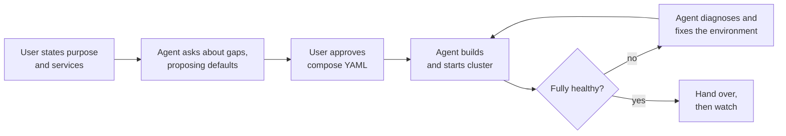

Constraints:

- The agent asks about any compose element the user leaves unspecified and proposes a default for each.
- The user must approve the generated compose YAML before anything starts.
- After start-up the agent monitors, diagnoses, and fixes the cluster until it passes layered acceptance.
- The agent covers every company project. A service can come from a released binary, a snapshot, a CI build artifact, or a local working directory.
- Models come from AWS Bedrock or self-hosted open-source models. In fully automatic mode the agent picks a model per subtask by complexity; users can override the choice.
- An internal platform serves the web UI; clusters run on the user's machine.

## 2. Key Decisions

| Question | Decision |
|---|---|
| Delivery | Internal platform serves the web UI; clusters run on the user's machine |
| Platform vs. local split | The platform does the reasoning; a local Runner executes. The Runner dials out and runs only whitelisted tools |
| Project knowledge | Registered `.cagent/service.yaml` first; live inspection as fallback; after a successful run the agent proposes a descriptor |
| Self-healing scope | Change the environment, never source code. Stop with a diagnosis when the root cause is in source |
| Acceptance | Layered checks (L1–L4) plus a stability window |
| Artifact sources | Nexus / Artifactory and CI build artifacts. No prebuilt images exist, so the Runner builds them locally |
| After delivery | Rule-based lightweight watch, cluster management, reusable recipes |
| Architecture | Deterministic state machine with bounded LLM nodes |
| Stack | Platform: Python (LangGraph + LiteLLM). Runner: Go (compose-go + Docker SDK) |
| Model hosting | The POC may use a local Ollama; production routes everything through the LiteLLM gateway |

**Why a state machine instead of a single autonomous agent.** Approval gates, the environment-only rule, budgets, and an LLM-free watch phase are hard rules. Hard rules belong in code, not in prompts. A state machine also confines small models to the narrow tasks they handle well.

**Why Go for the Runner.** `compose-go` is the Compose Spec parser and validator that docker compose itself uses. The Runner validates YAML with Docker's own semantics before start-up, which saves a full "start → fail → ask the LLM" round. Go also cross-compiles to a single binary, which makes distribution simple.

## 3. Architecture

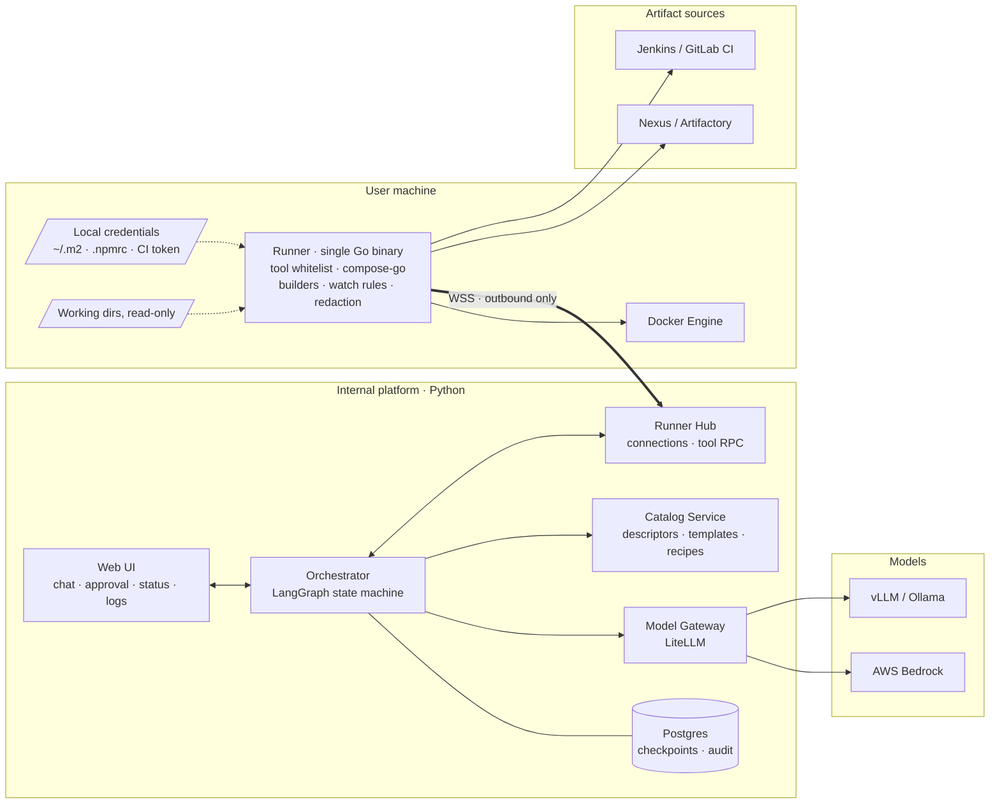

### 3.1 Platform (Python)

- **Web UI**: chat, YAML diff approval, cluster status panel, live logs.
- **Orchestrator**: a LangGraph state machine, one run per cluster task. A Postgres checkpointer persists state, so a run survives a platform restart or a closed browser tab. Approval waits sit at LangGraph interrupts.
- **Model Gateway**: LiteLLM in front of Bedrock and self-hosted models. It handles routing, usage, and cost accounting.
- **Catalog Service**: collects each repository's `.cagent/service.yaml`, maintains middleware templates, and stores shared recipes.
- **Runner Hub**: holds the Runners' WebSocket connections and turns tool calls into RPCs to the right Runner.

### 3.2 User machine (Go Runner)

- Opens no ports. It dials the platform with a platform-issued token bound to the user and the device.
- Runs only a fixed whitelist of tools. It exposes no arbitrary shell.
- Gives each cluster an isolated directory, `~/.cagent/clusters/<name>/`, holding the compose file, generated Dockerfiles, and the tuning log.
- Reads Nexus and CI credentials from the machine (`~/.m2/settings.xml`, `.npmrc`, CI tokens) and never uploads them.

### 3.3 POC vs. production

The Orchestrator talks only to LiteLLM and references tiers, not models. Moving from POC to production changes gateway configuration, not code.

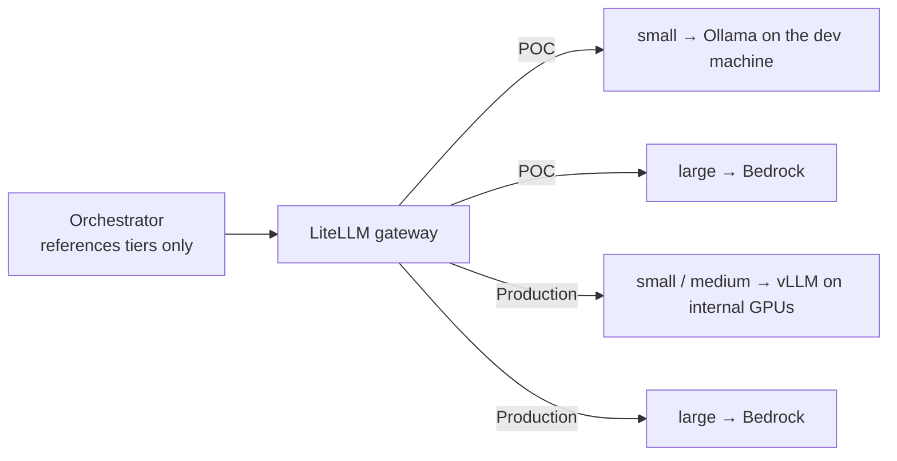

- **POC**: the platform, the Runner, and LiteLLM run together on one dev machine via compose.
- **Production**: the platform runs on internal infrastructure, and Runners connect to it remotely.

## 4. Workflow State Machine

Every phase revolves around a **ClusterSpec**, a structured statement of cluster intent. Conversation fills in the ClusterSpec; the compose YAML is generated from it.

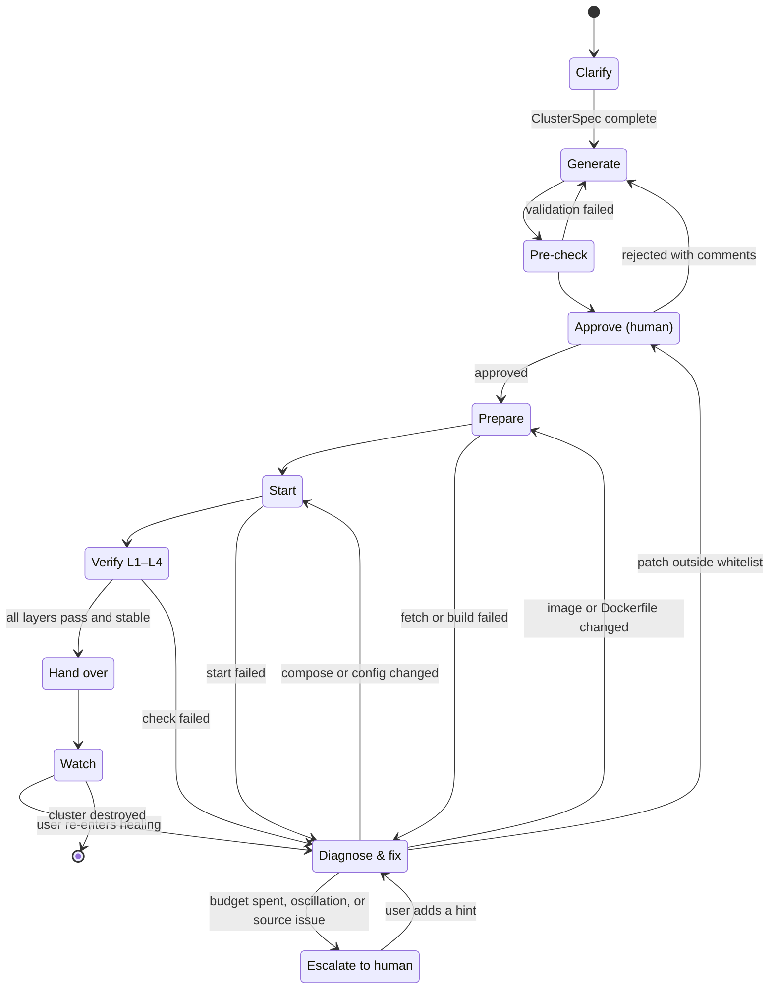

| # | Phase | Work | Performed by |
|---|---|---|---|
| 1 | Clarify | Extract the purpose and the service list; tag each service with its source (`release:1.4.2`, `snapshot:2.0-SNAPSHOT`, `workdir:/path`, `ci:job#123`). Ask about each missing required field from the descriptors, one at a time, each with a default | LLM (large) + descriptors |
| 2 | Generate | ClusterSpec → compose YAML, Dockerfiles, build plan. Registered services use templates; the LLM fills in unregistered ones after inspecting them | Templates first, LLM for gaps |
| 3 | Pre-check | compose-go validation; check port conflicts, image architecture, free local resources, security rules | Rules |
| 4 | Approve | Show YAML, Dockerfiles, and build plan. The user approves, edits, or rejects with comments | Human |
| 5 | Prepare | Fetch artifacts and build images | Runner |
| 6 | Start | `docker compose up -d` | Runner |
| 7 | Verify | L1 containers running → L2 healthchecks → L3 smoke probes → L4 user-defined checks → stability window (default: no restarts for 2 minutes) | Rules + probes |
| 8 | Diagnose & fix | Entered on any failure. Rules first, then the LLM | Rules → LLM |
| 9 | Hand over | Output endpoints, credentials, tuning log. Optionally save a recipe or write the fixed configuration back to the descriptor | Templates |
| 10 | Watch | Rule-based monitoring; on anomalies, notify the user, who decides whether to re-enter self-healing | Runner rules |

Automatic fixes return to Prepare or Start, never to Approve — unless a patch falls outside the environment-only whitelist.

## 5. Self-Healing Loop

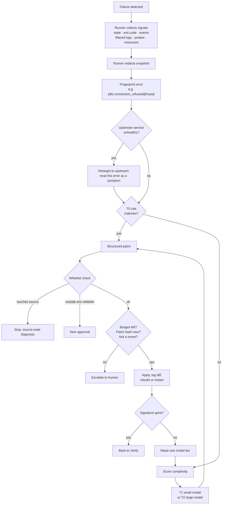

### 5.1 Collect signals

Each round the Runner collects container state, exit codes, restart counts, OOM kills, healthchecks, docker events, the last 200 log lines per service (pre-filtered for ERROR / Exception / FATAL), build logs, probe results, and resource usage. It packs them into a structured, redacted **diagnostic snapshot**. Raw logs are never uploaded in full.

### 5.2 Fingerprint errors

Strip timestamps, container IDs, IPs, port numbers, and similar variables, then compute a signature such as `bind:address_already_in_use`, `jdbc:connection_refused@mysql`, or `oom:exit137@app`.

### 5.3 Tiered handling

| Tier | Handling | Typical problems |
|---|---|---|
| T0 rules | Deterministic fix, no LLM | Host port conflict, exit code 137, dependency not ready (add `depends_on: service_healthy`), image architecture mismatch |
| T1 small model | Problems inside one service | Missing environment variable, wrong config field |
| T2 large model | Cross-service root causes, unseen errors | Kafka `advertised.listeners`, cross-service auth chains |

Fix in dependency order, upstream first. While an upstream service is unhealthy, treat downstream connection errors as symptoms.

### 5.4 Fix format and boundary

Every fix is a structured patch: a JSON Patch against the compose file, or a diff against a config file or Dockerfile. A whitelist validator checks each patch path. A patch that touches a source path stops the loop and produces a "source-code issue" diagnosis.

### 5.5 Budgets and stop conditions

- At most 3 attempts per error signature, 10 rounds overall, and 30 minutes; plus token and cost caps. Each cluster may override these.
- The same patch (by hash) never runs twice. If the signature survives a fix, the node moves up one model tier.
- A patch that reverts an earlier patch counts as oscillation and escalates to a human immediately.

### 5.6 Escalate to a human

The web UI shows the suspected root cause, log evidence, every attempted fix with its result, and suggested next steps. After the user adds a hint, the state machine resumes from where it stopped.

### 5.7 Learn from fixes

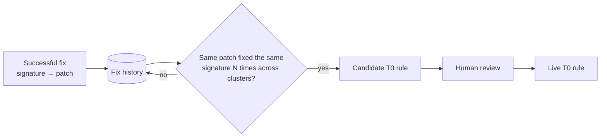

## 6. Service Descriptors and Builds

### 6.1 `.cagent/service.yaml`

```yaml
name: order-service
kind: app
stack: java-springboot          # selects the builder template
sources:
  release:  { nexus: "com.acme:order-service:{version}:jar" }
  snapshot: { nexus: "com.acme:order-service:{version}-SNAPSHOT:jar" }
  ci:       { jenkins: "order-service/main", artifact: "target/*.jar" }
  workdir:  { build: "mvn -q package -DskipTests", output: "target/*.jar" }
runtime:
  ports: [{ name: http, container: 8080 }]
  env:
    required: [SPRING_PROFILES_ACTIVE]
    defaults: { JAVA_OPTS: "-Xmx512m" }
  healthcheck: { http: "/actuator/health", expect: 200 }
requires:                        # capabilities needed, not concrete instances
  - capability: mysql
    version: ">=8.0"
    bind: { SPRING_DATASOURCE_URL: "jdbc:mysql://{{host}}:{{port}}/{{db}}" }
  - capability: kafka
    bind: { KAFKA_BOOTSTRAP: "{{host}}:{{port}}" }
probes:                          # L3 smoke probes
  - http: { path: "/api/orders/ping", expect: 200 }
```

Middleware templates use the same format (`kind: middleware`). The platform maintains them; each declares `provides`, supported versions, default configuration, healthchecks, and resource presets (`tiny` / `standard`). The generator matches `requires` against `provides` and renders connection parameters into environment variables:

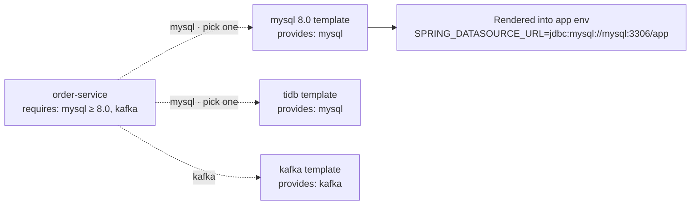

Swapping MySQL for TiDB changes the middleware, not the application.

### 6.2 From source to image

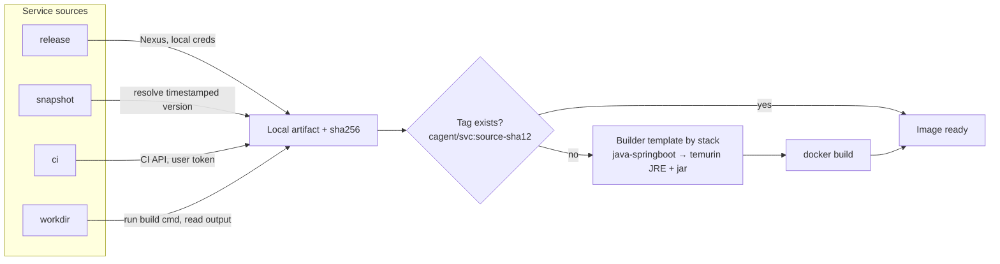

| Source | Runner action |
|---|---|
| release / snapshot | Download with the local Nexus credentials. Resolve a snapshot to its timestamped version (e.g. `2.0-20261016.031522-7`) and record it in the tuning log so the cluster is reproducible |
| ci | Download the artifact through the Jenkins / GitLab API with the user's CI token |
| workdir | Run the `build` command locally and read the `output` artifact. The working directory is read-only |

- **Image cache**: tag images `cagent/<svc>:<source>-<first 12 chars of artifact sha256>`; skip the build when the artifact is unchanged.
- **Single-service rebuild**: after a code change in a working directory, replace just that service's container in one step.
- **Unregistered projects**: the agent reads pom, gradle, package.json, go.mod, and any existing Dockerfile to draft a descriptor. Once the cluster works, the user can submit the draft to the project repository as a PR.

### 6.3 Middleware templates and ClusterSpec

Middleware templates live in `catalog/middleware/`. Each declares the capability it provides, its supported versions, one container port, the `connection` values a consumer's `bind` templates may use, a healthcheck, and resource presets:

```yaml
name: mysql
kind: middleware
provides: { capability: mysql }
image: "mysql:{version}"
versions: ["8.0", "8.4"]
default_version: "8.4"
port: 3306
connection: { db: app, user: app, password: app }   # throwaway prototype credentials
env:
  MYSQL_DATABASE: "{{db}}"
  MYSQL_USER: "{{user}}"
  MYSQL_PASSWORD: "{{password}}"
  MYSQL_ROOT_PASSWORD: root
healthcheck:
  cmd: ["CMD-SHELL", "mysqladmin ping -h 127.0.0.1 -u{{user}} -p{{password}} --silent"]
presets:
  tiny: { mem_limit: 512m, cpus: 0.5 }
  standard: { mem_limit: 1g, cpus: 1.0 }
```

A **ClusterSpec** is what the Clarify phase produces and the Generate phase consumes:

```yaml
name: orders-poc
purpose: Check that order-service stores orders in MySQL and publishes events to Kafka
services:
  - name: order-service
    source: { kind: release, ref: "1.4.2" }   # release | snapshot | ci | workdir
    env: { SPRING_PROFILES_ACTIVE: dev }
    publish: { http: 18080 }                   # port name → host port
middleware:
  - template: mysql
    preset: tiny
    publish: 13306
  - template: kafka
bindings: {}   # e.g. "order-service/mysql": mysql-b when two instances provide mysql
checks:
  - Creating an order returns 201 and the event appears on the orders topic
```

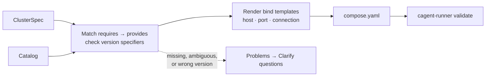

- Each `{{placeholder}}` in a consumer's `bind` is filled from the chosen provider: `host` (its compose service name), `port`, and its `connection` values.
- Every `$` in a generated string is escaped as `$$`, so compose does not interpolate it.
- App images are tagged `cagent/<service>:<source kind>-<ref>` (a hash for `workdir`); M4 builds them.
- The generator collects every problem instead of stopping at the first, so the Clarify phase can ask about all gaps in one round.

## 7. Model Routing

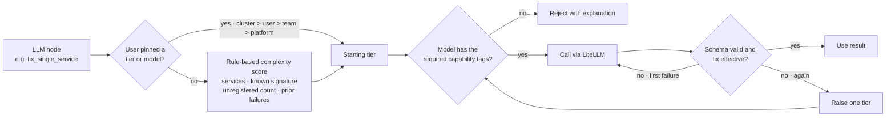

### 7.1 Three-level mapping

```yaml
tiers:                     # tier → model; varies by environment
  small:  ollama/qwen2.5-coder:7b
  medium: vllm/qwen2.5-32b-instruct
  large:  bedrock/claude-sonnet
nodes:                     # node → default tier
  clarify: large
  generate_unregistered: medium
  log_classify: small
  fix_single_service: small
  fix_cross_service: large
  handover_summary: small
```

Node code references tier names, never model names.

### 7.2 Automatic selection

Rules score complexity; the LLM never rates itself. The score sets the starting tier; a failed fix or a schema-invalid output moves the node up one tier. Pydantic schemas validate every LLM output: retry once on failure, then escalate.

### 7.3 Capability tags

Each model carries tags such as `tool_use`, `json_mode`, and `context`. The router refuses to assign a tool-calling node to a model without `tool_use` and explains why.

### 7.4 User overrides

Override order: platform default < team < user < this cluster. The web UI offers presets ("large model everywhere", "local models only") and per-node pinning.

## 8. Security

The sequence below shows one approved tool call and where each trust boundary sits.

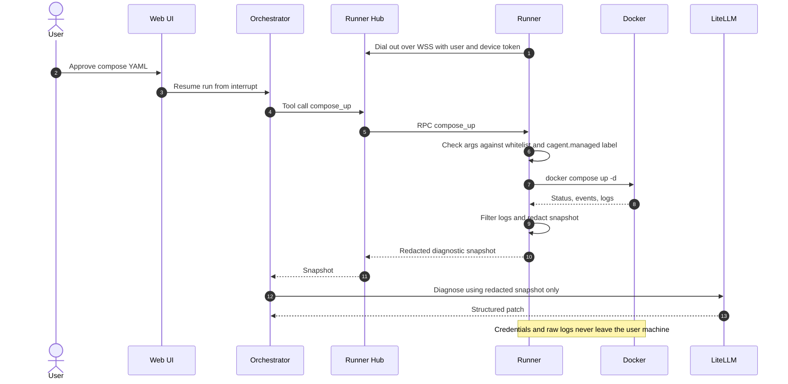

- **Runner authentication**: the user signs in to the web UI via SSO and registers the device, receiving a revocable token bound to user and device. Connections use WSS.
- **Tool argument checks**: file access stays inside `~/.cagent/`; declared working directories are read-only. Docker operations touch only compose projects labelled `cagent.managed=true`.
- **Compose security lint**: the Runner rejects every setting in the table below by default. The user can allow each one individually during approval, as `service:rule` (for example `web:privileged`). For a top-level volume the name before the colon is the volume name (for example `data:volume-driver`).

  | Rule ID | What it catches |
  | --- | --- |
  | `privileged` | `privileged: true` |
  | `host-network` | `network_mode: host` |
  | `pid-host` | `pid: host`, which exposes host processes |
  | `ipc-host` | `ipc: host`, which shares host IPC and shared memory |
  | `userns-host` | `userns_mode: host`, which turns off user-namespace remapping |
  | `cap-add` | any `cap_add` entry |
  | `devices` | any `devices` entry, which maps host devices into the container |
  | `security-opt` | `seccomp` or `apparmor` set to `unconfined`, `label=disable` (or `label:disable`), `no-new-privileges:false` |
  | `cgroup-parent` | any `cgroup_parent`, which places the container in a host cgroup |
  | `docker-sock` | a mount of the Docker socket, or of a directory that contains it (such as `/var/run` or `/run`) |
  | `host-mount` | a bind mount, or a local volume with `driver_opts` `device` plus `o: bind` (or `type: none`), whose source is outside the workspace |
  | `volume-driver` | a top-level volume with any driver other than `local`, because its options are opaque to the Runner; or a `local` volume whose `device` is not a bind path, a network share (`nfs`, `nfs4`, `cifs`), or `tmpfs`, such as `type: ext4` on `/dev/sda1` |

  Mount sources are checked after symlink resolution, and the check fails closed: a source that cannot be resolved, including a dangling symlink, is reported as `host-mount`. The finding shows the path as declared in the compose file.

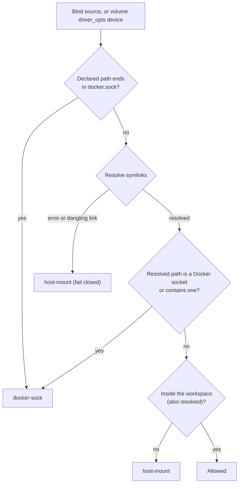

- **Reviewed-field allow-list**: the deny-list above names known escape vectors; the allow-list closes the rest. `runner/internal/compose/allowed_fields.json` lists the top-level and service keys the generator emits or that cannot weaken isolation. `validate` checks the keys in effect after YAML anchors, `extends`, and `include` are applied, and reports every other key as `field:<key>`, approvable one key at a time (`web:field:sysctls`, or `*:field:configs` for a top-level key). A key that already triggered a specific rule above is not reported twice. Keys starting with `x-` are compose extensions and always allowed. The platform's tests read the same file, so the generator cannot emit a key `validate` would reject.
- **Credentials and redaction**: credentials never leave the machine. The Runner redacts diagnostic snapshots (passwords, tokens, AK/SK, passwords inside JDBC URLs) before upload, so neither the platform nor any model sees raw logs.
- **Audit**: the platform logs every tool call, patch, and approval, replayable per cluster.

## 9. Testing Strategy

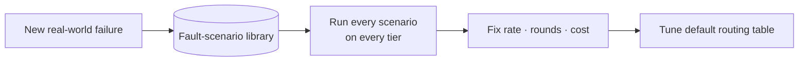

| Layer | Scope | Method |
|---|---|---|
| Unit | Runner: compose-go validation, whitelist, redaction, fingerprinting. Platform: ClusterSpec → compose generation, complexity scoring, budgets and oscillation detection | Go table-driven tests; golden files for generators |
| LLM nodes | Output structure and decisions of clarify, generate, diagnose | Record/replay in CI; nightly run against live models |
| Fault-scenario library | Prebuilt broken clusters: port conflict, OOM, missing env var, MySQL not ready, misconfigured Kafka listeners, architecture mismatch, config typos, and more. Each scenario records its root-cause category and maximum rounds | Run every scenario on every tier; track fix rate, rounds, and cost; tune default routing from the results |
| End-to-end | The agent deploys its own platform, plus 2–3 real company projects | Nightly |

## 10. POC Scope

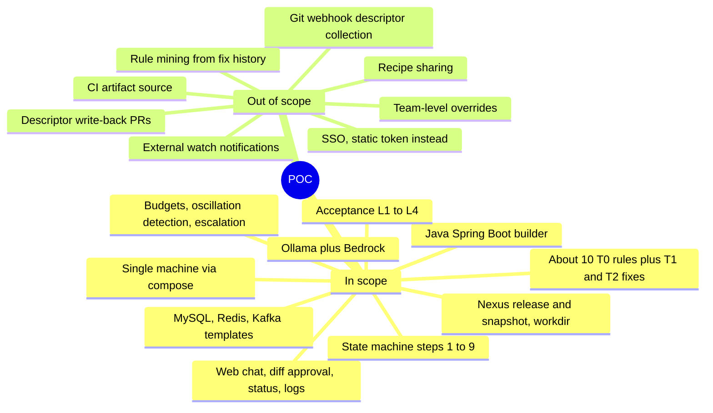

The POC reads descriptors from a local catalog directory instead of collecting them via Git webhooks.

**Success criteria:**

- At least 80% of fault scenarios fixed automatically within budget
- 2 real projects running end to end
- Registered projects go from prompt to healthy cluster in under 15 minutes
