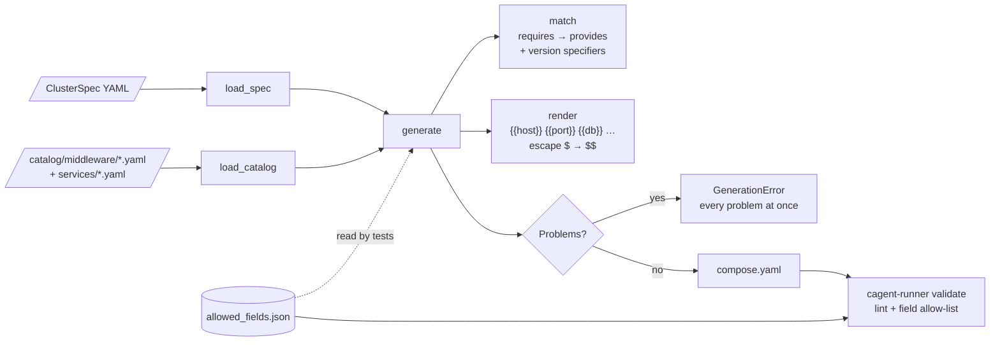
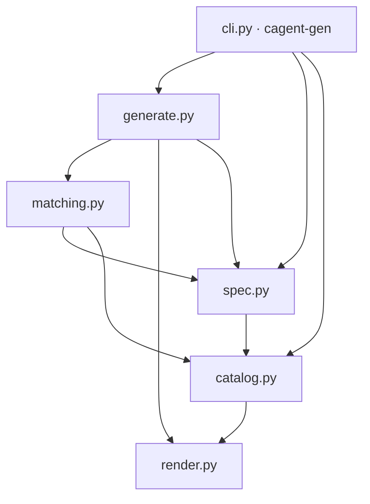
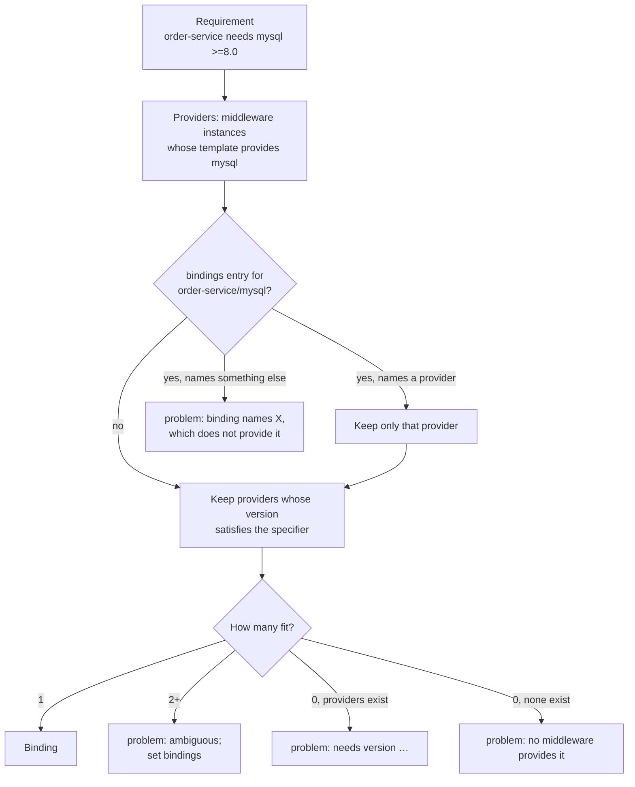
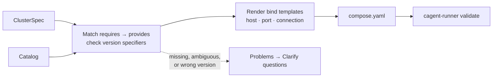

# M2 Catalog & Generator Implementation Plan

> **For Claude:** REQUIRED SUB-SKILL: Use superpowers:executing-plans to implement this plan task-by-task.

**Goal:** Turn a ClusterSpec plus a catalog of service descriptors and middleware templates into a compose file that passes `cagent-runner validate`, and close the Runner's lint with a reviewed-field allow-list.

**Architecture:** A Python package `cagent` under `platform/` (uv project). Pydantic models load catalog YAML and ClusterSpecs; pure functions match `requires` to `provides`, render `{{placeholder}}` templates, and generate a deterministic compose dict. The Go Runner gains a field allow-list stored as JSON. `validate` embeds it, and the Python tests read the same file, so generator and Runner cannot drift apart.

**Tech Stack:** Python 3.12+, uv, pydantic 2, PyYAML, packaging, pytest, ruff. Go 1.24 + compose-go v2.16.1 for the Runner part.

- Roadmap: [2026-10-17-poc-roadmap.md](2026-10-17-poc-roadmap.md) (M2)
- Design: [2026-10-17-container-agent-design.md](2026-10-17-container-agent-design.md), sections 4, 6.1, 8

---

## Data flow



`GenerationError` collects every problem instead of stopping at the first one, because M7's clarify node turns that list into questions for the user, and should ask about all the gaps at once.

## Module map



## Prerequisites

- Work on a feature branch, not `main`.
- **Go**: not installed on the host. Run Go commands in a container from the repository root: `docker run --rm -v "$PWD":/repo -w /repo golang:1.24 sh -c '<command>'`.
- **Python**: uv 0.9+ on the host (`uv --version`). uv downloads Python 3.12+ if needed.
- **Docker** running, for Task 12's live check.

---

### Task 1: Reviewed-field allow-list in the Runner

The M1 deny-list names known escape vectors; this allow-list closes every other one. Fields are read with compose-go's `LoadModel`, which expands YAML anchors and `extends`, so a risky key cannot hide in a base service (verified: `child: {extends: base}` inherits `uts: host` in the model, but not in the raw YAML).

**Files:**
- Create: `runner/internal/compose/allowed_fields.json`
- Create: `runner/internal/compose/fields.go`
- Test: `runner/internal/compose/fields_test.go`

**Step 1: Write the failing test**

```go
package compose

import (
	"context"
	"path/filepath"
	"reflect"
	"testing"
)

// checkFields runs the full field check the way validate does: specific rules first,
// then unreviewed keys that no specific finding already covers.
func checkFields(t *testing.T, body string) []Finding {
	t.Helper()
	path := writeCompose(t, body)
	ctx := context.Background()
	p, err := Load(ctx, path, "demo")
	if err != nil {
		t.Fatal(err)
	}
	f, err := LoadFields(ctx, path, "demo")
	if err != nil {
		t.Fatal(err)
	}
	return UnreviewedFields(f, Lint(p, []string{filepath.Dir(path)}, nil))
}

func TestUnreviewedFieldsAllowsReviewedKeys(t *testing.T) {
	got := checkFields(t, `
x-defaults: &defaults
  restart: "no"
services:
  web:
    <<: *defaults
    image: nginx:1.27
    environment: { A: "1" }
    ports: ["8080:80"]
    healthcheck: { test: ["CMD", "true"] }
    mem_limit: 256m
    x-note: extensions are fine
`)
	if len(got) != 0 {
		t.Errorf("reviewed keys reported: %v", got)
	}
}

func TestUnreviewedFieldsReportsOtherKeys(t *testing.T) {
	got := checkFields(t, `
services:
  web:
    image: nginx:1.27
    uts: host
    sysctls: { net.core.somaxconn: 1024 }
configs:
  app: { content: "x" }
`)
	want := []Finding{
		{TopLevel, "field:configs", "configs is not on the reviewed field list"},
		{"web", "field:sysctls", "sysctls is not on the reviewed field list"},
		{"web", "field:uts", "uts is not on the reviewed field list"},
	}
	if !reflect.DeepEqual(got, want) {
		t.Errorf("UnreviewedFields() =\n%v\nwant\n%v", got, want)
	}
}

func TestUnreviewedFieldsSeesThroughExtends(t *testing.T) {
	got := checkFields(t, `
services:
  base:
    image: busybox
    runtime: runc
  child:
    extends: { service: base }
`)
	want := []Finding{
		{"base", "field:runtime", "runtime is not on the reviewed field list"},
		{"child", "field:runtime", "runtime is not on the reviewed field list"},
	}
	if !reflect.DeepEqual(got, want) {
		t.Errorf("UnreviewedFields() =\n%v\nwant\n%v", got, want)
	}
}

func TestUnreviewedFieldsSkipsKeysWithSpecificFindings(t *testing.T) {
	// privileged: true fires the specific rule, so no duplicate field finding.
	// privileged: false fires nothing specific, so the key itself still needs review.
	got := checkFields(t, `
services:
  a: { image: nginx:1.27, privileged: true }
  b: { image: nginx:1.27, privileged: false }
`)
	want := []Finding{{"b", "field:privileged", "privileged is not on the reviewed field list"}}
	if !reflect.DeepEqual(got, want) {
		t.Errorf("UnreviewedFields() =\n%v\nwant\n%v", got, want)
	}
}

func TestWithoutApproved(t *testing.T) {
	in := []Finding{
		{"web", "field:uts", ""},
		{"web", RulePrivileged, ""},
		{TopLevel, "field:configs", ""},
	}
	allow := map[string]bool{"web:field:uts": true, "*:field:configs": true}
	want := []Finding{{"web", RulePrivileged, ""}}
	if got := WithoutApproved(in, allow); !reflect.DeepEqual(got, want) {
		t.Errorf("WithoutApproved() = %v, want %v", got, want)
	}
}
```

**Step 2: Run it to verify it fails**

Run: `docker run --rm -v "$PWD":/repo -w /repo/runner golang:1.24 go test ./internal/compose/`
Expected: FAIL — `undefined: LoadFields`, `undefined: UnreviewedFields`, `undefined: WithoutApproved`, `undefined: TopLevel`.

**Step 3: Add the allow-list**

`runner/internal/compose/allowed_fields.json`:

```json
{
  "top_level": [
    "name",
    "networks",
    "services",
    "volumes"
  ],
  "service": [
    "build",
    "command",
    "cpus",
    "depends_on",
    "entrypoint",
    "environment",
    "expose",
    "healthcheck",
    "hostname",
    "image",
    "init",
    "labels",
    "mem_limit",
    "mem_reservation",
    "networks",
    "platform",
    "ports",
    "read_only",
    "restart",
    "stop_grace_period",
    "tmpfs",
    "user",
    "volumes",
    "working_dir"
  ]
}
```

Keep each list sorted. Add a key only after deciding it cannot weaken isolation; `container_name`, `env_file`, `logging`, `ulimits`, and `deploy` are left out on purpose.

**Step 4: Write the implementation**

```go
package compose

import (
	"context"
	_ "embed"
	"encoding/json"
	"fmt"
	"sort"
	"strings"

	"github.com/compose-spec/compose-go/v2/cli"
)

// RuleFieldPrefix starts the rule ID of a key outside the reviewed list, e.g. "field:sysctls".
// Users approve one key at a time as "service:field:sysctls".
const RuleFieldPrefix = "field:"

// TopLevel is the Finding.Service value for a top-level key, so approvals read "*:field:include".
const TopLevel = "*"

// allowedFieldsJSON is the reviewed key list. The platform's generator tests read the same
// file, so the generator can never emit a key that validate would reject.
//
//go:embed allowed_fields.json
var allowedFieldsJSON []byte

type allowedFields struct {
	TopLevel []string `json:"top_level"`
	Service  []string `json:"service"`
}

var allowedTop, allowedService = mustParseAllowed(allowedFieldsJSON)

func mustParseAllowed(data []byte) (top, service map[string]bool) {
	var a allowedFields
	if err := json.Unmarshal(data, &a); err != nil {
		panic(fmt.Sprintf("allowed_fields.json: %v", err))
	}
	return toSet(a.TopLevel), toSet(a.Service)
}

func toSet(keys []string) map[string]bool {
	s := make(map[string]bool, len(keys))
	for _, k := range keys {
		s[k] = true
	}
	return s
}

// Fields holds the keys in effect in a compose file, sorted, after YAML anchors, extends,
// and includes are applied. Checking effective keys stops a risky key hiding behind extends.
type Fields struct {
	TopLevel []string
	Services map[string][]string
}

// LoadFields returns the effective keys of a compose file.
func LoadFields(ctx context.Context, path, name string) (Fields, error) {
	opts, err := cli.NewProjectOptions([]string{path},
		cli.WithName(name),
		cli.WithResolvedPaths(true),
	)
	if err != nil {
		return Fields{}, fmt.Errorf("compose options: %w", err)
	}
	model, err := opts.LoadModel(ctx)
	if err != nil {
		return Fields{}, fmt.Errorf("load %s: %w", path, err)
	}
	f := Fields{TopLevel: sortedKeys(model), Services: map[string][]string{}}
	services, _ := model["services"].(map[string]any)
	for name, s := range services {
		svc, _ := s.(map[string]any)
		f.Services[name] = sortedKeys(svc)
	}
	return f, nil
}

func sortedKeys(m map[string]any) []string {
	keys := make([]string, 0, len(m))
	for k := range m {
		keys = append(keys, k)
	}
	sort.Strings(keys)
	return keys
}

// specificRuleField maps rules that inspect a single service key to that key.
var specificRuleField = map[string]string{
	RulePrivileged:   "privileged",
	RuleHostNetwork:  "network_mode",
	RulePidHost:      "pid",
	RuleIpcHost:      "ipc",
	RuleUserNSHost:   "userns_mode",
	RuleCapAdd:       "cap_add",
	RuleDevices:      "devices",
	RuleSecurityOpt:  "security_opt",
	RuleCgroupParent: "cgroup_parent",
}

// UnreviewedFields reports keys outside the reviewed list. specific must be the unfiltered
// Lint findings: a key that already has a specific finding is skipped, so one setting needs
// one approval. Keys starting with "x-" are compose extensions and always allowed.
func UnreviewedFields(f Fields, specific []Finding) []Finding {
	covered := map[string]bool{}
	for _, s := range specific {
		if key, ok := specificRuleField[s.Rule]; ok {
			covered[s.Service+"/"+key] = true
		}
	}
	out := []Finding{}
	for _, k := range f.TopLevel {
		if !isExtension(k) && !allowedTop[k] {
			out = append(out, unreviewed(TopLevel, k))
		}
	}
	names := make([]string, 0, len(f.Services))
	for n := range f.Services {
		names = append(names, n)
	}
	sort.Strings(names)
	for _, svc := range names {
		for _, k := range f.Services[svc] {
			if isExtension(k) || allowedService[k] || covered[svc+"/"+k] {
				continue
			}
			out = append(out, unreviewed(svc, k))
		}
	}
	return out
}

func isExtension(key string) bool { return strings.HasPrefix(key, "x-") }

func unreviewed(svc, key string) Finding {
	return Finding{Service: svc, Rule: RuleFieldPrefix + key, Detail: key + " is not on the reviewed field list"}
}

// WithoutApproved drops findings the user approved as "service:rule".
func WithoutApproved(findings []Finding, allow map[string]bool) []Finding {
	out := []Finding{}
	for _, f := range findings {
		if !allow[f.Service+":"+f.Rule] {
			out = append(out, f)
		}
	}
	return out
}
```

**Step 5: Run tests to verify they pass**

Run: `docker run --rm -v "$PWD":/repo -w /repo golang:1.24 make runner-test`
Expected: five `ok` lines, no gofmt output.

**Step 6: Commit**

```bash
git add runner/internal/compose/allowed_fields.json runner/internal/compose/fields.go runner/internal/compose/fields_test.go
git commit -m "feat(runner): report compose keys outside the reviewed allow-list"
```

---

### Task 2: Wire the allow-list into `validate`

**Files:**
- Modify: `runner/cmd/cagent-runner/main.go`
- Test: `runner/cmd/cagent-runner/main_test.go`

**Step 1: Write the failing test** — append to `main_test.go`:

```go
func TestValidateReportsUnreviewedField(t *testing.T) {
	path := writeFile(t, "services:\n  web: { image: nginx:1.27, uts: host }\n")
	var out, errOut bytes.Buffer
	if code := run([]string{"validate", "-f", path}, &out, &errOut, allFree); code != exitFindings {
		t.Fatalf("exit %d, want %d; out: %s", code, exitFindings, out.String())
	}
	if !bytes.Contains(out.Bytes(), []byte(`"rule": "field:uts"`)) {
		t.Errorf("report lacks field:uts finding:\n%s", out.String())
	}
	out.Reset()
	if code := run([]string{"validate", "-f", path, "-allow", "web:field:uts"}, &out, &errOut, allFree); code != exitOK {
		t.Fatalf("approved field: exit %d, want %d; out: %s", code, exitOK, out.String())
	}
}
```

**Step 2: Run it to verify it fails**

Run: `docker run --rm -v "$PWD":/repo -w /repo/runner golang:1.24 go test ./cmd/cagent-runner/`
Expected: FAIL — `exit 0, want 1`, because `uts` is not checked yet.

**Step 3: Implement** — in `run`, replace the block from `p, err := compose.Load(...)` through the `rep := Report{...}` literal with:

```go
	ctx := context.Background()
	p, err := compose.Load(ctx, abs, *name)
	if err != nil {
		fmt.Fprintln(stderr, err)
		return exitError
	}
	fields, err := compose.LoadFields(ctx, abs, *name)
	if err != nil {
		fmt.Fprintln(stderr, err)
		return exitError
	}
	// Specific rules run unfiltered so the field check knows which keys they already cover;
	// approvals apply once, to the combined list.
	specific := compose.Lint(p, []string{ws}, nil)
	all := append(specific, compose.UnreviewedFields(fields, specific)...)
	rep := Report{
		Project:       p.Name,
		Findings:      compose.WithoutApproved(all, allow),
		PortConflicts: compose.HostPortConflicts(p, free),
	}
```

Also change the package comment's second line to: `// It currently ships only the offline "validate" subcommand.`

**Step 4: Run tests to verify they pass**

Run: `docker run --rm -v "$PWD":/repo -w /repo golang:1.24 make runner-test`
Expected: five `ok` lines.

**Step 5: Commit**

```bash
git add runner/cmd/cagent-runner
git commit -m "feat(runner): check reviewed fields in validate"
```

---

### Task 3: Scaffold the Python project

**Files:**
- Create: `platform/pyproject.toml`, `platform/src/cagent/__init__.py`, `platform/tests/__init__.py`
- Modify: `.gitignore`, `Makefile`
- Create (generated): `platform/uv.lock`

**Step 1: Add `platform/pyproject.toml`**

```toml
[project]
name = "cagent-platform"
version = "0.1.0"
description = "Container Agent platform: catalog, generator, orchestrator"
requires-python = ">=3.12"
dependencies = [
    "packaging>=24",
    "pydantic>=2.9",
    "pyyaml>=6.0",
]

[project.scripts]
cagent-gen = "cagent.cli:main"

[dependency-groups]
dev = [
    "pytest>=8.3",
    "ruff>=0.8",
]

[build-system]
requires = ["hatchling"]
build-backend = "hatchling.build"

[tool.hatch.build.targets.wheel]
packages = ["src/cagent"]

[tool.pytest.ini_options]
testpaths = ["tests"]

[tool.ruff]
line-length = 100

[tool.ruff.lint]
select = ["E", "F", "I", "UP", "B"]
```

**Step 2: Add the package and test markers**

```bash
mkdir -p platform/src/cagent platform/tests/fixtures/catalog/services catalog/middleware
printf '"""Container Agent platform."""\n' > platform/src/cagent/__init__.py
touch platform/tests/__init__.py
```

`tests/__init__.py` makes `tests` a package, so test modules can import shared paths with `from .conftest import ...`.

**Step 3: Replace `.gitignore` and `Makefile`**

`.gitignore`:

```
/bin/
.venv/
__pycache__/
.pytest_cache/
.ruff_cache/
```

`Makefile`:

```make
.PHONY: runner-test runner-build platform-test e2e

runner-test:
	cd runner && test -z "$$(gofmt -l .)" && go vet ./... && go test ./...

runner-build:
	cd runner && go build -o ../bin/cagent-runner ./cmd/cagent-runner

platform-test:
	cd platform && uv run ruff check . && uv run ruff format --check . && uv run pytest

# Generated compose files must pass the real validate command.
e2e: runner-build
	cd platform && CAGENT_RUNNER=$(CURDIR)/bin/cagent-runner uv run pytest tests/test_cli.py
```

**Step 4: Install**

Run: `cd platform && uv sync`
Expected: creates `.venv` and `uv.lock`; installs pydantic, pyyaml, packaging, pytest, ruff.

**Step 5: Commit**

```bash
git add .gitignore Makefile platform/pyproject.toml platform/uv.lock platform/src platform/tests/__init__.py
git commit -m "build: scaffold the platform Python project"
```

---

### Task 4: Placeholder rendering

**Files:**
- Create: `platform/src/cagent/render.py`
- Test: `platform/tests/test_render.py`

**Step 1: Write the failing test**

```python
import pytest

from cagent.render import RenderError, escape_compose, placeholders, render


def test_render_replaces_placeholders():
    got = render(
        "jdbc:mysql://{{host}}:{{ port }}/{{db}}", {"host": "mysql", "port": "3306", "db": "app"}
    )
    assert got == "jdbc:mysql://mysql:3306/app"


def test_render_rejects_unknown_placeholder():
    with pytest.raises(RenderError, match="db"):
        render("{{host}}/{{db}}", {"host": "mysql"})


def test_placeholders():
    assert placeholders("{{a}} and {{ b }} and {{a}}") == {"a", "b"}


def test_escape_compose_doubles_dollar():
    assert escape_compose('test "$(curl x)" = 200') == 'test "$$(curl x)" = 200'
```

**Step 2: Run it to verify it fails**

Run: `cd platform && uv run pytest tests/test_render.py`
Expected: FAIL — `ModuleNotFoundError: No module named 'cagent.render'`.

**Step 3: Write the implementation**

```python
"""Placeholder rendering for catalog templates, and escaping for compose files."""

import re
from collections.abc import Mapping

_PLACEHOLDER = re.compile(r"\{\{\s*(\w+)\s*\}\}")


class RenderError(ValueError):
    """A template used a placeholder that has no value."""


def placeholders(template: str) -> set[str]:
    """Return the placeholder names used in template."""
    return set(_PLACEHOLDER.findall(template))


def render(template: str, values: Mapping[str, str]) -> str:
    """Replace each {{name}} in template with values[name]."""

    def sub(match: re.Match[str]) -> str:
        key = match.group(1)
        if key not in values:
            raise RenderError(f"unknown placeholder {{{{{key}}}}} in {template!r}")
        return values[key]

    return _PLACEHOLDER.sub(sub, template)


def escape_compose(value: str) -> str:
    """Escape $ so docker compose does not treat it as variable interpolation."""
    return value.replace("$", "$$")
```

`escape_compose` matters: compose interpolates `$VAR` in every string, so an HTTP healthcheck using `$(curl ...)` would silently break without `$$`.

**Step 4: Run tests to verify they pass**

Run: `cd platform && uv run pytest tests/test_render.py`
Expected: `4 passed`.

**Step 5: Commit**

```bash
git add platform/src/cagent/render.py platform/tests/test_render.py
git commit -m "feat(platform): render catalog placeholders and escape compose interpolation"
```

---

### Task 5: Catalog models, loader, and middleware templates

**Files:**
- Create: `platform/src/cagent/catalog.py`
- Create: `catalog/middleware/mysql.yaml`, `catalog/middleware/redis.yaml`, `catalog/middleware/kafka.yaml`
- Create: `platform/tests/fixtures/catalog/services/order-service.yaml`
- Create: `platform/tests/conftest.py`
- Test: `platform/tests/test_catalog.py`

**Step 1: Add the templates and the sample descriptor**

`catalog/middleware/mysql.yaml`:

```yaml
name: mysql
kind: middleware
provides: { capability: mysql }
image: "mysql:{version}"
versions: ["8.0", "8.4"]
default_version: "8.4"
port: 3306
# Throwaway prototype credentials; clusters never hold real data.
connection:
  db: app
  user: app
  password: app
env:
  MYSQL_DATABASE: "{{db}}"
  MYSQL_USER: "{{user}}"
  MYSQL_PASSWORD: "{{password}}"
  MYSQL_ROOT_PASSWORD: root
healthcheck:
  # TCP to 127.0.0.1 fails while the entrypoint's init server runs with skip-networking,
  # so the check turns healthy only once the real server accepts connections.
  cmd: ["CMD-SHELL", "mysqladmin ping -h 127.0.0.1 -u{{user}} -p{{password}} --silent"]
presets:
  tiny: { mem_limit: 512m, cpus: 0.5 }
  standard: { mem_limit: 1g, cpus: 1.0 }
```

`catalog/middleware/redis.yaml`:

```yaml
name: redis
kind: middleware
provides: { capability: redis }
image: "redis:{version}"
versions: ["7.4"]
default_version: "7.4"
port: 6379
healthcheck:
  cmd: ["CMD", "redis-cli", "ping"]
presets:
  tiny: { mem_limit: 128m, cpus: 0.25 }
  standard: { mem_limit: 256m, cpus: 0.5 }
```

`catalog/middleware/kafka.yaml`:

```yaml
name: kafka
kind: middleware
provides: { capability: kafka }
image: "apache/kafka:{version}"
versions: ["3.9.0", "4.0.0"]
default_version: "3.9.0"
port: 9092
# Single-node KRaft broker. Clients inside the cluster reach it as {{host}}:9092.
env:
  KAFKA_NODE_ID: "1"
  KAFKA_PROCESS_ROLES: broker,controller
  KAFKA_LISTENERS: PLAINTEXT://:9092,CONTROLLER://:9093
  KAFKA_ADVERTISED_LISTENERS: PLAINTEXT://{{host}}:9092
  KAFKA_CONTROLLER_LISTENER_NAMES: CONTROLLER
  KAFKA_LISTENER_SECURITY_PROTOCOL_MAP: CONTROLLER:PLAINTEXT,PLAINTEXT:PLAINTEXT
  KAFKA_CONTROLLER_QUORUM_VOTERS: 1@localhost:9093
  KAFKA_OFFSETS_TOPIC_REPLICATION_FACTOR: "1"
  KAFKA_TRANSACTION_STATE_LOG_REPLICATION_FACTOR: "1"
  KAFKA_TRANSACTION_STATE_LOG_MIN_ISR: "1"
  KAFKA_GROUP_INITIAL_REBALANCE_DELAY_MS: "0"
  KAFKA_HEAP_OPTS: -Xmx256m -Xms256m
healthcheck:
  cmd: ["CMD-SHELL", "/opt/kafka/bin/kafka-broker-api-versions.sh --bootstrap-server localhost:9092 > /dev/null"]
presets:
  tiny: { mem_limit: 768m, cpus: 0.5 }
  standard: { mem_limit: 1536m, cpus: 1.0 }
```

`platform/tests/fixtures/catalog/services/order-service.yaml`:

```yaml
# Sample descriptor for tests. Real descriptors live in each project's .cagent/service.yaml.
name: order-service
kind: app
stack: java-springboot
sources:
  release:  { nexus: "com.acme:order-service:{version}:jar" }
  snapshot: { nexus: "com.acme:order-service:{version}-SNAPSHOT:jar" }
  ci:       { jenkins: "order-service/main", artifact: "target/*.jar" }
  workdir:  { build: "mvn -q package -DskipTests", output: "target/*.jar" }
runtime:
  ports: [{ name: http, container: 8080 }]
  env:
    required: [SPRING_PROFILES_ACTIVE]
    defaults: { JAVA_OPTS: "-Xmx512m" }
  healthcheck: { http: /actuator/health, expect: 200 }
requires:
  - capability: mysql
    version: ">=8.0"
    bind:
      SPRING_DATASOURCE_URL: "jdbc:mysql://{{host}}:{{port}}/{{db}}"
      SPRING_DATASOURCE_USERNAME: "{{user}}"
      SPRING_DATASOURCE_PASSWORD: "{{password}}"
  - capability: kafka
    bind: { SPRING_KAFKA_BOOTSTRAP_SERVERS: "{{host}}:{{port}}" }
probes:
  - http: { path: /api/orders/ping, expect: 200 }
```

**Step 2: Write the failing test**

`platform/tests/conftest.py` (Task 6 extends it):

```python
from pathlib import Path

import pytest

from cagent.catalog import Catalog, load_catalog

REPO = Path(__file__).resolve().parents[2]
FIXTURES = Path(__file__).parent / "fixtures"
REPO_CATALOG = REPO / "catalog"
FIXTURE_CATALOG = FIXTURES / "catalog"


@pytest.fixture
def catalog() -> Catalog:
    """Shipped middleware templates plus the sample order-service descriptor."""
    return load_catalog(REPO_CATALOG, FIXTURE_CATALOG)
```

`platform/tests/test_catalog.py`:

```python
from pathlib import Path

import pytest

from cagent.catalog import CatalogError, load_catalog

from .conftest import FIXTURE_CATALOG, REPO_CATALOG

MYSQL = (REPO_CATALOG / "middleware" / "mysql.yaml").read_text()


def write_template(root: Path, name: str, text: str) -> None:
    (root / "middleware").mkdir(parents=True, exist_ok=True)
    (root / "middleware" / f"{name}.yaml").write_text(text)


def test_shipped_catalog_loads(catalog):
    assert set(catalog.middleware) == {"mysql", "redis", "kafka"}
    assert set(catalog.services) == {"order-service"}
    assert catalog.middleware["kafka"].provides.capability == "kafka"
    assert catalog.services["order-service"].requires[0].version == ">=8.0"


def test_unknown_key_is_rejected(tmp_path):
    write_template(tmp_path, "mysql", MYSQL.replace("image:", "imgae:"))
    with pytest.raises(CatalogError, match="imgae"):
        load_catalog(tmp_path)


def test_duplicate_name_across_roots_is_rejected(tmp_path):
    write_template(tmp_path, "my-mysql", MYSQL)
    with pytest.raises(CatalogError, match="duplicate name 'mysql'"):
        load_catalog(REPO_CATALOG, tmp_path)


def test_template_placeholders_must_be_known(tmp_path):
    write_template(tmp_path, "mysql", MYSQL.replace('"{{db}}"', '"{{database}}"'))
    with pytest.raises(CatalogError, match="unknown placeholders: database"):
        load_catalog(tmp_path)


def test_healthcheck_needs_exactly_one_kind(tmp_path):
    bad = MYSQL.replace('  cmd: ["CMD-SHELL"', '  http: /health\n  cmd: ["CMD-SHELL"')
    write_template(tmp_path, "mysql", bad)
    with pytest.raises(CatalogError, match="exactly one of http or cmd"):
        load_catalog(tmp_path)


def test_invalid_version_specifier_is_rejected(tmp_path):
    text = (FIXTURE_CATALOG / "services" / "order-service.yaml").read_text()
    (tmp_path / "services").mkdir()
    (tmp_path / "services" / "order-service.yaml").write_text(text.replace(">=8.0", "at least 8"))
    with pytest.raises(CatalogError, match="invalid version specifier"):
        load_catalog(tmp_path)


def test_missing_root_is_rejected(tmp_path):
    with pytest.raises(CatalogError, match="not a directory"):
        load_catalog(tmp_path / "nope")
```

**Step 3: Run it to verify it fails**

Run: `cd platform && uv run pytest tests/test_catalog.py`
Expected: FAIL — `ModuleNotFoundError: No module named 'cagent.catalog'`.

**Step 4: Write the implementation**

```python
"""Service descriptors and middleware templates, and loading them from catalog directories."""

from dataclasses import dataclass
from pathlib import Path
from typing import Annotated, Literal

import yaml
from packaging.specifiers import InvalidSpecifier, SpecifierSet
from pydantic import BaseModel, ConfigDict, Field, ValidationError, field_validator, model_validator

from cagent.render import placeholders

# Names we accept for compose projects, services, and catalog entries.
NAME_PATTERN = r"^[a-z0-9][a-z0-9_-]*$"
Name = Annotated[str, Field(pattern=NAME_PATTERN)]
PortNumber = Annotated[int, Field(gt=0, lt=65536)]


class Strict(BaseModel):
    """Base model that rejects unknown keys, so a typo in a catalog file fails loudly."""

    model_config = ConfigDict(extra="forbid", frozen=True)


class Port(Strict):
    name: str
    container: PortNumber


class Healthcheck(Strict):
    """Either http (a path checked with curl on a named port) or cmd (a compose test)."""

    http: str | None = None
    port: str | None = None  # port name for http; defaults to the first port
    expect: int = 200
    cmd: list[str] | None = None

    @model_validator(mode="after")
    def _one_kind(self) -> "Healthcheck":
        if (self.http is None) == (self.cmd is None):
            raise ValueError("healthcheck needs exactly one of http or cmd")
        return self


class Env(Strict):
    required: list[str] = []
    defaults: dict[str, str] = {}


class Runtime(Strict):
    ports: list[Port] = []
    env: Env = Env()
    healthcheck: Healthcheck | None = None

    @model_validator(mode="after")
    def _http_port_exists(self) -> "Runtime":
        hc = self.healthcheck
        if hc is not None and hc.http is not None:
            names = [p.name for p in self.ports]
            if not names:
                raise ValueError("http healthcheck needs at least one port")
            if hc.port is not None and hc.port not in names:
                raise ValueError(f"healthcheck port {hc.port!r} is not one of {names}")
        return self


class NexusSource(Strict):
    nexus: str


class CiSource(Strict):
    jenkins: str
    artifact: str


class WorkdirSource(Strict):
    build: str
    output: str


class Sources(Strict):
    release: NexusSource | None = None
    snapshot: NexusSource | None = None
    ci: CiSource | None = None
    workdir: WorkdirSource | None = None


class Requirement(Strict):
    capability: str
    version: str | None = None  # PEP 440 specifier, e.g. ">=8.0"
    bind: dict[str, str] = {}  # env var -> template over {{host}}, {{port}}, provider connection

    @field_validator("version")
    @classmethod
    def _valid_specifier(cls, v: str | None) -> str | None:
        if v is not None:
            try:
                SpecifierSet(v)
            except InvalidSpecifier as e:
                raise ValueError(f"invalid version specifier {v!r}") from e
        return v


class HttpProbe(Strict):
    path: str
    expect: int = 200
    port: str | None = None


class Probe(Strict):
    http: HttpProbe


class ServiceDescriptor(Strict):
    """An application's `.cagent/service.yaml`."""

    name: Name
    kind: Literal["app"]
    stack: str
    sources: Sources
    runtime: Runtime
    requires: list[Requirement] = []
    probes: list[Probe] = []


class Provides(Strict):
    capability: str


class Preset(Strict):
    mem_limit: str
    cpus: float


class MiddlewareTemplate(Strict):
    """A platform-maintained middleware definition."""

    name: Name
    kind: Literal["middleware"]
    provides: Provides
    image: str  # "{version}" is replaced by the chosen version
    versions: list[str]
    default_version: str
    port: PortNumber
    connection: dict[str, str] = {}  # values bind templates may use besides host and port
    env: dict[str, str] = {}
    healthcheck: Healthcheck
    presets: dict[str, Preset]
    default_preset: str = "tiny"

    @model_validator(mode="after")
    def _consistent(self) -> "MiddlewareTemplate":
        if "{version}" not in self.image:
            raise ValueError("image must contain {version}")
        if self.default_version not in self.versions:
            raise ValueError(f"default_version {self.default_version!r} not in versions")
        if self.default_preset not in self.presets:
            raise ValueError(f"default_preset {self.default_preset!r} not in presets")
        known = {"host", "port", *self.connection}
        used = set().union(*(placeholders(v) for v in self.env.values()))
        used |= set().union(*(placeholders(c) for c in self.healthcheck.cmd or []))
        if unknown := used - known:
            raise ValueError(f"unknown placeholders: {', '.join(sorted(unknown))}")
        return self


class CatalogError(Exception):
    """A catalog file is missing, malformed, or duplicates another entry."""


@dataclass(frozen=True)
class Catalog:
    services: dict[str, ServiceDescriptor]
    middleware: dict[str, MiddlewareTemplate]


def load_catalog(*roots: Path) -> Catalog:
    """Load services/*.yaml and middleware/*.yaml from each root. Names must be unique."""
    services: dict[str, ServiceDescriptor] = {}
    middleware: dict[str, MiddlewareTemplate] = {}
    for root in roots:
        if not root.is_dir():
            raise CatalogError(f"{root}: not a directory")
        _load_dir(root / "services", ServiceDescriptor, services)
        _load_dir(root / "middleware", MiddlewareTemplate, middleware)
    return Catalog(services, middleware)


def _load_dir[M: Strict](directory: Path, model: type[M], into: dict[str, M]) -> None:
    for path in sorted(directory.glob("*.yaml")):
        try:
            item = model.model_validate(yaml.safe_load(path.read_text()))
        except (yaml.YAMLError, ValidationError) as e:
            raise CatalogError(f"{path}: {e}") from e
        if item.name in into:
            raise CatalogError(f"{path}: duplicate name {item.name!r}")
        into[item.name] = item
```

Every model forbids unknown keys, so a typo such as `imgae:` fails at load time instead of producing a compose file without an image. Placeholders in a template's `env` and `healthcheck` are checked at load time against `host`, `port`, and the template's `connection` keys.

**Step 5: Run tests to verify they pass**

Run: `cd platform && uv run pytest tests/test_catalog.py`
Expected: `7 passed`.

**Step 6: Commit**

```bash
git add catalog platform/src/cagent/catalog.py platform/tests/conftest.py platform/tests/test_catalog.py platform/tests/fixtures/catalog
git commit -m "feat(platform): load service descriptors and middleware templates"
```

---

### Task 6: ClusterSpec

**Files:**
- Create: `platform/src/cagent/spec.py`
- Create: `platform/tests/fixtures/orders-poc.spec.yaml`
- Modify: `platform/tests/conftest.py`
- Test: `platform/tests/test_spec.py`

**Step 1: Add the sample spec**

`platform/tests/fixtures/orders-poc.spec.yaml`:

```yaml
name: orders-poc
purpose: Check that order-service stores orders in MySQL and publishes events to Kafka
services:
  - name: order-service
    source: { kind: release, ref: "1.4.2" }
    env: { SPRING_PROFILES_ACTIVE: dev }
    publish: { http: 18080 }
middleware:
  - template: mysql
    preset: tiny
    publish: 13306
  - template: kafka
  - template: redis
checks:
  - Creating an order returns 201 and the event appears on the orders topic
```

**Step 2: Write the failing test**

Replace `platform/tests/conftest.py` with:

```python
from pathlib import Path

import pytest

from cagent.catalog import Catalog, load_catalog
from cagent.spec import ClusterSpec, load_spec

REPO = Path(__file__).resolve().parents[2]
FIXTURES = Path(__file__).parent / "fixtures"
REPO_CATALOG = REPO / "catalog"
FIXTURE_CATALOG = FIXTURES / "catalog"


@pytest.fixture
def catalog() -> Catalog:
    """Shipped middleware templates plus the sample order-service descriptor."""
    return load_catalog(REPO_CATALOG, FIXTURE_CATALOG)


@pytest.fixture
def orders_spec() -> ClusterSpec:
    return load_spec(FIXTURES / "orders-poc.spec.yaml")


def spec_with(**overrides) -> ClusterSpec:
    """The orders-poc spec with top-level fields replaced, for focused tests."""
    base = load_spec(FIXTURES / "orders-poc.spec.yaml").model_dump()
    return ClusterSpec.model_validate({**base, **overrides})
```

`platform/tests/test_spec.py`:

```python
import pytest
from pydantic import ValidationError

from cagent.spec import ClusterSpec, SpecError, load_spec

from .conftest import FIXTURES


def test_sample_spec_loads(orders_spec):
    assert orders_spec.name == "orders-poc"
    assert [m.instance for m in orders_spec.middleware] == ["mysql", "kafka", "redis"]
    assert orders_spec.services[0].publish == {"http": 18080}


def test_duplicate_names_are_rejected():
    with pytest.raises(ValidationError, match="duplicate names: mysql"):
        ClusterSpec.model_validate(
            {
                "name": "x",
                "purpose": "p",
                "middleware": [{"template": "mysql"}, {"template": "mysql"}],
            }
        )


def test_instance_name_overrides_template():
    spec = ClusterSpec.model_validate(
        {
            "name": "x",
            "purpose": "p",
            "middleware": [{"template": "mysql"}, {"template": "mysql", "name": "mysql-b"}],
        }
    )
    assert [m.instance for m in spec.middleware] == ["mysql", "mysql-b"]


@pytest.mark.parametrize("name", ["Orders", "-orders", "orders poc", ""])
def test_invalid_project_names_are_rejected(name):
    with pytest.raises(ValidationError):
        ClusterSpec.model_validate({"name": name, "purpose": "p"})


def test_load_spec_wraps_errors(tmp_path):
    path = tmp_path / "spec.yaml"
    path.write_text("name: x\npurpose: p\nservcies: []\n")
    with pytest.raises(SpecError, match="servcies"):
        load_spec(path)
    with pytest.raises(SpecError):
        load_spec(FIXTURES / "missing.yaml")
```

**Step 3: Run it to verify it fails**

Run: `cd platform && uv run pytest tests/test_spec.py`
Expected: FAIL — `ModuleNotFoundError: No module named 'cagent.spec'` (raised from conftest).

**Step 4: Write the implementation**

```python
"""ClusterSpec: the structured intent that conversation fills in and the generator consumes."""

from pathlib import Path
from typing import Literal

import yaml
from pydantic import Field, ValidationError, model_validator

from cagent.catalog import Name, PortNumber, Strict


class Source(Strict):
    kind: Literal["release", "snapshot", "ci", "workdir"]
    ref: str = Field(min_length=1)  # version, CI build, or working-directory path


class ServiceRef(Strict):
    name: Name
    source: Source
    env: dict[str, str] = {}
    publish: dict[str, PortNumber] = {}  # port name -> host port


class MiddlewareRef(Strict):
    template: str
    name: Name | None = None  # instance name; defaults to the template name
    version: str | None = None
    preset: str | None = None
    publish: PortNumber | None = None  # host port for the template's port

    @property
    def instance(self) -> str:
        return self.name or self.template


class ClusterSpec(Strict):
    name: Name
    purpose: str
    services: list[ServiceRef] = []
    middleware: list[MiddlewareRef] = []
    bindings: dict[str, str] = {}  # "consumer/capability" -> middleware instance
    checks: list[str] = []  # L4 user-defined checks, free text until M6

    @model_validator(mode="after")
    def _unique_names(self) -> "ClusterSpec":
        names = [s.name for s in self.services] + [m.instance for m in self.middleware]
        if dupes := sorted({n for n in names if names.count(n) > 1}):
            raise ValueError(f"duplicate names: {', '.join(dupes)}")
        return self


class SpecError(Exception):
    """A spec file is malformed."""


def load_spec(path: Path) -> ClusterSpec:
    try:
        return ClusterSpec.model_validate(yaml.safe_load(path.read_text()))
    except (OSError, yaml.YAMLError, ValidationError) as e:
        raise SpecError(f"{path}: {e}") from e
```

**Step 5: Run tests to verify they pass**

Run: `cd platform && uv run pytest`
Expected: all tests pass (catalog, render, spec).

**Step 6: Commit**

```bash
git add platform/src/cagent/spec.py platform/tests/conftest.py platform/tests/test_spec.py platform/tests/fixtures/orders-poc.spec.yaml
git commit -m "feat(platform): add the ClusterSpec model"
```

---

### Task 7: Match requirements to providers



**Files:**
- Create: `platform/src/cagent/matching.py`
- Test: `platform/tests/test_matching.py`

**Step 1: Write the failing test**

```python
from cagent.matching import match

from .conftest import spec_with


def providers(bindings):
    return {(b.consumer, b.requirement.capability): b.provider for b in bindings}


def test_each_requirement_binds_to_its_provider(catalog, orders_spec):
    bindings, problems = match(orders_spec, catalog)
    assert problems == []
    assert providers(bindings) == {
        ("order-service", "mysql"): "mysql",
        ("order-service", "kafka"): "kafka",
    }


def test_version_mismatch_is_reported(catalog):
    spec = spec_with(
        middleware=[
            {"template": "mysql", "version": "8.0"},
            {"template": "kafka"},
        ]
    )
    # Tighten the requirement so 8.0 no longer satisfies it.
    desc = catalog.services["order-service"]
    req = desc.requires[0].model_copy(update={"version": ">=8.4"})
    catalog.services["order-service"] = desc.model_copy(
        update={"requires": [req, desc.requires[1]]}
    )
    _, problems = match(spec, catalog)
    assert problems == ["order-service/mysql: needs version >=8.4; mysql is 8.0"]


def test_missing_provider_is_reported(catalog):
    _, problems = match(spec_with(middleware=[{"template": "mysql"}]), catalog)
    assert problems == ["order-service/kafka: no middleware in the spec provides kafka"]


def test_two_providers_are_ambiguous(catalog):
    spec = spec_with(
        middleware=[
            {"template": "mysql"},
            {"template": "mysql", "name": "mysql-b"},
            {"template": "kafka"},
        ]
    )
    _, problems = match(spec, catalog)
    assert problems == [
        "order-service/mysql: ambiguous, candidates mysql, mysql-b; "
        "set bindings['order-service/mysql']"
    ]


def test_explicit_binding_resolves_ambiguity(catalog):
    spec = spec_with(
        middleware=[
            {"template": "mysql"},
            {"template": "mysql", "name": "mysql-b"},
            {"template": "kafka"},
        ],
        bindings={"order-service/mysql": "mysql-b"},
    )
    bindings, problems = match(spec, catalog)
    assert problems == []
    assert providers(bindings)[("order-service", "mysql")] == "mysql-b"


def test_binding_to_wrong_capability_is_reported(catalog):
    spec = spec_with(bindings={"order-service/mysql": "kafka"})
    _, problems = match(spec, catalog)
    assert problems == ["order-service/mysql: binding names 'kafka', which does not provide it"]
```

**Step 2: Run it to verify it fails**

Run: `cd platform && uv run pytest tests/test_matching.py`
Expected: FAIL — `ModuleNotFoundError: No module named 'cagent.matching'`.

**Step 3: Write the implementation**

```python
"""Resolve each service requirement to the middleware instance that provides it."""

from dataclasses import dataclass

from packaging.specifiers import SpecifierSet
from packaging.version import InvalidVersion, Version

from cagent.catalog import Catalog, Requirement
from cagent.spec import ClusterSpec, MiddlewareRef


@dataclass(frozen=True)
class Binding:
    consumer: str  # service name
    requirement: Requirement
    provider: str  # middleware instance name


def instance_version(ref: MiddlewareRef, catalog: Catalog) -> str:
    return ref.version or catalog.middleware[ref.template].default_version


def _satisfies(version: str, specifier: str | None) -> bool:
    if specifier is None:
        return True
    try:
        return Version(version) in SpecifierSet(specifier)
    except InvalidVersion:
        return False


def match(spec: ClusterSpec, catalog: Catalog) -> tuple[list[Binding], list[str]]:
    """Return one binding per satisfied requirement, and a problem per unsatisfied one.

    Services and templates missing from the catalog are skipped here; the generator
    reports them.
    """
    instances = {m.instance: m for m in spec.middleware if m.template in catalog.middleware}
    bindings: list[Binding] = []
    problems: list[str] = []
    for svc in spec.services:
        desc = catalog.services.get(svc.name)
        if desc is None:
            continue
        for req in desc.requires:
            key = f"{svc.name}/{req.capability}"
            providers = [
                name
                for name, ref in instances.items()
                if catalog.middleware[ref.template].provides.capability == req.capability
            ]
            if key in spec.bindings:
                chosen = spec.bindings[key]
                if chosen not in providers:
                    problems.append(f"{key}: binding names {chosen!r}, which does not provide it")
                    continue
                providers = [chosen]
            fitting = [
                p
                for p in providers
                if _satisfies(instance_version(instances[p], catalog), req.version)
            ]
            if len(fitting) == 1:
                bindings.append(Binding(svc.name, req, fitting[0]))
            elif fitting:
                problems.append(
                    f"{key}: ambiguous, candidates {', '.join(fitting)}; set bindings[{key!r}]"
                )
            elif providers:
                found = ", ".join(
                    f"{p} is {instance_version(instances[p], catalog)}" for p in providers
                )
                problems.append(f"{key}: needs version {req.version}; {found}")
            else:
                problems.append(f"{key}: no middleware in the spec provides {req.capability}")
    return bindings, problems
```

**Step 4: Run tests to verify they pass**

Run: `cd platform && uv run pytest tests/test_matching.py`
Expected: `6 passed`.

**Step 5: Commit**

```bash
git add platform/src/cagent/matching.py platform/tests/test_matching.py
git commit -m "feat(platform): match service requirements to middleware providers"
```

---

### Task 8: Generate the compose document

**Files:**
- Create: `platform/src/cagent/generate.py`
- Create (generated, then reviewed): `platform/tests/fixtures/orders-poc.compose.yaml`
- Test: `platform/tests/test_generate.py`

**Step 1: Write the failing test**

```python
import os

import pytest

from cagent.generate import GenerationError, generate, image_tag, to_yaml
from cagent.spec import Source

from .conftest import FIXTURES, spec_with

GOLDEN = FIXTURES / "orders-poc.compose.yaml"


def test_orders_poc_matches_golden(catalog, orders_spec):
    """Regenerate with UPDATE_GOLDEN=1 after an intended change, then review the diff."""
    text = to_yaml(generate(orders_spec, catalog))
    if os.environ.get("UPDATE_GOLDEN"):
        GOLDEN.write_text(text)
    assert text == GOLDEN.read_text()


def test_app_service_is_wired_to_its_providers(catalog, orders_spec):
    app = generate(orders_spec, catalog)["services"]["order-service"]
    assert app["environment"]["SPRING_DATASOURCE_URL"] == "jdbc:mysql://mysql:3306/app"
    assert app["environment"]["SPRING_KAFKA_BOOTSTRAP_SERVERS"] == "kafka:9092"
    assert app["environment"]["SPRING_PROFILES_ACTIVE"] == "dev"
    assert app["depends_on"] == {
        "kafka": {"condition": "service_healthy"},
        "mysql": {"condition": "service_healthy"},
    }
    assert app["ports"] == ["18080:8080"]


def test_http_healthcheck_escapes_dollar(catalog, orders_spec):
    app = generate(orders_spec, catalog)["services"]["order-service"]
    assert "$$(curl" in app["healthcheck"]["test"][1]


def test_every_problem_is_reported_at_once(catalog):
    spec = spec_with(
        services=[
            {
                "name": "order-service",
                "source": {"kind": "release", "ref": "1.4.2"},
                "publish": {"grpc": 9090},
            },
            {"name": "billing", "source": {"kind": "release", "ref": "2.0"}},
        ],
        middleware=[{"template": "mysql", "version": "5.7"}, {"template": "kafka"}],
    )
    with pytest.raises(GenerationError) as err:
        generate(spec, catalog)
    assert err.value.problems == [
        "mysql: mysql 5.7 unsupported; use 8.0, 8.4",
        "order-service/mysql: needs version >=8.0; mysql is 5.7",
        "order-service: missing required env SPRING_PROFILES_ACTIVE",
        "order-service: cannot publish unknown port grpc; ports are http",
        "billing: not registered in the catalog",
    ]


@pytest.mark.parametrize(
    "kind, ref, want",
    [
        ("release", "1.4.2", "cagent/svc:release-1.4.2"),
        ("snapshot", "2.0-SNAPSHOT", "cagent/svc:snapshot-2.0-SNAPSHOT"),
        ("ci", "order-service/main#123", "cagent/svc:ci-order-service-main-123"),
        ("workdir", "/Users/dev/order-service", "cagent/svc:workdir-0b8f2b1c3a0d"),
    ],
)
def test_image_tag(kind, ref, want):
    got = image_tag("svc", Source(kind=kind, ref=ref))
    if kind == "workdir":
        assert got.startswith("cagent/svc:workdir-") and len(got) == len(want)
    else:
        assert got == want
```

**Step 2: Run it to verify it fails**

Run: `cd platform && uv run pytest tests/test_generate.py`
Expected: FAIL — `ModuleNotFoundError: No module named 'cagent.generate'`.

**Step 3: Write the implementation**

```python
"""Generate a compose document from a ClusterSpec and the catalog."""

import hashlib
import re
from collections import defaultdict
from typing import Any

import yaml

from cagent.catalog import Catalog, Healthcheck
from cagent.matching import Binding, match
from cagent.render import RenderError, escape_compose, render
from cagent.spec import ClusterSpec, Source

# Shared healthcheck timing: up to ~2.5 minutes after a 10 s grace period.
HEALTH_TIMING = {"interval": "5s", "timeout": "3s", "retries": 30, "start_period": "10s"}


class GenerationError(Exception):
    """The spec cannot be turned into a compose file. problems lists every reason."""

    def __init__(self, problems: list[str]):
        super().__init__("\n".join(problems))
        self.problems = problems


def image_tag(name: str, source: Source) -> str:
    """Tag the Runner builds for a service source (M4). Docker tags allow [A-Za-z0-9_.-]."""
    if source.kind == "workdir":
        ref = hashlib.sha256(source.ref.encode()).hexdigest()[:12]
    else:
        ref = re.sub(r"[^A-Za-z0-9_.-]", "-", source.ref)
    return f"cagent/{name}:{f'{source.kind}-{ref}'[:128]}"


def _healthcheck(hc: Healthcheck, ports: dict[str, int], values: dict[str, str]) -> dict[str, Any]:
    if hc.cmd is not None:
        test = [escape_compose(render(part, values)) for part in hc.cmd]
    else:
        port = ports[hc.port] if hc.port else next(iter(ports.values()))
        url = f"http://localhost:{port}{hc.http}"
        probe = f"test \"$(curl -s -o /dev/null -w '%{{http_code}}' {url})\" = {hc.expect}"
        test = ["CMD-SHELL", escape_compose(probe)]
    return {"test": test, **HEALTH_TIMING}


def generate(spec: ClusterSpec, catalog: Catalog) -> dict[str, Any]:
    """Return the compose document as a dict. Raises GenerationError listing every problem."""
    problems: list[str] = []
    services: dict[str, dict[str, Any]] = {}

    for ref in spec.middleware:
        tpl = catalog.middleware.get(ref.template)
        if tpl is None:
            problems.append(f"{ref.instance}: unknown middleware template {ref.template!r}")
            continue
        version = ref.version or tpl.default_version
        if version not in tpl.versions:
            problems.append(
                f"{ref.instance}: {tpl.name} {version} unsupported; use {', '.join(tpl.versions)}"
            )
            continue
        preset = tpl.presets.get(ref.preset or tpl.default_preset)
        if preset is None:
            problems.append(
                f"{ref.instance}: unknown preset {ref.preset!r}; use {', '.join(tpl.presets)}"
            )
            continue
        values = {"host": ref.instance, "port": str(tpl.port), **tpl.connection}
        svc: dict[str, Any] = {"image": tpl.image.replace("{version}", version)}
        if tpl.env:
            svc["environment"] = {
                k: escape_compose(render(v, values)) for k, v in sorted(tpl.env.items())
            }
        if ref.publish:
            svc["ports"] = [f"{ref.publish}:{tpl.port}"]
        svc["healthcheck"] = _healthcheck(tpl.healthcheck, {"default": tpl.port}, values)
        svc["mem_limit"] = preset.mem_limit
        svc["cpus"] = preset.cpus
        services[ref.instance] = svc

    bindings, match_problems = match(spec, catalog)
    problems += match_problems
    by_consumer: dict[str, list[Binding]] = defaultdict(list)
    for b in bindings:
        by_consumer[b.consumer].append(b)
    instances = {m.instance: m for m in spec.middleware}

    for ref in spec.services:
        desc = catalog.services.get(ref.name)
        if desc is None:
            problems.append(f"{ref.name}: not registered in the catalog")
            continue
        if getattr(desc.sources, ref.source.kind) is None:
            problems.append(f"{ref.name}: its descriptor declares no {ref.source.kind} source")
        ports = {p.name: p.container for p in desc.runtime.ports}
        env = dict(desc.runtime.env.defaults)
        depends: dict[str, dict[str, str]] = {}
        for b in by_consumer[ref.name]:
            tpl = catalog.middleware[instances[b.provider].template]
            values = {"host": b.provider, "port": str(tpl.port), **tpl.connection}
            for var, template in b.requirement.bind.items():
                try:
                    env[var] = render(template, values)
                except RenderError as e:
                    problems.append(f"{ref.name}/{b.requirement.capability}: {var}: {e}")
            depends[b.provider] = {"condition": "service_healthy"}
        env.update(ref.env)
        if missing := [v for v in desc.runtime.env.required if v not in env]:
            problems.append(f"{ref.name}: missing required env {', '.join(missing)}")
        if unknown := sorted(set(ref.publish) - set(ports)):
            problems.append(
                f"{ref.name}: cannot publish unknown port {', '.join(unknown)}; "
                f"ports are {', '.join(ports) or 'none'}"
            )

        svc = {"image": image_tag(ref.name, ref.source)}
        if env:
            svc["environment"] = {k: escape_compose(v) for k, v in sorted(env.items())}
        published = [f"{host}:{ports[n]}" for n, host in sorted(ref.publish.items()) if n in ports]
        if published:
            svc["ports"] = published
        if depends:
            svc["depends_on"] = dict(sorted(depends.items()))
        if desc.runtime.healthcheck is not None:
            svc["healthcheck"] = _healthcheck(desc.runtime.healthcheck, ports, {})
        services[ref.name] = svc

    if problems:
        raise GenerationError(problems)
    return {"name": spec.name, "services": dict(sorted(services.items()))}


def to_yaml(compose: dict[str, Any]) -> str:
    return yaml.safe_dump(compose, sort_keys=False, default_flow_style=False, allow_unicode=True)
```

**Step 4: Create the golden file, then review it**

Run: `cd platform && UPDATE_GOLDEN=1 uv run pytest tests/test_generate.py -k golden`

Compare `platform/tests/fixtures/orders-poc.compose.yaml` with the expected content below. It must match exactly; if it differs, fix the code, not the golden file.

```yaml
name: orders-poc
services:
  kafka:
    image: apache/kafka:3.9.0
    environment:
      KAFKA_ADVERTISED_LISTENERS: PLAINTEXT://kafka:9092
      KAFKA_CONTROLLER_LISTENER_NAMES: CONTROLLER
      KAFKA_CONTROLLER_QUORUM_VOTERS: 1@localhost:9093
      KAFKA_GROUP_INITIAL_REBALANCE_DELAY_MS: '0'
      KAFKA_HEAP_OPTS: -Xmx256m -Xms256m
      KAFKA_LISTENERS: PLAINTEXT://:9092,CONTROLLER://:9093
      KAFKA_LISTENER_SECURITY_PROTOCOL_MAP: CONTROLLER:PLAINTEXT,PLAINTEXT:PLAINTEXT
      KAFKA_NODE_ID: '1'
      KAFKA_OFFSETS_TOPIC_REPLICATION_FACTOR: '1'
      KAFKA_PROCESS_ROLES: broker,controller
      KAFKA_TRANSACTION_STATE_LOG_MIN_ISR: '1'
      KAFKA_TRANSACTION_STATE_LOG_REPLICATION_FACTOR: '1'
    healthcheck:
      test:
      - CMD-SHELL
      - /opt/kafka/bin/kafka-broker-api-versions.sh --bootstrap-server localhost:9092
        > /dev/null
      interval: 5s
      timeout: 3s
      retries: 30
      start_period: 10s
    mem_limit: 768m
    cpus: 0.5
  mysql:
    image: mysql:8.4
    environment:
      MYSQL_DATABASE: app
      MYSQL_PASSWORD: app
      MYSQL_ROOT_PASSWORD: root
      MYSQL_USER: app
    ports:
    - 13306:3306
    healthcheck:
      test:
      - CMD-SHELL
      - mysqladmin ping -h 127.0.0.1 -uapp -papp --silent
      interval: 5s
      timeout: 3s
      retries: 30
      start_period: 10s
    mem_limit: 512m
    cpus: 0.5
  order-service:
    image: cagent/order-service:release-1.4.2
    environment:
      JAVA_OPTS: -Xmx512m
      SPRING_DATASOURCE_PASSWORD: app
      SPRING_DATASOURCE_URL: jdbc:mysql://mysql:3306/app
      SPRING_DATASOURCE_USERNAME: app
      SPRING_KAFKA_BOOTSTRAP_SERVERS: kafka:9092
      SPRING_PROFILES_ACTIVE: dev
    ports:
    - 18080:8080
    depends_on:
      kafka:
        condition: service_healthy
      mysql:
        condition: service_healthy
    healthcheck:
      test:
      - CMD-SHELL
      - test "$$(curl -s -o /dev/null -w '%{http_code}' http://localhost:8080/actuator/health)"
        = 200
      interval: 5s
      timeout: 3s
      retries: 30
      start_period: 10s
  redis:
    image: redis:7.4
    healthcheck:
      test:
      - CMD
      - redis-cli
      - ping
      interval: 5s
      timeout: 3s
      retries: 30
      start_period: 10s
    mem_limit: 128m
    cpus: 0.25
```

What to check by eye: `$$(curl` in the app healthcheck; `'0'` and `'1'` quoted so YAML keeps them strings; app `depends_on` both providers with `service_healthy`; redis present although unused (the spec asked for it).

**Step 5: Run tests to verify they pass**

Run: `cd platform && uv run pytest tests/test_generate.py`
Expected: `8 passed`.

**Step 6: Commit**

```bash
git add platform/src/cagent/generate.py platform/tests/test_generate.py platform/tests/fixtures/orders-poc.compose.yaml
git commit -m "feat(platform): generate compose documents from a ClusterSpec"
```

---

### Task 9: Generator stays inside the Runner allow-list

**Files:**
- Test: `platform/tests/test_allowlist.py`

**Step 1: Write the test**

```python
"""The generator must only emit keys that `cagent-runner validate` treats as reviewed."""

import json

from cagent.generate import generate

from .conftest import REPO

ALLOWED = json.loads((REPO / "runner/internal/compose/allowed_fields.json").read_text())


def test_generated_keys_are_on_the_runner_allow_list(catalog, orders_spec):
    compose = generate(orders_spec, catalog)
    assert set(compose) <= set(ALLOWED["top_level"])
    for name, service in compose["services"].items():
        extra = set(service) - set(ALLOWED["service"])
        assert not extra, f"{name} uses keys validate would flag: {sorted(extra)}"
```

**Step 2: Prove it can fail** — temporarily add `svc["container_name"] = ref.instance` after `svc["cpus"] = preset.cpus` in `generate.py`, run `cd platform && uv run pytest tests/test_allowlist.py`, and confirm `FAILED ... uses keys validate would flag: ['container_name']`. Then remove the line.

**Step 3: Run it to verify it passes**

Run: `cd platform && uv run pytest tests/test_allowlist.py`
Expected: `1 passed`.

**Step 4: Commit**

```bash
git add platform/tests/test_allowlist.py
git commit -m "test(platform): keep generated keys inside the runner allow-list"
```

---

### Task 10: `cagent-gen` command

**Files:**
- Create: `platform/src/cagent/cli.py`
- Test: `platform/tests/test_cli.py`

**Step 1: Write the failing test**

The last test runs the real Runner. It is skipped unless `CAGENT_RUNNER` points to the binary; `make e2e` sets it.

```python
import json
import os
import subprocess

import pytest

from cagent.cli import EXIT_INPUT, EXIT_OK, EXIT_PROBLEMS, main

from .conftest import FIXTURE_CATALOG, FIXTURES, REPO_CATALOG

CATALOG_ARGS = ["--catalog", str(REPO_CATALOG), "--catalog", str(FIXTURE_CATALOG)]


def test_generates_compose_file(tmp_path):
    out = tmp_path / "compose.yaml"
    code = main([str(FIXTURES / "orders-poc.spec.yaml"), *CATALOG_ARGS, "-o", str(out)])
    assert code == EXIT_OK
    assert out.read_text() == (FIXTURES / "orders-poc.compose.yaml").read_text()


def test_lists_problems_on_stderr(tmp_path, capsys):
    spec = tmp_path / "spec.yaml"
    spec.write_text(
        "name: x\npurpose: p\nservices:\n  - {name: billing, source: {kind: release, ref: '1'}}\n"
    )
    assert main([str(spec), *CATALOG_ARGS]) == EXIT_PROBLEMS
    assert "- billing: not registered in the catalog" in capsys.readouterr().err


def test_rejects_malformed_spec(tmp_path, capsys):
    spec = tmp_path / "spec.yaml"
    spec.write_text("name: x\n")
    assert main([str(spec), *CATALOG_ARGS]) == EXIT_INPUT
    assert "purpose" in capsys.readouterr().err


@pytest.mark.skipif(
    "CAGENT_RUNNER" not in os.environ, reason="set CAGENT_RUNNER to the runner binary"
)
def test_generated_file_passes_runner_validate(tmp_path):
    out = tmp_path / "compose.yaml"
    assert main([str(FIXTURES / "orders-poc.spec.yaml"), *CATALOG_ARGS, "-o", str(out)]) == EXIT_OK
    result = subprocess.run(
        [os.environ["CAGENT_RUNNER"], "validate", "-f", str(out), "-name", "orders-poc"],
        capture_output=True,
        text=True,
    )
    report = json.loads(result.stdout or "{}")
    assert result.returncode == 0, f"stderr: {result.stderr}\nreport: {report}"
    assert report["findings"] == [] and report["port_conflicts"] == []
```

**Step 2: Run it to verify it fails**

Run: `cd platform && uv run pytest tests/test_cli.py`
Expected: FAIL — `ModuleNotFoundError: No module named 'cagent.cli'`.

**Step 3: Write the implementation**

```python
"""cagent-gen: generate a compose file from a ClusterSpec."""

import argparse
import sys
from pathlib import Path

from cagent.catalog import CatalogError, load_catalog
from cagent.generate import GenerationError, generate, to_yaml
from cagent.spec import SpecError, load_spec

EXIT_OK, EXIT_PROBLEMS, EXIT_INPUT = 0, 1, 2


def main(argv: list[str] | None = None) -> int:
    parser = argparse.ArgumentParser(prog="cagent-gen", description=__doc__)
    parser.add_argument("spec", type=Path, help="ClusterSpec YAML file")
    parser.add_argument(
        "--catalog",
        type=Path,
        action="append",
        required=True,
        help="catalog root with middleware/ and services/; repeatable",
    )
    parser.add_argument("-o", "--output", type=Path, help="write here instead of stdout")
    args = parser.parse_args(argv)

    try:
        catalog = load_catalog(*args.catalog)
        spec = load_spec(args.spec)
    except (CatalogError, SpecError) as e:
        print(e, file=sys.stderr)
        return EXIT_INPUT
    try:
        text = to_yaml(generate(spec, catalog))
    except GenerationError as e:
        for problem in e.problems:
            print(f"- {problem}", file=sys.stderr)
        return EXIT_PROBLEMS
    if args.output:
        args.output.write_text(text)
    else:
        sys.stdout.write(text)
    return EXIT_OK
```

**Step 4: Run tests to verify they pass**

Run: `make platform-test`
Expected: ruff clean; `37 passed, 1 skipped`.

**Step 5: Run the end-to-end check against the real Runner**

Go is not on the host, so cross-compile the Runner for it in the container, then run the skipped test:

```bash
docker run --rm -v "$PWD":/repo -w /repo/runner -e GOOS=darwin -e GOARCH=arm64 golang:1.24 go build -o ../bin/cagent-runner ./cmd/cagent-runner
cd platform && CAGENT_RUNNER=$PWD/../bin/cagent-runner uv run pytest tests/test_cli.py -k runner_validate
```

Expected: `1 passed`. (On a host with Go, `make e2e` does both steps.) If it fails with a port conflict, something on the host already uses 18080 or 13306; free it and rerun.

**Step 6: Commit**

```bash
git add platform/src/cagent/cli.py platform/tests/test_cli.py
git commit -m "feat(platform): add cagent-gen command"
```

---

### Task 11: CI

**Files:**
- Create: `.github/workflows/platform.yml`

**Step 1: Add the workflow**

```yaml
name: platform

on:
  push:
    paths: ["platform/**", "catalog/**", "runner/**", ".github/workflows/platform.yml"]
  pull_request:
    paths: ["platform/**", "catalog/**", "runner/**", ".github/workflows/platform.yml"]

jobs:
  test:
    runs-on: ubuntu-latest
    steps:
      - uses: actions/checkout@v4
      - uses: actions/setup-go@v5
        with:
          go-version-file: runner/go.mod
      - uses: astral-sh/setup-uv@v6
      - name: Lint and unit tests
        run: make platform-test
      - name: Generated compose passes runner validate
        run: make e2e
```

The workflow uses no event payload values in `run:` steps, so it has no injection surface.

**Step 2: Commit**

```bash
git add .github/workflows/platform.yml
git commit -m "ci: test platform and run the generator-to-validate check"
```

---

### Task 12: Live check of the middleware templates

Schema-valid templates are worthless if the containers never turn healthy. This task has no code; it proves the shipped templates work. During planning the check passed: all three services were healthy within 20 s on Docker 29 (arm64), and the client checks below succeeded.

**Step 1: Generate and start a middleware-only cluster**

```bash
mkdir -p /tmp/cagent-m2-check
cat > /tmp/cagent-m2-check/spec.yaml <<'EOF'
name: cagent-m2-check
purpose: Verify the shipped middleware templates start and turn healthy
middleware:
  - template: mysql
  - template: kafka
  - template: redis
EOF
cd platform && uv run cagent-gen /tmp/cagent-m2-check/spec.yaml --catalog ../catalog -o /tmp/cagent-m2-check/compose.yaml && cd ..
docker compose -f /tmp/cagent-m2-check/compose.yaml up -d --wait --wait-timeout 300
```

Expected: `Container cagent-m2-check-{mysql,kafka,redis}-1 Healthy`, exit 0.

**Step 2: Exercise each service as a client would**

```bash
C="docker compose -f /tmp/cagent-m2-check/compose.yaml exec -T"
$C kafka sh -c '/opt/kafka/bin/kafka-topics.sh --bootstrap-server kafka:9092 --create --topic orders --partitions 1 >/dev/null && echo orders-msg | /opt/kafka/bin/kafka-console-producer.sh --bootstrap-server kafka:9092 --topic orders && /opt/kafka/bin/kafka-console-consumer.sh --bootstrap-server kafka:9092 --topic orders --from-beginning --max-messages 1 --timeout-ms 15000 2>/dev/null'
$C mysql mysql -h 127.0.0.1 -uapp -papp app -e 'SELECT 1 AS ok'
$C redis redis-cli SET k v
```

Expected: `orders-msg`; a table with `ok 1`; `OK`. Kafka is reached as `kafka:9092`, which proves the advertised listener uses the service name.

**Step 3: Tear down**

```bash
docker compose -f /tmp/cagent-m2-check/compose.yaml down -v && rm -rf /tmp/cagent-m2-check
```

Nothing to commit.

---

### Task 13: Update the design doc

**Files:**
- Modify: `docs/plans/2026-10-17-container-agent-design.md`

**Step 1: Section 8** — insert this bullet directly before the `- **Credentials and redaction**` bullet:

```markdown
- **Reviewed-field allow-list**: the deny-list above names known escape vectors; the allow-list closes the rest. `runner/internal/compose/allowed_fields.json` lists the top-level and service keys the generator emits or that cannot weaken isolation. `validate` checks the keys in effect after YAML anchors, `extends`, and `include` are applied, and reports every other key as `field:<key>`, approvable one key at a time (`web:field:sysctls`, or `*:field:configs` for a top-level key). A key that already triggered a specific rule above is not reported twice. Keys starting with `x-` are compose extensions and always allowed. The platform's tests read the same file, so the generator cannot emit a key `validate` would reject.
```

**Step 2: Section 6** — add this subsection at the end of section 6, directly before `## 7. Model Routing`:

````markdown
### 6.3 Middleware templates and ClusterSpec

Middleware templates live in `catalog/middleware/`. Each declares the capability it provides, its supported versions, one container port, the `connection` values a consumer's `bind` templates may use, a healthcheck, and resource presets:

```yaml
name: mysql
kind: middleware
provides: { capability: mysql }
image: "mysql:{version}"
versions: ["8.0", "8.4"]
default_version: "8.4"
port: 3306
connection: { db: app, user: app, password: app }   # throwaway prototype credentials
env:
  MYSQL_DATABASE: "{{db}}"
  MYSQL_USER: "{{user}}"
  MYSQL_PASSWORD: "{{password}}"
  MYSQL_ROOT_PASSWORD: root
healthcheck:
  cmd: ["CMD-SHELL", "mysqladmin ping -h 127.0.0.1 -u{{user}} -p{{password}} --silent"]
presets:
  tiny: { mem_limit: 512m, cpus: 0.5 }
  standard: { mem_limit: 1g, cpus: 1.0 }
```

A **ClusterSpec** is what the Clarify phase produces and the Generate phase consumes:

```yaml
name: orders-poc
purpose: Check that order-service stores orders in MySQL and publishes events to Kafka
services:
  - name: order-service
    source: { kind: release, ref: "1.4.2" }   # release | snapshot | ci | workdir
    env: { SPRING_PROFILES_ACTIVE: dev }
    publish: { http: 18080 }                   # port name → host port
middleware:
  - template: mysql
    preset: tiny
    publish: 13306
  - template: kafka
bindings: {}   # e.g. "order-service/mysql": mysql-b when two instances provide mysql
checks:
  - Creating an order returns 201 and the event appears on the orders topic
```



- Each `{{placeholder}}` in a consumer's `bind` is filled from the chosen provider: `host` (its compose service name), `port`, and its `connection` values.
- Every `$` in a generated string is escaped as `$$`, so compose does not interpolate it.
- App images are tagged `cagent/<service>:<source kind>-<ref>` (a hash for `workdir`); M4 builds them.
- The generator collects every problem instead of stopping at the first, so the Clarify phase can ask about all gaps in one round.
````

**Step 3: Check the Mermaid diagram renders** (paste it into https://mermaid.live or view the file on GitHub after pushing).

**Step 4: Commit**

```bash
git add docs/plans/2026-10-17-container-agent-design.md
git commit -m "docs: describe the field allow-list, middleware templates, and ClusterSpec"
```

---

## Milestone 2 done when

- [ ] `make runner-test` passes (in the golang container)
- [ ] `make platform-test` passes: ruff clean, `37 passed, 1 skipped`
- [ ] The end-to-end check (Task 10, Step 5) passes: generated YAML has no findings in `cagent-runner validate`
- [ ] Task 12's live check passes: MySQL, Kafka, and Redis turn healthy and answer a client
- [ ] `runner` and `platform` workflows green on the PR

## Not in M2

- Building app images (`cagent/<svc>:<source>-<ref>` tags are produced here; M4 builds them)
- Top-level `networks` options (for example `driver: macvlan`) are not inspected; the generator never emits them
- L3 probes and L4 checks are carried in the descriptor and spec but run in M3 and M6
