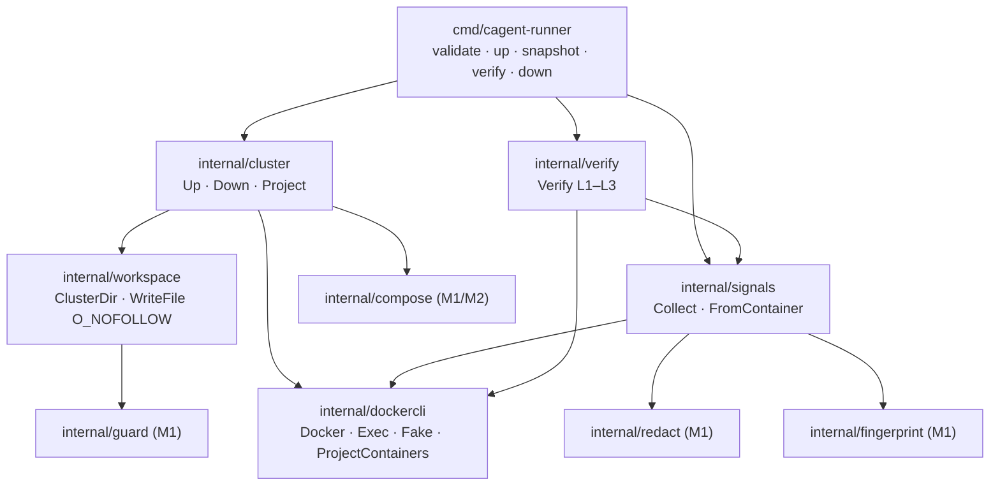
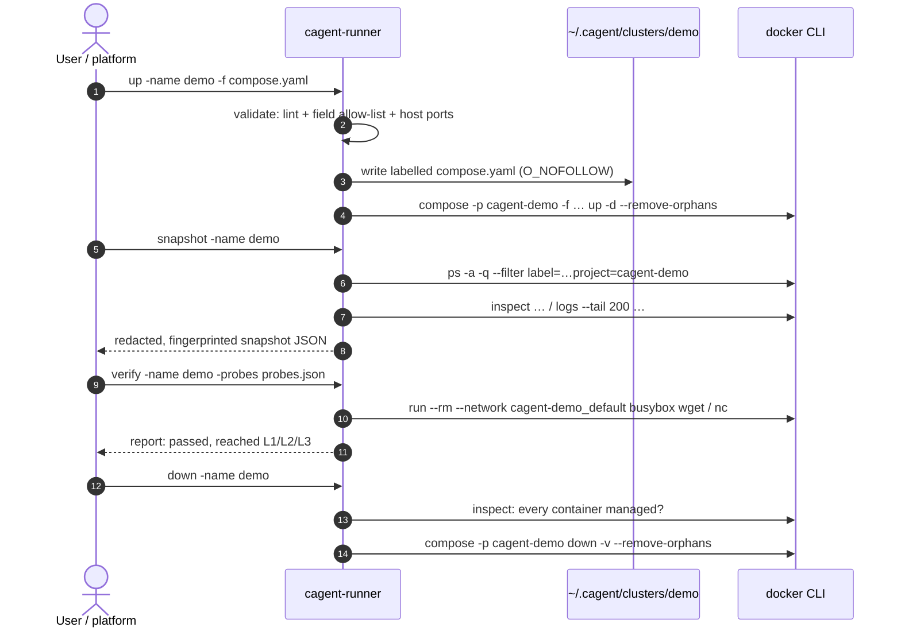
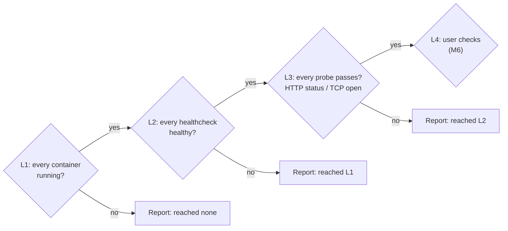

# M3 Runner Tools & Signals Implementation Plan

> **For Claude:** REQUIRED SUB-SKILL: Use superpowers:executing-plans to implement this plan task-by-task.

**Goal:** Let the Runner start, inspect, verify, and remove a cluster on a real Docker daemon, producing a redacted, fingerprinted diagnostic snapshot and an L1–L3 acceptance report.

**Architecture:** Five new Go packages under `runner/internal/`. `dockercli` wraps the `docker` CLI behind an interface, with a fake for unit tests. `workspace` owns `~/.cagent/clusters/<name>/` and writes files with `O_NOFOLLOW`. `cluster` runs `up` and `down` on `cagent-<name>` compose projects and refuses projects it does not manage. `signals` turns `docker inspect` and `docker logs` output into a snapshot, reusing M1's `redact` and `fingerprint`. `verify` checks L1 (running), L2 (healthy), and L3 (HTTP/TCP probes from a busybox container on the cluster network). The CLI gains `up`, `snapshot`, `verify`, and `down`.

**Tech Stack:** Go 1.24, compose-go v2.16.1, the `docker` CLI (Docker 29 / Compose v2+), `busybox:1.37` for probes. GitHub Actions.

- Roadmap: [2026-10-17-poc-roadmap.md](2026-10-17-poc-roadmap.md) (M3)
- Design: [2026-10-17-container-agent-design.md](2026-10-17-container-agent-design.md), sections 3.2, 4, 5.1, 8

---

## Decisions made while planning

| Decision | Why |
|---|---|
| Use the `docker` CLI's JSON output, not the Go Docker SDK | No large dependency or API-version negotiation; the Runner does exactly what a user could do by hand. Every argument is built in code and passed as argv, never through a shell. Task 9 updates the design doc, which said "SDK". |
| Name projects `cagent-<cluster>`; `down` refuses a project holding any container without `cagent.managed=true` | The Runner must never touch the user's own compose projects, even one with a clashing name. |
| Validate cluster names with `^[a-z0-9][a-z0-9_-]*$` before any docker call | Keeps names from becoming flags (`-rf`) or paths (`../x`). |
| Open workspace files on the declared path with `O_NOFOLLOW` after the guard check | Closes the check-then-write race noted after M1. Opening the guard's *resolved* path would follow the link before `O_NOFOLLOW` could refuse it. |
| Run L3 probes in `busybox:1.37` on `<project>_default` | Container IPs are not reachable from the host on Docker Desktop; a probe container on the cluster network works on every platform and needs no published ports. |
| Snapshot keeps ≤ 20 redacted error lines and the last 5 lines per service | Design 5.1: small models diagnose from a short, structured snapshot, and raw logs never leave the machine. |

## Package map



## One cluster's life through the CLI



## Prerequisites

- Work on a feature branch, not `main`.
- **Go is not installed on the host.** Run unit-test commands in a container from the repository root:
  `docker run --rm -v "$PWD":/repo -w /repo/runner golang:1.24 <go command>`
- **Integration tests need the host's Docker daemon and `docker` CLI**, which the golang container lacks (and mounting `docker.sock` into it is exactly what the Runner's lint forbids). Cross-compile the test binary for the host instead (Task 7).
- `busybox:1.37` is pulled on first use (~2 MB).

---

### Task 1: Docker CLI wrapper

**Files:**
- Create: `runner/internal/dockercli/dockercli.go`
- Create: `runner/internal/dockercli/fake.go`
- Test: `runner/internal/dockercli/dockercli_test.go`

**Step 1: Write the failing test**

```go
package dockercli

import (
	"context"
	"testing"
)

// inspectJSON is trimmed real `docker inspect` output for one exited and one healthy container.
const inspectJSON = `[
 {"Id":"aaa","Name":"/cagent-demo-crash-1","RestartCount":0,
  "State":{"Status":"exited","Restarting":false,"OOMKilled":false,"ExitCode":3},
  "Config":{"Labels":{"com.docker.compose.service":"crash","cagent.managed":"true"}}},
 {"Id":"bbb","Name":"/cagent-demo-web-1","RestartCount":2,
  "State":{"Status":"running","Restarting":false,"OOMKilled":false,"ExitCode":0,
           "Health":{"Status":"healthy","Log":[{"ExitCode":0,"Output":"ok"}]}},
  "Config":{"Labels":{"com.docker.compose.service":"web","cagent.managed":"true"}}}
]`

func TestProjectContainers(t *testing.T) {
	f := &Fake{Responses: map[string]FakeResponse{
		"ps -a -q --no-trunc --filter label=com.docker.compose.project=cagent-demo": {Out: "aaa\nbbb\n"},
		"inspect aaa bbb": {Out: inspectJSON},
	}}
	cs, err := ProjectContainers(context.Background(), f, "cagent-demo")
	if err != nil {
		t.Fatal(err)
	}
	if len(cs) != 2 {
		t.Fatalf("got %d containers, want 2", len(cs))
	}
	crash, web := cs[0], cs[1]
	if crash.Service() != "crash" || crash.State.Status != "exited" || crash.State.ExitCode != 3 {
		t.Errorf("crash parsed wrong: %+v", crash)
	}
	if crash.State.Health != nil {
		t.Error("container without healthcheck has Health")
	}
	if web.RestartCount != 2 || web.State.Health == nil || web.State.Health.Status != "healthy" {
		t.Errorf("web parsed wrong: %+v", web)
	}
}

func TestProjectContainersEmpty(t *testing.T) {
	f := &Fake{Responses: map[string]FakeResponse{
		"ps -a -q --no-trunc --filter label=com.docker.compose.project=cagent-none": {Out: ""},
	}}
	cs, err := ProjectContainers(context.Background(), f, "cagent-none")
	if err != nil || cs != nil {
		t.Errorf("got %v, %v; want nil, nil", cs, err)
	}
	if len(f.Calls) != 1 {
		t.Errorf("inspect should not run for an empty project; calls: %v", f.Calls)
	}
}
```

**Step 2: Run it to verify it fails**

Run: `docker run --rm -v "$PWD":/repo -w /repo/runner golang:1.24 go test ./internal/dockercli/`
Expected: FAIL — `undefined: Fake`, `undefined: FakeResponse`, `undefined: ProjectContainers`.

**Step 3: Write the implementation**

`runner/internal/dockercli/dockercli.go`:

```go
// Package dockercli runs the docker CLI and parses its JSON output. Callers build every
// argument themselves; nothing here passes through a shell.
package dockercli

import (
	"bytes"
	"context"
	"encoding/json"
	"fmt"
	"os/exec"
	"strings"
)

// Docker runs docker subcommands. Exec is the real implementation; tests use a fake.
type Docker interface {
	// Output returns stdout. A non-zero exit becomes an error carrying stderr.
	Output(ctx context.Context, args ...string) ([]byte, error)
	// Combined returns stdout and stderr interleaved, plus the exit error if any.
	Combined(ctx context.Context, args ...string) ([]byte, error)
}

// Exec runs the docker binary found on PATH.
type Exec struct{}

func (Exec) Output(ctx context.Context, args ...string) ([]byte, error) {
	var stderr bytes.Buffer
	cmd := exec.CommandContext(ctx, "docker", args...)
	cmd.Stderr = &stderr
	out, err := cmd.Output()
	if err != nil {
		return out, fmt.Errorf("docker %s: %w: %s", strings.Join(args, " "), err, strings.TrimSpace(stderr.String()))
	}
	return out, nil
}

func (Exec) Combined(ctx context.Context, args ...string) ([]byte, error) {
	return exec.CommandContext(ctx, "docker", args...).CombinedOutput()
}

// ComposeProjectLabel is the label docker compose puts on every container it creates.
const ComposeProjectLabel = "com.docker.compose.project"

// ComposeServiceLabel names the compose service a container belongs to.
const ComposeServiceLabel = "com.docker.compose.service"

// Container is the part of `docker inspect` output the Runner uses.
type Container struct {
	ID           string `json:"Id"`
	Name         string `json:"Name"`
	RestartCount int    `json:"RestartCount"`
	State        struct {
		Status     string `json:"Status"` // created, running, restarting, exited, dead, ...
		Restarting bool   `json:"Restarting"`
		OOMKilled  bool   `json:"OOMKilled"`
		ExitCode   int    `json:"ExitCode"`
		Health     *struct {
			Status string `json:"Status"` // starting, healthy, unhealthy
			Log    []struct {
				ExitCode int    `json:"ExitCode"`
				Output   string `json:"Output"`
			} `json:"Log"`
		} `json:"Health"`
	} `json:"State"`
	Config struct {
		Labels map[string]string `json:"Labels"`
	} `json:"Config"`
}

// Service returns the compose service name of the container.
func (c Container) Service() string { return c.Config.Labels[ComposeServiceLabel] }

// ProjectContainers inspects every container, running or not, of a compose project.
func ProjectContainers(ctx context.Context, d Docker, project string) ([]Container, error) {
	ids, err := d.Output(ctx, "ps", "-a", "-q", "--no-trunc", "--filter", "label="+ComposeProjectLabel+"="+project)
	if err != nil {
		return nil, err
	}
	fields := strings.Fields(string(ids))
	if len(fields) == 0 {
		return nil, nil
	}
	out, err := d.Output(ctx, append([]string{"inspect"}, fields...)...)
	if err != nil {
		return nil, err
	}
	var cs []Container
	if err := json.Unmarshal(out, &cs); err != nil {
		return nil, fmt.Errorf("parse docker inspect: %w", err)
	}
	return cs, nil
}
```

`runner/internal/dockercli/fake.go` (non-test file so other packages' tests can use it):

```go
package dockercli

import (
	"context"
	"fmt"
	"strings"
	"sync"
)

// Fake is a Docker for tests. It answers each command from Responses, keyed by the
// space-joined arguments, and records every call. An unknown command is an error.
type Fake struct {
	mu        sync.Mutex
	Responses map[string]FakeResponse
	Calls     []string
}

// FakeResponse is the canned result of one command.
type FakeResponse struct {
	Out string
	Err error
}

func (f *Fake) answer(args []string) ([]byte, error) {
	key := strings.Join(args, " ")
	f.mu.Lock()
	defer f.mu.Unlock()
	f.Calls = append(f.Calls, key)
	r, ok := f.Responses[key]
	if !ok {
		return nil, fmt.Errorf("fake docker: unexpected command %q", key)
	}
	return []byte(r.Out), r.Err
}

func (f *Fake) Output(_ context.Context, args ...string) ([]byte, error) { return f.answer(args) }

func (f *Fake) Combined(_ context.Context, args ...string) ([]byte, error) { return f.answer(args) }
```

**Step 4: Run tests to verify they pass**

Run: `docker run --rm -v "$PWD":/repo -w /repo/runner golang:1.24 go test ./internal/dockercli/`
Expected: `ok`

**Step 5: Commit**

```bash
git add runner/internal/dockercli
git commit -m "feat(runner): wrap the docker CLI and parse inspect output"
```

---

### Task 2: Cluster workspace

**Files:**
- Create: `runner/internal/workspace/workspace.go`
- Test: `runner/internal/workspace/workspace_test.go`

**Step 1: Write the failing test**

`TestWriteFileRefusesSymlink` uses a link that stays *inside* the workspace, so the guard passes it; only `O_NOFOLLOW` can refuse it. That is the race this task closes.

```go
package workspace

import (
	"os"
	"path/filepath"
	"testing"
)

func TestValidName(t *testing.T) {
	for _, n := range []string{"orders-poc", "a", "x_1"} {
		if !ValidName(n) {
			t.Errorf("ValidName(%q) = false", n)
		}
	}
	for _, n := range []string{"", "-rf", "Orders", "a/b", "../x", "a b"} {
		if ValidName(n) {
			t.Errorf("ValidName(%q) = true", n)
		}
	}
}

func TestWriteFile(t *testing.T) {
	w, err := Open(t.TempDir())
	if err != nil {
		t.Fatal(err)
	}
	path, err := w.WriteFile("demo", "compose.yaml", []byte("services: {}\n"))
	if err != nil {
		t.Fatal(err)
	}
	if filepath.Base(filepath.Dir(path)) != "demo" {
		t.Errorf("written to %s, want inside clusters/demo", path)
	}
	got, _ := os.ReadFile(path)
	if string(got) != "services: {}\n" {
		t.Errorf("content = %q", got)
	}
	fi, _ := os.Stat(path)
	if fi.Mode().Perm() != 0o600 {
		t.Errorf("mode = %v, want 0600", fi.Mode().Perm())
	}
}

func TestWriteFileRefusesSymlink(t *testing.T) {
	root := t.TempDir()
	w, err := Open(root)
	if err != nil {
		t.Fatal(err)
	}
	dir, err := w.ClusterDir("demo")
	if err != nil {
		t.Fatal(err)
	}
	// A link that stays inside the workspace passes the guard, but O_NOFOLLOW still
	// refuses to write through it.
	target := filepath.Join(dir, "real.yaml")
	if err := os.WriteFile(target, []byte("original"), 0o600); err != nil {
		t.Fatal(err)
	}
	if err := os.Symlink(target, filepath.Join(dir, "compose.yaml")); err != nil {
		t.Fatal(err)
	}
	if _, err := w.WriteFile("demo", "compose.yaml", []byte("evil")); err == nil {
		t.Fatal("write through a symlink succeeded")
	}
	if got, _ := os.ReadFile(target); string(got) != "original" {
		t.Errorf("link target modified: %q", got)
	}
}

func TestRejectsBadNames(t *testing.T) {
	w, err := Open(t.TempDir())
	if err != nil {
		t.Fatal(err)
	}
	if _, err := w.ClusterDir("../escape"); err == nil {
		t.Error("ClusterDir accepted ../escape")
	}
	for _, file := range []string{"../x", "sub/x", "..", "."} {
		if _, err := w.WriteFile("demo", file, nil); err == nil {
			t.Errorf("WriteFile accepted file name %q", file)
		}
	}
}
```

**Step 2: Run it to verify it fails**

Run: `docker run --rm -v "$PWD":/repo -w /repo/runner golang:1.24 go test ./internal/workspace/`
Expected: FAIL — `undefined: ValidName`, `undefined: Open`.

**Step 3: Write the implementation**

```go
// Package workspace manages the Runner's per-cluster directories under ~/.cagent/clusters.
package workspace

import (
	"fmt"
	"os"
	"path/filepath"
	"regexp"
	"syscall"

	"github.com/yutaofr/container-agent/runner/internal/guard"
)

// namePattern matches cluster names. It also keeps names from looking like CLI flags.
var namePattern = regexp.MustCompile(`^[a-z0-9][a-z0-9_-]*$`)

// ValidName reports whether name can be used as a cluster name.
func ValidName(name string) bool { return namePattern.MatchString(name) }

// Workspace is the Runner's home directory, normally ~/.cagent.
type Workspace struct{ root string }

// Open returns the workspace at root, creating it if needed.
func Open(root string) (*Workspace, error) {
	if err := os.MkdirAll(root, 0o700); err != nil {
		return nil, err
	}
	return &Workspace{root: root}, nil
}

// DefaultRoot is $CAGENT_HOME, or ~/.cagent when it is unset.
func DefaultRoot() (string, error) {
	if r := os.Getenv("CAGENT_HOME"); r != "" {
		return r, nil
	}
	home, err := os.UserHomeDir()
	if err != nil {
		return "", err
	}
	return filepath.Join(home, ".cagent"), nil
}

// ClusterDir returns the directory for one cluster, creating it if needed.
func (w *Workspace) ClusterDir(name string) (string, error) {
	if !ValidName(name) {
		return "", fmt.Errorf("invalid cluster name %q", name)
	}
	dir := filepath.Join(w.root, "clusters", name)
	if err := os.MkdirAll(dir, 0o700); err != nil {
		return "", err
	}
	return dir, nil
}

// WriteFile writes data to file, a plain file name, inside the cluster's directory. The
// guard rejects a path that resolves outside the directory. The open then uses the declared
// path, not the resolved one, with O_NOFOLLOW, so it refuses any symlink in the final
// element, including one planted after the check: this closes the check-then-write race.
func (w *Workspace) WriteFile(cluster, file string, data []byte) (string, error) {
	if file != filepath.Base(file) || file == "." || file == ".." {
		return "", fmt.Errorf("invalid file name %q", file)
	}
	dir, err := w.ClusterDir(cluster)
	if err != nil {
		return "", err
	}
	g, err := guard.New(dir)
	if err != nil {
		return "", err
	}
	path := filepath.Join(dir, file)
	if _, err := g.CheckWrite(path); err != nil {
		return "", err
	}
	f, err := os.OpenFile(path, os.O_WRONLY|os.O_CREATE|os.O_TRUNC|syscall.O_NOFOLLOW, 0o600)
	if err != nil {
		return "", fmt.Errorf("open %s: %w", path, err)
	}
	if _, err := f.Write(data); err != nil {
		f.Close()
		return "", err
	}
	return path, f.Close()
}
```

**Step 4: Run tests to verify they pass**

Run: `docker run --rm -v "$PWD":/repo -w /repo/runner golang:1.24 go test ./internal/workspace/`
Expected: `ok`

**Step 5: Commit**

```bash
git add runner/internal/workspace
git commit -m "feat(runner): add cluster workspaces with no-follow writes"
```

---

### Task 3: Cluster lifecycle

**Files:**
- Create: `runner/internal/cluster/cluster.go`
- Test: `runner/internal/cluster/cluster_test.go`

**Step 1: Write the failing test**

```go
package cluster

import (
	"context"
	"errors"
	"os"
	"path/filepath"
	"strings"
	"testing"

	"github.com/yutaofr/container-agent/runner/internal/compose"
	"github.com/yutaofr/container-agent/runner/internal/dockercli"
	"github.com/yutaofr/container-agent/runner/internal/workspace"
)

const psDemo = "ps -a -q --no-trunc --filter label=com.docker.compose.project=cagent-demo"

func TestUpWritesLabelledComposeAndStarts(t *testing.T) {
	src := filepath.Join(t.TempDir(), "compose.yaml")
	if err := os.WriteFile(src, []byte("services:\n  web: { image: nginx:1.27 }\n"), 0o644); err != nil {
		t.Fatal(err)
	}
	ctx := context.Background()
	p, err := compose.Load(ctx, src, Project("demo"))
	if err != nil {
		t.Fatal(err)
	}
	root := t.TempDir()
	w, err := workspace.Open(root)
	if err != nil {
		t.Fatal(err)
	}
	want := filepath.Join(root, "clusters", "demo", "compose.yaml")
	f := &dockercli.Fake{Responses: map[string]dockercli.FakeResponse{
		"compose -p cagent-demo -f " + want + " up -d --remove-orphans": {},
	}}

	path, err := Up(ctx, f, w, "demo", p)
	if err != nil {
		t.Fatal(err)
	}
	if path != want {
		t.Errorf("compose written to %s, want %s", path, want)
	}
	data, _ := os.ReadFile(path)
	for _, label := range []string{`cagent.managed: "true"`, "cagent.cluster: demo"} {
		if !strings.Contains(string(data), label) {
			t.Errorf("written compose lacks %s:\n%s", label, data)
		}
	}
}

func TestDownRefusesUnmanagedContainers(t *testing.T) {
	f := &dockercli.Fake{Responses: map[string]dockercli.FakeResponse{
		psDemo:        {Out: "aaa\n"},
		"inspect aaa": {Out: `[{"Id":"aaa","Name":"/theirs","Config":{"Labels":{}}}]`},
	}}
	err := Down(context.Background(), f, "demo")
	if !errors.Is(err, ErrNotManaged) {
		t.Fatalf("got %v, want ErrNotManaged", err)
	}
	for _, c := range f.Calls {
		if strings.Contains(c, " down ") {
			t.Errorf("down ran on an unmanaged project: %v", f.Calls)
		}
	}
}

func TestDownRemovesManagedProject(t *testing.T) {
	f := &dockercli.Fake{Responses: map[string]dockercli.FakeResponse{
		psDemo:        {Out: "aaa\n"},
		"inspect aaa": {Out: `[{"Id":"aaa","Name":"/x","Config":{"Labels":{"cagent.managed":"true"}}}]`},
		"compose -p cagent-demo down -v --remove-orphans": {},
	}}
	if err := Down(context.Background(), f, "demo"); err != nil {
		t.Fatal(err)
	}
}

func TestRejectsFlagLikeNames(t *testing.T) {
	f := &dockercli.Fake{}
	if err := Down(context.Background(), f, "-rf"); err == nil {
		t.Error("Down accepted -rf")
	}
	if len(f.Calls) != 0 {
		t.Errorf("docker was called: %v", f.Calls)
	}
}
```

**Step 2: Run it to verify it fails**

Run: `docker run --rm -v "$PWD":/repo -w /repo/runner golang:1.24 go test ./internal/cluster/`
Expected: FAIL — `undefined: Project`, `undefined: Up`, `undefined: Down`, `undefined: ErrNotManaged`.

**Step 3: Write the implementation**

```go
// Package cluster starts and stops Runner-managed compose projects.
package cluster

import (
	"context"
	"errors"
	"fmt"

	"github.com/compose-spec/compose-go/v2/types"

	"github.com/yutaofr/container-agent/runner/internal/compose"
	"github.com/yutaofr/container-agent/runner/internal/dockercli"
	"github.com/yutaofr/container-agent/runner/internal/workspace"
)

// ProjectPrefix keeps Runner projects apart from the user's own compose projects.
const ProjectPrefix = "cagent-"

// ErrNotManaged means a compose project holds a container without the managed label,
// so it is not the Runner's to touch.
var ErrNotManaged = errors.New("project has a container the Runner does not manage")

// Project returns the compose project name for a cluster.
func Project(name string) string { return ProjectPrefix + name }

// Up labels every service in p, writes p to the cluster's workspace, and starts it
// detached. It returns the path of the written compose file. Callers must validate p first.
func Up(ctx context.Context, d dockercli.Docker, w *workspace.Workspace, name string, p *types.Project) (string, error) {
	if !workspace.ValidName(name) {
		return "", fmt.Errorf("invalid cluster name %q", name)
	}
	compose.ApplyManagedLabels(p, name)
	data, err := p.MarshalYAML()
	if err != nil {
		return "", fmt.Errorf("marshal compose: %w", err)
	}
	path, err := w.WriteFile(name, "compose.yaml", data)
	if err != nil {
		return "", err
	}
	_, err = d.Output(ctx, "compose", "-p", Project(name), "-f", path, "up", "-d", "--remove-orphans")
	return path, err
}

// Down removes the cluster's containers, networks, and volumes. It refuses when any
// container in the project lacks the managed label.
func Down(ctx context.Context, d dockercli.Docker, name string) error {
	if !workspace.ValidName(name) {
		return fmt.Errorf("invalid cluster name %q", name)
	}
	cs, err := dockercli.ProjectContainers(ctx, d, Project(name))
	if err != nil {
		return err
	}
	for _, c := range cs {
		if !compose.IsManaged(c.Config.Labels) {
			return fmt.Errorf("%w: %s", ErrNotManaged, c.Name)
		}
	}
	_, err = d.Output(ctx, "compose", "-p", Project(name), "down", "-v", "--remove-orphans")
	return err
}
```

**Step 4: Run tests to verify they pass**

Run: `docker run --rm -v "$PWD":/repo -w /repo/runner golang:1.24 go test ./internal/cluster/`
Expected: `ok`

**Step 5: Commit**

```bash
git add runner/internal/cluster
git commit -m "feat(runner): start and stop managed compose projects"
```

---

### Task 4: Diagnostic snapshot

**Files:**
- Create: `runner/internal/signals/signals.go`
- Test: `runner/internal/signals/signals_test.go`

**Step 1: Write the failing test**

```go
package signals

import (
	"context"
	"encoding/json"
	"reflect"
	"strings"
	"testing"

	"github.com/yutaofr/container-agent/runner/internal/dockercli"
)

func container(t *testing.T, js string) dockercli.Container {
	t.Helper()
	var c dockercli.Container
	if err := json.Unmarshal([]byte(js), &c); err != nil {
		t.Fatal(err)
	}
	return c
}

func TestFromContainerCrashed(t *testing.T) {
	c := container(t, `{"Id":"a","Name":"/cagent-demo-api-1",
		"State":{"Status":"exited","ExitCode":3},
		"Config":{"Labels":{"com.docker.compose.service":"api"}}}`)
	logs := "Starting api\n" +
		"connecting with password=hunter2\n" +
		"java.net.ConnectException: Connection refused\n" +
		"\tat com.acme.Db.open(Db.java:42)\n"
	s := FromContainer(c, logs, DefaultOptions)

	if s.Service != "api" || s.Container != "cagent-demo-api-1" || s.State != "exited" || s.ExitCode != 3 {
		t.Errorf("state wrong: %+v", s)
	}
	want := []string{"conn:refused@api", "exit:3@api"}
	if !reflect.DeepEqual(s.Signatures, want) {
		t.Errorf("signatures = %v, want %v", s.Signatures, want)
	}
	if !reflect.DeepEqual(s.ErrorLines, []string{"java.net.ConnectException: Connection refused"}) {
		t.Errorf("error lines = %v", s.ErrorLines)
	}
	joined := strings.Join(s.Tail, "\n")
	if strings.Contains(joined, "hunter2") || !strings.Contains(joined, "password=******") {
		t.Errorf("tail not redacted: %v", s.Tail)
	}
}

func TestFromContainerOOMKilled(t *testing.T) {
	c := container(t, `{"Id":"a","Name":"/x","State":{"Status":"exited","OOMKilled":true,"ExitCode":137},
		"Config":{"Labels":{"com.docker.compose.service":"worker"}}}`)
	s := FromContainer(c, "", DefaultOptions)
	if !s.OOMKilled || !reflect.DeepEqual(s.Signatures, []string{"oom:killed@worker"}) {
		t.Errorf("got %+v", s)
	}
}

func TestFromContainerHealthyRunning(t *testing.T) {
	c := container(t, `{"Id":"a","Name":"/x","RestartCount":1,
		"State":{"Status":"running","Health":{"Status":"healthy","Log":[{"ExitCode":0,"Output":"ok token=abc\n"}]}},
		"Config":{"Labels":{"com.docker.compose.service":"web"}}}`)
	s := FromContainer(c, "GET / 200\n", DefaultOptions)
	if s.Health != "healthy" || s.HealthLog != "ok token=******" || s.RestartCount != 1 {
		t.Errorf("got %+v", s)
	}
	if len(s.Signatures) != 0 || len(s.ErrorLines) != 0 {
		t.Errorf("healthy service has evidence: %+v", s)
	}
}

func TestFromContainerBoundsEvidence(t *testing.T) {
	c := container(t, `{"Id":"a","Name":"/x","State":{"Status":"running"},
		"Config":{"Labels":{"com.docker.compose.service":"noisy"}}}`)
	var b strings.Builder
	for i := 0; i < 50; i++ {
		b.WriteString("ERROR retrying\n")
	}
	b.WriteString("last line\n")
	s := FromContainer(c, b.String(), Options{TailLines: 200, MaxErrorLines: 3, KeepTail: 2})
	if len(s.ErrorLines) != 3 {
		t.Errorf("kept %d error lines, want 3", len(s.ErrorLines))
	}
	if !reflect.DeepEqual(s.Tail, []string{"ERROR retrying", "last line"}) {
		t.Errorf("tail = %v", s.Tail)
	}
}

func TestCollectSortsServices(t *testing.T) {
	f := &dockercli.Fake{Responses: map[string]dockercli.FakeResponse{
		"ps -a -q --no-trunc --filter label=com.docker.compose.project=cagent-demo": {Out: "b\na\n"},
		"inspect b a": {Out: `[
			{"Id":"b","Name":"/web","State":{"Status":"running"},"Config":{"Labels":{"com.docker.compose.service":"web"}}},
			{"Id":"a","Name":"/api","State":{"Status":"running"},"Config":{"Labels":{"com.docker.compose.service":"api"}}}]`},
		"logs --tail 200 b": {Out: "up\n"},
		"logs --tail 200 a": {Out: "up\n"},
	}}
	snap, err := Collect(context.Background(), f, "cagent-demo", DefaultOptions)
	if err != nil {
		t.Fatal(err)
	}
	if snap.Project != "cagent-demo" || len(snap.Services) != 2 || snap.Services[0].Service != "api" {
		t.Errorf("got %+v", snap)
	}
}
```

**Step 2: Run it to verify it fails**

Run: `docker run --rm -v "$PWD":/repo -w /repo/runner golang:1.24 go test ./internal/signals/`
Expected: FAIL — `undefined: FromContainer`, `undefined: DefaultOptions`, `undefined: Options`, `undefined: Collect`.

**Step 3: Write the implementation**

```go
// Package signals collects a redacted, fingerprinted diagnostic snapshot of a cluster.
// Raw logs never leave this package: only filtered, redacted lines do.
package signals

import (
	"context"
	"regexp"
	"sort"
	"strconv"
	"strings"

	"github.com/yutaofr/container-agent/runner/internal/dockercli"
	"github.com/yutaofr/container-agent/runner/internal/fingerprint"
	"github.com/yutaofr/container-agent/runner/internal/redact"
)

// Options bound how much log text a snapshot carries.
type Options struct {
	TailLines     int // lines read from each container's log
	MaxErrorLines int // error lines kept per service
	KeepTail      int // last lines kept per service, error or not
}

// DefaultOptions match design section 5.1.
var DefaultOptions = Options{TailLines: 200, MaxErrorLines: 20, KeepTail: 5}

// Service is one container's state and evidence.
type Service struct {
	Service      string   `json:"service"`
	Container    string   `json:"container"`
	State        string   `json:"state"`
	ExitCode     int      `json:"exit_code"`
	OOMKilled    bool     `json:"oom_killed"`
	RestartCount int      `json:"restart_count"`
	Health       string   `json:"health,omitempty"`     // "", starting, healthy, unhealthy
	HealthLog    string   `json:"health_log,omitempty"` // last healthcheck output, redacted
	ErrorLines   []string `json:"error_lines"`
	Tail         []string `json:"tail"`
	Signatures   []string `json:"signatures"`
}

// Snapshot is what the Runner reports to the platform for diagnosis.
type Snapshot struct {
	Project  string    `json:"project"`
	Services []Service `json:"services"`
}

var errorLine = regexp.MustCompile(`(?i)error|exception|fatal|panic|caused by`)

// Collect inspects every container of a compose project and reads its recent logs.
func Collect(ctx context.Context, d dockercli.Docker, project string, opt Options) (Snapshot, error) {
	cs, err := dockercli.ProjectContainers(ctx, d, project)
	if err != nil {
		return Snapshot{}, err
	}
	snap := Snapshot{Project: project, Services: []Service{}}
	for _, c := range cs {
		// A container removed since inspect has no logs; its state still belongs in the snapshot.
		logs, _ := d.Combined(ctx, "logs", "--tail", strconv.Itoa(opt.TailLines), c.ID)
		snap.Services = append(snap.Services, FromContainer(c, string(logs), opt))
	}
	sort.Slice(snap.Services, func(i, j int) bool { return snap.Services[i].Service < snap.Services[j].Service })
	return snap, nil
}

// FromContainer builds one service entry. Every line is redacted before it is kept or
// fingerprinted.
func FromContainer(c dockercli.Container, logs string, opt Options) Service {
	s := Service{
		Service:      c.Service(),
		Container:    strings.TrimPrefix(c.Name, "/"),
		State:        c.State.Status,
		ExitCode:     c.State.ExitCode,
		OOMKilled:    c.State.OOMKilled,
		RestartCount: c.RestartCount,
		ErrorLines:   []string{},
		Tail:         []string{},
	}
	if h := c.State.Health; h != nil {
		s.Health = h.Status
		if n := len(h.Log); n > 0 {
			s.HealthLog = redact.String(strings.TrimSpace(h.Log[n-1].Output))
		}
	}

	sigs := map[string]bool{}
	var lines []string
	for _, l := range strings.Split(logs, "\n") {
		if l = strings.TrimRight(l, "\r "); l != "" {
			lines = append(lines, redact.String(l))
		}
	}
	for _, l := range lines {
		if !errorLine.MatchString(l) {
			continue
		}
		if len(s.ErrorLines) < opt.MaxErrorLines {
			s.ErrorLines = append(s.ErrorLines, l)
		}
		sigs[fingerprint.FromLog(s.Service, l).String()] = true
	}
	if start := len(lines) - opt.KeepTail; start > 0 {
		lines = lines[start:]
	}
	s.Tail = append(s.Tail, lines...)

	if stopped := c.State.Status == "exited" || c.State.Status == "dead"; stopped || c.State.Restarting || c.State.OOMKilled {
		sigs[fingerprint.FromExit(s.Service, c.State.ExitCode, c.State.OOMKilled).String()] = true
	}
	s.Signatures = make([]string, 0, len(sigs))
	for k := range sigs {
		s.Signatures = append(s.Signatures, k)
	}
	sort.Strings(s.Signatures)
	return s
}
```

Lines are redacted *before* they are matched, kept, or fingerprinted, so no code path can hold an unredacted line past `FromContainer`.

**Step 4: Run tests to verify they pass**

Run: `docker run --rm -v "$PWD":/repo -w /repo/runner golang:1.24 go test ./internal/signals/`
Expected: `ok`

**Step 5: Commit**

```bash
git add runner/internal/signals
git commit -m "feat(runner): collect redacted, fingerprinted diagnostic snapshots"
```

---

### Task 5: Acceptance levels L1–L3

**Files:**
- Create: `runner/internal/verify/verify.go`
- Test: `runner/internal/verify/verify_test.go`

**Step 1: Write the failing test**

```go
package verify

import (
	"context"
	"errors"
	"testing"

	"github.com/yutaofr/container-agent/runner/internal/dockercli"
	"github.com/yutaofr/container-agent/runner/internal/signals"
)

const (
	wgetWeb = "run --rm --network cagent-demo_default busybox:1.37 wget -S -q -O /dev/null -T 5 http://web:8080/"
	ncDB    = "run --rm --network cagent-demo_default busybox:1.37 nc -z -w 5 db 3306"
)

func snapshot(services ...signals.Service) signals.Snapshot {
	return signals.Snapshot{Project: "cagent-demo", Services: services}
}

var (
	webHealthy = signals.Service{Service: "web", State: "running", Health: "healthy"}
	dbRunning  = signals.Service{Service: "db", State: "running"}
)

func TestL1FailureStopsEarly(t *testing.T) {
	crashed := signals.Service{Service: "api", State: "exited", ExitCode: 137, OOMKilled: true}
	f := &dockercli.Fake{}
	rep := Verify(context.Background(), f, snapshot(webHealthy, crashed),
		[]Probe{{Service: "web", HTTP: &HTTPProbe{Port: 8080, Path: "/"}}})
	if rep.Passed || rep.Reached != "" {
		t.Errorf("got passed=%v reached=%q, want false and none", rep.Passed, rep.Reached)
	}
	if got := rep.Results[1]; got.OK || got.Detail != "exited, exit 137, OOM killed" {
		t.Errorf("api result = %+v", got)
	}
	if len(f.Calls) != 0 {
		t.Errorf("probes ran despite L1 failure: %v", f.Calls)
	}
}

func TestL2Unhealthy(t *testing.T) {
	sick := signals.Service{Service: "web", State: "running", Health: "unhealthy", HealthLog: "curl: (7) refused"}
	rep := Verify(context.Background(), &dockercli.Fake{}, snapshot(sick, dbRunning), nil)
	if rep.Passed || rep.Reached != "L1" {
		t.Errorf("got passed=%v reached=%q, want false and L1", rep.Passed, rep.Reached)
	}
	last := rep.Results[len(rep.Results)-2]
	if last.Detail != "unhealthy: curl: (7) refused" {
		t.Errorf("web L2 detail = %q", last.Detail)
	}
}

func TestNoProbesPassesAtL2(t *testing.T) {
	rep := Verify(context.Background(), &dockercli.Fake{}, snapshot(webHealthy, dbRunning), nil)
	if !rep.Passed || rep.Reached != "L2" {
		t.Errorf("got passed=%v reached=%q, want true and L2", rep.Passed, rep.Reached)
	}
}

func TestProbes(t *testing.T) {
	f := &dockercli.Fake{Responses: map[string]dockercli.FakeResponse{
		wgetWeb: {Out: "  HTTP/1.1 301 Moved\n  Location: /home\n  HTTP/1.1 200 OK\n  Content-Length: 3\n"},
		ncDB:    {},
	}}
	probes := []Probe{
		{Service: "web", HTTP: &HTTPProbe{Port: 8080, Path: "/"}},
		{Service: "db", TCP: &TCPProbe{Port: 3306}},
	}
	rep := Verify(context.Background(), f, snapshot(webHealthy, dbRunning), probes)
	if !rep.Passed || rep.Reached != "L3" {
		t.Fatalf("got %+v", rep)
	}
	if d := rep.Results[4].Detail; d != "GET http://web:8080/ returned 200, want 200" {
		t.Errorf("http detail = %q", d)
	}
}

func TestProbeFailures(t *testing.T) {
	f := &dockercli.Fake{Responses: map[string]dockercli.FakeResponse{
		wgetWeb: {Out: "  HTTP/1.1 503 Service Unavailable\nwget: server returned error", Err: errors.New("exit 1")},
		ncDB:    {Err: errors.New("exit 1")},
	}}
	probes := []Probe{
		{Service: "web", HTTP: &HTTPProbe{Port: 8080, Path: "/"}},
		{Service: "db", TCP: &TCPProbe{Port: 3306}},
		{Service: "ghost", TCP: &TCPProbe{Port: 1}},
		{Service: "web", HTTP: &HTTPProbe{Port: 8080, Path: "/a b"}},
		{Service: "web"},
	}
	rep := Verify(context.Background(), f, snapshot(webHealthy, dbRunning), probes)
	if rep.Passed || rep.Reached != "L2" {
		t.Fatalf("got passed=%v reached=%q", rep.Passed, rep.Reached)
	}
	want := []string{
		"GET http://web:8080/ returned 503, want 200",
		"TCP db:3306 refused or timed out",
		"unknown service",
		`invalid path "/a b"`,
		"probe needs exactly one of http or tcp",
	}
	for i, w := range want {
		if r := rep.Results[4+i]; r.OK || r.Detail != w {
			t.Errorf("probe %d = %+v, want failed %q", i, r, w)
		}
	}
}
```

**Step 2: Run it to verify it fails**

Run: `docker run --rm -v "$PWD":/repo -w /repo/runner golang:1.24 go test ./internal/verify/`
Expected: FAIL — `undefined: Verify`, `undefined: Probe`, `undefined: HTTPProbe`, `undefined: TCPProbe`.

**Step 3: Write the implementation**

```go
// Package verify runs acceptance levels L1–L3 against a cluster snapshot.
//
//	L1  every container is running
//	L2  every container with a healthcheck is healthy
//	L3  every probe passes
//
// Each level runs only when the one below it passed. Probes run from a throwaway busybox
// container on the cluster's network, because container IPs are not reachable from the
// host on every platform (Docker Desktop on macOS, for one).
package verify

import (
	"context"
	"fmt"
	"regexp"
	"strconv"
	"strings"

	"github.com/yutaofr/container-agent/runner/internal/dockercli"
	"github.com/yutaofr/container-agent/runner/internal/signals"
)

// ProbeImage runs probes. busybox ships wget and nc.
const ProbeImage = "busybox:1.37"

// Probe checks one service from inside the cluster network. Set exactly one of HTTP or TCP.
type Probe struct {
	Service string     `json:"service"`
	HTTP    *HTTPProbe `json:"http,omitempty"`
	TCP     *TCPProbe  `json:"tcp,omitempty"`
}

// HTTPProbe expects status Expect (200 when zero) from GET http://service:Port/Path.
type HTTPProbe struct {
	Port   int    `json:"port"`
	Path   string `json:"path"`
	Expect int    `json:"expect"`
}

// TCPProbe expects service:Port to accept a connection.
type TCPProbe struct {
	Port int `json:"port"`
}

// Result is one check at one level.
type Result struct {
	Level   string `json:"level"`
	Service string `json:"service"`
	OK      bool   `json:"ok"`
	Detail  string `json:"detail"`
}

// Report is the outcome. Reached is the highest level whose checks all passed ("" for none).
type Report struct {
	Passed  bool     `json:"passed"`
	Reached string   `json:"reached"`
	Results []Result `json:"results"`
}

// Verify checks snap level by level, running probes only once L1 and L2 pass.
func Verify(ctx context.Context, d dockercli.Docker, snap signals.Snapshot, probes []Probe) Report {
	rep := Report{Results: []Result{}}
	add := func(r Result) bool { rep.Results = append(rep.Results, r); return r.OK }

	l1 := len(snap.Services) > 0
	if !l1 {
		add(Result{Level: "L1", OK: false, Detail: "no containers"})
	}
	for _, s := range snap.Services {
		l1 = add(levelOne(s)) && l1
	}
	if !l1 {
		return rep
	}
	rep.Reached = "L1"

	l2 := true
	for _, s := range snap.Services {
		l2 = add(levelTwo(s)) && l2
	}
	if !l2 {
		return rep
	}
	rep.Reached = "L2"

	services := map[string]bool{}
	for _, s := range snap.Services {
		services[s.Service] = true
	}
	l3 := true
	for _, p := range probes {
		l3 = add(runProbe(ctx, d, snap.Project+"_default", p, services)) && l3
	}
	if l3 {
		if len(probes) > 0 {
			rep.Reached = "L3"
		}
		rep.Passed = true
	}
	return rep
}

func levelOne(s signals.Service) Result {
	r := Result{Level: "L1", Service: s.Service, OK: s.State == "running", Detail: s.State}
	switch {
	case !r.OK:
		r.Detail = fmt.Sprintf("%s, exit %d", s.State, s.ExitCode)
		if s.OOMKilled {
			r.Detail += ", OOM killed"
		}
	case s.RestartCount > 0:
		r.Detail = fmt.Sprintf("running, restarted %d times", s.RestartCount)
	}
	return r
}

func levelTwo(s signals.Service) Result {
	switch s.Health {
	case "":
		return Result{Level: "L2", Service: s.Service, OK: true, Detail: "no healthcheck"}
	case "healthy":
		return Result{Level: "L2", Service: s.Service, OK: true, Detail: "healthy"}
	default:
		detail := s.Health
		if s.HealthLog != "" {
			detail += ": " + s.HealthLog
		}
		return Result{Level: "L2", Service: s.Service, OK: false, Detail: detail}
	}
}

// statusLine matches the status line wget -S prints; the last one wins after redirects.
var statusLine = regexp.MustCompile(`HTTP/\d(?:\.\d)? (\d{3})`)

func runProbe(ctx context.Context, d dockercli.Docker, network string, p Probe, services map[string]bool) Result {
	fail := func(detail string) Result { return Result{Level: "L3", Service: p.Service, Detail: detail} }
	if !services[p.Service] {
		return fail("unknown service")
	}
	run := []string{"run", "--rm", "--network", network, ProbeImage}
	switch {
	case p.HTTP != nil && p.TCP == nil:
		h := p.HTTP
		if !strings.HasPrefix(h.Path, "/") || strings.ContainsAny(h.Path, " \t\r\n") {
			return fail(fmt.Sprintf("invalid path %q", h.Path))
		}
		expect := h.Expect
		if expect == 0 {
			expect = 200
		}
		url := fmt.Sprintf("http://%s:%d%s", p.Service, h.Port, h.Path)
		out, _ := d.Combined(ctx, append(run, "wget", "-S", "-q", "-O", "/dev/null", "-T", "5", url)...)
		matches := statusLine.FindAllSubmatch(out, -1)
		if len(matches) == 0 {
			return fail(fmt.Sprintf("GET %s: no response: %s", url, strings.TrimSpace(string(out))))
		}
		got, _ := strconv.Atoi(string(matches[len(matches)-1][1]))
		r := Result{Level: "L3", Service: p.Service, OK: got == expect,
			Detail: fmt.Sprintf("GET %s returned %d, want %d", url, got, expect)}
		return r
	case p.TCP != nil && p.HTTP == nil:
		addr := fmt.Sprintf("%s:%d", p.Service, p.TCP.Port)
		_, err := d.Combined(ctx, append(run, "nc", "-z", "-w", "5", p.Service, strconv.Itoa(p.TCP.Port))...)
		if err != nil {
			return fail("TCP " + addr + " refused or timed out")
		}
		return Result{Level: "L3", Service: p.Service, OK: true, Detail: "TCP " + addr + " open"}
	default:
		return fail("probe needs exactly one of http or tcp")
	}
}
```

`wget -S` prints every response's status line; after a redirect the last one is the real answer, hence `FindAllSubmatch` and the last match. A non-2xx status makes `wget` exit non-zero, so the exit error is ignored and the status line decides.

**Step 4: Run tests to verify they pass**

Run: `docker run --rm -v "$PWD":/repo -w /repo/runner golang:1.24 go test ./internal/verify/`
Expected: `ok`

**Step 5: Commit**

```bash
git add runner/internal/verify
git commit -m "feat(runner): verify clusters at L1 to L3"
```

---

### Task 6: `up`, `snapshot`, `verify`, `down` subcommands

`run` now dispatches subcommands and takes its process dependencies (`free`, `docker`, `home`) in one `deps` value, so tests can swap all three.

**Files:**
- Modify: `runner/cmd/cagent-runner/main_test.go`
- Create: `runner/cmd/cagent-runner/lifecycle_test.go`
- Modify (rewrite): `runner/cmd/cagent-runner/main.go`

**Step 1: Move the existing tests to `deps`**

In `main_test.go`, add `"github.com/yutaofr/container-agent/runner/internal/dockercli"` to the imports, replace `func allFree(int) bool { return true }` with:

```go
// testDeps treats every port as free, fails any docker call it was not told about, and
// roots the workspace in a temp dir.
func testDeps(t *testing.T) deps {
	t.Helper()
	root := t.TempDir()
	return deps{
		free:   func(int) bool { return true },
		docker: &dockercli.Fake{},
		home:   func() (string, error) { return root, nil },
	}
}
```

then replace every `allFree)` with `testDeps(t))`:

```bash
sed -i.bak 's/allFree)/testDeps(t))/g' runner/cmd/cagent-runner/main_test.go && rm runner/cmd/cagent-runner/main_test.go.bak
```

**Step 2: Write the failing tests for the new subcommands**

`runner/cmd/cagent-runner/lifecycle_test.go`:

```go
package main

import (
	"bytes"
	"os"
	"path/filepath"
	"strings"
	"testing"

	"github.com/yutaofr/container-agent/runner/internal/dockercli"
)

const psDemo = "ps -a -q --no-trunc --filter label=com.docker.compose.project=cagent-demo"

// withDocker returns testDeps whose docker answers only the given commands.
func withDocker(t *testing.T, responses map[string]dockercli.FakeResponse) (deps, *dockercli.Fake, string) {
	t.Helper()
	d := testDeps(t)
	f := &dockercli.Fake{Responses: responses}
	d.docker = f
	root, _ := d.home()
	return d, f, root
}

func TestUpStartsCleanCompose(t *testing.T) {
	src := writeFile(t, "services:\n  web: { image: nginx:1.27 }\n")
	d, f, root := withDocker(t, nil)
	written := filepath.Join(root, "clusters", "demo", "compose.yaml")
	f.Responses = map[string]dockercli.FakeResponse{
		"compose -p cagent-demo -f " + written + " up -d --remove-orphans": {},
	}
	var out, errOut bytes.Buffer
	if code := run([]string{"up", "-name", "demo", "-f", src}, &out, &errOut, d); code != exitOK {
		t.Fatalf("exit %d, stderr: %s", code, errOut.String())
	}
	if !strings.Contains(out.String(), `"project": "cagent-demo"`) {
		t.Errorf("output: %s", out.String())
	}
	data, err := os.ReadFile(written)
	if err != nil || !strings.Contains(string(data), `cagent.managed: "true"`) {
		t.Errorf("workspace compose missing or unlabelled: %v\n%s", err, data)
	}
}

func TestUpRefusesFindings(t *testing.T) {
	src := writeFile(t, "services:\n  web: { image: nginx:1.27, privileged: true }\n")
	d, f, _ := withDocker(t, nil)
	var out, errOut bytes.Buffer
	if code := run([]string{"up", "-name", "demo", "-f", src}, &out, &errOut, d); code != exitFindings {
		t.Fatalf("exit %d, want %d", code, exitFindings)
	}
	if len(f.Calls) != 0 {
		t.Errorf("docker called despite findings: %v", f.Calls)
	}
}

func TestSubcommandsRequireValidName(t *testing.T) {
	for _, args := range [][]string{
		{"up", "-f", "x.yaml"},
		{"up", "-name", "-rf", "-f", "x.yaml"},
		{"snapshot"},
		{"verify", "-name", "Bad"},
		{"down", "-name", "../x"},
	} {
		var out, errOut bytes.Buffer
		if code := run(args, &out, &errOut, testDeps(t)); code != exitError {
			t.Errorf("%v: exit %d, want %d", args, code, exitError)
		}
	}
}

func TestDownRefusesForeignProject(t *testing.T) {
	d, f, _ := withDocker(t, map[string]dockercli.FakeResponse{
		psDemo:        {Out: "aaa\n"},
		"inspect aaa": {Out: `[{"Id":"aaa","Name":"/theirs","Config":{"Labels":{}}}]`},
	})
	var out, errOut bytes.Buffer
	if code := run([]string{"down", "-name", "demo"}, &out, &errOut, d); code != exitError {
		t.Fatalf("exit %d, want %d", code, exitError)
	}
	if !strings.Contains(errOut.String(), "does not manage") {
		t.Errorf("stderr: %s", errOut.String())
	}
	if len(f.Calls) != 2 {
		t.Errorf("unexpected calls: %v", f.Calls)
	}
}

func TestVerifyExitCodes(t *testing.T) {
	cases := []struct {
		state string
		want  int
	}{
		{`{"Status":"running"}`, exitOK},
		{`{"Status":"exited","ExitCode":1}`, exitFindings},
	}
	for _, c := range cases {
		d, _, _ := withDocker(t, map[string]dockercli.FakeResponse{
			psDemo: {Out: "aaa\n"},
			"inspect aaa": {Out: `[{"Id":"aaa","Name":"/x","State":` + c.state +
				`,"Config":{"Labels":{"com.docker.compose.service":"web"}}}]`},
			"logs --tail 200 aaa": {Out: ""},
		})
		var out, errOut bytes.Buffer
		if code := run([]string{"verify", "-name", "demo"}, &out, &errOut, d); code != c.want {
			t.Errorf("state %s: exit %d, want %d; out: %s", c.state, code, c.want, out.String())
		}
	}
}
```

**Step 3: Run them to verify they fail**

Run: `docker run --rm -v "$PWD":/repo -w /repo/runner golang:1.24 go test ./cmd/cagent-runner/`
Expected: FAIL — `undefined: deps`.

**Step 4: Rewrite `main.go`**

The validate logic moves into `check`, which `up` reuses, so nothing starts without passing every validation:

```go
// Command cagent-runner executes whitelisted cluster operations on the user's machine.
package main

import (
	"context"
	"encoding/json"
	"flag"
	"fmt"
	"io"
	"os"
	"path/filepath"
	"strings"

	"github.com/compose-spec/compose-go/v2/types"

	"github.com/yutaofr/container-agent/runner/internal/cluster"
	"github.com/yutaofr/container-agent/runner/internal/compose"
	"github.com/yutaofr/container-agent/runner/internal/dockercli"
	"github.com/yutaofr/container-agent/runner/internal/signals"
	"github.com/yutaofr/container-agent/runner/internal/verify"
	"github.com/yutaofr/container-agent/runner/internal/workspace"
)

// Exit codes shared by every subcommand.
const (
	exitOK       = 0
	exitFindings = 1 // validation findings, or a cluster that failed verification
	exitError    = 2
)

const usage = `usage:
  cagent-runner validate -f compose.yaml [-name N] [-workspace DIR] [-allow svc:rule,...]
  cagent-runner up       -name N -f compose.yaml [-workspace DIR] [-allow svc:rule,...]
  cagent-runner snapshot -name N
  cagent-runner verify   -name N [-probes probes.json]
  cagent-runner down     -name N`

// Report is the JSON that validate prints, and that up prints when it refuses to start.
type Report struct {
	Project       string                 `json:"project"`
	Findings      []compose.Finding      `json:"findings"`
	PortConflicts []compose.PortConflict `json:"port_conflicts"`
}

// deps are the process-level dependencies, injected so tests can replace them.
type deps struct {
	free   func(int) bool
	docker dockercli.Docker
	home   func() (string, error)
}

func main() {
	d := deps{free: compose.TCPPortFree, docker: dockercli.Exec{}, home: workspace.DefaultRoot}
	os.Exit(run(os.Args[1:], os.Stdout, os.Stderr, d))
}

// run is main without process globals, so tests can drive it.
func run(args []string, stdout, stderr io.Writer, d deps) int {
	if len(args) == 0 {
		fmt.Fprintln(stderr, usage)
		return exitError
	}
	cmds := map[string]func([]string, io.Writer, io.Writer, deps) int{
		"validate": runValidate, "up": runUp, "snapshot": runSnapshot, "verify": runVerify, "down": runDown,
	}
	cmd, ok := cmds[args[0]]
	if !ok {
		fmt.Fprintln(stderr, usage)
		return exitError
	}
	return cmd(args[1:], stdout, stderr, d)
}

// composeFlags are shared by validate and up.
type composeFlags struct {
	file, name, workspace, allow *string
}

func addComposeFlags(fs *flag.FlagSet, defaultName string) composeFlags {
	return composeFlags{
		file:      fs.String("f", "compose.yaml", "compose file"),
		name:      fs.String("name", defaultName, "cluster name"),
		workspace: fs.String("workspace", "", "directory bind mounts may use (default: compose file dir)"),
		allow:     fs.String("allow", "", "approved exceptions, comma-separated service:rule"),
	}
}

// check loads a compose file under project and runs every validation. The returned
// project is the loaded one, ready to start when the report is clean.
func check(cf composeFlags, project string, free func(int) bool) (*types.Project, Report, error) {
	abs, err := filepath.Abs(*cf.file)
	if err != nil {
		return nil, Report{}, err
	}
	ws := *cf.workspace
	if ws == "" {
		ws = filepath.Dir(abs)
	}
	allow := map[string]bool{}
	for _, a := range strings.Split(*cf.allow, ",") {
		if a = strings.TrimSpace(a); a != "" {
			allow[a] = true
		}
	}
	ctx := context.Background()
	p, err := compose.Load(ctx, abs, project)
	if err != nil {
		return nil, Report{}, err
	}
	fields, err := compose.LoadFields(ctx, abs, project)
	if err != nil {
		return nil, Report{}, err
	}
	// Specific rules run unfiltered so the field check knows which keys they already cover;
	// approvals apply once, to the combined list.
	specific := compose.Lint(p, []string{ws}, nil)
	all := append(specific, compose.UnreviewedFields(fields, specific)...)
	rep := Report{
		Project:       p.Name,
		Findings:      compose.WithoutApproved(all, allow),
		PortConflicts: compose.HostPortConflicts(p, free),
	}
	return p, rep, nil
}

func (r Report) clean() bool { return len(r.Findings) == 0 && len(r.PortConflicts) == 0 }

func runValidate(args []string, stdout, stderr io.Writer, d deps) int {
	fs := flag.NewFlagSet("validate", flag.ContinueOnError)
	fs.SetOutput(stderr)
	cf := addComposeFlags(fs, "validate")
	if err := fs.Parse(args); err != nil {
		return exitError
	}
	_, rep, err := check(cf, *cf.name, d.free)
	if err != nil {
		fmt.Fprintln(stderr, err)
		return exitError
	}
	if err := writeJSON(stdout, rep); err != nil {
		fmt.Fprintln(stderr, err)
		return exitError
	}
	if !rep.clean() {
		return exitFindings
	}
	return exitOK
}

func runUp(args []string, stdout, stderr io.Writer, d deps) int {
	fs := flag.NewFlagSet("up", flag.ContinueOnError)
	fs.SetOutput(stderr)
	cf := addComposeFlags(fs, "")
	if err := fs.Parse(args); err != nil {
		return exitError
	}
	if !workspace.ValidName(*cf.name) {
		fmt.Fprintf(stderr, "invalid or missing -name %q\n", *cf.name)
		return exitError
	}
	p, rep, err := check(cf, cluster.Project(*cf.name), d.free)
	if err != nil {
		fmt.Fprintln(stderr, err)
		return exitError
	}
	if !rep.clean() {
		fmt.Fprintln(stderr, "refusing to start: validation findings")
		_ = writeJSON(stdout, rep)
		return exitFindings
	}
	w, err := openWorkspace(d)
	if err != nil {
		fmt.Fprintln(stderr, err)
		return exitError
	}
	path, err := cluster.Up(context.Background(), d.docker, w, *cf.name, p)
	if err != nil {
		fmt.Fprintln(stderr, err)
		return exitError
	}
	return writeOrFail(stdout, stderr, map[string]string{"project": cluster.Project(*cf.name), "compose": path})
}

func runSnapshot(args []string, stdout, stderr io.Writer, d deps) int {
	name, ok := parseName("snapshot", args, stderr, nil)
	if !ok {
		return exitError
	}
	snap, err := signals.Collect(context.Background(), d.docker, cluster.Project(name), signals.DefaultOptions)
	if err != nil {
		fmt.Fprintln(stderr, err)
		return exitError
	}
	return writeOrFail(stdout, stderr, snap)
}

func runVerify(args []string, stdout, stderr io.Writer, d deps) int {
	var probesFile *string
	name, ok := parseName("verify", args, stderr, func(fs *flag.FlagSet) {
		probesFile = fs.String("probes", "", "JSON array of probes for L3")
	})
	if !ok {
		return exitError
	}
	var probes []verify.Probe
	if *probesFile != "" {
		data, err := os.ReadFile(*probesFile)
		if err == nil {
			err = json.Unmarshal(data, &probes)
		}
		if err != nil {
			fmt.Fprintf(stderr, "probes: %v\n", err)
			return exitError
		}
	}
	ctx := context.Background()
	snap, err := signals.Collect(ctx, d.docker, cluster.Project(name), signals.DefaultOptions)
	if err != nil {
		fmt.Fprintln(stderr, err)
		return exitError
	}
	rep := verify.Verify(ctx, d.docker, snap, probes)
	if code := writeOrFail(stdout, stderr, rep); code != exitOK {
		return code
	}
	if !rep.Passed {
		return exitFindings
	}
	return exitOK
}

func runDown(args []string, stdout, stderr io.Writer, d deps) int {
	name, ok := parseName("down", args, stderr, nil)
	if !ok {
		return exitError
	}
	if err := cluster.Down(context.Background(), d.docker, name); err != nil {
		fmt.Fprintln(stderr, err)
		return exitError
	}
	return writeOrFail(stdout, stderr, map[string]string{"project": cluster.Project(name), "status": "removed"})
}

// parseName parses a subcommand that takes -name plus optional extra flags.
func parseName(cmd string, args []string, stderr io.Writer, extra func(*flag.FlagSet)) (string, bool) {
	fs := flag.NewFlagSet(cmd, flag.ContinueOnError)
	fs.SetOutput(stderr)
	name := fs.String("name", "", "cluster name")
	if extra != nil {
		extra(fs)
	}
	if err := fs.Parse(args); err != nil {
		return "", false
	}
	if !workspace.ValidName(*name) {
		fmt.Fprintf(stderr, "invalid or missing -name %q\n", *name)
		return "", false
	}
	return *name, true
}

func openWorkspace(d deps) (*workspace.Workspace, error) {
	root, err := d.home()
	if err != nil {
		return nil, err
	}
	return workspace.Open(root)
}

func writeJSON(w io.Writer, v any) error {
	enc := json.NewEncoder(w)
	enc.SetIndent("", "  ")
	return enc.Encode(v)
}

func writeOrFail(stdout, stderr io.Writer, v any) int {
	if err := writeJSON(stdout, v); err != nil {
		fmt.Fprintln(stderr, err)
		return exitError
	}
	return exitOK
}
```

**Step 5: Run all unit tests**

Run: `docker run --rm -v "$PWD":/repo -w /repo golang:1.24 make runner-test`
Expected: ten `ok` lines (cmd/cagent-runner, cluster, compose, dockercli, fingerprint, guard, redact, signals, verify, workspace), no gofmt output.

**Step 6: Commit**

```bash
git add runner/cmd/cagent-runner
git commit -m "feat(runner): add up, snapshot, verify, and down commands"
```

---

### Task 7: Integration tests against real Docker

Three busybox services exercise every snapshot path at once: `web` is healthy, `crash` logs a connection error containing a password and exits 3, and `oom` exceeds a 32 MB limit. During planning, all four tests passed in 16 s on Docker 29 (arm64) and left no containers, networks, or volumes behind.

**Files:**
- Create: `runner/test/integration/cluster_test.go`
- Modify: `Makefile`, `.github/workflows/runner.yml`

**Step 1: Write the tests**

```go
//go:build integration

// Package integration runs the Runner's lifecycle, signal, and verify code against a real
// Docker daemon. Run with: go test -tags integration ./test/integration/
package integration

import (
	"context"
	"errors"
	"fmt"
	"os"
	"os/exec"
	"path/filepath"
	"slices"
	"strings"
	"testing"
	"time"

	"github.com/yutaofr/container-agent/runner/internal/cluster"
	"github.com/yutaofr/container-agent/runner/internal/compose"
	"github.com/yutaofr/container-agent/runner/internal/dockercli"
	"github.com/yutaofr/container-agent/runner/internal/signals"
	"github.com/yutaofr/container-agent/runner/internal/verify"
	"github.com/yutaofr/container-agent/runner/internal/workspace"
)

const webService = `
  web:
    image: busybox:1.37
    command: ["sh", "-c", "mkdir -p /www && echo ok > /www/index.html && httpd -f -p 8080 -h /www"]
    healthcheck:
      test: ["CMD", "wget", "-q", "-O", "/dev/null", "http://127.0.0.1:8080/"]
      interval: 1s
      timeout: 2s
      retries: 30
`

const brokenServices = `
  crash:
    image: busybox:1.37
    command: ["sh", "-c", "echo 'java.net.ConnectException: Connection refused password=hunter2'; exit 3"]
    restart: "no"
  oom:
    image: busybox:1.37
    command: ["sh", "-c", "tail /dev/zero"]
    mem_limit: 32m
    restart: "no"
`

var d = dockercli.Exec{}

// up starts a fresh cluster from the given services and removes it when the test ends.
func up(t *testing.T, services string) string {
	t.Helper()
	ctx := context.Background()
	name := fmt.Sprintf("it-%d", time.Now().UnixNano()%1_000_000_000)
	src := filepath.Join(t.TempDir(), "compose.yaml")
	if err := os.WriteFile(src, []byte("services:"+services), 0o644); err != nil {
		t.Fatal(err)
	}
	p, err := compose.Load(ctx, src, cluster.Project(name))
	if err != nil {
		t.Fatal(err)
	}
	w, err := workspace.Open(t.TempDir())
	if err != nil {
		t.Fatal(err)
	}
	t.Cleanup(func() {
		if err := cluster.Down(context.Background(), d, name); err != nil {
			t.Errorf("cleanup: %v", err)
		}
	})
	if _, err := cluster.Up(ctx, d, w, name, p); err != nil {
		t.Fatal(err)
	}
	return name
}

// waitFor polls snapshots until done accepts one, or fails after timeout.
func waitFor(t *testing.T, name string, timeout time.Duration, done func(map[string]signals.Service) bool) signals.Snapshot {
	t.Helper()
	deadline := time.Now().Add(timeout)
	for {
		snap, err := signals.Collect(context.Background(), d, cluster.Project(name), signals.DefaultOptions)
		if err != nil {
			t.Fatal(err)
		}
		byName := map[string]signals.Service{}
		for _, s := range snap.Services {
			byName[s.Service] = s
		}
		if done(byName) {
			return snap
		}
		if time.Now().After(deadline) {
			t.Fatalf("timed out; last snapshot: %+v", snap)
		}
		time.Sleep(time.Second)
	}
}

func TestBrokenServicesAreDiagnosed(t *testing.T) {
	name := up(t, webService+brokenServices)
	snap := waitFor(t, name, 90*time.Second, func(s map[string]signals.Service) bool {
		return s["crash"].State == "exited" && s["oom"].State == "exited" && s["web"].Health == "healthy"
	})
	by := map[string]signals.Service{}
	for _, s := range snap.Services {
		by[s.Service] = s
	}

	crash := by["crash"]
	if crash.ExitCode != 3 || !slices.Contains(crash.Signatures, "conn:refused@crash") ||
		!slices.Contains(crash.Signatures, "exit:3@crash") {
		t.Errorf("crash = %+v", crash)
	}
	evidence := strings.Join(append(crash.ErrorLines, crash.Tail...), "\n")
	if strings.Contains(evidence, "hunter2") || !strings.Contains(evidence, "password=******") {
		t.Errorf("crash evidence not redacted: %q", evidence)
	}

	oom := by["oom"]
	if !oom.OOMKilled || !slices.Contains(oom.Signatures, "oom:killed@oom") {
		t.Errorf("oom = %+v", oom)
	}

	rep := verify.Verify(context.Background(), d, snap, nil)
	if rep.Passed || rep.Reached != "" {
		t.Errorf("verify passed a broken cluster: %+v", rep)
	}
}

func TestHealthyClusterReachesL3(t *testing.T) {
	name := up(t, webService)
	snap := waitFor(t, name, 60*time.Second, func(s map[string]signals.Service) bool {
		return s["web"].Health == "healthy"
	})
	probes := []verify.Probe{
		{Service: "web", HTTP: &verify.HTTPProbe{Port: 8080, Path: "/"}},
		{Service: "web", HTTP: &verify.HTTPProbe{Port: 8080, Path: "/missing", Expect: 404}},
		{Service: "web", TCP: &verify.TCPProbe{Port: 8080}},
	}
	rep := verify.Verify(context.Background(), d, snap, probes)
	if !rep.Passed || rep.Reached != "L3" {
		t.Fatalf("verify: %+v", rep)
	}

	wrong := []verify.Probe{{Service: "web", TCP: &verify.TCPProbe{Port: 9999}}}
	if rep := verify.Verify(context.Background(), d, snap, wrong); rep.Passed {
		t.Errorf("closed port passed: %+v", rep)
	}
}

func TestDownRefusesForeignProject(t *testing.T) {
	name := fmt.Sprintf("it-foreign-%d", time.Now().UnixNano()%1_000_000_000)
	project := cluster.Project(name)
	// A container that claims the project name but lacks the managed label.
	id, err := exec.Command("docker", "run", "-d", "--label", dockercli.ComposeProjectLabel+"="+project,
		"busybox:1.37", "sleep", "60").Output()
	if err != nil {
		t.Fatal(err)
	}
	t.Cleanup(func() { _ = exec.Command("docker", "rm", "-f", strings.TrimSpace(string(id))).Run() })

	if err := cluster.Down(context.Background(), d, name); !errors.Is(err, cluster.ErrNotManaged) {
		t.Fatalf("got %v, want ErrNotManaged", err)
	}
	if out, _ := exec.Command("docker", "inspect", "-f", "{{.State.Running}}", strings.TrimSpace(string(id))).Output(); strings.TrimSpace(string(out)) != "true" {
		t.Error("foreign container was stopped")
	}
}

func TestDownRemovesEverything(t *testing.T) {
	name := up(t, webService)
	waitFor(t, name, 60*time.Second, func(s map[string]signals.Service) bool { return s["web"].State == "running" })
	if err := cluster.Down(context.Background(), d, name); err != nil {
		t.Fatal(err)
	}
	cs, err := dockercli.ProjectContainers(context.Background(), d, cluster.Project(name))
	if err != nil || len(cs) != 0 {
		t.Errorf("containers left after down: %v, %v", cs, err)
	}
}
```

**Step 2: Run them on the host**

Cross-compile the test binary in the container, then run it where the Docker CLI is:

```bash
docker run --rm -v "$PWD":/repo -w /repo/runner -e GOOS=darwin -e GOARCH=arm64 golang:1.24 \
  sh -c 'go vet -tags integration ./test/integration/ && go test -c -tags integration -o ../bin/integration.test ./test/integration/'
(cd runner && ../bin/integration.test -test.v -test.timeout 5m)
```

Expected: `--- PASS` for `TestBrokenServicesAreDiagnosed`, `TestHealthyClusterReachesL3`, `TestDownRefusesForeignProject`, `TestDownRemovesEverything`; final `PASS`.

**Step 3: Confirm nothing is left behind**

```bash
docker ps -a --format '{{.Names}}' | grep cagent-it; docker network ls --format '{{.Name}}' | grep cagent-it; docker volume ls -q | grep cagent-it; echo checked
```

Expected: only `checked`.

**Step 4: Add the Makefile target and CI job**

`Makefile` (full file):

```make
.PHONY: runner-test runner-integration runner-build platform-test e2e

runner-test:
	cd runner && test -z "$$(gofmt -l .)" && go vet ./... && go test ./...

# Needs a Docker daemon; starts and removes throwaway busybox clusters.
runner-integration:
	cd runner && go vet -tags integration ./... && go test -tags integration -count=1 ./test/integration/

runner-build:
	cd runner && go build -o ../bin/cagent-runner ./cmd/cagent-runner

platform-test:
	cd platform && uv run ruff check . && uv run ruff format --check . && uv run pytest

# Generated compose files must pass the real validate command.
e2e: runner-build
	cd platform && CAGENT_RUNNER=$(CURDIR)/bin/cagent-runner uv run pytest tests/test_cli.py
```

`.github/workflows/runner.yml` (full file; the `integration` job is new and uses the runner's own Docker daemon):

```yaml
name: runner

on:
  push:
    paths: ["runner/**", ".github/workflows/runner.yml"]
  pull_request:
    paths: ["runner/**", ".github/workflows/runner.yml"]

jobs:
  test:
    runs-on: ubuntu-latest
    defaults:
      run:
        working-directory: runner
    steps:
      - uses: actions/checkout@v4
      - uses: actions/setup-go@v5
        with:
          go-version-file: runner/go.mod
      - name: gofmt
        run: test -z "$(gofmt -l .)"
      - run: go vet ./...
      - run: go test ./...

  integration:
    runs-on: ubuntu-latest
    steps:
      - uses: actions/checkout@v4
      - uses: actions/setup-go@v5
        with:
          go-version-file: runner/go.mod
      - name: Lifecycle, signals, and verify against real Docker
        run: make runner-integration
```

**Step 5: Commit**

```bash
git add runner/test Makefile .github/workflows/runner.yml
git commit -m "test(runner): exercise lifecycle, signals, and verify against real Docker"
```

---

### Task 8: CLI smoke test on the host

Proves the binary, not just the packages, works end to end. Nothing to commit.

**Step 1: Build for the host and prepare a sample**

```bash
docker run --rm -v "$PWD":/repo -w /repo/runner -e GOOS=darwin -e GOARCH=arm64 golang:1.24 go build -o ../bin/cagent-runner ./cmd/cagent-runner
mkdir -p /tmp/cagent-smoke && cd /tmp/cagent-smoke
cat > compose.yaml <<'EOF'
services:
  web:
    image: busybox:1.37
    command: ["sh", "-c", "mkdir -p /www && echo ok > /www/index.html && httpd -f -p 8080 -h /www"]
    healthcheck:
      test: ["CMD", "wget", "-q", "-O", "/dev/null", "http://127.0.0.1:8080/"]
      interval: 1s
      retries: 30
EOF
echo '[{"service":"web","http":{"port":8080,"path":"/"}},{"service":"web","tcp":{"port":8080}}]' > probes.json
export CAGENT_HOME=/tmp/cagent-smoke/home R=$OLDPWD/bin/cagent-runner
```

**Step 2: Drive the lifecycle**

```bash
$R up -name smoke -f compose.yaml; echo "up=$?"
sleep 4
$R snapshot -name smoke; echo "snapshot=$?"
$R verify -name smoke -probes probes.json; echo "verify=$?"
$R down -name smoke; echo "down=$?"
```

Expected: `up=0` with `"project": "cagent-smoke"`; the snapshot shows `web` `running` and `healthy` with empty `signatures`; verify prints `"passed": true`, `"reached": "L3"`, and `verify=0`; `down=0` with `"status": "removed"`.

**Step 3: Clean up**

```bash
cd - && rm -rf /tmp/cagent-smoke bin
```

---

### Task 9: Update the design doc

**Files:**
- Modify: `docs/plans/2026-10-17-container-agent-design.md`

**Step 1: Section 2** — in the Key Decisions table, change the Stack row's Runner part from `Go (compose-go + Docker SDK)` to `Go (compose-go + docker CLI)`.

**Step 2: Section 3.2** — append these bullets to the list:

```markdown
- Drives Docker through the `docker` CLI and its JSON output (`docker compose`, `docker inspect`, `docker logs`), with every argument built by the Runner and no shell in between. This avoids a large SDK dependency and API-version negotiation, and the Runner does exactly what a user could do by hand.
- Names every compose project `cagent-<cluster>`. Before `down`, it checks that every container in the project carries `cagent.managed=true`, so it never touches a project it did not start.
- Writes workspace files by opening the declared path with `O_NOFOLLOW` after the guard check, so a symlink planted between the check and the write is refused.
- Runs L3 probes from a throwaway `busybox` container on the cluster network, because container IPs are not reachable from the host on every platform (Docker Desktop on macOS, for one).
```

**Step 3: Section 4** — directly after the phase table (before the paragraph that starts "Automatic fixes return"), insert:

````markdown
Verification runs level by level and stops at the first level that fails, so the report names the lowest broken layer:


````

**Step 4: Section 5.1** — replace the paragraph under `### 5.1 Collect signals` with:

```markdown
Each round the Runner collects, per service: container state, exit code, restart count, OOM kill, healthcheck status with its last output, and the last 200 log lines. It redacts every line, keeps up to 20 error lines (matching `error`, `exception`, `fatal`, `panic`, or `caused by`) and the last 5 lines, and fingerprints the error lines and any abnormal exit. The result is a structured, redacted **diagnostic snapshot**; raw logs never leave the machine. Build logs join the snapshot with M4; Docker events and resource usage are not collected yet.
```

**Step 5: Check the new Mermaid diagram renders** (https://mermaid.live, or GitHub after pushing).

**Step 6: Commit**

```bash
git add docs/plans/2026-10-17-container-agent-design.md
git commit -m "docs: describe docker CLI access, acceptance levels, and snapshots"
```

---

## Milestone 3 done when

- [ ] `make runner-test` passes in the golang container: ten packages `ok`, gofmt clean
- [ ] Task 7's integration tests pass on the host and leave nothing behind
- [ ] Task 8's CLI smoke reaches L3 and `down` removes the project
- [ ] `runner` workflow green on the PR, including the new `integration` job

## Not in M3

- Image builds and build logs (M4); `up` today fails if an app image does not exist
- The stability window and L4 user checks (M6), and repeated snapshots over time
- Docker events and resource usage in the snapshot
- Exposing these operations as RPC tools over WSS (M5)
