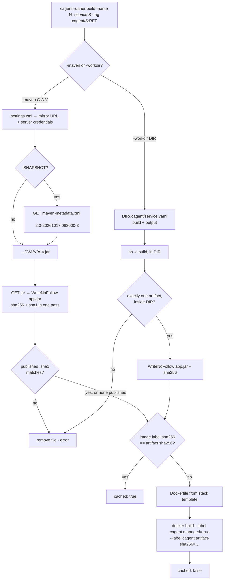
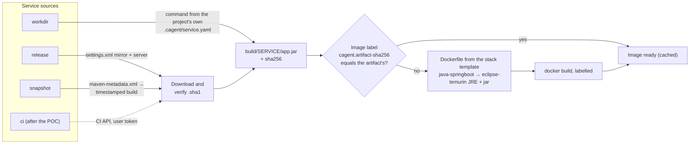

# M4 Artifacts & Builds Implementation Plan

> **For Claude:** REQUIRED SUB-SKILL: Use superpowers:executing-plans to implement this plan task-by-task.

**Goal:** Turn a service's source — a Nexus release, a Nexus snapshot, or the developer's working directory — into a labelled, cached `cagent/<service>:<ref>` image the cluster can run.

**Architecture:** Four additions to the Go Runner. `workspace` gains a streaming, hashing `WriteNoFollow` and per-service build directories. `maven` reads the repository and credentials from `~/.m2/settings.xml`, resolves snapshots through `maven-metadata.xml`, and downloads with `.sha1` verification; `maven/maventest` is a fake Maven-layout repository for tests. `workdir` runs the build command from the project's *own* `.cagent/service.yaml`. `builder` renders the `java-springboot` Dockerfile and skips the build when the image's `cagent.artifact-sha256` label already matches. The CLI gains `build`.

**Tech Stack:** Go 1.24, `go.yaml.in/yaml/v3` (already an indirect dependency), the `docker` CLI, `eclipse-temurin:<jdk>-jre`. No Nexus is needed: tests use `maventest`, because the Runner only ever speaks the standard Maven repository layout.

- Roadmap: [2026-10-17-poc-roadmap.md](2026-10-17-poc-roadmap.md) (M4)
- Design: [2026-10-17-container-agent-design.md](2026-10-17-container-agent-design.md), sections 6.2 and 8

---

## Decisions made while planning

| Decision | Why |
|---|---|
| Repository = first `<mirror>` in `~/.m2/settings.xml` covering `*` or `central`; credentials = `<server>` with the same id | Developers already have this file; the Runner needs no configuration of its own (user decision, 2026-10-17). |
| `${env.VAR}` in credentials is expanded; encrypted `{…}` passwords are rejected with a clear error | Tokens in environment variables are common; Maven's master-password decryption is out of POC scope. |
| Workdir builds run on the host toolchain (user decision), and the command comes only from `<workdir>/.cagent/service.yaml` | Once M5 puts the Runner behind RPC, the platform can name a directory but can never make the Runner run a command the developer did not write. `sh -c` is deliberate here: the input is the developer's own file. |
| The workdir artifact must be exactly one regular file resolving inside the workdir | Stops an output glob or a planted symlink from smuggling in a file from elsewhere. |
| Downloads stream through `WriteNoFollow`, hashed as they are written, and are checked against the published `.sha1` | One pass computes the SHA-256 for the cache and the SHA-1 for integrity; a mismatch or a failed copy leaves no file behind. |
| Cache key = image label `cagent.artifact-sha256`, not the tag | The generator's tag for a snapshot never changes; a new snapshot build must still rebuild. |
| `eclipse-temurin:<jdk>-jre`, JDK 21 by default | Verified on 2026-10-17: the 17 and 21 JRE images ship `curl`, which the generator's HTTP healthcheck needs. |
| `build` reports failures as JSON (`error`, redacted `log`) with exit 1 | The platform diagnoses build failures like any other (M5–M7). |

## How a source becomes an image



## Prerequisites

- Work on a feature branch, not `main`.
- **Go is not installed on the host.** Run unit-test commands in the container: `docker run --rm -v "$PWD":/repo -w /repo/runner golang:1.24 <go command>`.
- **Integration tests and the CLI smoke run on the host** (Docker CLI needed): cross-compile with `GOOS=darwin GOARCH=arm64` in the container, then run the binary. Never mount `docker.sock` into a container.
- **No Java on the host.** Test fixtures compile a tiny Java HTTP service with `eclipse-temurin:17-jdk` in a container. Images pulled on first use: `eclipse-temurin:17-jdk`, `eclipse-temurin:17-jre`, `busybox:1.37`.
- No company network is needed: the fake repository stands in for Nexus.

---

### Task 1: Streaming no-follow writes and build directories

M3's `WriteFile` becomes a thin wrapper over `WriteNoFollow`, which streams, hashes, and removes partial files. `BuildDir` gives each service its own docker build context.

**Files:**
- Modify (full file below): `runner/internal/workspace/workspace.go`
- Test: `runner/internal/workspace/workspace_test.go` (append three tests; add `"errors"` and `"strings"` to its imports)

**Step 1: Write the failing tests** — append to `workspace_test.go`:

```go
func TestBuildDir(t *testing.T) {
	root := t.TempDir()
	w, err := Open(root)
	if err != nil {
		t.Fatal(err)
	}
	dir, err := w.BuildDir("demo", "order-service")
	if err != nil {
		t.Fatal(err)
	}
	if want := filepath.Join(root, "clusters", "demo", "build", "order-service"); dir != want {
		t.Errorf("BuildDir = %s, want %s", dir, want)
	}
	if _, err := w.BuildDir("demo", "../x"); err == nil {
		t.Error("BuildDir accepted ../x")
	}
}

func TestWriteNoFollowHashes(t *testing.T) {
	dir := t.TempDir()
	path, sum, err := WriteNoFollow(dir, "app.jar", strings.NewReader("hello"))
	if err != nil {
		t.Fatal(err)
	}
	// sha256("hello")
	if sum != "2cf24dba5fb0a30e26e83b2ac5b9e29e1b161e5c1fa7425e73043362938b9824" {
		t.Errorf("sha256 = %s", sum)
	}
	if got, _ := os.ReadFile(path); string(got) != "hello" {
		t.Errorf("content = %q", got)
	}
}

type failingReader struct{}

func (failingReader) Read([]byte) (int, error) { return 0, errors.New("connection reset") }

func TestWriteNoFollowRemovesPartialFile(t *testing.T) {
	dir := t.TempDir()
	if _, _, err := WriteNoFollow(dir, "app.jar", failingReader{}); err == nil {
		t.Fatal("want error from failing reader")
	}
	if _, err := os.Stat(filepath.Join(dir, "app.jar")); !os.IsNotExist(err) {
		t.Errorf("partial file left behind: %v", err)
	}
}
```

**Step 2: Run them to verify they fail**

Run: `docker run --rm -v "$PWD":/repo -w /repo/runner golang:1.24 go test ./internal/workspace/`
Expected: FAIL — `w.BuildDir undefined`, `undefined: WriteNoFollow`.

**Step 3: Replace `workspace.go`**

```go
// Package workspace manages the Runner's per-cluster directories under ~/.cagent/clusters.
package workspace

import (
	"bytes"
	"crypto/sha256"
	"encoding/hex"
	"fmt"
	"io"
	"os"
	"path/filepath"
	"regexp"
	"syscall"

	"github.com/yutaofr/container-agent/runner/internal/guard"
)

// namePattern matches cluster names. It also keeps names from looking like CLI flags.
var namePattern = regexp.MustCompile(`^[a-z0-9][a-z0-9_-]*$`)

// ValidName reports whether name can be used as a cluster name.
func ValidName(name string) bool { return namePattern.MatchString(name) }

// Workspace is the Runner's home directory, normally ~/.cagent.
type Workspace struct{ root string }

// Open returns the workspace at root, creating it if needed.
func Open(root string) (*Workspace, error) {
	if err := os.MkdirAll(root, 0o700); err != nil {
		return nil, err
	}
	return &Workspace{root: root}, nil
}

// DefaultRoot is $CAGENT_HOME, or ~/.cagent when it is unset.
func DefaultRoot() (string, error) {
	if r := os.Getenv("CAGENT_HOME"); r != "" {
		return r, nil
	}
	home, err := os.UserHomeDir()
	if err != nil {
		return "", err
	}
	return filepath.Join(home, ".cagent"), nil
}

// ClusterDir returns the directory for one cluster, creating it if needed.
func (w *Workspace) ClusterDir(name string) (string, error) {
	if !ValidName(name) {
		return "", fmt.Errorf("invalid cluster name %q", name)
	}
	dir := filepath.Join(w.root, "clusters", name)
	if err := os.MkdirAll(dir, 0o700); err != nil {
		return "", err
	}
	return dir, nil
}

// WriteFile writes data to file, a plain file name, inside the cluster's directory.
func (w *Workspace) WriteFile(cluster, file string, data []byte) (string, error) {
	dir, err := w.ClusterDir(cluster)
	if err != nil {
		return "", err
	}
	path, _, err := WriteNoFollow(dir, file, bytes.NewReader(data))
	return path, err
}

// BuildDir returns the docker build context for one service of a cluster, creating it
// if needed.
func (w *Workspace) BuildDir(cluster, service string) (string, error) {
	if !ValidName(service) {
		return "", fmt.Errorf("invalid service name %q", service)
	}
	dir, err := w.ClusterDir(cluster)
	if err != nil {
		return "", err
	}
	build := filepath.Join(dir, "build", service)
	if err := os.MkdirAll(build, 0o700); err != nil {
		return "", err
	}
	return build, nil
}

// WriteNoFollow streams r into file, a plain file name inside dir, and returns the path
// and the hex SHA-256 of the bytes written. The guard rejects a path that resolves outside
// dir. The open then uses the declared path, not the resolved one, with O_NOFOLLOW, so it
// refuses any symlink in the final element, including one planted after the check: this
// closes the check-then-write race. A failed copy removes the partial file.
func WriteNoFollow(dir, file string, r io.Reader) (string, string, error) {
	if file != filepath.Base(file) || file == "." || file == ".." {
		return "", "", fmt.Errorf("invalid file name %q", file)
	}
	g, err := guard.New(dir)
	if err != nil {
		return "", "", err
	}
	path := filepath.Join(dir, file)
	if _, err := g.CheckWrite(path); err != nil {
		return "", "", err
	}
	f, err := os.OpenFile(path, os.O_WRONLY|os.O_CREATE|os.O_TRUNC|syscall.O_NOFOLLOW, 0o600)
	if err != nil {
		return "", "", fmt.Errorf("open %s: %w", path, err)
	}
	h := sha256.New()
	_, err = io.Copy(io.MultiWriter(f, h), r)
	if cerr := f.Close(); err == nil {
		err = cerr
	}
	if err != nil {
		os.Remove(path)
		return "", "", fmt.Errorf("write %s: %w", path, err)
	}
	return path, hex.EncodeToString(h.Sum(nil)), nil
}
```

**Step 4: Run tests to verify they pass**

Run: `docker run --rm -v "$PWD":/repo -w /repo/runner golang:1.24 go test ./internal/workspace/ ./internal/cluster/`
Expected: two `ok` lines (cluster still passes through the refactored `WriteFile`).

**Step 5: Commit**

```bash
git add runner/internal/workspace
git commit -m "feat(runner): stream hashed no-follow writes into per-service build dirs"
```

---

### Task 2: Maven settings and coordinates

**Files:**
- Create: `runner/internal/maven/settings.go`, `runner/internal/maven/coords.go`
- Test: `runner/internal/maven/settings_test.go`

**Step 1: Write the failing test**

```go
package maven

import (
	"errors"
	"os"
	"path/filepath"
	"strings"
	"testing"
)

func writeSettings(t *testing.T, body string) string {
	t.Helper()
	path := filepath.Join(t.TempDir(), "settings.xml")
	if err := os.WriteFile(path, []byte(body), 0o600); err != nil {
		t.Fatal(err)
	}
	return path
}

func TestLoadRepoPicksCentralMirrorAndItsServer(t *testing.T) {
	t.Setenv("NEXUS_TOKEN", "s3cret")
	path := writeSettings(t, `<settings xmlns="http://maven.apache.org/SETTINGS/1.0.0">
  <mirrors>
    <mirror><id>internal-only</id><mirrorOf>internal</mirrorOf><url>https://other/</url></mirror>
    <mirror><id>nexus</id><mirrorOf>external:*, central</mirrorOf><url>https://nexus.acme.com/repository/maven-public/</url></mirror>
  </mirrors>
  <servers>
    <server><id>other</id><username>x</username><password>y</password></server>
    <server><id>nexus</id><username>dev</username><password>${env.NEXUS_TOKEN}</password></server>
  </servers>
</settings>`)
	repo, err := LoadRepo(path)
	if err != nil {
		t.Fatal(err)
	}
	want := Repo{ID: "nexus", URL: "https://nexus.acme.com/repository/maven-public", Username: "dev", Password: "s3cret"}
	if repo != want {
		t.Errorf("LoadRepo() = %+v, want %+v", repo, want)
	}
}

func TestLoadRepoErrors(t *testing.T) {
	cases := []struct {
		name, body string
		want       error
		wantText   string
	}{
		{"no usable mirror",
			`<settings><mirrors><mirror><id>a</id><mirrorOf>internal</mirrorOf><url>u</url></mirror></mirrors></settings>`,
			ErrNoMirror, ""},
		{"encrypted password",
			`<settings><mirrors><mirror><id>n</id><mirrorOf>*</mirrorOf><url>u</url></mirror></mirrors>
			 <servers><server><id>n</id><username>u</username><password>{COQLCE6DU6GtcS5P=}</password></server></servers></settings>`,
			ErrEncryptedPassword, ""},
		{"unset env var",
			`<settings><mirrors><mirror><id>n</id><mirrorOf>*</mirrorOf><url>u</url></mirror></mirrors>
			 <servers><server><id>n</id><username>u</username><password>${env.CAGENT_TEST_UNSET}</password></server></servers></settings>`,
			nil, "unset environment variable CAGENT_TEST_UNSET"},
	}
	for _, c := range cases {
		t.Run(c.name, func(t *testing.T) {
			_, err := LoadRepo(writeSettings(t, c.body))
			if c.want != nil && !errors.Is(err, c.want) {
				t.Errorf("got %v, want %v", err, c.want)
			}
			if c.wantText != "" && (err == nil || !strings.Contains(err.Error(), c.wantText)) {
				t.Errorf("got %v, want text %q", err, c.wantText)
			}
		})
	}
}

func TestParseCoord(t *testing.T) {
	c, err := ParseCoord("com.acme:order-service:2.0-SNAPSHOT")
	if err != nil {
		t.Fatal(err)
	}
	if c != (Coord{"com.acme", "order-service", "2.0-SNAPSHOT", "jar"}) || !c.Snapshot() {
		t.Errorf("got %+v", c)
	}
	if c.dir() != "com/acme/order-service/2.0-SNAPSHOT" {
		t.Errorf("dir = %s", c.dir())
	}
	for _, bad := range []string{"a:b", "a:b:c:d:e", "a:..:1", "a:b/c:1", "a:b:1:", "-x:b:1"} {
		if _, err := ParseCoord(bad); err == nil {
			t.Errorf("ParseCoord(%q) accepted", bad)
		}
	}
}
```

**Step 2: Run it to verify it fails**

Run: `docker run --rm -v "$PWD":/repo -w /repo/runner golang:1.24 go test ./internal/maven/`
Expected: FAIL — `undefined: LoadRepo`, `undefined: Repo`, `undefined: ErrNoMirror`, `undefined: ParseCoord`.

**Step 3: Write the implementation**

`runner/internal/maven/settings.go`:

```go
// Package maven downloads artifacts from a Maven-layout repository (Nexus, Artifactory)
// using the repository and credentials the developer already has in ~/.m2/settings.xml.
package maven

import (
	"encoding/xml"
	"errors"
	"fmt"
	"os"
	"path/filepath"
	"regexp"
	"strings"
)

// ErrEncryptedPassword means settings.xml holds a {…} password encrypted with
// settings-security.xml, which the Runner does not decrypt.
var ErrEncryptedPassword = errors.New("encrypted settings.xml passwords are not supported; use a token, or ${env.VAR}")

// ErrNoMirror means settings.xml names no repository the Runner can use.
var ErrNoMirror = errors.New("settings.xml has no <mirror> whose mirrorOf covers * or central")

// Repo is a repository base URL with optional basic-auth credentials.
type Repo struct {
	ID       string
	URL      string
	Username string
	Password string
}

type settings struct {
	Mirrors []struct {
		ID       string `xml:"id"`
		URL      string `xml:"url"`
		MirrorOf string `xml:"mirrorOf"`
	} `xml:"mirrors>mirror"`
	Servers []struct {
		ID       string `xml:"id"`
		Username string `xml:"username"`
		Password string `xml:"password"`
	} `xml:"servers>server"`
}

// DefaultSettingsPath is ~/.m2/settings.xml.
func DefaultSettingsPath() (string, error) {
	home, err := os.UserHomeDir()
	if err != nil {
		return "", err
	}
	return filepath.Join(home, ".m2", "settings.xml"), nil
}

// LoadRepo reads settings.xml and returns the first mirror covering * or central, with
// the credentials of the <server> that has the same id.
func LoadRepo(path string) (Repo, error) {
	data, err := os.ReadFile(path)
	if err != nil {
		return Repo{}, err
	}
	var s settings
	if err := xml.Unmarshal(data, &s); err != nil {
		return Repo{}, fmt.Errorf("parse %s: %w", path, err)
	}
	for _, m := range s.Mirrors {
		if !coversCentral(m.MirrorOf) {
			continue
		}
		repo := Repo{ID: m.ID, URL: strings.TrimRight(strings.TrimSpace(m.URL), "/")}
		for _, srv := range s.Servers {
			if srv.ID != m.ID {
				continue
			}
			if repo.Username, err = expandEnv(strings.TrimSpace(srv.Username)); err != nil {
				return Repo{}, err
			}
			pw := strings.TrimSpace(srv.Password)
			if strings.HasPrefix(pw, "{") && strings.HasSuffix(pw, "}") {
				return Repo{}, fmt.Errorf("server %s: %w", srv.ID, ErrEncryptedPassword)
			}
			if repo.Password, err = expandEnv(pw); err != nil {
				return Repo{}, err
			}
		}
		return repo, nil
	}
	return Repo{}, ErrNoMirror
}

func coversCentral(mirrorOf string) bool {
	for _, part := range strings.Split(mirrorOf, ",") {
		if p := strings.TrimSpace(part); p == "*" || p == "central" || p == "external:*" {
			return true
		}
	}
	return false
}

var envRef = regexp.MustCompile(`\$\{env\.([A-Za-z_][A-Za-z0-9_]*)\}`)

// expandEnv replaces ${env.NAME} with the environment variable, as Maven does.
func expandEnv(s string) (string, error) {
	var missing []string
	out := envRef.ReplaceAllStringFunc(s, func(ref string) string {
		name := envRef.FindStringSubmatch(ref)[1]
		v, ok := os.LookupEnv(name)
		if !ok {
			missing = append(missing, name)
		}
		return v
	})
	if len(missing) > 0 {
		return "", fmt.Errorf("settings.xml references unset environment variable %s", strings.Join(missing, ", "))
	}
	return out, nil
}
```

`runner/internal/maven/coords.go`:

```go
package maven

import (
	"fmt"
	"regexp"
	"strings"
)

// Coord is a Maven artifact coordinate.
type Coord struct {
	Group, Artifact, Version, Ext string
}

// part allows the characters Maven coordinates use, and nothing that could form a path
// segment such as ".." or "/".
var part = regexp.MustCompile(`^[A-Za-z0-9_][A-Za-z0-9_.-]*$`)

// ParseCoord parses "group:artifact:version" or "group:artifact:version:ext" (default jar).
func ParseCoord(s string) (Coord, error) {
	fields := strings.Split(s, ":")
	if len(fields) != 3 && len(fields) != 4 {
		return Coord{}, fmt.Errorf("coordinate %q: want group:artifact:version[:ext]", s)
	}
	c := Coord{Group: fields[0], Artifact: fields[1], Version: fields[2], Ext: "jar"}
	if len(fields) == 4 {
		c.Ext = fields[3]
	}
	for _, f := range []string{c.Group, c.Artifact, c.Version, c.Ext} {
		if !part.MatchString(f) || strings.Contains(f, "..") {
			return Coord{}, fmt.Errorf("coordinate %q: invalid part %q", s, f)
		}
	}
	return c, nil
}

// Snapshot reports whether the version is a -SNAPSHOT that must be resolved.
func (c Coord) Snapshot() bool { return strings.HasSuffix(c.Version, "-SNAPSHOT") }

// dir is the coordinate's directory in the repository layout.
func (c Coord) dir() string {
	return strings.ReplaceAll(c.Group, ".", "/") + "/" + c.Artifact + "/" + c.Version
}

func (c Coord) String() string {
	return c.Group + ":" + c.Artifact + ":" + c.Version + ":" + c.Ext
}
```

**Step 4: Run tests to verify they pass**

Run: `docker run --rm -v "$PWD":/repo -w /repo/runner golang:1.24 go test ./internal/maven/`
Expected: `ok`

**Step 5: Commit**

```bash
git add runner/internal/maven
git commit -m "feat(runner): read the repository and credentials from settings.xml"
```

---

### Task 3: Resolve and download artifacts

**Files:**
- Create: `runner/internal/maven/maventest/maventest.go` (fake repository, also used by Tasks 6 and 7)
- Create: `runner/internal/maven/client.go`
- Test: `runner/internal/maven/client_test.go`

**Step 1: Add the fake repository**

```go
// Package maventest serves a Maven-layout repository with basic auth. It stands in for
// Nexus or Artifactory in tests: the Runner only ever uses the standard repository layout.
package maventest

import (
	"crypto/sha1"
	"encoding/hex"
	"fmt"
	"net/http"
	"net/http/httptest"
	"os"
	"path/filepath"
	"strings"
	"sync"
	"testing"
)

// Repo is a fake repository. Files are served at /<path>; every request needs the
// configured basic-auth credentials.
type Repo struct {
	*httptest.Server
	User, Password string

	mu    sync.Mutex
	files map[string][]byte
}

// New starts a repository and stops it when the test ends.
func New(t testing.TB, user, password string) *Repo {
	r := &Repo{User: user, Password: password, files: map[string][]byte{}}
	r.Server = httptest.NewServer(http.HandlerFunc(r.serve))
	t.Cleanup(r.Close)
	return r
}

func (r *Repo) serve(w http.ResponseWriter, req *http.Request) {
	if u, p, ok := req.BasicAuth(); !ok || u != r.User || p != r.Password {
		w.WriteHeader(http.StatusUnauthorized)
		return
	}
	r.mu.Lock()
	data, ok := r.files[strings.TrimPrefix(req.URL.Path, "/")]
	r.mu.Unlock()
	if !ok {
		http.NotFound(w, req)
		return
	}
	_, _ = w.Write(data)
}

// Put stores data at path, plus path.sha1 when withSHA1 is set.
func (r *Repo) Put(path string, data []byte, withSHA1 bool) {
	r.mu.Lock()
	defer r.mu.Unlock()
	r.files[path] = data
	if withSHA1 {
		sum := sha1.Sum(data)
		r.files[path+".sha1"] = []byte(hex.EncodeToString(sum[:]))
	}
}

// PutRelease stores group:artifact:version as a jar with its .sha1.
func (r *Repo) PutRelease(group, artifact, version string, data []byte) {
	dir := strings.ReplaceAll(group, ".", "/") + "/" + artifact + "/" + version
	r.Put(fmt.Sprintf("%s/%s-%s.jar", dir, artifact, version), data, true)
}

// PutSnapshot stores a timestamped snapshot jar, its .sha1, and maven-metadata.xml, and
// returns the resolved version, e.g. 2.0-20261017.083000-3.
func (r *Repo) PutSnapshot(group, artifact, version, timestamp, build string, data []byte) string {
	dir := strings.ReplaceAll(group, ".", "/") + "/" + artifact + "/" + version
	resolved := strings.TrimSuffix(version, "-SNAPSHOT") + "-" + timestamp + "-" + build
	r.Put(fmt.Sprintf("%s/%s-%s.jar", dir, artifact, resolved), data, true)
	r.Put(dir+"/maven-metadata.xml", []byte(fmt.Sprintf(`<?xml version="1.0" encoding="UTF-8"?>
<metadata modelVersion="1.1.0">
  <groupId>%s</groupId>
  <artifactId>%s</artifactId>
  <version>%s</version>
  <versioning>
    <snapshot><timestamp>%s</timestamp><buildNumber>%s</buildNumber></snapshot>
    <snapshotVersions>
      <snapshotVersion><extension>pom</extension><value>%s</value></snapshotVersion>
      <snapshotVersion><extension>jar</extension><value>%s</value></snapshotVersion>
    </snapshotVersions>
  </versioning>
</metadata>
`, group, artifact, version, timestamp, build, resolved, resolved)), false)
	return resolved
}

// SettingsXML writes a settings.xml into dir whose mirror points at the repository, with
// the repository's credentials, and returns its path.
func (r *Repo) SettingsXML(t testing.TB, dir string) string {
	t.Helper()
	path := filepath.Join(dir, "settings.xml")
	body := fmt.Sprintf(`<settings xmlns="http://maven.apache.org/SETTINGS/1.0.0">
  <mirrors>
    <mirror><id>company-nexus</id><mirrorOf>*</mirrorOf><url>%s/</url></mirror>
  </mirrors>
  <servers>
    <server><id>company-nexus</id><username>%s</username><password>%s</password></server>
  </servers>
</settings>
`, r.URL, r.User, r.Password)
	if err := os.WriteFile(path, []byte(body), 0o600); err != nil {
		t.Fatal(err)
	}
	return path
}
```

**Step 2: Write the failing test**

```go
package maven

import (
	"context"
	"os"
	"path/filepath"
	"strings"
	"testing"

	"github.com/yutaofr/container-agent/runner/internal/maven/maventest"
)

func clientFor(t *testing.T, r *maventest.Repo) Client {
	t.Helper()
	repo, err := LoadRepo(r.SettingsXML(t, t.TempDir()))
	if err != nil {
		t.Fatal(err)
	}
	return Client{Repo: repo}
}

func TestDownloadRelease(t *testing.T) {
	r := maventest.New(t, "dev", "token")
	r.PutRelease("com.acme", "demo", "1.0.0", []byte("release-jar"))
	c := clientFor(t, r)
	ctx := context.Background()

	a, err := c.Resolve(ctx, Coord{"com.acme", "demo", "1.0.0", "jar"})
	if err != nil {
		t.Fatal(err)
	}
	if a.Resolved != "1.0.0" || !strings.HasSuffix(a.URL, "/com/acme/demo/1.0.0/demo-1.0.0.jar") {
		t.Errorf("resolved %+v", a)
	}
	dir := t.TempDir()
	path, sum, err := c.Download(ctx, a, dir, "app.jar")
	if err != nil {
		t.Fatal(err)
	}
	if got, _ := os.ReadFile(path); string(got) != "release-jar" || len(sum) != 64 {
		t.Errorf("content %q, sha256 %q", got, sum)
	}
}

func TestResolveSnapshotToTimestampedBuild(t *testing.T) {
	r := maventest.New(t, "dev", "token")
	want := r.PutSnapshot("com.acme", "demo", "2.0-SNAPSHOT", "20261017.083000", "3", []byte("snap"))
	a, err := clientFor(t, r).Resolve(context.Background(), Coord{"com.acme", "demo", "2.0-SNAPSHOT", "jar"})
	if err != nil {
		t.Fatal(err)
	}
	if a.Resolved != want || want != "2.0-20261017.083000-3" {
		t.Errorf("resolved %q, want %q", a.Resolved, want)
	}
	if !strings.HasSuffix(a.URL, "/2.0-SNAPSHOT/demo-2.0-20261017.083000-3.jar") {
		t.Errorf("url %s", a.URL)
	}
}

func TestDownloadRejectsChecksumMismatch(t *testing.T) {
	r := maventest.New(t, "dev", "token")
	r.PutRelease("com.acme", "demo", "1.0.0", []byte("original"))
	r.Put("com/acme/demo/1.0.0/demo-1.0.0.jar", []byte("tampered"), false) // keeps the old .sha1
	c := clientFor(t, r)
	a, _ := c.Resolve(context.Background(), Coord{"com.acme", "demo", "1.0.0", "jar"})
	dir := t.TempDir()
	if _, _, err := c.Download(context.Background(), a, dir, "app.jar"); err == nil ||
		!strings.Contains(err.Error(), "does not match published") {
		t.Fatalf("got %v, want checksum mismatch", err)
	}
	if _, err := os.Stat(filepath.Join(dir, "app.jar")); !os.IsNotExist(err) {
		t.Error("mismatched download left on disk")
	}
}

func TestDownloadWithoutPublishedChecksum(t *testing.T) {
	r := maventest.New(t, "dev", "token")
	r.Put("com/acme/demo/1.0.0/demo-1.0.0.jar", []byte("no-sha"), false)
	c := clientFor(t, r)
	a, _ := c.Resolve(context.Background(), Coord{"com.acme", "demo", "1.0.0", "jar"})
	if _, _, err := c.Download(context.Background(), a, t.TempDir(), "app.jar"); err != nil {
		t.Fatalf("download without .sha1 failed: %v", err)
	}
}

func TestErrorsNameTheProblem(t *testing.T) {
	r := maventest.New(t, "dev", "token")
	ctx := context.Background()

	bad := clientFor(t, r)
	bad.Repo.Password = "wrong"
	a, _ := bad.Resolve(ctx, Coord{"com.acme", "demo", "1.0.0", "jar"})
	if _, _, err := bad.Download(ctx, a, t.TempDir(), "app.jar"); err == nil ||
		!strings.Contains(err.Error(), `check the <server> credentials for mirror "company-nexus"`) {
		t.Errorf("wrong password: got %v", err)
	}

	c := clientFor(t, r)
	if _, err := c.Resolve(ctx, Coord{"com.acme", "demo", "9.9-SNAPSHOT", "jar"}); err == nil ||
		!strings.Contains(err.Error(), "not found") {
		t.Errorf("missing snapshot: got %v", err)
	}
}
```

**Step 3: Run it to verify it fails**

Run: `docker run --rm -v "$PWD":/repo -w /repo/runner golang:1.24 go test ./internal/maven/`
Expected: FAIL — `undefined: Client`.

**Step 4: Write the implementation**

```go
package maven

import (
	"context"
	"crypto/sha1"
	"encoding/hex"
	"encoding/xml"
	"errors"
	"fmt"
	"io"
	"net/http"
	"os"
	"strings"

	"github.com/yutaofr/container-agent/runner/internal/workspace"
)

// Client fetches artifacts from one repository.
type Client struct {
	Repo Repo
	HTTP *http.Client
}

// Artifact is a coordinate resolved to a concrete version and download URL.
type Artifact struct {
	Coord    Coord
	Resolved string // e.g. 1.4.2, or 2.0-20261017.083000-3 for a snapshot
	URL      string
}

type metadata struct {
	Snapshot struct {
		Timestamp   string `xml:"timestamp"`
		BuildNumber string `xml:"buildNumber"`
	} `xml:"versioning>snapshot"`
	SnapshotVersions []struct {
		Classifier string `xml:"classifier"`
		Extension  string `xml:"extension"`
		Value      string `xml:"value"`
	} `xml:"versioning>snapshotVersions>snapshotVersion"`
}

// Resolve turns a coordinate into a download URL. A -SNAPSHOT version is resolved to its
// latest timestamped build through maven-metadata.xml, so the exact artifact is recorded.
func (c Client) Resolve(ctx context.Context, coord Coord) (Artifact, error) {
	base := c.Repo.URL + "/" + coord.dir()
	resolved := coord.Version
	if coord.Snapshot() {
		body, err := c.get(ctx, base+"/maven-metadata.xml")
		if err != nil {
			return Artifact{}, err
		}
		defer body.Close()
		var md metadata
		if err := xml.NewDecoder(body).Decode(&md); err != nil {
			return Artifact{}, fmt.Errorf("parse snapshot metadata for %s: %w", coord, err)
		}
		if resolved = snapshotValue(md, coord); resolved == "" {
			return Artifact{}, fmt.Errorf("%s: snapshot metadata names no %s build", coord, coord.Ext)
		}
	}
	url := fmt.Sprintf("%s/%s-%s.%s", base, coord.Artifact, resolved, coord.Ext)
	return Artifact{Coord: coord, Resolved: resolved, URL: url}, nil
}

func snapshotValue(md metadata, coord Coord) string {
	for _, v := range md.SnapshotVersions {
		if v.Extension == coord.Ext && v.Classifier == "" {
			return v.Value
		}
	}
	if md.Snapshot.Timestamp != "" && md.Snapshot.BuildNumber != "" {
		base := strings.TrimSuffix(coord.Version, "-SNAPSHOT")
		return base + "-" + md.Snapshot.Timestamp + "-" + md.Snapshot.BuildNumber
	}
	return ""
}

// Download writes the artifact to file inside dir and returns its path and SHA-256. When
// the repository publishes a .sha1 next to the artifact, the download must match it.
func (c Client) Download(ctx context.Context, a Artifact, dir, file string) (string, string, error) {
	body, err := c.get(ctx, a.URL)
	if err != nil {
		return "", "", err
	}
	defer body.Close()
	h := sha1.New()
	path, sum, err := workspace.WriteNoFollow(dir, file, io.TeeReader(body, h))
	if err != nil {
		return "", "", err
	}
	want, err := c.publishedSHA1(ctx, a.URL)
	if err != nil {
		os.Remove(path)
		return "", "", err
	}
	if got := hex.EncodeToString(h.Sum(nil)); want != "" && want != got {
		os.Remove(path)
		return "", "", fmt.Errorf("%s: sha1 %s does not match published %s", a.URL, got, want)
	}
	return path, sum, nil
}

// publishedSHA1 returns the repository's .sha1 for url, or "" when it has none.
func (c Client) publishedSHA1(ctx context.Context, url string) (string, error) {
	body, err := c.get(ctx, url+".sha1")
	if err != nil {
		var nf errNotFound
		if errors.As(err, &nf) {
			return "", nil
		}
		return "", err
	}
	defer body.Close()
	data, err := io.ReadAll(io.LimitReader(body, 1024))
	if err != nil {
		return "", err
	}
	// The file holds the hex digest, sometimes followed by the file name.
	fields := strings.Fields(string(data))
	if len(fields) == 0 {
		return "", fmt.Errorf("%s.sha1 is empty", url)
	}
	return strings.ToLower(fields[0]), nil
}

type errNotFound struct{ url string }

func (e errNotFound) Error() string { return e.url + ": not found" }

func (c Client) get(ctx context.Context, url string) (io.ReadCloser, error) {
	req, err := http.NewRequestWithContext(ctx, http.MethodGet, url, nil)
	if err != nil {
		return nil, err
	}
	if c.Repo.Username != "" {
		req.SetBasicAuth(c.Repo.Username, c.Repo.Password)
	}
	httpc := c.HTTP
	if httpc == nil {
		httpc = http.DefaultClient
	}
	resp, err := httpc.Do(req)
	if err != nil {
		return nil, err
	}
	switch {
	case resp.StatusCode == http.StatusOK:
		return resp.Body, nil
	case resp.StatusCode == http.StatusNotFound:
		resp.Body.Close()
		return nil, errNotFound{url}
	case resp.StatusCode == http.StatusUnauthorized || resp.StatusCode == http.StatusForbidden:
		resp.Body.Close()
		return nil, fmt.Errorf("%s: %s; check the <server> credentials for mirror %q", url, resp.Status, c.Repo.ID)
	default:
		resp.Body.Close()
		return nil, fmt.Errorf("%s: %s", url, resp.Status)
	}
}
```

**Step 5: Run tests to verify they pass**

Run: `docker run --rm -v "$PWD":/repo -w /repo/runner golang:1.24 go test ./internal/maven/...`
Expected: `ok` for `maven`; `maventest` has no tests.

**Step 6: Commit**

```bash
git add runner/internal/maven
git commit -m "feat(runner): resolve snapshots and download artifacts with checksum checks"
```

---

### Task 4: Working-directory builds

**Files:**
- Create: `runner/internal/workdir/workdir.go`
- Test: `runner/internal/workdir/workdir_test.go`
- Modify: `runner/go.mod`, `runner/go.sum` (YAML becomes a direct dependency)

**Step 1: Write the failing test**

```go
package workdir

import (
	"context"
	"errors"
	"os"
	"path/filepath"
	"strings"
	"testing"
)

// project creates a working directory with a descriptor using build and output.
func project(t *testing.T, build, output string) string {
	t.Helper()
	dir := t.TempDir()
	if err := os.MkdirAll(filepath.Join(dir, ".cagent"), 0o755); err != nil {
		t.Fatal(err)
	}
	desc := "name: demo\nkind: app\nstack: java-springboot\nsources:\n  workdir:\n" +
		"    build: '" + build + "'\n    output: '" + output + "'\nruntime: {}\n"
	if err := os.WriteFile(filepath.Join(dir, DescriptorPath), []byte(desc), 0o644); err != nil {
		t.Fatal(err)
	}
	return dir
}

func build(t *testing.T, dir string) (string, error) {
	t.Helper()
	d, err := LoadDescriptor(dir)
	if err != nil {
		t.Fatal(err)
	}
	return Build(context.Background(), dir, d)
}

func TestBuildReturnsTheArtifact(t *testing.T) {
	dir := project(t, "mkdir -p target && echo jar > target/demo.jar && echo x > target/demo.jar.original", "target/*.jar")
	got, err := build(t, dir)
	if err != nil {
		t.Fatal(err)
	}
	if filepath.Base(got) != "demo.jar" {
		t.Errorf("artifact = %s", got)
	}
}

func TestBuildFailureCarriesRedactedLog(t *testing.T) {
	dir := project(t, "echo compiling; echo password=hunter2; echo BUILD FAILURE; exit 1", "target/*.jar")
	_, err := build(t, dir)
	var be *BuildError
	if !errors.As(err, &be) {
		t.Fatalf("got %v, want BuildError", err)
	}
	log := strings.Join(be.Log, "\n")
	if strings.Contains(log, "hunter2") || !strings.Contains(log, "BUILD FAILURE") {
		t.Errorf("log = %q", log)
	}
}

func TestBuildNeedsExactlyOneArtifact(t *testing.T) {
	dir := project(t, "mkdir -p target && touch target/a.jar target/a-sources.jar", "target/*.jar")
	if _, err := build(t, dir); err == nil || !strings.Contains(err.Error(), "matched 2 files") {
		t.Errorf("got %v", err)
	}
}

func TestBuildOutputMustStayInside(t *testing.T) {
	outside := t.TempDir()
	if err := os.WriteFile(filepath.Join(outside, "evil.jar"), []byte("x"), 0o644); err != nil {
		t.Fatal(err)
	}
	dir := project(t, "mkdir -p target && ln -sf "+outside+"/evil.jar target/app.jar", "target/*.jar")
	if _, err := build(t, dir); err == nil || !strings.Contains(err.Error(), "resolves outside") {
		t.Errorf("symlinked artifact: got %v", err)
	}
}

func TestLoadDescriptorNeedsWorkdirSource(t *testing.T) {
	dir := t.TempDir()
	if err := os.MkdirAll(filepath.Join(dir, ".cagent"), 0o755); err != nil {
		t.Fatal(err)
	}
	body := "name: demo\nsources:\n  release: { nexus: 'a:b:{version}:jar' }\n"
	if err := os.WriteFile(filepath.Join(dir, DescriptorPath), []byte(body), 0o644); err != nil {
		t.Fatal(err)
	}
	if _, err := LoadDescriptor(dir); err == nil || !strings.Contains(err.Error(), "needs build and output") {
		t.Errorf("got %v", err)
	}
	if _, err := LoadDescriptor(t.TempDir()); err == nil {
		t.Error("missing descriptor accepted")
	}
}
```

**Step 2: Run it to verify it fails**

Run: `docker run --rm -v "$PWD":/repo -w /repo/runner golang:1.24 go test ./internal/workdir/`
Expected: FAIL — `undefined: DescriptorPath`, `undefined: LoadDescriptor`, `undefined: Build`, `undefined: BuildError`.

**Step 3: Write the implementation**

```go
// Package workdir builds a project in the developer's working directory with their own
// toolchain. The build command comes only from the project's .cagent/service.yaml in that
// directory, never from the platform: the platform can name a directory to build, but it
// cannot make the Runner run a command the developer did not write.
package workdir

import (
	"bytes"
	"context"
	"fmt"
	"os"
	"os/exec"
	"path/filepath"
	"strings"

	"go.yaml.in/yaml/v3"

	"github.com/yutaofr/container-agent/runner/internal/guard"
	"github.com/yutaofr/container-agent/runner/internal/redact"
)

// DescriptorPath is where a project keeps its descriptor, relative to its root.
const DescriptorPath = ".cagent/service.yaml"

// LogTail is how many redacted lines of a failed build's output are reported.
const LogTail = 40

// Descriptor is the part of service.yaml the Runner needs. The platform validates the
// full schema; unknown keys are ignored here.
type Descriptor struct {
	Name    string `yaml:"name"`
	Stack   string `yaml:"stack"`
	Sources struct {
		Workdir *struct {
			Build  string `yaml:"build"`
			Output string `yaml:"output"`
		} `yaml:"workdir"`
	} `yaml:"sources"`
}

// LoadDescriptor reads dir/.cagent/service.yaml and checks it declares a workdir source.
func LoadDescriptor(dir string) (Descriptor, error) {
	path := filepath.Join(dir, DescriptorPath)
	data, err := os.ReadFile(path)
	if err != nil {
		return Descriptor{}, err
	}
	var d Descriptor
	if err := yaml.Unmarshal(data, &d); err != nil {
		return Descriptor{}, fmt.Errorf("parse %s: %w", path, err)
	}
	if w := d.Sources.Workdir; w == nil || w.Build == "" || w.Output == "" {
		return Descriptor{}, fmt.Errorf("%s: sources.workdir needs build and output", path)
	}
	return d, nil
}

// BuildError is a failed build with the redacted tail of its output.
type BuildError struct {
	Err error
	Log []string
}

func (e *BuildError) Error() string {
	return fmt.Sprintf("build failed: %v\n%s", e.Err, strings.Join(e.Log, "\n"))
}

func (e *BuildError) Unwrap() error { return e.Err }

// Build runs the descriptor's build command in dir and returns the single artifact its
// output glob matches. The artifact must resolve inside dir.
func Build(ctx context.Context, dir string, d Descriptor) (string, error) {
	cmd := exec.CommandContext(ctx, "sh", "-c", d.Sources.Workdir.Build)
	cmd.Dir = dir
	out, err := cmd.CombinedOutput()
	if err != nil {
		return "", &BuildError{Err: err, Log: tail(out)}
	}
	matches, err := filepath.Glob(filepath.Join(dir, d.Sources.Workdir.Output))
	if err != nil {
		return "", err
	}
	if len(matches) != 1 {
		return "", fmt.Errorf("output %q matched %d files, want exactly 1: %v", d.Sources.Workdir.Output, len(matches), matches)
	}
	root, err := guard.Resolve(dir)
	if err != nil {
		return "", err
	}
	artifact, err := guard.Resolve(matches[0])
	if err != nil {
		return "", err
	}
	if !guard.Within(root, artifact) {
		return "", fmt.Errorf("output %s resolves outside %s", matches[0], dir)
	}
	if fi, err := os.Stat(artifact); err != nil || !fi.Mode().IsRegular() {
		return "", fmt.Errorf("output %s is not a regular file", matches[0])
	}
	return artifact, nil
}

// tail returns the last LogTail non-empty lines of out, redacted.
func tail(out []byte) []string {
	var lines []string
	for _, l := range bytes.Split(out, []byte("\n")) {
		if s := strings.TrimRight(string(l), "\r "); s != "" {
			lines = append(lines, redact.String(s))
		}
	}
	if len(lines) > LogTail {
		lines = lines[len(lines)-LogTail:]
	}
	return lines
}
```

**Step 4: Promote the YAML dependency and run the tests**

Run: `docker run --rm -v "$PWD":/repo -w /repo/runner golang:1.24 sh -c 'go get go.yaml.in/yaml/v3@v3.0.5 && go mod tidy && go test ./internal/workdir/'`
Expected: `ok`; `go.mod` now lists `go.yaml.in/yaml/v3 v3.0.5` as a direct requirement.

**Step 5: Commit**

```bash
git add runner/go.mod runner/go.sum runner/internal/workdir
git commit -m "feat(runner): build working directories with the project's own command"
```

---

### Task 5: Stack templates and cached image builds

**Files:**
- Create: `runner/internal/builder/builder.go`
- Test: `runner/internal/builder/builder_test.go`

**Step 1: Write the failing test**

```go
package builder

import (
	"context"
	"errors"
	"os"
	"path/filepath"
	"strings"
	"testing"

	"github.com/yutaofr/container-agent/runner/internal/dockercli"
)

const (
	tag     = "cagent/order-service:release-1.4.2"
	sha     = "abc123"
	inspect = `image inspect --format {{index .Config.Labels "cagent.artifact-sha256"}} ` + tag
)

func buildCmd(dir string) string {
	return "build -t " + tag + " --label cagent.managed=true --label cagent.artifact-sha256=" + sha +
		" -f " + filepath.Join(dir, "Dockerfile") + " " + dir
}

func TestDockerfile(t *testing.T) {
	df, err := Dockerfile("java-springboot", "17")
	if err != nil {
		t.Fatal(err)
	}
	for _, want := range []string{"FROM eclipse-temurin:17-jre", "COPY app.jar /app/app.jar", "exec java $JAVA_OPTS -jar /app/app.jar"} {
		if !strings.Contains(df, want) {
			t.Errorf("Dockerfile lacks %q:\n%s", want, df)
		}
	}
	if _, err := Dockerfile("cobol", "17"); err == nil {
		t.Error("unknown stack accepted")
	}
	if _, err := Dockerfile("java-springboot", "17; rm -rf /"); err == nil {
		t.Error("bad jdk accepted")
	}
}

func TestBuildWritesDockerfileAndBuilds(t *testing.T) {
	dir := t.TempDir()
	f := &dockercli.Fake{Responses: map[string]dockercli.FakeResponse{
		inspect:       {Err: errors.New("No such image")},
		buildCmd(dir): {Out: "Successfully built"},
	}}
	cached, err := Build(context.Background(), f, Request{Tag: tag, Stack: "java-springboot", Dir: dir, SHA256: sha})
	if err != nil || cached {
		t.Fatalf("got cached=%v err=%v", cached, err)
	}
	df, _ := os.ReadFile(filepath.Join(dir, "Dockerfile"))
	if !strings.Contains(string(df), "eclipse-temurin:"+DefaultJDK+"-jre") {
		t.Errorf("Dockerfile not written with default JDK:\n%s", df)
	}
}

func TestBuildReusesImageWithSameArtifact(t *testing.T) {
	f := &dockercli.Fake{Responses: map[string]dockercli.FakeResponse{inspect: {Out: sha + "\n"}}}
	cached, err := Build(context.Background(), f, Request{Tag: tag, Stack: "java-springboot", Dir: t.TempDir(), SHA256: sha})
	if err != nil || !cached {
		t.Fatalf("got cached=%v err=%v", cached, err)
	}
	if len(f.Calls) != 1 {
		t.Errorf("build ran despite cache hit: %v", f.Calls)
	}
}

func TestBuildRebuildsWhenArtifactChanged(t *testing.T) {
	dir := t.TempDir()
	f := &dockercli.Fake{Responses: map[string]dockercli.FakeResponse{
		inspect:       {Out: "old-sha\n"},
		buildCmd(dir): {},
	}}
	if cached, err := Build(context.Background(), f, Request{Tag: tag, Stack: "java-springboot", Dir: dir, SHA256: sha}); err != nil || cached {
		t.Fatalf("got cached=%v err=%v", cached, err)
	}
}

func TestBuildFailureCarriesRedactedLog(t *testing.T) {
	dir := t.TempDir()
	f := &dockercli.Fake{Responses: map[string]dockercli.FakeResponse{
		inspect:       {Err: errors.New("No such image")},
		buildCmd(dir): {Out: "step 1\nERROR: pull access denied token=abc\n", Err: errors.New("exit 1")},
	}}
	_, err := Build(context.Background(), f, Request{Tag: tag, Stack: "java-springboot", Dir: dir, SHA256: sha})
	var be *BuildError
	if !errors.As(err, &be) || strings.Contains(strings.Join(be.Log, "\n"), "abc") {
		t.Fatalf("got %v", err)
	}
}

func TestBuildRejectsForeignTags(t *testing.T) {
	f := &dockercli.Fake{}
	for _, bad := range []string{"nginx:latest", "cagent/x", "cagent/X:1", "cagent/x:-flag", "registry.io/cagent/x:1"} {
		if _, err := Build(context.Background(), f, Request{Tag: bad, Stack: "java-springboot", Dir: t.TempDir()}); err == nil {
			t.Errorf("tag %q accepted", bad)
		}
	}
	if len(f.Calls) != 0 {
		t.Errorf("docker called: %v", f.Calls)
	}
}
```

**Step 2: Run it to verify it fails**

Run: `docker run --rm -v "$PWD":/repo -w /repo/runner golang:1.24 go test ./internal/builder/`
Expected: FAIL — `undefined: Dockerfile`, `undefined: Build`, `undefined: Request`, `undefined: DefaultJDK`, `undefined: BuildError`.

**Step 3: Write the implementation**

```go
// Package builder turns a local artifact into a labelled image with a stack template.
package builder

import (
	"bytes"
	"context"
	"fmt"
	"regexp"
	"strings"

	"github.com/yutaofr/container-agent/runner/internal/dockercli"
	"github.com/yutaofr/container-agent/runner/internal/redact"
	"github.com/yutaofr/container-agent/runner/internal/workspace"
)

// LabelArtifactSHA records which artifact an image was built from. A matching label means
// the image is current and the build is skipped.
const LabelArtifactSHA = "cagent.artifact-sha256"

// ArtifactFile is the artifact's name inside the build context.
const ArtifactFile = "app.jar"

// DefaultJDK is the Java major version used when the request names none.
const DefaultJDK = "21"

// tagPattern confines builds to the cagent/ namespace the generator uses.
var tagPattern = regexp.MustCompile(`^cagent/[a-z0-9][a-z0-9_-]*:[A-Za-z0-9_][A-Za-z0-9_.-]{0,127}$`)

// ValidTag reports whether tag is in the cagent/ namespace builds are confined to.
func ValidTag(tag string) bool { return tagPattern.MatchString(tag) }

var jdkPattern = regexp.MustCompile(`^[0-9]{1,3}$`)

var templates = map[string]string{
	// eclipse-temurin JRE images ship curl, which the generated HTTP healthchecks use.
	"java-springboot": `# Generated by cagent-runner for stack java-springboot. Do not edit.
FROM eclipse-temurin:{{jdk}}-jre
WORKDIR /app
COPY ` + ArtifactFile + ` /app/` + ArtifactFile + `
ENTRYPOINT ["sh", "-c", "exec java $JAVA_OPTS -jar /app/` + ArtifactFile + `"]
`,
}

// Dockerfile renders the template for stack.
func Dockerfile(stack, jdk string) (string, error) {
	t, ok := templates[stack]
	if !ok {
		return "", fmt.Errorf("unsupported stack %q", stack)
	}
	if !jdkPattern.MatchString(jdk) {
		return "", fmt.Errorf("invalid jdk %q", jdk)
	}
	return strings.ReplaceAll(t, "{{jdk}}", jdk), nil
}

// Request describes one image build. Dir must already hold ArtifactFile.
type Request struct {
	Tag    string
	Stack  string
	JDK    string // DefaultJDK when empty
	Dir    string
	SHA256 string // of ArtifactFile
}

// BuildError is a failed docker build with the redacted tail of its output.
type BuildError struct {
	Err error
	Log []string
}

func (e *BuildError) Error() string {
	return fmt.Sprintf("docker build failed: %v\n%s", e.Err, strings.Join(e.Log, "\n"))
}

func (e *BuildError) Unwrap() error { return e.Err }

// Build builds req.Tag unless an image with that tag was already built from the same
// artifact. It reports whether the existing image was reused.
func Build(ctx context.Context, d dockercli.Docker, req Request) (bool, error) {
	if !ValidTag(req.Tag) {
		return false, fmt.Errorf("invalid image tag %q: must be cagent/<service>:<ref>", req.Tag)
	}
	if req.JDK == "" {
		req.JDK = DefaultJDK
	}
	df, err := Dockerfile(req.Stack, req.JDK)
	if err != nil {
		return false, err
	}
	// A missing image makes inspect fail; that just means there is nothing to reuse.
	current, err := d.Output(ctx, "image", "inspect", "--format",
		`{{index .Config.Labels "`+LabelArtifactSHA+`"}}`, req.Tag)
	if err == nil && strings.TrimSpace(string(current)) == req.SHA256 {
		return true, nil
	}
	dfPath, _, err := workspace.WriteNoFollow(req.Dir, "Dockerfile", strings.NewReader(df))
	if err != nil {
		return false, err
	}
	out, err := d.Combined(ctx, "build", "-t", req.Tag,
		"--label", "cagent.managed=true", "--label", LabelArtifactSHA+"="+req.SHA256,
		"-f", dfPath, req.Dir)
	if err != nil {
		return false, &BuildError{Err: err, Log: tail(out, 30)}
	}
	return false, nil
}

func tail(out []byte, n int) []string {
	var lines []string
	for _, l := range bytes.Split(out, []byte("\n")) {
		if s := strings.TrimSpace(string(l)); s != "" {
			lines = append(lines, redact.String(s))
		}
	}
	if len(lines) > n {
		lines = lines[len(lines)-n:]
	}
	return lines
}
```

**Step 4: Run tests to verify they pass**

Run: `docker run --rm -v "$PWD":/repo -w /repo/runner golang:1.24 go test ./internal/builder/`
Expected: `ok`

**Step 5: Commit**

```bash
git add runner/internal/builder
git commit -m "feat(runner): build labelled images from stack templates with an artifact cache"
```

---

### Task 6: `build` subcommand

**Files:**
- Modify (full file below): `runner/cmd/cagent-runner/main.go`
- Test: `runner/cmd/cagent-runner/build_test.go`

**Step 1: Write the failing test**

```go
package main

import (
	"bytes"
	"crypto/sha256"
	"encoding/hex"
	"encoding/json"
	"errors"
	"os"
	"path/filepath"
	"testing"

	"github.com/yutaofr/container-agent/runner/internal/dockercli"
	"github.com/yutaofr/container-agent/runner/internal/maven/maventest"
)

const (
	webTag     = "cagent/web:release-1.0.0"
	inspectWeb = `image inspect --format {{index .Config.Labels "cagent.artifact-sha256"}} ` + webTag
)

// buildDeps returns deps whose docker treats the image as missing and accepts any
// `docker build` of webTag into the web build dir.
func buildDeps(t *testing.T) (deps, *dockercli.Fake, string) {
	t.Helper()
	d, f, root := withDocker(t, nil)
	f.Responses = map[string]dockercli.FakeResponse{inspectWeb: {Err: errors.New("No such image")}}
	return d, f, filepath.Join(root, "clusters", "demo", "build", "web")
}

func expectBuild(f *dockercli.Fake, dir, sha string) {
	f.Responses["build -t "+webTag+" --label cagent.managed=true --label cagent.artifact-sha256="+sha+
		" -f "+filepath.Join(dir, "Dockerfile")+" "+dir] = dockercli.FakeResponse{}
}

func runBuildCmd(t *testing.T, d deps, args ...string) (int, BuildResult, string) {
	t.Helper()
	var out, errOut bytes.Buffer
	code := run(append([]string{"build", "-name", "demo", "-service", "web", "-tag", webTag}, args...), &out, &errOut, d)
	var res BuildResult
	if out.Len() > 0 {
		if err := json.Unmarshal(out.Bytes(), &res); err != nil {
			t.Fatalf("bad JSON %q: %v", out.String(), err)
		}
	}
	return code, res, errOut.String()
}

func sha256Hex(s string) string {
	sum := sha256.Sum256([]byte(s))
	return hex.EncodeToString(sum[:])
}

func TestBuildFromMavenRelease(t *testing.T) {
	repo := maventest.New(t, "dev", "token")
	repo.PutRelease("com.acme", "web", "1.0.0", []byte("release-jar"))
	settings := repo.SettingsXML(t, t.TempDir())
	d, f, dir := buildDeps(t)
	expectBuild(f, dir, sha256Hex("release-jar"))

	code, res, stderr := runBuildCmd(t, d, "-maven", "com.acme:web:1.0.0", "-settings", settings)
	if code != exitOK {
		t.Fatalf("exit %d, stderr %s, res %+v", code, stderr, res)
	}
	if res.Version != "1.0.0" || res.Source != "maven:com.acme:web:1.0.0:jar" || res.Cached {
		t.Errorf("result %+v", res)
	}
	if got, _ := os.ReadFile(filepath.Join(dir, "app.jar")); string(got) != "release-jar" {
		t.Errorf("artifact = %q", got)
	}
}

func TestBuildFromMavenSnapshotReportsResolvedVersion(t *testing.T) {
	repo := maventest.New(t, "dev", "token")
	want := repo.PutSnapshot("com.acme", "web", "2.0-SNAPSHOT", "20261017.083000", "3", []byte("snap"))
	d, _, _ := buildDeps(t)
	_, res, _ := runBuildCmd(t, d, "-maven", "com.acme:web:2.0-SNAPSHOT", "-settings", repo.SettingsXML(t, t.TempDir()))
	if res.Version != want {
		t.Errorf("version %q, want %q", res.Version, want)
	}
}

func TestBuildFromWorkdir(t *testing.T) {
	proj := t.TempDir()
	if err := os.MkdirAll(filepath.Join(proj, ".cagent"), 0o755); err != nil {
		t.Fatal(err)
	}
	desc := "name: web\nstack: java-springboot\nsources:\n  workdir:\n" +
		"    build: 'mkdir -p target && printf release-jar > target/web.jar'\n    output: 'target/*.jar'\n"
	if err := os.WriteFile(filepath.Join(proj, ".cagent", "service.yaml"), []byte(desc), 0o644); err != nil {
		t.Fatal(err)
	}
	d, f, dir := buildDeps(t)
	expectBuild(f, dir, sha256Hex("release-jar"))
	code, res, stderr := runBuildCmd(t, d, "-workdir", proj)
	if code != exitOK || res.Source != "workdir:"+proj {
		t.Fatalf("exit %d, stderr %s, res %+v", code, stderr, res)
	}
}

func TestBuildFromWorkdirFailureReportsLog(t *testing.T) {
	proj := t.TempDir()
	if err := os.MkdirAll(filepath.Join(proj, ".cagent"), 0o755); err != nil {
		t.Fatal(err)
	}
	desc := "name: web\nsources:\n  workdir:\n    build: 'echo token=abc; echo COMPILATION ERROR; exit 1'\n    output: 'target/*.jar'\n"
	if err := os.WriteFile(filepath.Join(proj, ".cagent", "service.yaml"), []byte(desc), 0o644); err != nil {
		t.Fatal(err)
	}
	d, f, _ := buildDeps(t)
	code, res, _ := runBuildCmd(t, d, "-workdir", proj)
	if code != exitFindings || len(res.Log) != 2 || res.Log[0] != "token=******" || res.Log[1] != "COMPILATION ERROR" {
		t.Fatalf("exit %d, res %+v", code, res)
	}
	if len(f.Calls) != 0 {
		t.Errorf("docker called after a failed build: %v", f.Calls)
	}
}

func TestBuildArgumentErrors(t *testing.T) {
	for _, args := range [][]string{
		{"build", "-name", "demo", "-service", "web", "-tag", webTag},
		{"build", "-name", "demo", "-service", "web", "-tag", webTag, "-maven", "a:b:1", "-workdir", "."},
		{"build", "-name", "demo", "-service", "web", "-tag", "nginx:latest", "-maven", "a:b:1"},
		{"build", "-name", "demo", "-service", "../x", "-tag", webTag, "-maven", "a:b:1"},
	} {
		var out, errOut bytes.Buffer
		if code := run(args, &out, &errOut, testDeps(t)); code != exitError {
			t.Errorf("%v: exit %d, want %d", args, code, exitError)
		}
	}
}
```

**Step 2: Run it to verify it fails**

Run: `docker run --rm -v "$PWD":/repo -w /repo/runner golang:1.24 go test ./cmd/cagent-runner/`
Expected: FAIL — `undefined: BuildResult`.

**Step 3: Replace `main.go`**

Changes from M3: the usage line, `"build": runBuild` in the dispatch map, `BuildResult`, `runBuild`, and the `errors`, `builder`, `maven`, `workdir` imports. Everything else is unchanged.

```go
// Command cagent-runner executes whitelisted cluster operations on the user's machine.
package main

import (
	"context"
	"encoding/json"
	"errors"
	"flag"
	"fmt"
	"io"
	"os"
	"path/filepath"
	"strings"

	"github.com/compose-spec/compose-go/v2/types"

	"github.com/yutaofr/container-agent/runner/internal/builder"
	"github.com/yutaofr/container-agent/runner/internal/cluster"
	"github.com/yutaofr/container-agent/runner/internal/compose"
	"github.com/yutaofr/container-agent/runner/internal/dockercli"
	"github.com/yutaofr/container-agent/runner/internal/maven"
	"github.com/yutaofr/container-agent/runner/internal/signals"
	"github.com/yutaofr/container-agent/runner/internal/verify"
	"github.com/yutaofr/container-agent/runner/internal/workdir"
	"github.com/yutaofr/container-agent/runner/internal/workspace"
)

// Exit codes shared by every subcommand.
const (
	exitOK       = 0
	exitFindings = 1 // validation findings, or a cluster that failed verification
	exitError    = 2
)

const usage = `usage:
  cagent-runner validate -f compose.yaml [-name N] [-workspace DIR] [-allow svc:rule,...]
  cagent-runner up       -name N -f compose.yaml [-workspace DIR] [-allow svc:rule,...]
  cagent-runner snapshot -name N
  cagent-runner verify   -name N [-probes probes.json]
  cagent-runner down     -name N
  cagent-runner build    -name N -service S -tag cagent/S:REF (-maven G:A:V[:EXT] [-settings F] | -workdir DIR) [-stack S] [-jdk V]`

// Report is the JSON that validate prints, and that up prints when it refuses to start.
type Report struct {
	Project       string                 `json:"project"`
	Findings      []compose.Finding      `json:"findings"`
	PortConflicts []compose.PortConflict `json:"port_conflicts"`
}

// deps are the process-level dependencies, injected so tests can replace them.
type deps struct {
	free   func(int) bool
	docker dockercli.Docker
	home   func() (string, error)
}

func main() {
	d := deps{free: compose.TCPPortFree, docker: dockercli.Exec{}, home: workspace.DefaultRoot}
	os.Exit(run(os.Args[1:], os.Stdout, os.Stderr, d))
}

// run is main without process globals, so tests can drive it.
func run(args []string, stdout, stderr io.Writer, d deps) int {
	if len(args) == 0 {
		fmt.Fprintln(stderr, usage)
		return exitError
	}
	cmds := map[string]func([]string, io.Writer, io.Writer, deps) int{
		"validate": runValidate, "up": runUp, "snapshot": runSnapshot, "verify": runVerify, "down": runDown,
		"build": runBuild,
	}
	cmd, ok := cmds[args[0]]
	if !ok {
		fmt.Fprintln(stderr, usage)
		return exitError
	}
	return cmd(args[1:], stdout, stderr, d)
}

// composeFlags are shared by validate and up.
type composeFlags struct {
	file, name, workspace, allow *string
}

func addComposeFlags(fs *flag.FlagSet, defaultName string) composeFlags {
	return composeFlags{
		file:      fs.String("f", "compose.yaml", "compose file"),
		name:      fs.String("name", defaultName, "cluster name"),
		workspace: fs.String("workspace", "", "directory bind mounts may use (default: compose file dir)"),
		allow:     fs.String("allow", "", "approved exceptions, comma-separated service:rule"),
	}
}

// check loads a compose file under project and runs every validation. The returned
// project is the loaded one, ready to start when the report is clean.
func check(cf composeFlags, project string, free func(int) bool) (*types.Project, Report, error) {
	abs, err := filepath.Abs(*cf.file)
	if err != nil {
		return nil, Report{}, err
	}
	ws := *cf.workspace
	if ws == "" {
		ws = filepath.Dir(abs)
	}
	allow := map[string]bool{}
	for _, a := range strings.Split(*cf.allow, ",") {
		if a = strings.TrimSpace(a); a != "" {
			allow[a] = true
		}
	}
	ctx := context.Background()
	p, err := compose.Load(ctx, abs, project)
	if err != nil {
		return nil, Report{}, err
	}
	fields, err := compose.LoadFields(ctx, abs, project)
	if err != nil {
		return nil, Report{}, err
	}
	// Specific rules run unfiltered so the field check knows which keys they already cover;
	// approvals apply once, to the combined list.
	specific := compose.Lint(p, []string{ws}, nil)
	all := append(specific, compose.UnreviewedFields(fields, specific)...)
	rep := Report{
		Project:       p.Name,
		Findings:      compose.WithoutApproved(all, allow),
		PortConflicts: compose.HostPortConflicts(p, free),
	}
	return p, rep, nil
}

func (r Report) clean() bool { return len(r.Findings) == 0 && len(r.PortConflicts) == 0 }

func runValidate(args []string, stdout, stderr io.Writer, d deps) int {
	fs := flag.NewFlagSet("validate", flag.ContinueOnError)
	fs.SetOutput(stderr)
	cf := addComposeFlags(fs, "validate")
	if err := fs.Parse(args); err != nil {
		return exitError
	}
	_, rep, err := check(cf, *cf.name, d.free)
	if err != nil {
		fmt.Fprintln(stderr, err)
		return exitError
	}
	if err := writeJSON(stdout, rep); err != nil {
		fmt.Fprintln(stderr, err)
		return exitError
	}
	if !rep.clean() {
		return exitFindings
	}
	return exitOK
}

func runUp(args []string, stdout, stderr io.Writer, d deps) int {
	fs := flag.NewFlagSet("up", flag.ContinueOnError)
	fs.SetOutput(stderr)
	cf := addComposeFlags(fs, "")
	if err := fs.Parse(args); err != nil {
		return exitError
	}
	if !workspace.ValidName(*cf.name) {
		fmt.Fprintf(stderr, "invalid or missing -name %q\n", *cf.name)
		return exitError
	}
	p, rep, err := check(cf, cluster.Project(*cf.name), d.free)
	if err != nil {
		fmt.Fprintln(stderr, err)
		return exitError
	}
	if !rep.clean() {
		fmt.Fprintln(stderr, "refusing to start: validation findings")
		_ = writeJSON(stdout, rep)
		return exitFindings
	}
	w, err := openWorkspace(d)
	if err != nil {
		fmt.Fprintln(stderr, err)
		return exitError
	}
	path, err := cluster.Up(context.Background(), d.docker, w, *cf.name, p)
	if err != nil {
		fmt.Fprintln(stderr, err)
		return exitError
	}
	return writeOrFail(stdout, stderr, map[string]string{"project": cluster.Project(*cf.name), "compose": path})
}

func runSnapshot(args []string, stdout, stderr io.Writer, d deps) int {
	name, ok := parseName("snapshot", args, stderr, nil)
	if !ok {
		return exitError
	}
	snap, err := signals.Collect(context.Background(), d.docker, cluster.Project(name), signals.DefaultOptions)
	if err != nil {
		fmt.Fprintln(stderr, err)
		return exitError
	}
	return writeOrFail(stdout, stderr, snap)
}

func runVerify(args []string, stdout, stderr io.Writer, d deps) int {
	var probesFile *string
	name, ok := parseName("verify", args, stderr, func(fs *flag.FlagSet) {
		probesFile = fs.String("probes", "", "JSON array of probes for L3")
	})
	if !ok {
		return exitError
	}
	var probes []verify.Probe
	if *probesFile != "" {
		data, err := os.ReadFile(*probesFile)
		if err == nil {
			err = json.Unmarshal(data, &probes)
		}
		if err != nil {
			fmt.Fprintf(stderr, "probes: %v\n", err)
			return exitError
		}
	}
	ctx := context.Background()
	snap, err := signals.Collect(ctx, d.docker, cluster.Project(name), signals.DefaultOptions)
	if err != nil {
		fmt.Fprintln(stderr, err)
		return exitError
	}
	rep := verify.Verify(ctx, d.docker, snap, probes)
	if code := writeOrFail(stdout, stderr, rep); code != exitOK {
		return code
	}
	if !rep.Passed {
		return exitFindings
	}
	return exitOK
}

func runDown(args []string, stdout, stderr io.Writer, d deps) int {
	name, ok := parseName("down", args, stderr, nil)
	if !ok {
		return exitError
	}
	if err := cluster.Down(context.Background(), d.docker, name); err != nil {
		fmt.Fprintln(stderr, err)
		return exitError
	}
	return writeOrFail(stdout, stderr, map[string]string{"project": cluster.Project(name), "status": "removed"})
}

// BuildResult is the JSON that build prints. On failure Error and Log are set instead of
// Cached, and the exit code is exitFindings so the platform can diagnose the log.
type BuildResult struct {
	Image   string   `json:"image"`
	Source  string   `json:"source"`
	Version string   `json:"version,omitempty"` // resolved repository version
	SHA256  string   `json:"sha256,omitempty"`
	Cached  bool     `json:"cached"`
	Error   string   `json:"error,omitempty"`
	Log     []string `json:"log,omitempty"`
}

func runBuild(args []string, stdout, stderr io.Writer, d deps) int {
	fs := flag.NewFlagSet("build", flag.ContinueOnError)
	fs.SetOutput(stderr)
	name := fs.String("name", "", "cluster name")
	service := fs.String("service", "", "compose service the image is for")
	tag := fs.String("tag", "", "image tag, cagent/<service>:<ref>")
	coord := fs.String("maven", "", "repository artifact, group:artifact:version[:ext]")
	dir := fs.String("workdir", "", "working directory holding .cagent/service.yaml")
	settings := fs.String("settings", "", "Maven settings.xml (default ~/.m2/settings.xml)")
	stack := fs.String("stack", "", "builder stack (default: the descriptor's, else java-springboot)")
	jdk := fs.String("jdk", "", "Java major version (default "+builder.DefaultJDK+")")
	if err := fs.Parse(args); err != nil {
		return exitError
	}
	usageErr := func(msg string) int { fmt.Fprintln(stderr, msg); return exitError }
	switch {
	case !workspace.ValidName(*name) || !workspace.ValidName(*service):
		return usageErr("build needs valid -name and -service")
	case !builder.ValidTag(*tag):
		return usageErr(fmt.Sprintf("invalid -tag %q: must be cagent/<service>:<ref>", *tag))
	case (*coord == "") == (*dir == ""):
		return usageErr("build needs exactly one of -maven or -workdir")
	}
	w, err := openWorkspace(d)
	if err != nil {
		return usageErr(err.Error())
	}
	buildDir, err := w.BuildDir(*name, *service)
	if err != nil {
		return usageErr(err.Error())
	}

	ctx := context.Background()
	res := BuildResult{Image: *tag}
	// failed reports a build that ran and failed: the platform gets the error and log.
	failed := func(err error) int {
		res.Error = err.Error()
		var wb *workdir.BuildError
		var db *builder.BuildError
		switch {
		case errors.As(err, &wb):
			res.Error, res.Log = wb.Err.Error(), wb.Log
		case errors.As(err, &db):
			res.Error, res.Log = db.Err.Error(), db.Log
		}
		_ = writeJSON(stdout, res)
		return exitFindings
	}

	if *coord != "" {
		c, err := maven.ParseCoord(*coord)
		if err != nil {
			return usageErr(err.Error())
		}
		path := *settings
		if path == "" {
			if path, err = maven.DefaultSettingsPath(); err != nil {
				return usageErr(err.Error())
			}
		}
		repo, err := maven.LoadRepo(path)
		if err != nil {
			return usageErr(err.Error())
		}
		client := maven.Client{Repo: repo}
		art, err := client.Resolve(ctx, c)
		if err != nil {
			return failed(err)
		}
		res.Source, res.Version = "maven:"+c.String(), art.Resolved
		if _, res.SHA256, err = client.Download(ctx, art, buildDir, builder.ArtifactFile); err != nil {
			return failed(err)
		}
	} else {
		abs, err := filepath.Abs(*dir)
		if err != nil {
			return usageErr(err.Error())
		}
		desc, err := workdir.LoadDescriptor(abs)
		if err != nil {
			return usageErr(err.Error())
		}
		res.Source = "workdir:" + abs
		if *stack == "" {
			*stack = desc.Stack
		}
		artifact, err := workdir.Build(ctx, abs, desc)
		if err != nil {
			return failed(err)
		}
		src, err := os.Open(artifact)
		if err != nil {
			return failed(err)
		}
		_, res.SHA256, err = workspace.WriteNoFollow(buildDir, builder.ArtifactFile, src)
		src.Close()
		if err != nil {
			return failed(err)
		}
	}
	if *stack == "" {
		*stack = "java-springboot"
	}
	res.Cached, err = builder.Build(ctx, d.docker, builder.Request{
		Tag: *tag, Stack: *stack, JDK: *jdk, Dir: buildDir, SHA256: res.SHA256,
	})
	if err != nil {
		return failed(err)
	}
	return writeOrFail(stdout, stderr, res)
}

// parseName parses a subcommand that takes -name plus optional extra flags.
func parseName(cmd string, args []string, stderr io.Writer, extra func(*flag.FlagSet)) (string, bool) {
	fs := flag.NewFlagSet(cmd, flag.ContinueOnError)
	fs.SetOutput(stderr)
	name := fs.String("name", "", "cluster name")
	if extra != nil {
		extra(fs)
	}
	if err := fs.Parse(args); err != nil {
		return "", false
	}
	if !workspace.ValidName(*name) {
		fmt.Fprintf(stderr, "invalid or missing -name %q\n", *name)
		return "", false
	}
	return *name, true
}

func openWorkspace(d deps) (*workspace.Workspace, error) {
	root, err := d.home()
	if err != nil {
		return nil, err
	}
	return workspace.Open(root)
}

func writeJSON(w io.Writer, v any) error {
	enc := json.NewEncoder(w)
	enc.SetIndent("", "  ")
	return enc.Encode(v)
}

func writeOrFail(stdout, stderr io.Writer, v any) int {
	if err := writeJSON(stdout, v); err != nil {
		fmt.Fprintln(stderr, err)
		return exitError
	}
	return exitOK
}
```

**Step 4: Run all unit tests**

Run: `docker run --rm -v "$PWD":/repo -w /repo golang:1.24 make runner-test`
Expected: thirteen `ok` lines plus `maventest [no test files]`; no gofmt output.

**Step 5: Commit**

```bash
git add runner/cmd/cagent-runner
git commit -m "feat(runner): add build command for repository and workdir sources"
```

---

### Task 7: Integration tests against real Docker

A real jar travels the whole path: compiled in a JDK container, published to the fake repository, downloaded and checksum-verified, built into an image, rebuilt from cache, started with the generator's curl healthcheck, and probed at L3. During planning, the three new tests and M3's four passed together in 20 s on Docker 29 (arm64) and left nothing behind.

**Files:**
- Create: `runner/test/integration/build_test.go`

**Step 1: Write the tests**

They reuse `up`, `waitFor`, and `d` from M3's `cluster_test.go` in the same package.

```go
//go:build integration

package integration

import (
	"context"
	"fmt"
	"os"
	"os/exec"
	"path/filepath"
	"strings"
	"testing"
	"time"

	"github.com/yutaofr/container-agent/runner/internal/builder"
	"github.com/yutaofr/container-agent/runner/internal/maven"
	"github.com/yutaofr/container-agent/runner/internal/maven/maventest"
	"github.com/yutaofr/container-agent/runner/internal/signals"
	"github.com/yutaofr/container-agent/runner/internal/verify"
	"github.com/yutaofr/container-agent/runner/internal/workdir"
	"github.com/yutaofr/container-agent/runner/internal/workspace"
)

// mainJava is a minimal stand-in for a Spring Boot service: it answers /actuator/health.
const mainJava = `import com.sun.net.httpserver.HttpServer;
import java.net.InetSocketAddress;

public class Main {
    public static void main(String[] args) throws Exception {
        HttpServer server = HttpServer.create(new InetSocketAddress(8080), 0);
        server.createContext("/actuator/health", exchange -> {
            byte[] body = "{\"status\":\"UP\"}".getBytes();
            exchange.sendResponseHeaders(200, body.length);
            exchange.getResponseBody().write(body);
            exchange.close();
        });
        server.start();
        System.out.println("demo started on 8080");
    }
}
`

// compileInJDK is the "host toolchain" for these tests: the host has no Java, so javac runs
// in a JDK container. From the Runner's point of view it is just the developer's command.
const compileInJDK = `docker run --rm -v "$PWD":/src -w /src eclipse-temurin:17-jdk sh -c ` +
	`'mkdir -p target/classes && javac -d target/classes Main.java && jar --create --file target/demo.jar --main-class Main -C target/classes .'`

// demoJar compiles mainJava into a runnable jar and returns its bytes.
func demoJar(t *testing.T) []byte {
	t.Helper()
	dir := t.TempDir()
	if err := os.WriteFile(filepath.Join(dir, "Main.java"), []byte(mainJava), 0o644); err != nil {
		t.Fatal(err)
	}
	cmd := exec.Command("sh", "-c", compileInJDK)
	cmd.Dir = dir
	if out, err := cmd.CombinedOutput(); err != nil {
		t.Fatalf("compile demo: %v\n%s", err, out)
	}
	jar, err := os.ReadFile(filepath.Join(dir, "target", "demo.jar"))
	if err != nil {
		t.Fatal(err)
	}
	return jar
}

// uniqueTag returns a fresh cagent/ tag and removes the image when the test ends.
func uniqueTag(t *testing.T, ref string) string {
	t.Helper()
	tag := fmt.Sprintf("cagent/it-demo-%d:%s", time.Now().UnixNano()%1_000_000_000, ref)
	t.Cleanup(func() { _ = exec.Command("docker", "rmi", "-f", tag).Run() })
	return tag
}

func imageLabel(t *testing.T, tag string) string {
	t.Helper()
	out, err := exec.Command("docker", "image", "inspect", "--format",
		`{{index .Config.Labels "`+builder.LabelArtifactSHA+`"}}`, tag).Output()
	if err != nil {
		t.Fatal(err)
	}
	return strings.TrimSpace(string(out))
}

func TestReleaseBuildsCachesAndRuns(t *testing.T) {
	ctx := context.Background()
	repo := maventest.New(t, "dev", "token")
	repo.PutRelease("com.acme", "demo", "1.0.0", demoJar(t))
	mrepo, err := maven.LoadRepo(repo.SettingsXML(t, t.TempDir()))
	if err != nil {
		t.Fatal(err)
	}
	client := maven.Client{Repo: mrepo}
	w, err := workspace.Open(t.TempDir())
	if err != nil {
		t.Fatal(err)
	}
	dir, err := w.BuildDir("it", "demo")
	if err != nil {
		t.Fatal(err)
	}
	tag := uniqueTag(t, "release-1.0.0")

	art, err := client.Resolve(ctx, maven.Coord{Group: "com.acme", Artifact: "demo", Version: "1.0.0", Ext: "jar"})
	if err != nil {
		t.Fatal(err)
	}
	_, sum, err := client.Download(ctx, art, dir, builder.ArtifactFile)
	if err != nil {
		t.Fatal(err)
	}
	req := builder.Request{Tag: tag, Stack: "java-springboot", JDK: "17", Dir: dir, SHA256: sum}
	if cached, err := builder.Build(ctx, d, req); err != nil || cached {
		t.Fatalf("first build: cached=%v err=%v", cached, err)
	}
	if got := imageLabel(t, tag); got != sum {
		t.Errorf("image label %q, want %q", got, sum)
	}
	if cached, err := builder.Build(ctx, d, req); err != nil || !cached {
		t.Fatalf("second build: cached=%v err=%v, want cache hit", cached, err)
	}

	// Run it with the healthcheck the generator emits; curl must exist in the image.
	name := up(t, fmt.Sprintf(`
  demo:
    image: %s
    healthcheck:
      test: ["CMD-SHELL", "test \"$$(curl -s -o /dev/null -w '%%{http_code}' http://localhost:8080/actuator/health)\" = 200"]
      interval: 1s
      timeout: 3s
      retries: 60
`, tag))
	snap := waitFor(t, name, 90*time.Second, func(s map[string]signals.Service) bool {
		return s["demo"].Health == "healthy"
	})
	rep := verify.Verify(ctx, d, snap, []verify.Probe{
		{Service: "demo", HTTP: &verify.HTTPProbe{Port: 8080, Path: "/actuator/health"}},
	})
	if !rep.Passed || rep.Reached != "L3" {
		t.Fatalf("verify: %+v", rep)
	}
}

func TestSnapshotResolvesToTimestampedBuild(t *testing.T) {
	ctx := context.Background()
	repo := maventest.New(t, "dev", "token")
	want := repo.PutSnapshot("com.acme", "demo", "2.0-SNAPSHOT", "20261017.083000", "3", demoJar(t))
	mrepo, err := maven.LoadRepo(repo.SettingsXML(t, t.TempDir()))
	if err != nil {
		t.Fatal(err)
	}
	client := maven.Client{Repo: mrepo}
	art, err := client.Resolve(ctx, maven.Coord{Group: "com.acme", Artifact: "demo", Version: "2.0-SNAPSHOT", Ext: "jar"})
	if err != nil {
		t.Fatal(err)
	}
	if art.Resolved != want {
		t.Fatalf("resolved %q, want %q", art.Resolved, want)
	}
	dir := t.TempDir()
	_, sum, err := client.Download(ctx, art, dir, builder.ArtifactFile)
	if err != nil {
		t.Fatal(err)
	}
	tag := uniqueTag(t, "snapshot-2.0-SNAPSHOT")
	if _, err := builder.Build(ctx, d, builder.Request{Tag: tag, Stack: "java-springboot", JDK: "17", Dir: dir, SHA256: sum}); err != nil {
		t.Fatal(err)
	}
	if got := imageLabel(t, tag); got != sum {
		t.Errorf("image label %q, want %q", got, sum)
	}
}

func TestWorkdirBuildsWithTheDevelopersCommand(t *testing.T) {
	ctx := context.Background()
	proj := t.TempDir()
	if err := os.WriteFile(filepath.Join(proj, "Main.java"), []byte(mainJava), 0o644); err != nil {
		t.Fatal(err)
	}
	if err := os.MkdirAll(filepath.Join(proj, ".cagent"), 0o755); err != nil {
		t.Fatal(err)
	}
	desc := fmt.Sprintf("name: demo\nkind: app\nstack: java-springboot\nsources:\n  workdir:\n    build: %q\n    output: target/*.jar\n", compileInJDK)
	if err := os.WriteFile(filepath.Join(proj, workdir.DescriptorPath), []byte(desc), 0o644); err != nil {
		t.Fatal(err)
	}
	dl, err := workdir.LoadDescriptor(proj)
	if err != nil {
		t.Fatal(err)
	}
	artifact, err := workdir.Build(ctx, proj, dl)
	if err != nil {
		t.Fatal(err)
	}
	src, err := os.Open(artifact)
	if err != nil {
		t.Fatal(err)
	}
	defer src.Close()
	dir := t.TempDir()
	_, sum, err := workspace.WriteNoFollow(dir, builder.ArtifactFile, src)
	if err != nil {
		t.Fatal(err)
	}
	tag := uniqueTag(t, "workdir-test")
	if cached, err := builder.Build(ctx, d, builder.Request{Tag: tag, Stack: dl.Stack, JDK: "17", Dir: dir, SHA256: sum}); err != nil || cached {
		t.Fatalf("cached=%v err=%v", cached, err)
	}
}
```

**Step 2: Run every integration test on the host**

```bash
docker run --rm -v "$PWD":/repo -w /repo/runner -e GOOS=darwin -e GOARCH=arm64 golang:1.24 \
  sh -c 'go vet -tags integration ./... && go test -c -tags integration -o ../bin/integration.test ./test/integration/'
(cd runner && ../bin/integration.test -test.v -test.timeout 10m)
```

Expected: `--- PASS` for `TestReleaseBuildsCachesAndRuns`, `TestSnapshotResolvesToTimestampedBuild`, `TestWorkdirBuildsWithTheDevelopersCommand`, and M3's four tests; final `PASS`.

**Step 3: Confirm nothing is left behind**

```bash
docker image ls --format '{{.Repository}}:{{.Tag}}' | grep cagent/it; docker ps -a --format '{{.Names}}' | grep cagent-it; docker network ls --format '{{.Name}}' | grep cagent-it; rm -rf bin; echo checked
```

Expected: only `checked`.

**Step 4: Commit**

```bash
git add runner/test/integration/build_test.go
git commit -m "test(runner): build, cache, and run images from repository and workdir sources"
```

The `runner` workflow's `integration` job (from M3) runs these tests in CI with no change.

---

### Task 8: CLI smoke test on the host

Proves the `build` binary end to end with a plain static file server as the repository, which also covers a mirror with no `<server>` credentials. Nothing to commit. During planning: first build `cached: false`, second `cached: true`, verify `reached: L3`.

**Step 1: Build the CLI and a repository holding a real jar**

```bash
docker run --rm -v "$PWD":/repo -w /repo/runner -e GOOS=darwin -e GOARCH=arm64 golang:1.24 go build -o ../bin/cagent-runner ./cmd/cagent-runner
SM=/tmp/cagent-m4-smoke R=$PWD/bin/cagent-runner
mkdir -p $SM/src $SM/repo/com/acme/demo/1.0.0 && cd $SM/src
sed -n '/^const mainJava = `/,/^`$/p' $OLDPWD/runner/test/integration/build_test.go | sed '1s/^const mainJava = `//;$d' > Main.java
docker run --rm -v "$PWD":/src -w /src eclipse-temurin:17-jdk sh -c 'mkdir -p target/classes && javac -d target/classes Main.java && jar --create --file target/demo.jar --main-class Main -C target/classes .'
cp target/demo.jar $SM/repo/com/acme/demo/1.0.0/demo-1.0.0.jar
shasum -a 1 target/demo.jar | cut -d' ' -f1 > $SM/repo/com/acme/demo/1.0.0/demo-1.0.0.jar.sha1
cd $SM
echo '<settings><mirrors><mirror><id>local</id><mirrorOf>*</mirrorOf><url>http://127.0.0.1:18765/</url></mirror></mirrors></settings>' > settings.xml
(cd repo && python3 -m http.server 18765 --bind 127.0.0.1 >/dev/null 2>&1 &)
export CAGENT_HOME=$SM/home
```

**Step 2: Build twice, then run and verify**

```bash
$R build -name smoke -service demo -tag cagent/demo:release-1.0.0 -maven com.acme:demo:1.0.0 -settings settings.xml -jdk 17
$R build -name smoke -service demo -tag cagent/demo:release-1.0.0 -maven com.acme:demo:1.0.0 -settings settings.xml -jdk 17 | grep cached
cat > compose.yaml <<'EOF'
services:
  demo:
    image: cagent/demo:release-1.0.0
    healthcheck:
      test: ["CMD-SHELL", "test \"$$(curl -s -o /dev/null -w '%{http_code}' http://localhost:8080/actuator/health)\" = 200"]
      interval: 1s
      retries: 60
EOF
echo '[{"service":"demo","http":{"port":8080,"path":"/actuator/health"}}]' > probes.json
$R up -name smoke -f compose.yaml
for i in $(seq 1 30); do $R verify -name smoke -probes probes.json > v.json && break; sleep 1; done; grep -E '"(passed|reached)"' v.json
```

Expected: the first build prints `"version": "1.0.0"` and `"cached": false`; the second prints `"cached": true`; verify prints `"passed": true` and `"reached": "L3"`.

**Step 3: Clean up**

```bash
$R down -name smoke && docker rmi cagent/demo:release-1.0.0
pkill -f "http.server 18765"; cd "$(dirname "$R")/.." && rm -rf $SM bin
```

---

### Task 9: Update the design doc

**Files:**
- Modify: `docs/plans/2026-10-17-container-agent-design.md`

**Step 1: Section 6.2** — replace everything from `### 6.2 From source to image` up to (not including) `### 6.3` with:

````markdown
### 6.2 From source to image



| Source | Runner action |
|---|---|
| release / snapshot | Use the first `<mirror>` in `~/.m2/settings.xml` that covers `*` or `central`, with the `<server>` of the same id. Credentials may be plain or `${env.VAR}`; encrypted `{…}` passwords are rejected with a clear error. Resolve a snapshot through `maven-metadata.xml` to its timestamped build (e.g. `2.0-20261016.031522-7`) and report it, so the cluster is reproducible. Verify the download against the repository's `.sha1` when one is published. |
| ci | After the POC: download through the Jenkins / GitLab API with the user's CI token |
| workdir | Read the build command and output glob from the project's own `.cagent/service.yaml`, run the command with the developer's toolchain in that directory, and require exactly one artifact that resolves inside it. The platform only names the directory, so it can never make the Runner run a command the developer did not write. |

- **Image tags and cache**: images keep the generator's tag `cagent/<service>:<source>-<ref>` and carry the label `cagent.artifact-sha256`. A build is skipped when the existing image's label matches the artifact: a new snapshot build under the same tag rebuilds, an unchanged artifact does not.
- **Stack templates**: `java-springboot` renders `FROM eclipse-temurin:<jdk>-jre` (JDK 21 unless the request names another) plus the jar. The JRE images ship `curl`, which the generated HTTP healthchecks use.
- **Single-service rebuild**: after a code change in a working directory, replace just that service's container in one step.
- **Unregistered projects**: the agent reads pom, gradle, package.json, go.mod, and any existing Dockerfile to draft a descriptor. Once the cluster works, the user can submit the draft to the project repository as a PR.
````

**Step 2: Section 8** — insert this bullet directly before the `- **Credentials and redaction**` bullet:

```markdown
- **Build commands**: the Runner runs a working-directory build command only from that project's own `.cagent/service.yaml`. The platform can name a directory to build but cannot supply a command, and the artifact the build produces must resolve inside the directory.
```

**Step 3: Check the Mermaid diagram renders** (https://mermaid.live, or GitHub after pushing).

**Step 4: Commit**

```bash
git add docs/plans/2026-10-17-container-agent-design.md
git commit -m "docs: describe repository downloads, workdir builds, and the image cache"
```

---

## Milestone 4 done when

- [ ] `make runner-test` passes in the golang container: thirteen packages `ok`, gofmt clean
- [ ] Task 7: all seven integration tests pass on the host and leave no images, containers, or networks
- [ ] Task 8: CLI builds, hits the cache on the second build, and the image reaches L3
- [ ] `runner` workflow green on the PR, including the `integration` job

## Not in M4

- CI artifacts as a source (after the POC, per design section 10)
- Encrypted settings.xml passwords
- Stacks other than `java-springboot`
- Wiring `build` into `up` automatically: M6's orchestrator calls `build` for each app service before `up`
