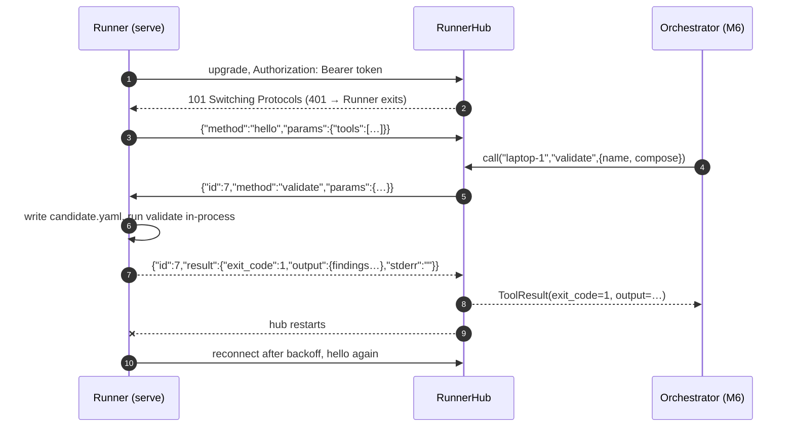
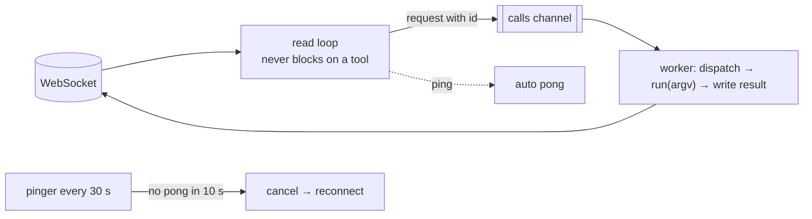
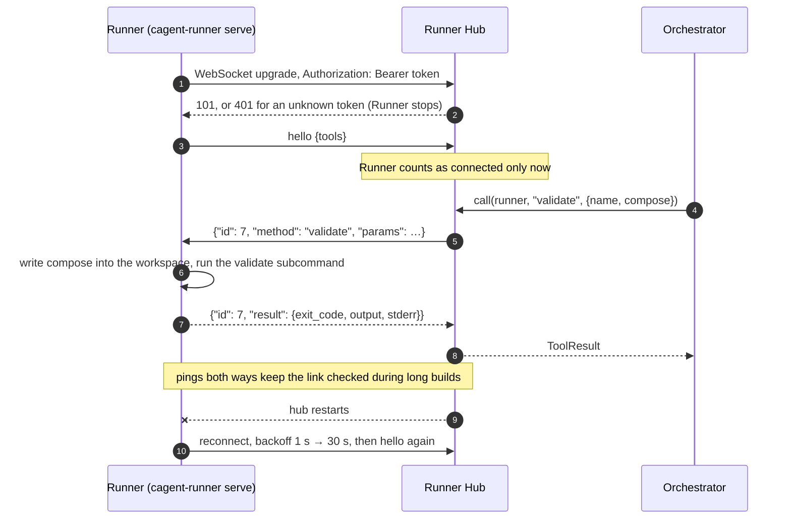
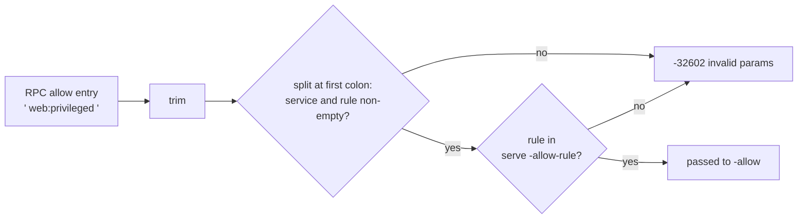

# M5 Runner ↔ Platform Link Implementation Plan

> **For Claude:** REQUIRED SUB-SKILL: Use superpowers:executing-plans to implement this plan task-by-task.

**Goal:** Let the platform call every Runner tool over a WebSocket the Runner dials out, and have the Runner come back by itself when the hub restarts.

**Architecture:** The Go Runner gains `cagent-runner serve`: it dials the hub with a bearer token, says `hello`, and answers JSON-RPC 2.0 calls. Each call runs one existing CLI subcommand in-process (`validate`, `up`, `snapshot`, `verify`, `down`, `build`), so RPC and CLI share one code path; the result carries the subcommand's exit code, JSON output, and redacted stderr. The Python `cagent.hub.RunnerHub` authenticates Runners at the handshake, registers them on `hello`, routes calls by id, and fails pending calls on disconnect.

**Tech Stack:** Go: `github.com/coder/websocket` v1.8.15. Python: `websockets` 17 (asyncio API), `pytest-asyncio` 1.4.

- Roadmap: [2026-10-17-poc-roadmap.md](2026-10-17-poc-roadmap.md) (M5)
- Design: [2026-10-17-container-agent-design.md](2026-10-17-container-agent-design.md), sections 3.1, 3.2, 8

---

## Decisions made while planning

| Decision | Why |
|---|---|
| JSON-RPC 2.0 over WebSocket, hub as caller, Runner dials out | Standard framing; the user's machine opens no port (design 3.2). |
| A tool = one CLI subcommand run in-process; result = `{exit_code, output, stderr}` | One validation and output format for CLI and RPC. Findings and failed verifications are results, not errors; JSON-RPC errors only mean unknown method or invalid params. |
| Platform sends compose and probes as **content**; the Runner writes them into the cluster workspace | The platform never names a file on the user's machine. |
| `build` over RPC: workdir only inside a `-workdir-root` given to `serve`; Maven settings only from `serve` | The platform can pick which approved directory to build, never an arbitrary one, and cannot redirect credentials. |
| Params decoded with `DisallowUnknownFields` | A typo or an injected field fails loudly. |
| `allow` approvals over RPC must name a rule listed with `serve -allow-rule` (repeatable, empty by default) | The platform relays the user's approvals, but a compromised platform or leaked token must not be able to approve `privileged` or `docker-sock` on its own. Added as Task 7 after an automated security review. |
| Token from an environment variable (`-token-env`, default `CAGENT_TOKEN`); a 401/403 stops the Runner | Keeps the token out of `ps`; retrying a rejected token cannot help. |
| Runner reads continuously; calls run one at a time on a worker goroutine | `websockets` pings every 20 s; `coder/websocket` answers pings only while reading. Handling a 5-minute build in the read loop would get the Runner dropped as dead. |
| Hub registers a Runner only after `hello`; on reconnect it swaps the new connection in **before** closing the old | Both found by tests while planning: without the first, `wait_for_runner` returned before the tool list arrived; without the second, a call could be routed to the closing connection. |
| Reconnect with exponential backoff, 1 s → 30 s, reset after a successful connection | Survives hub restarts without hammering the hub. |

## Protocol



## Runner side of one connection



## Prerequisites

- Work on a feature branch, not `main`.
- **Go is not installed on the host.** Run Go commands in the container: `docker run --rm -v "$PWD":/repo -w /repo/runner golang:1.24 <go command>`.
- **The end-to-end test runs on the host** (it starts the real Runner and calls `docker`): cross-compile the Runner with `GOOS=darwin GOARCH=arm64` in the container. Python runs on the host with uv.

---

### Task 1: Let the docker fake take time

The ping test in Task 2 needs a tool call that stays busy.

**Files:**
- Modify (full file below): `runner/internal/dockercli/fake.go`

**Step 1: Replace `fake.go`**

```go
package dockercli

import (
	"context"
	"fmt"
	"strings"
	"sync"
	"time"
)

// Fake is a Docker for tests. It answers each command from Responses, keyed by the
// space-joined arguments, and records every call. An unknown command is an error.
type Fake struct {
	mu        sync.Mutex
	Responses map[string]FakeResponse
	Calls     []string
}

// FakeResponse is the canned result of one command.
type FakeResponse struct {
	Out   string
	Err   error
	Delay time.Duration // how long the command takes to answer
}

func (f *Fake) answer(args []string) ([]byte, error) {
	key := strings.Join(args, " ")
	f.mu.Lock()
	f.Calls = append(f.Calls, key)
	r, ok := f.Responses[key]
	f.mu.Unlock()
	if !ok {
		return nil, fmt.Errorf("fake docker: unexpected command %q", key)
	}
	time.Sleep(r.Delay)
	return []byte(r.Out), r.Err
}

func (f *Fake) Output(_ context.Context, args ...string) ([]byte, error) { return f.answer(args) }

func (f *Fake) Combined(_ context.Context, args ...string) ([]byte, error) { return f.answer(args) }
```

The lock is now released before the sleep, so a slow answer never blocks other calls.

**Step 2: Run the existing tests**

Run: `docker run --rm -v "$PWD":/repo -w /repo/runner golang:1.24 go test ./...`
Expected: all packages `ok`.

**Step 3: Commit**

```bash
git add runner/internal/dockercli/fake.go
git commit -m "test(runner): let the docker fake simulate slow commands"
```

---

### Task 2: `cagent-runner serve`

**Files:**
- Create: `runner/cmd/cagent-runner/serve.go`
- Test: `runner/cmd/cagent-runner/serve_test.go`
- Modify: `runner/cmd/cagent-runner/main.go` (usage and dispatch)
- Modify: `runner/go.mod`, `runner/go.sum`

**Step 1: Add the dependency**

Run: `docker run --rm -v "$PWD":/repo -w /repo/runner golang:1.24 go get github.com/coder/websocket@v1.8.15`
Expected: `go: added github.com/coder/websocket v1.8.15`

**Step 2: Write the failing test**

The fake hub is a real WebSocket server, so these tests exercise the actual protocol.

```go
package main

import (
	"context"
	"encoding/json"
	"errors"
	"net/http"
	"net/http/httptest"
	"strings"
	"testing"
	"time"

	"github.com/coder/websocket"
	"github.com/coder/websocket/wsjson"

	"github.com/yutaofr/container-agent/runner/internal/dockercli"
)

const testToken = "secret"

// fakeHub accepts runner connections that present testToken and hands each one to the test.
func fakeHub(t *testing.T) (string, <-chan *websocket.Conn) {
	t.Helper()
	conns := make(chan *websocket.Conn, 4)
	stop := make(chan struct{})
	t.Cleanup(func() { close(stop) })
	srv := httptest.NewServer(http.HandlerFunc(func(w http.ResponseWriter, r *http.Request) {
		if r.Header.Get("Authorization") != "Bearer "+testToken {
			w.WriteHeader(http.StatusUnauthorized)
			return
		}
		c, err := websocket.Accept(w, r, nil)
		if err != nil {
			return
		}
		conns <- c
		<-stop // keep the handler alive while the test uses c
	}))
	t.Cleanup(srv.Close)
	return "ws" + strings.TrimPrefix(srv.URL, "http") + "/runner", conns
}

// startServe runs serveLoop until the test ends and returns the hub side of its first connection.
func startServe(t *testing.T, d deps, mutate func(*serveConfig)) (*websocket.Conn, <-chan *websocket.Conn) {
	t.Helper()
	url, conns := fakeHub(t)
	cfg := serveConfig{hub: url, token: testToken, backoff: 10 * time.Millisecond,
		backoffMax: 50 * time.Millisecond, pingEvery: time.Hour}
	if mutate != nil {
		mutate(&cfg)
	}
	ctx, cancel := context.WithCancel(context.Background())
	done := make(chan struct{})
	go func() { _ = serveLoop(ctx, cfg, d, &strings.Builder{}); close(done) }()
	t.Cleanup(func() { cancel(); <-done })
	c := next(t, conns)
	var hello rpcRequest
	readJSON(t, c, &hello)
	if hello.Method != "hello" {
		t.Fatalf("first message %+v, want hello", hello)
	}
	return c, conns
}

func next(t *testing.T, conns <-chan *websocket.Conn) *websocket.Conn {
	t.Helper()
	select {
	case c := <-conns:
		return c
	case <-time.After(5 * time.Second):
		t.Fatal("runner did not connect")
		return nil
	}
}

func readJSON(t *testing.T, c *websocket.Conn, v any) {
	t.Helper()
	ctx, cancel := context.WithTimeout(context.Background(), 5*time.Second)
	defer cancel()
	if err := wsjson.Read(ctx, c, v); err != nil {
		t.Fatal(err)
	}
}

// call sends one request and returns the decoded response.
func call(t *testing.T, c *websocket.Conn, id int, method string, params any) rpcResponse {
	t.Helper()
	ctx, cancel := context.WithTimeout(context.Background(), 5*time.Second)
	defer cancel()
	req := map[string]any{"jsonrpc": "2.0", "id": id, "method": method, "params": params}
	if err := wsjson.Write(ctx, c, req); err != nil {
		t.Fatal(err)
	}
	var resp rpcResponse
	readJSON(t, c, &resp)
	return resp
}

func TestServeAnswersToolCalls(t *testing.T) {
	d, _, _ := withDocker(t, map[string]dockercli.FakeResponse{
		"ps -a -q --no-trunc --filter label=com.docker.compose.project=cagent-demo": {Out: ""},
	})
	c, _ := startServe(t, d, nil)

	resp := call(t, c, 1, "validate", map[string]any{
		"name": "demo", "compose": "services:\n  web: { image: nginx:1.27, privileged: true }\n",
	})
	if resp.Error != nil || resp.Result == nil || resp.Result.ExitCode != exitFindings {
		t.Fatalf("validate: %+v", resp)
	}
	var rep Report
	if err := json.Unmarshal(resp.Result.Output, &rep); err != nil || len(rep.Findings) != 1 {
		t.Errorf("validate output %s: %v", resp.Result.Output, err)
	}

	resp = call(t, c, 2, "snapshot", map[string]any{"name": "demo"})
	if resp.Error != nil || resp.Result.ExitCode != exitOK {
		t.Fatalf("snapshot: %+v", resp)
	}
	var snap struct {
		Project  string `json:"project"`
		Services []any  `json:"services"`
	}
	if err := json.Unmarshal(resp.Result.Output, &snap); err != nil || snap.Project != "cagent-demo" || snap.Services == nil {
		t.Errorf("snapshot output %s: %v", resp.Result.Output, err)
	}
}

func TestServeRejectsBadCalls(t *testing.T) {
	c, _ := startServe(t, testDeps(t), nil)
	cases := []struct {
		method string
		params any
		code   int
	}{
		{"rm", map[string]any{}, rpcMethodNotFound},
		{"serve", map[string]any{}, rpcMethodNotFound},
		{"snapshot", map[string]any{"name": "demo", "extra": 1}, rpcInvalidParams},
		{"down", map[string]any{"name": "-rf"}, rpcInvalidParams},
		{"build", map[string]any{"name": "demo", "service": "web", "tag": "cagent/web:x", "workdir": "/etc"}, rpcInvalidParams},
	}
	for i, tc := range cases {
		resp := call(t, c, i+1, tc.method, tc.params)
		if resp.Error == nil || resp.Error.Code != tc.code {
			t.Errorf("%s %v: got %+v, want error %d", tc.method, tc.params, resp, tc.code)
		}
	}
}

func TestServeKeepsAnsweringPingsDuringALongCall(t *testing.T) {
	d, _, _ := withDocker(t, map[string]dockercli.FakeResponse{
		"ps -a -q --no-trunc --filter label=com.docker.compose.project=cagent-slow": {Delay: 2 * time.Second},
	})
	c, _ := startServe(t, d, nil)
	ctx, cancel := context.WithTimeout(context.Background(), 5*time.Second)
	defer cancel()
	if err := wsjson.Write(ctx, c, map[string]any{"jsonrpc": "2.0", "id": 1, "method": "snapshot",
		"params": map[string]any{"name": "slow"}}); err != nil {
		t.Fatal(err)
	}
	// Ping needs a concurrent reader on this side too.
	got := make(chan rpcResponse, 1)
	go func() {
		var r rpcResponse
		if wsjson.Read(ctx, c, &r) == nil {
			got <- r
		}
	}()
	pctx, pcancel := context.WithTimeout(ctx, 500*time.Millisecond)
	defer pcancel()
	if err := c.Ping(pctx); err != nil {
		t.Fatalf("runner stopped answering pings during a call: %v", err)
	}
	select {
	case r := <-got:
		if r.Result == nil {
			t.Errorf("slow call: %+v", r)
		}
	case <-ctx.Done():
		t.Fatal("slow call never answered")
	}
}

func TestServeReconnectsAfterHubDrops(t *testing.T) {
	c, conns := startServe(t, testDeps(t), nil)
	c.Close(websocket.StatusGoingAway, "hub restarting")
	c2 := next(t, conns)
	var hello rpcRequest
	readJSON(t, c2, &hello)
	if hello.Method != "hello" {
		t.Fatalf("after reconnect got %+v", hello)
	}
	if resp := call(t, c2, 1, "rm", nil); resp.Error == nil {
		t.Error("reconnected runner did not answer")
	}
}

func TestServeStopsOnRejectedToken(t *testing.T) {
	url, _ := fakeHub(t)
	cfg := serveConfig{hub: url, token: "wrong", backoff: 10 * time.Millisecond, backoffMax: 10 * time.Millisecond, pingEvery: time.Hour}
	ctx, cancel := context.WithTimeout(context.Background(), 5*time.Second)
	defer cancel()
	if err := serveLoop(ctx, cfg, testDeps(t), &strings.Builder{}); !errors.Is(err, ErrUnauthorized) {
		t.Fatalf("got %v, want ErrUnauthorized", err)
	}
}

func TestServeNeedsHubAndToken(t *testing.T) {
	t.Setenv("CAGENT_TOKEN", "")
	for _, args := range [][]string{
		{"serve", "-hub", "http://x"},
		{"serve", "-hub", "ws://x/runner"},
	} {
		var out, errOut strings.Builder
		if code := run(args, &out, &errOut, testDeps(t)); code != exitError {
			t.Errorf("%v: exit %d, want %d", args, code, exitError)
		}
	}
}
```

**Step 3: Run it to verify it fails**

Run: `docker run --rm -v "$PWD":/repo -w /repo/runner golang:1.24 go test ./cmd/cagent-runner/`
Expected: FAIL — `undefined: rpcRequest`, `undefined: serveConfig`, `undefined: serveLoop`, `undefined: rpcResponse`.

**Step 4: Write the implementation**

`runner/cmd/cagent-runner/serve.go`:

```go
package main

import (
	"bytes"
	"context"
	"encoding/json"
	"errors"
	"flag"
	"fmt"
	"io"
	"net/http"
	"os"
	"os/signal"
	"path/filepath"
	"sort"
	"strings"
	"syscall"
	"time"

	"github.com/coder/websocket"
	"github.com/coder/websocket/wsjson"

	"github.com/yutaofr/container-agent/runner/internal/guard"
	"github.com/yutaofr/container-agent/runner/internal/redact"
	"github.com/yutaofr/container-agent/runner/internal/workspace"
)

// The Runner dials the hub and answers JSON-RPC 2.0 calls; the hub never connects to the
// user's machine. Each call runs one CLI subcommand in-process, so RPC and CLI share one
// code path, one validation, and one output format.

// ErrUnauthorized means the hub rejected the token; retrying cannot help.
var ErrUnauthorized = errors.New("hub rejected the runner token")

// JSON-RPC 2.0 error codes.
const (
	rpcMethodNotFound = -32601
	rpcInvalidParams  = -32602
)

type rpcRequest struct {
	JSONRPC string          `json:"jsonrpc"`
	ID      json.RawMessage `json:"id,omitempty"`
	Method  string          `json:"method"`
	Params  json.RawMessage `json:"params,omitempty"`
}

type rpcError struct {
	Code    int    `json:"code"`
	Message string `json:"message"`
}

type rpcResponse struct {
	JSONRPC string          `json:"jsonrpc"`
	ID      json.RawMessage `json:"id"`
	Result  *ToolResult     `json:"result,omitempty"`
	Error   *rpcError       `json:"error,omitempty"`
}

// ToolResult carries a subcommand's outcome unchanged: findings and failed verifications
// are results with a non-zero exit code, not RPC errors.
type ToolResult struct {
	ExitCode int             `json:"exit_code"`
	Output   json.RawMessage `json:"output"`
	Stderr   string          `json:"stderr,omitempty"`
}

type serveConfig struct {
	hub          string
	token        string
	workdirRoots []string // resolved; build may only use working directories inside these
	settings     string   // Maven settings.xml; the platform cannot choose another
	backoff      time.Duration
	backoffMax   time.Duration
	pingEvery    time.Duration
}

// stringList is a repeatable string flag.
type stringList []string

func (l *stringList) String() string     { return strings.Join(*l, ",") }
func (l *stringList) Set(v string) error { *l = append(*l, v); return nil }

func runServe(args []string, stdout, stderr io.Writer, d deps) int {
	fs := flag.NewFlagSet("serve", flag.ContinueOnError)
	fs.SetOutput(stderr)
	hub := fs.String("hub", "", "hub URL, ws:// or wss://")
	tokenEnv := fs.String("token-env", "CAGENT_TOKEN", "environment variable holding the runner token")
	settings := fs.String("maven-settings", "", "Maven settings.xml for build (default ~/.m2/settings.xml)")
	var roots stringList
	fs.Var(&roots, "workdir-root", "directory under which build may use working directories; repeatable")
	if err := fs.Parse(args); err != nil {
		return exitError
	}
	if !strings.HasPrefix(*hub, "ws://") && !strings.HasPrefix(*hub, "wss://") {
		fmt.Fprintln(stderr, "serve needs -hub ws://… or wss://…")
		return exitError
	}
	// The token comes from the environment, not a flag, so it never shows up in ps.
	token := os.Getenv(*tokenEnv)
	if token == "" {
		fmt.Fprintf(stderr, "environment variable %s is empty\n", *tokenEnv)
		return exitError
	}
	cfg := serveConfig{hub: *hub, token: token, settings: *settings,
		backoff: time.Second, backoffMax: 30 * time.Second, pingEvery: 30 * time.Second}
	for _, r := range roots {
		rr, err := guard.Resolve(r)
		if err != nil {
			fmt.Fprintf(stderr, "workdir-root %s: %v\n", r, err)
			return exitError
		}
		cfg.workdirRoots = append(cfg.workdirRoots, rr)
	}
	ctx, stop := signal.NotifyContext(context.Background(), os.Interrupt, syscall.SIGTERM)
	defer stop()
	if err := serveLoop(ctx, cfg, d, stderr); err != nil {
		fmt.Fprintln(stderr, err)
		return exitError
	}
	return exitOK
}

// serveLoop keeps a hub connection up until ctx ends, reconnecting with exponential
// backoff. Only a rejected token stops it early.
func serveLoop(ctx context.Context, cfg serveConfig, d deps, logw io.Writer) error {
	wait := cfg.backoff
	for {
		connected, err := serveOnce(ctx, cfg, d)
		if ctx.Err() != nil {
			return nil
		}
		if errors.Is(err, ErrUnauthorized) {
			return err
		}
		if connected {
			wait = cfg.backoff
		}
		fmt.Fprintf(logw, "hub connection lost: %v; reconnecting in %s\n", err, wait)
		select {
		case <-ctx.Done():
			return nil
		case <-time.After(wait):
		}
		wait = min(wait*2, cfg.backoffMax)
	}
}

// serveOnce runs one connection. The read loop never blocks on a tool: calls go to a
// single worker, so pings keep getting answered during a long build.
func serveOnce(ctx context.Context, cfg serveConfig, d deps) (bool, error) {
	c, resp, err := websocket.Dial(ctx, cfg.hub, &websocket.DialOptions{
		HTTPHeader: http.Header{"Authorization": {"Bearer " + cfg.token}},
	})
	if err != nil {
		if resp != nil && (resp.StatusCode == http.StatusUnauthorized || resp.StatusCode == http.StatusForbidden) {
			return false, ErrUnauthorized
		}
		return false, err
	}
	defer c.CloseNow()
	c.SetReadLimit(16 << 20) // compose files and probe lists

	connCtx, cancel := context.WithCancel(ctx)
	defer cancel()
	if err := wsjson.Write(connCtx, c, hello()); err != nil {
		return true, err
	}

	calls := make(chan rpcRequest, 64)
	defer close(calls)
	go func() {
		for req := range calls {
			if err := wsjson.Write(connCtx, c, dispatch(connCtx, cfg, d, req)); err != nil {
				cancel()
			}
		}
	}()
	go func() {
		t := time.NewTicker(cfg.pingEvery)
		defer t.Stop()
		for {
			select {
			case <-connCtx.Done():
				return
			case <-t.C:
				pctx, done := context.WithTimeout(connCtx, 10*time.Second)
				if err := c.Ping(pctx); err != nil {
					cancel()
				}
				done()
			}
		}
	}()

	for {
		var req rpcRequest
		if err := wsjson.Read(connCtx, c, &req); err != nil {
			return true, err
		}
		if len(req.ID) == 0 {
			continue // notifications need no answer
		}
		calls <- req
	}
}

func hello() map[string]any {
	names := make([]string, 0, len(tools))
	for n := range tools {
		names = append(names, n)
	}
	sort.Strings(names)
	return map[string]any{"jsonrpc": "2.0", "method": "hello", "params": map[string]any{"tools": names}}
}

// dispatch runs one call. Params errors become JSON-RPC errors; everything the subcommand
// itself reports, including a non-zero exit, is a result.
func dispatch(ctx context.Context, cfg serveConfig, d deps, req rpcRequest) rpcResponse {
	resp := rpcResponse{JSONRPC: "2.0", ID: req.ID}
	tool, ok := tools[req.Method]
	if !ok {
		resp.Error = &rpcError{Code: rpcMethodNotFound, Message: "unknown method " + req.Method}
		return resp
	}
	argv, err := tool(cfg, d, req.Params)
	if err != nil {
		resp.Error = &rpcError{Code: rpcInvalidParams, Message: err.Error()}
		return resp
	}
	var out, errOut bytes.Buffer
	code := run(argv, &out, &errOut, d)
	res := &ToolResult{ExitCode: code, Output: json.RawMessage("null"), Stderr: redact.String(strings.TrimSpace(errOut.String()))}
	if json.Valid(out.Bytes()) && out.Len() > 0 {
		res.Output = json.RawMessage(bytes.TrimSpace(out.Bytes()))
	}
	resp.Result = res
	return resp
}

// A tool turns validated params into argv for one subcommand. Inputs the platform sends as
// content (compose YAML, probes) are written into the cluster's workspace first, so the
// platform never names a file on the user's machine.
type tool func(cfg serveConfig, d deps, params json.RawMessage) ([]string, error)

var tools = map[string]tool{
	"validate": composeTool("validate"),
	"up":       composeTool("up"),
	"snapshot": nameTool("snapshot"),
	"down":     nameTool("down"),
	"verify":   verifyTool,
	"build":    buildTool,
}

// decode parses params strictly: an unknown field is an error, not silently ignored.
func decode(params json.RawMessage, v any) error {
	if len(params) == 0 {
		params = json.RawMessage("{}")
	}
	dec := json.NewDecoder(bytes.NewReader(params))
	dec.DisallowUnknownFields()
	return dec.Decode(v)
}

func requireName(name string) error {
	if !workspace.ValidName(name) {
		return fmt.Errorf("invalid name %q", name)
	}
	return nil
}

func writeInput(d deps, cluster, file string, data []byte) (string, error) {
	w, err := openWorkspace(d)
	if err != nil {
		return "", err
	}
	return w.WriteFile(cluster, file, data)
}

func composeTool(cmd string) tool {
	return func(_ serveConfig, d deps, params json.RawMessage) ([]string, error) {
		var p struct {
			Name    string   `json:"name"`
			Compose string   `json:"compose"`
			Allow   []string `json:"allow"`
		}
		if err := decode(params, &p); err != nil {
			return nil, err
		}
		if err := requireName(p.Name); err != nil {
			return nil, err
		}
		if p.Compose == "" {
			return nil, errors.New("compose is required")
		}
		for _, a := range p.Allow {
			if strings.Contains(a, ",") {
				return nil, fmt.Errorf("allow entry %q contains a comma", a)
			}
		}
		path, err := writeInput(d, p.Name, "candidate.yaml", []byte(p.Compose))
		if err != nil {
			return nil, err
		}
		return []string{cmd, "-name", p.Name, "-f", path, "-allow", strings.Join(p.Allow, ",")}, nil
	}
}

func nameTool(cmd string) tool {
	return func(_ serveConfig, _ deps, params json.RawMessage) ([]string, error) {
		var p struct {
			Name string `json:"name"`
		}
		if err := decode(params, &p); err != nil {
			return nil, err
		}
		if err := requireName(p.Name); err != nil {
			return nil, err
		}
		return []string{cmd, "-name", p.Name}, nil
	}
}

func verifyTool(_ serveConfig, d deps, params json.RawMessage) ([]string, error) {
	var p struct {
		Name   string          `json:"name"`
		Probes json.RawMessage `json:"probes"`
	}
	if err := decode(params, &p); err != nil {
		return nil, err
	}
	if err := requireName(p.Name); err != nil {
		return nil, err
	}
	argv := []string{"verify", "-name", p.Name}
	if len(p.Probes) > 0 && string(p.Probes) != "null" {
		path, err := writeInput(d, p.Name, "probes.json", p.Probes)
		if err != nil {
			return nil, err
		}
		argv = append(argv, "-probes", path)
	}
	return argv, nil
}

func buildTool(cfg serveConfig, _ deps, params json.RawMessage) ([]string, error) {
	var p struct {
		Name    string `json:"name"`
		Service string `json:"service"`
		Tag     string `json:"tag"`
		Maven   string `json:"maven"`
		Workdir string `json:"workdir"`
		Stack   string `json:"stack"`
		JDK     string `json:"jdk"`
	}
	if err := decode(params, &p); err != nil {
		return nil, err
	}
	if err := requireName(p.Name); err != nil {
		return nil, err
	}
	argv := []string{"build", "-name", p.Name, "-service", p.Service, "-tag", p.Tag}
	switch {
	case p.Maven != "" && p.Workdir == "":
		argv = append(argv, "-maven", p.Maven)
		if cfg.settings != "" {
			argv = append(argv, "-settings", cfg.settings)
		}
	case p.Workdir != "" && p.Maven == "":
		dir, err := guard.Resolve(p.Workdir)
		if err != nil {
			return nil, err
		}
		if !withinRoots(dir, cfg.workdirRoots) {
			return nil, fmt.Errorf("workdir %s is outside every -workdir-root the user allowed", p.Workdir)
		}
		argv = append(argv, "-workdir", filepath.Clean(dir))
	default:
		return nil, errors.New("build needs exactly one of maven or workdir")
	}
	if p.Stack != "" {
		argv = append(argv, "-stack", p.Stack)
	}
	if p.JDK != "" {
		argv = append(argv, "-jdk", p.JDK)
	}
	return argv, nil
}

func withinRoots(dir string, roots []string) bool {
	for _, r := range roots {
		if guard.Within(r, dir) {
			return true
		}
	}
	return false
}
```

In `main.go`, add the usage line directly above the `build` line:

```
  cagent-runner serve    -hub ws://HOST/runner [-token-env CAGENT_TOKEN] [-workdir-root DIR]... [-maven-settings F]
```

and register the subcommand in `run`'s dispatch map:

```go
		"build": runBuild, "serve": runServe,
```

`serve` is deliberately absent from the `tools` map, so the platform cannot start a nested serve.

**Step 5: Tidy and run all unit tests**

Run: `docker run --rm -v "$PWD":/repo -w /repo golang:1.24 sh -c 'cd runner && go mod tidy && cd .. && make runner-test'`
Expected: thirteen `ok` lines plus `maventest [no test files]`; `go.mod` lists `github.com/coder/websocket v1.8.15` as a direct requirement. `TestServeKeepsAnsweringPingsDuringALongCall` takes about 2 s: a call blocks for 2 s while a ping with a 500 ms deadline still succeeds.

**Step 6: Commit**

```bash
git add runner/go.mod runner/go.sum runner/cmd/cagent-runner
git commit -m "feat(runner): serve tool calls over JSON-RPC to the hub, reconnecting"
```

---

### Task 3: Python WebSocket dependencies

**Files:**
- Modify: `platform/pyproject.toml`, `platform/uv.lock`

**Step 1: Add the packages**

```bash
cd platform && uv add "websockets>=14" && uv add --dev "pytest-asyncio>=1.4.0"
```

**Step 2: Turn on asyncio test mode** — in `platform/pyproject.toml`, make the pytest section read:

```toml
[tool.pytest.ini_options]
testpaths = ["tests"]
asyncio_mode = "auto"
asyncio_default_fixture_loop_scope = "function"
```

**Step 3: Check nothing broke**

Run: `make platform-test`
Expected: ruff clean; `37 passed, 1 skipped`.

**Step 4: Commit**

```bash
git add platform/pyproject.toml platform/uv.lock
git commit -m "build(platform): add websockets and pytest-asyncio"
```

---

### Task 4: Runner Hub

**Files:**
- Create: `platform/src/cagent/hub.py`
- Test: `platform/tests/test_hub.py`

**Step 1: Write the failing test**

The fake runner speaks the same protocol as the Go Runner, so hub behaviour is tested without Go.

```python
"""Hub tests against a scripted fake runner speaking the same JSON-RPC protocol as the Go one."""

import asyncio
import json
from collections.abc import Callable

import pytest
from websockets.asyncio.client import ClientConnection, connect
from websockets.exceptions import InvalidStatus

from cagent.hub import RunnerError, RunnerHub, RunnerUnavailable, start

TOKEN = "t-123"


@pytest.fixture
async def hub():
    hub = RunnerHub({TOKEN: "laptop-1"})
    server = await start(hub, "127.0.0.1", 0)
    port = server.sockets[0].getsockname()[1]
    yield hub, f"ws://127.0.0.1:{port}/runner"
    server.close()
    await server.wait_closed()


async def fake_runner(url: str, answer: Callable[[dict], dict | None], token: str = TOKEN):
    """Connect, say hello, and answer each request with answer(request); None means stay silent."""
    ws = await connect(url, additional_headers={"Authorization": f"Bearer {token}"})
    await ws.send(
        json.dumps({"jsonrpc": "2.0", "method": "hello", "params": {"tools": ["validate"]}})
    )

    async def loop():
        async for raw in ws:
            req = json.loads(raw)
            reply = answer(req)
            if reply is not None:
                await ws.send(json.dumps({"jsonrpc": "2.0", "id": req["id"], **reply}))

    return ws, asyncio.create_task(loop())


def echo(req: dict) -> dict:
    return {"result": {"exit_code": 0, "output": {"echo": req["params"]}, "stderr": ""}}


async def connected(hub: RunnerHub, url: str, answer=echo) -> ClientConnection:
    ws, _ = await fake_runner(url, answer)
    await hub.wait_for_runner("laptop-1", timeout=5)
    return ws


async def test_call_returns_the_tool_result(hub):
    h, url = hub
    await connected(h, url)
    result = await h.call("laptop-1", "validate", {"name": "demo"})
    assert result.ok and result.output == {"echo": {"name": "demo"}}
    assert h.tools("laptop-1") == ["validate"]


async def test_non_zero_exit_is_a_result_not_an_error(hub):
    h, url = hub
    await connected(h, url, lambda req: {"result": {"exit_code": 1, "output": {"findings": [1]}}})
    result = await h.call("laptop-1", "validate", {})
    assert not result.ok and result.exit_code == 1 and result.output == {"findings": [1]}


async def test_rpc_error_is_raised(hub):
    h, url = hub
    await connected(h, url, lambda req: {"error": {"code": -32601, "message": "unknown method rm"}})
    with pytest.raises(RunnerError) as err:
        await h.call("laptop-1", "rm", {})
    assert err.value.code == -32601


async def test_bad_token_is_rejected_at_handshake(hub):
    h, url = hub
    with pytest.raises(InvalidStatus) as err:
        await fake_runner(url, echo, token="wrong")
    assert err.value.response.status_code == 401
    assert h.connected() == set()


async def test_unknown_runner_is_unavailable(hub):
    h, _ = hub
    with pytest.raises(RunnerUnavailable):
        await h.call("laptop-1", "validate", {})


async def test_disconnect_fails_the_pending_call(hub):
    h, url = hub
    ws = await connected(h, url, lambda req: None)  # never answers
    call = asyncio.create_task(h.call("laptop-1", "snapshot", {"name": "demo"}))
    await asyncio.sleep(0.1)
    await ws.close()
    with pytest.raises(RunnerUnavailable):
        await call
    assert h.connected() == set()


async def test_call_times_out(hub):
    h, url = hub
    await connected(h, url, lambda req: None)
    with pytest.raises(TimeoutError):
        await h.call("laptop-1", "snapshot", {}, timeout=0.2)


async def test_reconnect_replaces_the_old_connection(hub):
    h, url = hub
    old = await connected(h, url)
    new = await connected(h, url)
    await old.wait_closed()
    assert h.connected() == {"laptop-1"}
    assert (await h.call("laptop-1", "validate", {"n": 2})).output == {"echo": {"n": 2}}
    await new.close()


async def test_runner_counts_as_connected_only_after_hello(hub):
    h, url = hub
    ws = await connect(url, additional_headers={"Authorization": f"Bearer {TOKEN}"})
    await ws.send(json.dumps({"jsonrpc": "2.0", "id": 1, "result": {}}))  # not a hello
    await ws.wait_closed()
    assert ws.close_reason == "expected hello"
    assert h.connected() == set()
```

**Step 2: Run it to verify it fails**

Run: `cd platform && uv run pytest tests/test_hub.py`
Expected: FAIL — `ModuleNotFoundError: No module named 'cagent.hub'`.

**Step 3: Write the implementation**

```python
"""Runner Hub: Runners dial in over WebSocket; the platform calls their tools with JSON-RPC 2.0.

The hub never connects to a user's machine. A Runner authenticates with a bearer token, which
the hub maps to a runner id; after that, `call` sends a request and awaits the matching result.
"""

import asyncio
import hmac
import itertools
import json
from collections.abc import Mapping
from dataclasses import dataclass, field
from http import HTTPStatus
from typing import Any

from websockets.asyncio.server import Server, ServerConnection, serve
from websockets.exceptions import ConnectionClosed
from websockets.http11 import Request, Response

# Seconds to wait for a result. Builds compile and pull images, so they get longer.
DEFAULT_TIMEOUT = 120.0
TIMEOUTS = {"build": 900.0, "up": 300.0}

# Seconds a new connection has to send its hello before the hub drops it.
HELLO_TIMEOUT = 10.0


class RunnerUnavailable(Exception):
    """The runner is not connected, or disconnected before answering."""


class RunnerError(Exception):
    """The runner refused the call: unknown method or invalid params (JSON-RPC error)."""

    def __init__(self, code: int, message: str):
        super().__init__(f"{message} (code {code})")
        self.code = code
        self.message = message


@dataclass(frozen=True)
class ToolResult:
    """One subcommand's outcome, as the CLI would report it."""

    exit_code: int
    output: Any
    stderr: str = ""

    @property
    def ok(self) -> bool:
        return self.exit_code == 0


@dataclass
class _Runner:
    ws: ServerConnection
    tools: list[str] = field(default_factory=list)
    pending: dict[int, asyncio.Future] = field(default_factory=dict)


class RunnerHub:
    def __init__(self, tokens: Mapping[str, str]):
        """tokens maps each accepted bearer token to the runner id it authenticates."""
        self._tokens = dict(tokens)
        self._runners: dict[str, _Runner] = {}
        self._ids = itertools.count(1)
        self._changed = asyncio.Condition()

    def _runner_id(self, request: Request) -> str | None:
        auth = request.headers.get("Authorization", "")
        if not auth.startswith("Bearer "):
            return None
        presented = auth.removeprefix("Bearer ").encode()
        for token, runner_id in self._tokens.items():
            if hmac.compare_digest(presented, token.encode()):
                return runner_id
        return None

    def _authenticate(self, connection: ServerConnection, request: Request) -> Response | None:
        if self._runner_id(request) is None:
            return connection.respond(HTTPStatus.UNAUTHORIZED, "unauthorized\n")
        return None

    async def _handle(self, ws: ServerConnection) -> None:
        runner_id = self._runner_id(ws.request)
        assert runner_id is not None  # _authenticate already rejected anything else
        # A runner counts as connected only once it has said hello, so callers that wait for
        # it can rely on its tool list.
        try:
            first = json.loads(await asyncio.wait_for(ws.recv(), HELLO_TIMEOUT))
        except (TimeoutError, ConnectionClosed, ValueError):
            await ws.close(reason="expected hello")
            return
        if not isinstance(first, dict) or first.get("method") != "hello":
            await ws.close(reason="expected hello")
            return
        runner = _Runner(ws, tools=list(first.get("params", {}).get("tools", [])))
        # Swap in the new connection before closing the old one, so no call can be routed
        # to a connection that is already closing.
        async with self._changed:
            old = self._runners.get(runner_id)
            self._runners[runner_id] = runner
            self._changed.notify_all()
        if old is not None:
            await old.ws.close(reason="replaced by a new connection")
        try:
            async for raw in ws:
                self._receive(runner, raw)
        except ConnectionClosed:
            pass
        finally:
            for fut in runner.pending.values():
                if not fut.done():
                    fut.set_exception(RunnerUnavailable(f"{runner_id} disconnected"))
            async with self._changed:
                if self._runners.get(runner_id) is runner:
                    del self._runners[runner_id]
                self._changed.notify_all()

    def _receive(self, runner: _Runner, raw: str | bytes) -> None:
        msg = json.loads(raw)
        fut = runner.pending.get(msg.get("id"))
        if fut is None or fut.done():
            return  # an answer to a call that already timed out
        if error := msg.get("error"):
            fut.set_exception(RunnerError(error.get("code", 0), error.get("message", "")))
        else:
            fut.set_result(msg.get("result"))

    def connected(self) -> set[str]:
        return set(self._runners)

    def tools(self, runner_id: str) -> list[str]:
        runner = self._runners.get(runner_id)
        return list(runner.tools) if runner else []

    async def wait_for_runner(self, runner_id: str, timeout: float) -> None:
        """Return once runner_id is connected; raise TimeoutError after timeout seconds."""
        async with asyncio.timeout(timeout), self._changed:
            await self._changed.wait_for(lambda: runner_id in self._runners)

    async def call(
        self, runner_id: str, method: str, params: Mapping[str, Any], timeout: float | None = None
    ) -> ToolResult:
        """Call one tool on a runner and return its result."""
        runner = self._runners.get(runner_id)
        if runner is None:
            raise RunnerUnavailable(f"{runner_id} is not connected")
        call_id = next(self._ids)
        fut: asyncio.Future = asyncio.get_running_loop().create_future()
        runner.pending[call_id] = fut
        try:
            request = {"jsonrpc": "2.0", "id": call_id, "method": method, "params": dict(params)}
            try:
                await runner.ws.send(json.dumps(request))
            except ConnectionClosed as e:
                raise RunnerUnavailable(f"{runner_id} disconnected") from e
            result = await asyncio.wait_for(fut, timeout or TIMEOUTS.get(method, DEFAULT_TIMEOUT))
        finally:
            runner.pending.pop(call_id, None)
        return ToolResult(
            exit_code=result["exit_code"],
            output=result.get("output"),
            stderr=result.get("stderr", ""),
        )


async def start(hub: RunnerHub, host: str, port: int) -> Server:
    """Serve the hub until the returned server is closed."""
    return await serve(hub._handle, host, port, process_request=hub._authenticate)
```

**Step 4: Run tests to verify they pass, repeatedly**

Run: `cd platform && for i in 1 2 3 4 5; do uv run pytest -q tests/test_hub.py | tail -1; done`
Expected: `9 passed` five times. The repetition guards the two races this design closes (hello before registration, swap before close).

**Step 5: Commit**

```bash
git add platform/src/cagent/hub.py platform/tests/test_hub.py
git commit -m "feat(platform): add the Runner Hub with token auth and call routing"
```

---

### Task 5: End to end — real Runner, real hub, hub restart

This is the milestone's success criterion. During planning it passed five times in a row in about 1.1 s, including the restart, and the Runner exited 0 on SIGTERM.

**Files:**
- Create: `platform/tests/test_hub_e2e.py`
- Modify: `Makefile`

**Step 1: Write the test**

```python
"""The real Go Runner against the real hub: tool calls, then surviving a hub restart.

Skipped unless CAGENT_RUNNER points to the runner binary; `make e2e` sets it. Needs the docker
CLI for snapshot.
"""

import os
import socket
import subprocess

import pytest

from cagent.generate import generate, to_yaml
from cagent.hub import RunnerError, RunnerHub, start

pytestmark = pytest.mark.skipif(
    "CAGENT_RUNNER" not in os.environ, reason="set CAGENT_RUNNER to the runner binary"
)

TOKEN = "e2e-token"


def free_port() -> int:
    with socket.socket() as s:
        s.bind(("127.0.0.1", 0))
        return s.getsockname()[1]


async def test_runner_answers_over_the_hub_and_survives_a_restart(tmp_path, catalog, orders_spec):
    port = free_port()
    hub = RunnerHub({TOKEN: "e2e"})
    server = await start(hub, "127.0.0.1", port)
    env = {**os.environ, "CAGENT_TOKEN": TOKEN, "CAGENT_HOME": str(tmp_path / "home")}
    runner = subprocess.Popen(
        [os.environ["CAGENT_RUNNER"], "serve", "-hub", f"ws://127.0.0.1:{port}/runner"],
        env=env,
        stdout=subprocess.DEVNULL,
        stderr=subprocess.DEVNULL,
    )
    try:
        await hub.wait_for_runner("e2e", timeout=10)
        assert {"validate", "up", "snapshot", "verify", "down", "build"} <= set(hub.tools("e2e"))

        # M2's generated compose passes the Runner's validation, sent as content over RPC.
        compose = to_yaml(generate(orders_spec, catalog))
        good = await hub.call("e2e", "validate", {"name": "orders-poc", "compose": compose})
        assert good.ok, good
        assert good.output["findings"] == [] and good.output["port_conflicts"] == []

        risky = "services:\n  web: { image: nginx:1.27, privileged: true }\n"
        bad = await hub.call("e2e", "validate", {"name": "risky", "compose": risky})
        assert bad.exit_code == 1 and bad.output["findings"][0]["rule"] == "privileged"

        snap = await hub.call("e2e", "snapshot", {"name": "e2e-none"})
        assert snap.ok and snap.output["services"] == []

        with pytest.raises(RunnerError):
            await hub.call("e2e", "down", {"name": "-rf"})

        # Restart the hub on the same port; the Runner must reconnect by itself.
        server.close()
        await server.wait_closed()
        hub = RunnerHub({TOKEN: "e2e"})
        server = await start(hub, "127.0.0.1", port)
        await hub.wait_for_runner("e2e", timeout=15)
        assert (await hub.call("e2e", "snapshot", {"name": "e2e-none"})).ok
    finally:
        runner.terminate()
        assert runner.wait(timeout=10) == 0, "runner did not shut down cleanly on SIGTERM"
        server.close()
        await server.wait_closed()
```

**Step 2: Run it against the real Runner**

```bash
docker run --rm -v "$PWD":/repo -w /repo/runner -e GOOS=darwin -e GOARCH=arm64 golang:1.24 go build -o ../bin/cagent-runner ./cmd/cagent-runner
cd platform && CAGENT_RUNNER=$PWD/../bin/cagent-runner uv run pytest -v tests/test_hub_e2e.py; cd ..
pgrep -fl "cagent-runner serve" || echo "no runner left"
```

Expected: `PASSED`, then `no runner left`. If validate reports port conflicts, something on the host uses 18080 or 13306 (the orders-poc ports); free them and rerun.

**Step 3: Add it to `make e2e`** — replace the `e2e` target in `Makefile` with:

```make
# Generated compose files must pass the real validate command, and the real Runner must
# answer the hub and reconnect after a hub restart.
e2e: runner-build
	cd platform && CAGENT_RUNNER=$(CURDIR)/bin/cagent-runner uv run pytest tests/test_cli.py tests/test_hub_e2e.py
```

The `platform` workflow already runs `make e2e`, so CI covers this with no workflow change.

**Step 4: Run the whole Python suite with the Runner**

Run: `cd platform && CAGENT_RUNNER=$PWD/../bin/cagent-runner uv run pytest -q; cd .. && rm -rf bin`
Expected: `48 passed`.

**Step 5: Commit**

```bash
git add platform/tests/test_hub_e2e.py Makefile
git commit -m "test(platform): drive the real Runner through the hub across a restart"
```

---

### Task 6: Update the design doc

**Files:**
- Modify: `docs/plans/2026-10-17-container-agent-design.md`

**Step 1: Section 3** — insert this subsection after `### 3.3 POC vs. production` and its content, directly before `## 4. Workflow State Machine`:

````markdown
### 3.4 Runner protocol

The Runner dials the hub over WebSocket and the two speak JSON-RPC 2.0, with the hub as caller:



- Each tool is one CLI subcommand run in-process, so RPC and CLI share one code path and one output format. The result carries the subcommand's exit code unchanged: validation findings and failed verifications are results, not errors. JSON-RPC errors mean an unknown method or invalid params.
- Params are decoded strictly (unknown fields are rejected). The platform sends compose files and probes as *content*, which the Runner writes into the cluster workspace; it never names a file on the user's machine. `build` accepts a working directory only inside a `-workdir-root` the user passed to `serve`, and uses the Runner's own Maven settings.
- The Runner reads the connection continuously and runs calls one at a time on a worker, so it keeps answering pings while a build runs; otherwise the hub would drop it as dead.
- The hub swaps a reconnecting Runner's new connection in before closing the old one, so no call is routed to a closing connection. A disconnect fails every pending call with `RunnerUnavailable`.
````

**Step 2: Section 8** — replace the `- **Runner authentication**` bullet with:

```markdown
- **Runner authentication**: the user signs in to the web UI via SSO and registers the device, receiving a revocable token bound to user and device. Connections use WSS. In the POC the hub holds a static token-to-runner map, the Runner reads its token from an environment variable (never a flag, so it stays out of `ps`), and a rejected token stops the Runner instead of retrying.
```

**Step 3: Check the Mermaid diagram renders** (https://mermaid.live, or GitHub after pushing).

**Step 4: Commit**

```bash
git add docs/plans/2026-10-17-container-agent-design.md
git commit -m "docs: describe the Runner protocol and POC authentication"
```

---

### Task 7: Local ceiling for RPC approvals

Added after Tasks 1–6, in response to an automated security review: Task 2's `composeTool` passed the platform's `allow` list straight to `-allow`, so a compromised platform or a leaked token could approve `web:privileged` without anyone at the user's machine agreeing.

**Behaviour**

- `serve` takes a repeatable `-allow-rule RULE` flag. Each value is a lint rule ID as the Runner reports it (`privileged`, `docker-sock`, `field:sysctls`). The list is empty by default, so by default the platform cannot approve any exception.
- For `validate` and `up`, every `allow` entry from RPC is trimmed (the subcommand trims too, so the check sees what it will run), then split at the **first** colon into service and rule. Rule IDs such as `field:sysctls` contain colons; services do not. `*:field:configs` therefore has the rule `field:configs`.
- The call fails with JSON-RPC invalid params (`-32602`) when an entry contains a comma, has no colon, has an empty service or rule, or names a rule that is not in the list. Example: `allow "web:privileged": rule "privileged" is not in this Runner's -allow-rule list`.
- The command-line `-allow` flag of `validate` and `up` is unchanged.



**Files**

- `runner/cmd/cagent-runner/serve.go`: `serveConfig.allowRules`, the `-allow-rule` flag, `checkApprovals`, and `composeTool` now using `cfg`.
- `runner/cmd/cagent-runner/main.go`: usage line.
- `runner/cmd/cagent-runner/serve_test.go`: refused by default; applied when listed (and no other rule opens); field and top-level field rules; malformed entries; whitespace normalised.
- `platform/tests/test_hub_e2e.py`: the real Runner is started with `-allow-rule privileged`; an approved `web:privileged` passes and `web:docker-sock` is refused.
- Design doc: sections 3.4 and 8.

**Commits:** `bb67dcf` (code and tests); the documentation follows in the next commit.

**Verified:** `make runner-test` in the golang container (13 packages `ok`); `make platform-test` (`46 passed, 2 skipped`); the end-to-end test on the host with the darwin/arm64 Runner (3 runs, `48 passed` for the whole suite), with no `cagent-runner serve` process and no `bin/` left behind.

---

## Milestone 5 done when

- [ ] `make runner-test` passes in the golang container: thirteen packages `ok`
- [ ] `make platform-test` passes: ruff clean, `46 passed, 2 skipped`
- [ ] Task 5's end-to-end test passes on the host: tools answer over the hub, and the Runner reconnects after the hub restarts
- [ ] `runner` and `platform` workflows green on the PR

## Not in M5

- SSO device registration and revocable per-device tokens (the POC uses a static map)
- TLS termination (`wss://`) in front of the hub; the Runner already accepts `wss://` URLs
- Running several calls on one Runner in parallel; calls are serialized per Runner
- An HTTP API in front of the hub; M6's orchestrator calls `RunnerHub` in-process
