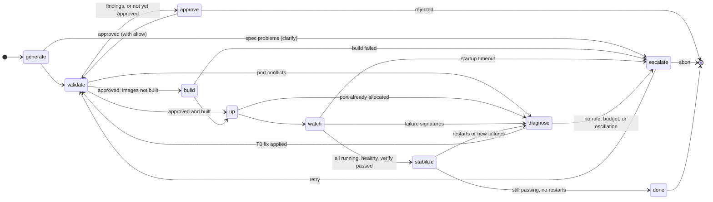

# M6 Deterministic Orchestrator Implementation Plan

> **For Claude:** REQUIRED SUB-SKILL: Use superpowers:executing-plans to implement this plan task-by-task.

**Goal:** Drive a cluster from ClusterSpec to "healthy" with no LLM: generate, validate, wait for the user's approval, build, start, watch, stabilize, and fix well-known failures with T0 rules inside budgets, escalating to a person when they run out.

**Architecture:** A LangGraph state graph in `cagent.orchestrator`. Nodes call the Runner's tools through the M5 hub; `approve` and `escalate` pause on LangGraph interrupts, and a checkpointer lets any orchestrator instance resume a run by thread id. Pure modules carry the logic: `cagent.rules` (problems and T0 fixes as JSON Patches), `cagent.patches` (apply, environment whitelist, fingerprints for oscillation). Two Runner fixes, found while verifying this plan on real Docker, make the port check trustworthy.

**Tech Stack:** Python: `langgraph` 1.2.16 (`InMemorySaver` in tests), `jsonpatch` 1.35. Go: standard library only.

- Roadmap: [2026-10-17-poc-roadmap.md](2026-10-17-poc-roadmap.md) (M6)
- Design: [2026-10-17-container-agent-design.md](2026-10-17-container-agent-design.md), sections 4, 5

---

## Decisions made while planning

| Decision | Why |
|---|---|
| `approve` and `escalate` only call `interrupt()` | A node that called `interrupt()` re-runs from the top on resume, so anything before the interrupt must be idempotent. Doing nothing else there makes them trivially so. |
| Every node returns `Command(goto=…)`; budgets and history live in graph state | Routing is explicit in one place, and the checkpointer persists everything a resumed run needs. |
| Five T0 rule functions covering six problem kinds | Enough for the M6 criterion (port conflict, OOM) plus common neighbours; "dependency not ready" is already prevented by the generator's `depends_on: service_healthy` and by `upstream_first`. |
| Oscillation = a fix recreating a compose fingerprint already seen | One check covers both "same patch twice" and "patch reverting an earlier one". |
| Fixes return to `validate`, then `up` — not to `approve` | Design section 4: environment-only patches do not need a second approval; `within_environment` enforces the boundary. |
| `SimCluster` fakes the Runner for state-machine tests; one real-Docker test proves the criterion | The fake makes every branch fast and deterministic; the real test catches what fakes cannot (it caught two Runner bugs below). |
| Checkpointer injected; tests use `InMemorySaver` and prove resume across orchestrator instances | Postgres wiring belongs with the POC deployment (M9); the graph code does not change. |
| L4 user checks stay free text until M7 | Evaluating "an order appears on the topic" needs a model; M6 verifies L1–L3 plus the stability window. |

### Bugs found by the real-Docker run while planning

1. **The Runner's port check missed IPv4 holders on macOS.** `net.Listen("tcp", ":p")` binds the IPv6 dual-stack wildcard with Go's default `SO_REUSEADDR`; on macOS that succeeds while another program holds `0.0.0.0:p` or `127.0.0.1:p`, so `validate` reported the port free and Docker would fail at `up`. M1's test held the port with Go itself, which hid it. Task 1 probes all three addresses with `SO_REUSEADDR` cleared.
2. **A re-applied fix saw the cluster's own port as a conflict.** After the OOM fix, `validate` found redis's host port taken — by redis itself — and moved it again; Runner `up` would refuse for the same reason. Task 2 treats ports published by the cluster's own *managed* containers as free.

## The state machine



## Prerequisites

- Work on a feature branch, not `main`.
- **Go is not installed on the host.** Run Go commands in the container: `docker run --rm -v "$PWD":/repo -w /repo/runner golang:1.24 <go command>`. Task 1's port check is platform-specific, so it is also run on macOS by cross-compiling the test binary.
- **The end-to-end test runs on the host** with a cross-compiled Runner and pulls `busybox:1.37` and `redis:7.4`.

---

### Task 1: Port check sees every holder

**Files:**
- Modify (full file below): `runner/internal/compose/ports.go`
- Modify: `runner/internal/compose/ports_test.go` (replace `TestTCPPortFree`)

**Step 1: Write the failing test** — replace `TestTCPPortFree` with:

```go
func TestTCPPortFree(t *testing.T) {
	// Another program may hold a port on any one address; Docker publishing on 0.0.0.0
	// would then fail, so every holder must make the port count as taken.
	for _, holder := range []struct{ network, addr string }{
		{"tcp4", "0.0.0.0:0"},
		{"tcp4", "127.0.0.1:0"},
		{"tcp6", "[::]:0"},
	} {
		l, err := net.Listen(holder.network, holder.addr)
		if err != nil {
			t.Logf("skip %s: %v", holder.addr, err) // e.g. no IPv6 in this environment
			continue
		}
		port := l.Addr().(*net.TCPAddr).Port
		if TCPPortFree(port) {
			t.Errorf("port %d held on %s reported free", port, holder.addr)
		}
		l.Close()
	}
	l, err := net.Listen("tcp4", "127.0.0.1:0")
	if err != nil {
		t.Fatal(err)
	}
	port := l.Addr().(*net.TCPAddr).Port
	l.Close()
	if !TCPPortFree(port) {
		t.Errorf("released port %d reported taken", port)
	}
}
```

**Step 2: Run it on macOS to see it fail**

```bash
docker run --rm -v "$PWD":/repo -w /repo/runner -e GOOS=darwin -e GOARCH=arm64 golang:1.24 go test -c -o ../bin/compose.test ./internal/compose/
(cd runner/internal/compose && ../../../bin/compose.test -test.run TestTCPPortFree -test.v)
```

Expected on macOS: FAIL — `port … held on 0.0.0.0:0 reported free` and `… held on 127.0.0.1:0 reported free`. (In the Linux container the old code may pass; the bug is macOS-specific, which is why it hid.)

**Step 3: Replace `ports.go`**

```go
package compose

import (
	"context"
	"net"
	"strconv"
	"strings"
	"syscall"

	"github.com/compose-spec/compose-go/v2/types"
)

// PortConflict is a published host port that cannot be bound.
type PortConflict struct {
	Service string `json:"service"`
	Port    int    `json:"port"`
	Reason  string `json:"reason"` // "in-use" or "duplicate"
}

// HostPortConflicts lists published TCP host ports that are taken on the host
// or published twice within the project. free reports whether a port can be bound.
func HostPortConflicts(p *types.Project, free func(port int) bool) []PortConflict {
	out := []PortConflict{}
	seen := map[int]string{}
	for _, name := range serviceNames(p) {
		for _, pc := range p.Services[name].Ports {
			if pc.Protocol != "" && pc.Protocol != "tcp" {
				continue
			}
			for _, port := range expandPorts(pc.Published) {
				if owner, dup := seen[port]; dup && owner != name {
					out = append(out, PortConflict{name, port, "duplicate"})
					continue
				}
				seen[port] = name
				if !free(port) {
					out = append(out, PortConflict{name, port, "in-use"})
				}
			}
		}
	}
	return out
}

// TCPPortFree reports whether Docker could publish a TCP port: it must bind on the IPv4
// wildcard, IPv4 loopback, and (where the host has IPv6) the IPv6 wildcard. Each probe
// clears SO_REUSEADDR, which Go sets by default: with it, BSD-derived kernels such as
// macOS let a wildcard bind succeed while another program holds the port on a specific
// address or the other address family, and the check would miss a real conflict.
func TCPPortFree(port int) bool {
	p := strconv.Itoa(port)
	for _, probe := range []struct{ network, addr string }{
		{"tcp4", "0.0.0.0:" + p},
		{"tcp4", "127.0.0.1:" + p},
		{"tcp6", "[::]:" + p},
	} {
		l, err := noReuseListen.Listen(context.Background(), probe.network, probe.addr)
		if err != nil {
			if probe.network == "tcp6" && !ipv6Available() {
				continue
			}
			return false
		}
		_ = l.Close()
	}
	return true
}

var noReuseListen = net.ListenConfig{
	Control: func(_, _ string, c syscall.RawConn) error {
		var serr error
		if err := c.Control(func(fd uintptr) {
			serr = syscall.SetsockoptInt(int(fd), syscall.SOL_SOCKET, syscall.SO_REUSEADDR, 0)
		}); err != nil {
			return err
		}
		return serr
	},
}

// ipv6Available reports whether the host can bind IPv6 at all.
func ipv6Available() bool {
	l, err := net.Listen("tcp6", "[::1]:0")
	if err != nil {
		return false
	}
	_ = l.Close()
	return true
}

// expandPorts turns "8080" or "8000-8002" into ports. Empty or invalid input yields none.
func expandPorts(published string) []int {
	if published == "" {
		return nil
	}
	lo, hi, isRange := strings.Cut(published, "-")
	start, err := strconv.Atoi(lo)
	if err != nil {
		return nil
	}
	end := start
	if isRange {
		if end, err = strconv.Atoi(hi); err != nil || end < start {
			return nil
		}
	}
	ports := make([]int, 0, end-start+1)
	for p := start; p <= end; p++ {
		ports = append(ports, p)
	}
	return ports
}
```

**Step 4: Run it on both platforms**

```bash
docker run --rm -v "$PWD":/repo -w /repo/runner golang:1.24 go test -count=1 -run TestTCPPortFree -v ./internal/compose/
docker run --rm -v "$PWD":/repo -w /repo/runner -e GOOS=darwin -e GOARCH=arm64 golang:1.24 go test -c -o ../bin/compose.test ./internal/compose/
(cd runner/internal/compose && ../../../bin/compose.test -test.v -test.run TestTCPPortFree) && rm -rf bin
```

Expected: `--- PASS: TestTCPPortFree` on both.

**Step 5: Commit**

```bash
git add runner/internal/compose/ports.go runner/internal/compose/ports_test.go
git commit -m "fix(runner): detect host ports held on any address, with SO_REUSEADDR cleared"
```

---

### Task 2: A cluster's own published ports are not conflicts

**Files:**
- Modify (full file below): `runner/internal/dockercli/dockercli.go`
- Modify: `runner/internal/dockercli/dockercli_test.go`, `runner/cmd/cagent-runner/main.go`, `runner/cmd/cagent-runner/lifecycle_test.go`

**Step 1: Write the failing tests**

Append to `dockercli_test.go` (and add `"encoding/json"` to its imports):

```go
func TestPublishedPorts(t *testing.T) {
	var cs []Container
	if err := json.Unmarshal([]byte(`[{"NetworkSettings":{"Ports":{
		"6379/tcp":[{"HostIp":"0.0.0.0","HostPort":"61283"},{"HostIp":"::","HostPort":"61283"}],
		"8080/tcp":[{"HostIp":"0.0.0.0","HostPort":"18080"}],
		"9090/tcp":null}}}]`), &cs); err != nil {
		t.Fatal(err)
	}
	if got := cs[0].PublishedPorts(); len(got) != 2 || got[0] != 18080 || got[1] != 61283 {
		t.Errorf("PublishedPorts() = %v, want [18080 61283]", got)
	}
}
```

Append to `lifecycle_test.go`:

```go
func TestOwnPublishedPortsAreNotConflicts(t *testing.T) {
	src := writeFile(t, "services:\n  redis: { image: redis:7.4, ports: [\"61283:6379\"] }\n")
	for _, c := range []struct {
		labels string
		want   int
	}{
		{`{"cagent.managed":"true"}`, exitOK}, // the cluster's own running redis
		{`{}`, exitFindings},                  // someone else's container claiming the name
	} {
		d, _, _ := withDocker(t, map[string]dockercli.FakeResponse{
			psDemo: {Out: "aaa\n"},
			"inspect aaa": {Out: `[{"Id":"aaa","Config":{"Labels":` + c.labels + `},
				"NetworkSettings":{"Ports":{"6379/tcp":[{"HostIp":"0.0.0.0","HostPort":"61283"}]}}}]`},
		})
		d.free = func(port int) bool { return port != 61283 } // the port is held on the host
		var out, errOut bytes.Buffer
		if code := run([]string{"validate", "-name", "demo", "-f", src}, &out, &errOut, d); code != c.want {
			t.Errorf("labels %s: exit %d, want %d; out %s", c.labels, code, c.want, out.String())
		}
	}
}
```

In `lifecycle_test.go`'s `TestUpRefusesFindings`, replace the `len(f.Calls) != 0` check: the port check now asks docker about the cluster's containers, so assert instead that nothing was started:

```go
	for _, c := range f.Calls {
		if strings.Contains(c, " up ") {
			t.Errorf("cluster started despite findings: %v", f.Calls)
		}
	}
```

**Step 2: Run them to verify they fail**

Run: `docker run --rm -v "$PWD":/repo -w /repo/runner golang:1.24 go test ./internal/dockercli/ ./cmd/cagent-runner/`
Expected: FAIL — `cs[0].PublishedPorts undefined`.

**Step 3: Implement**

Replace `runner/internal/dockercli/dockercli.go`:

```go
// Package dockercli runs the docker CLI and parses its JSON output. Callers build every
// argument themselves; nothing here passes through a shell.
package dockercli

import (
	"bytes"
	"context"
	"encoding/json"
	"fmt"
	"os/exec"
	"sort"
	"strconv"
	"strings"
)

// Docker runs docker subcommands. Exec is the real implementation; tests use a fake.
type Docker interface {
	// Output returns stdout. A non-zero exit becomes an error carrying stderr.
	Output(ctx context.Context, args ...string) ([]byte, error)
	// Combined returns stdout and stderr interleaved, plus the exit error if any.
	Combined(ctx context.Context, args ...string) ([]byte, error)
}

// Exec runs the docker binary found on PATH.
type Exec struct{}

func (Exec) Output(ctx context.Context, args ...string) ([]byte, error) {
	var stderr bytes.Buffer
	cmd := exec.CommandContext(ctx, "docker", args...)
	cmd.Stderr = &stderr
	out, err := cmd.Output()
	if err != nil {
		return out, fmt.Errorf("docker %s: %w: %s", strings.Join(args, " "), err, strings.TrimSpace(stderr.String()))
	}
	return out, nil
}

func (Exec) Combined(ctx context.Context, args ...string) ([]byte, error) {
	return exec.CommandContext(ctx, "docker", args...).CombinedOutput()
}

// ComposeProjectLabel is the label docker compose puts on every container it creates.
const ComposeProjectLabel = "com.docker.compose.project"

// ComposeServiceLabel names the compose service a container belongs to.
const ComposeServiceLabel = "com.docker.compose.service"

// Container is the part of `docker inspect` output the Runner uses.
type Container struct {
	ID           string `json:"Id"`
	Name         string `json:"Name"`
	RestartCount int    `json:"RestartCount"`
	State        struct {
		Status     string `json:"Status"` // created, running, restarting, exited, dead, ...
		Restarting bool   `json:"Restarting"`
		OOMKilled  bool   `json:"OOMKilled"`
		ExitCode   int    `json:"ExitCode"`
		Health     *struct {
			Status string `json:"Status"` // starting, healthy, unhealthy
			Log    []struct {
				ExitCode int    `json:"ExitCode"`
				Output   string `json:"Output"`
			} `json:"Log"`
		} `json:"Health"`
	} `json:"State"`
	Config struct {
		Labels map[string]string `json:"Labels"`
	} `json:"Config"`
	NetworkSettings struct {
		Ports map[string][]struct {
			HostIP   string `json:"HostIp"`
			HostPort string `json:"HostPort"`
		} `json:"Ports"`
	} `json:"NetworkSettings"`
}

// PublishedPorts returns the host ports the container publishes, deduplicated across
// IPv4 and IPv6 bindings.
func (c Container) PublishedPorts() []int {
	seen := map[int]bool{}
	var out []int
	for _, bindings := range c.NetworkSettings.Ports {
		for _, b := range bindings {
			if p, err := strconv.Atoi(b.HostPort); err == nil && !seen[p] {
				seen[p] = true
				out = append(out, p)
			}
		}
	}
	sort.Ints(out)
	return out
}

// Service returns the compose service name of the container.
func (c Container) Service() string { return c.Config.Labels[ComposeServiceLabel] }

// ProjectContainers inspects every container, running or not, of a compose project.
func ProjectContainers(ctx context.Context, d Docker, project string) ([]Container, error) {
	ids, err := d.Output(ctx, "ps", "-a", "-q", "--no-trunc", "--filter", "label="+ComposeProjectLabel+"="+project)
	if err != nil {
		return nil, err
	}
	fields := strings.Fields(string(ids))
	if len(fields) == 0 {
		return nil, nil
	}
	out, err := d.Output(ctx, append([]string{"inspect"}, fields...)...)
	if err != nil {
		return nil, err
	}
	var cs []Container
	if err := json.Unmarshal(out, &cs); err != nil {
		return nil, fmt.Errorf("parse docker inspect: %w", err)
	}
	return cs, nil
}
```

In `main.go`, change `check` to take `deps` instead of a port function:

```go
func check(cf composeFlags, project string, d deps) (*types.Project, Report, error) {
```

directly after its `compose.Load` error check, add:

```go
	own := ownPorts(ctx, d.docker, *cf.name)
	free := func(port int) bool { return own[port] || d.free(port) }
```

update both callers to `check(cf, *cf.name, d)` (validate) and `check(cf, cluster.Project(*cf.name), d)` (up), and add above `func (r Report) clean()`:

```go
// ownPorts returns the host ports this cluster's own managed containers already publish.
// When a fix is re-applied, the running cluster must not count as a conflict with itself.
// Containers without the managed label do not count, and an unavailable docker means none.
func ownPorts(ctx context.Context, d dockercli.Docker, name string) map[int]bool {
	own := map[int]bool{}
	if !workspace.ValidName(name) {
		return own
	}
	cs, err := dockercli.ProjectContainers(ctx, d, cluster.Project(name))
	if err != nil {
		return own
	}
	for _, c := range cs {
		if compose.IsManaged(c.Config.Labels) {
			for _, p := range c.PublishedPorts() {
				own[p] = true
			}
		}
	}
	return own
}
```

**Step 4: Run all unit tests**

Run: `docker run --rm -v "$PWD":/repo -w /repo golang:1.24 make runner-test`
Expected: thirteen `ok` lines plus `maventest [no test files]`.

**Step 5: Commit**

```bash
git add runner/internal/dockercli runner/cmd/cagent-runner
git commit -m "fix(runner): treat ports the cluster itself publishes as free"
```

---

### Task 3: Orchestrator dependencies

**Files:**
- Modify: `platform/pyproject.toml`, `platform/uv.lock`

**Step 1: Add the packages**

Run: `cd platform && uv add "langgraph>=1.2" "jsonpatch>=1.33"`
Expected: `+ langgraph==1.2.16`, `+ jsonpatch==1.35` (or newer patch releases).

**Step 2: Check nothing broke**

Run: `make platform-test`
Expected: ruff clean; `46 passed, 2 skipped`.

**Step 3: Commit**

```bash
git add platform/pyproject.toml platform/uv.lock
git commit -m "build(platform): add langgraph and jsonpatch"
```

---

### Task 4: Middleware templates may set a command

The real-Docker test needs a workload that holds memory; templates had no way to override the image's command.

**Files:**
- Modify: `platform/src/cagent/catalog.py`, `platform/src/cagent/generate.py`
- Create: `platform/tests/fixtures/e2e-catalog/middleware/memhog.yaml`
- Test: `platform/tests/test_generate.py`

**Step 1: Add the test fixture and the failing test**

`platform/tests/fixtures/e2e-catalog/middleware/memhog.yaml` (in its own catalog root, so the shipped-catalog test still sees exactly mysql, redis, and kafka):

```yaml
# Test-only middleware for the real-Docker orchestrator test: it holds about 160 MB, then
# serves HTTP. Its tiny preset (64m) gets it OOM-killed, so T0 must raise mem_limit. The
# allocation exceeds twice the limit because compose lets a container swap as much memory
# again as mem_limit when memswap_limit is unset.
name: memhog
kind: middleware
provides: { capability: memhog }
image: "busybox:{version}"
command:
  - sh
  - -c
  - 'mkdir -p /www && echo ok > /www/index.html && awk "BEGIN{s=sprintf(\"%160000000s\",\"\"); system(\"httpd -f -p 8080 -h /www\")}"'
versions: ["1.37"]
default_version: "1.37"
port: 8080
healthcheck:
  cmd: ["CMD", "wget", "-q", "-O", "/dev/null", "http://127.0.0.1:8080/"]
presets:
  tiny: { mem_limit: 64m, cpus: 0.25 }
```

Append to `test_generate.py`, and add `from cagent.catalog import load_catalog` plus `REPO_CATALOG` to its imports:

```python
def test_template_command_is_emitted():
    catalog = load_catalog(REPO_CATALOG, FIXTURES / "e2e-catalog")
    spec = spec_with(services=[], middleware=[{"template": "memhog"}])
    memhog = generate(spec, catalog)["services"]["memhog"]
    assert memhog["command"][:2] == ["sh", "-c"] and "httpd" in memhog["command"][2]
    assert (
        "command"
        not in generate(spec_with(services=[], middleware=[{"template": "redis"}]), catalog)[
            "services"
        ]["redis"]
    )
```

**Step 2: Run it to verify it fails**

Run: `cd platform && uv run pytest tests/test_generate.py -k command`
Expected: FAIL — `CatalogError: … command … Extra inputs are not permitted`.

**Step 3: Implement**

In `MiddlewareTemplate` (`catalog.py`), directly after `image`:

```python
    command: list[str] | None = None  # overrides the image's default command
```

In `generate` (`generate.py`), directly after the middleware service's `image` is set:

```python
        if tpl.command:
            svc["command"] = [escape_compose(c) for c in tpl.command]
```

**Step 4: Run all tests**

Run: `make platform-test`
Expected: `47 passed, 2 skipped`; the orders-poc golden file is unchanged.

**Step 5: Commit**

```bash
git add platform/src/cagent/catalog.py platform/src/cagent/generate.py platform/tests/test_generate.py platform/tests/fixtures/e2e-catalog
git commit -m "feat(platform): let middleware templates set a command"
```

---

### Task 5: T0 rules and patches

**Files:**
- Create: `platform/src/cagent/patches.py`, `platform/src/cagent/rules.py`
- Test: `platform/tests/test_rules.py`

**Step 1: Write the failing test**

```python
import pytest

from cagent.patches import apply, fingerprint, within_environment
from cagent.rules import (
    Problem,
    first_fix,
    problems_from_snapshot,
    problems_from_validate,
    to_mb,
    upstream_first,
)


def compose(**services):
    return {"name": "x", "services": services}


def fixed(problem: Problem, doc: dict) -> dict:
    fix = first_fix(problem, doc)
    assert fix is not None and within_environment(fix.patch), fix
    return apply(doc, fix.patch)


def test_port_conflict_moves_only_the_clashing_port():
    doc = compose(db={"ports": ["13306:3306", "13307:33060"]}, other={"ports": ["14306:80"]})
    out = fixed(Problem("port:conflict", "db", "13306"), doc)
    assert out["services"]["db"]["ports"] == ["15306:3306", "13307:33060"]  # 14306 is taken
    assert doc["services"]["db"]["ports"][0] == "13306:3306"  # input untouched


def test_runtime_bind_failure_moves_every_published_port():
    out = fixed(
        Problem("bind:address_in_use", "web"), compose(web={"ports": ["8080:80", "8443:443"]})
    )
    assert out["services"]["web"]["ports"] == ["9080:80", "9443:443"]


def test_oom_doubles_memory_up_to_the_cap():
    out = fixed(Problem("oom:killed", "db"), compose(db={"mem_limit": "512m"}))
    assert out["services"]["db"]["mem_limit"] == "1024m"
    assert first_fix(Problem("oom:killed", "db"), compose(db={"mem_limit": "4g"})) is None
    assert (
        fixed(Problem("oom:killed", "db"), compose(db={}))["services"]["db"]["mem_limit"] == "512m"
    )


def test_java_heap_doubles_xmx_and_keeps_room_for_it():
    doc = compose(app={"environment": {"JAVA_OPTS": "-Xms128m -Xmx512m"}, "mem_limit": "768m"})
    out = fixed(Problem("oom:app", "app"), doc)
    assert out["services"]["app"]["environment"]["JAVA_OPTS"] == "-Xms128m -Xmx1024m"
    assert out["services"]["app"]["mem_limit"] == "2048m"
    assert first_fix(Problem("oom:app", "app"), compose(app={"environment": {}})) is None


def test_arch_mismatch_adds_platform_once():
    out = fixed(Problem("image:arch_mismatch", "legacy"), compose(legacy={"image": "old:1"}))
    assert out["services"]["legacy"]["platform"] == "linux/amd64"
    assert first_fix(Problem("image:arch_mismatch", "legacy"), out) is None


def test_slow_start_extends_the_grace_period():
    doc = compose(
        web={"healthcheck": {"test": ["CMD", "true"], "start_period": "10s", "retries": 30}}
    )
    out = fixed(Problem("health:unhealthy", "web"), doc)
    assert out["services"]["web"]["healthcheck"]["start_period"] == "30s"
    assert out["services"]["web"]["healthcheck"]["retries"] == 60


def test_unknown_failures_have_no_rule():
    assert first_fix(Problem("exit:1", "web"), compose(web={})) is None


def test_problem_extraction():
    assert problems_from_validate({"port_conflicts": [{"service": "db", "port": 13306}]}) == [
        Problem("port:conflict", "db", "13306")
    ]
    snap = {
        "services": [
            {"service": "db", "signatures": ["oom:killed@db"]},
            {"service": "web", "signatures": [], "health": "unhealthy", "health_log": "timeout"},
            {"service": "ok", "signatures": [], "health": "healthy"},
        ]
    }
    assert problems_from_snapshot(snap) == [
        Problem("oom:killed", "db"),
        Problem("health:unhealthy", "web", "timeout"),
    ]


def test_upstream_problems_hide_their_symptoms():
    doc = compose(db={}, app={"depends_on": {"db": {"condition": "service_healthy"}}})
    problems = [Problem("conn:refused", "app"), Problem("oom:killed", "db")]
    assert upstream_first(problems, doc) == [Problem("oom:killed", "db")]


@pytest.mark.parametrize(
    "size, mb", [("512m", 512), ("1g", 1024), ("1536M", 1536), ("2GB", 2048), ("bogus", None)]
)
def test_to_mb(size, mb):
    assert to_mb(size) == mb


def test_patches_outside_the_environment_are_flagged():
    assert within_environment([{"op": "replace", "path": "/services/db/mem_limit", "value": "1g"}])
    assert not within_environment([{"op": "replace", "path": "/services/db/image", "value": "x"}])
    assert not within_environment([{"op": "add", "path": "/services/db/privileged", "value": True}])
    assert not within_environment([{"op": "add", "path": "/volumes/data", "value": {}}])


def test_fingerprint_is_order_independent():
    assert fingerprint({"a": 1, "b": {"c": 2}}) == fingerprint({"b": {"c": 2}, "a": 1})
```

**Step 2: Run it to verify it fails**

Run: `cd platform && uv run pytest tests/test_rules.py`
Expected: FAIL — `ModuleNotFoundError: No module named 'cagent.patches'`.

**Step 3: Write the implementation**

`platform/src/cagent/patches.py`:

```python
"""Structured compose patches: apply them, keep them inside the environment, fingerprint them.

Every automatic fix is an RFC 6902 JSON Patch against the compose document (design 5.4).
"""

import copy
import hashlib
import json
import re
from typing import Any

import jsonpatch

# Paths an automatic fix may touch: per-service environment settings, never images, builds,
# commands, volumes, or anything security-relevant. A patch outside these needs approval.
_ENV_PATH = re.compile(
    r"^/services/[^/]+/"
    r"(ports(/\d+|/-)?|mem_limit|cpus|environment(/[^/]+)?|platform|depends_on(/.*)?|healthcheck(/.*)?)$"
)


def within_environment(patch: list[dict[str, Any]]) -> bool:
    """True when every operation only changes environment-level service settings."""
    return all(_ENV_PATH.match(op.get("path", "")) for op in patch)


def apply(compose: dict[str, Any], patch: list[dict[str, Any]]) -> dict[str, Any]:
    """Return a patched copy; the input is never modified."""
    return jsonpatch.apply_patch(copy.deepcopy(compose), patch)


def fingerprint(compose: dict[str, Any]) -> str:
    """Stable hash of a compose document, used to detect a fix loop returning to a past state."""
    canonical = json.dumps(compose, sort_keys=True, separators=(",", ":"))
    return hashlib.sha256(canonical.encode()).hexdigest()[:16]
```

`platform/src/cagent/rules.py`:

```python
"""T0 rules: deterministic fixes for well-known failures, no LLM (design 5.3).

A rule sees one Problem and the current compose document and returns a Fix (a JSON Patch with
its reason) or None when it cannot help. Problems come from the Runner's validate report and
snapshots, keyed by the error signatures M1 defined.
"""

import re
from collections.abc import Callable
from dataclasses import dataclass
from typing import Any

MEM_CAP_MB = 4096  # never raise a memory limit beyond this automatically
START_PERIOD_CAP_S = 600


@dataclass(frozen=True)
class Problem:
    kind: str  # e.g. "oom:killed", "port:conflict", "health:unhealthy"
    service: str
    detail: str = ""

    @property
    def signature(self) -> str:
        return f"{self.kind}@{self.service}"


@dataclass(frozen=True)
class Fix:
    rule: str
    signature: str
    patch: list[dict[str, Any]]
    reason: str


def problems_from_validate(report: dict[str, Any]) -> list[Problem]:
    return [
        Problem("port:conflict", c["service"], str(c["port"]))
        for c in report.get("port_conflicts") or []
    ]


def problems_from_snapshot(snapshot: dict[str, Any]) -> list[Problem]:
    """Every signature the Runner reported, plus unhealthy services that logged no error."""
    out: list[Problem] = []
    for s in snapshot.get("services") or []:
        for sig in s.get("signatures") or []:
            kind, _, service = sig.rpartition("@")
            out.append(Problem(kind, service))
        if s.get("health") == "unhealthy" and not s.get("signatures"):
            out.append(Problem("health:unhealthy", s["service"], s.get("health_log", "")))
    return out


def upstream_first(problems: list[Problem], compose: dict[str, Any]) -> list[Problem]:
    """Drop problems of services whose dependencies also have problems: those are symptoms."""
    broken = {p.service for p in problems}
    services = compose.get("services", {})
    return [
        p
        for p in problems
        if not broken & set(services.get(p.service, {}).get("depends_on", {}) or {})
    ]


# --- helpers --------------------------------------------------------------------------------

_SIZE = re.compile(r"^(\d+)\s*([kmg]?)b?$", re.IGNORECASE)


def to_mb(size: str) -> int | None:
    m = _SIZE.match(str(size).strip())
    if not m:
        return None
    n, unit = int(m.group(1)), m.group(2).lower()
    return {"k": n // 1024, "m": n, "g": n * 1024, "": n // (1024 * 1024)}[unit]


def _duration_s(value: str) -> int | None:
    m = re.fullmatch(r"(\d+)(s|m)", str(value))
    if not m:
        return None
    return int(m.group(1)) * (60 if m.group(2) == "m" else 1)


def _set(path: str, present: bool, value: Any) -> dict[str, Any]:
    return {"op": "replace" if present else "add", "path": path, "value": value}


# --- rules ----------------------------------------------------------------------------------


def port_conflict(problem: Problem, compose: dict[str, Any]) -> Fix | None:
    """Move a clashing published host port up by 1000 until it is unused in the document."""
    if problem.kind not in ("port:conflict", "bind:address_in_use"):
        return None
    svc = compose["services"].get(problem.service, {})
    ports = svc.get("ports") or []
    used = {
        int(p.split(":")[0])
        for s in compose["services"].values()
        for p in s.get("ports") or []
        if ":" in str(p)
    }
    patch, moved = [], []
    for i, entry in enumerate(ports):
        host, sep, container = str(entry).partition(":")
        if not sep or (problem.kind == "port:conflict" and host != problem.detail):
            continue
        new = int(host) + 1000
        while new in used:
            new += 1000
        if new > 65535:
            return None
        used.add(new)
        patch.append(
            {
                "op": "replace",
                "path": f"/services/{problem.service}/ports/{i}",
                "value": f"{new}:{container}",
            }
        )
        moved.append(f"{host}→{new}")
    if not patch:
        return None
    return Fix(
        "port_conflict", problem.signature, patch, f"host port in use; moved {', '.join(moved)}"
    )


def oom_killed(problem: Problem, compose: dict[str, Any]) -> Fix | None:
    """Double the container memory limit, up to MEM_CAP_MB."""
    if problem.kind != "oom:killed":
        return None
    svc = compose["services"][problem.service]
    current = to_mb(svc["mem_limit"]) if "mem_limit" in svc else 256
    if current is None or current >= MEM_CAP_MB:
        return None
    new = min(current * 2, MEM_CAP_MB)
    return Fix(
        "oom_killed",
        problem.signature,
        [_set(f"/services/{problem.service}/mem_limit", "mem_limit" in svc, f"{new}m")],
        f"killed for exceeding {current}m; raised mem_limit to {new}m",
    )


_XMX = re.compile(r"-Xmx(\d+)([mMgG])")


def java_heap(problem: Problem, compose: dict[str, Any]) -> Fix | None:
    """Double -Xmx in JAVA_OPTS and keep mem_limit at least twice the heap."""
    if problem.kind != "oom:app":
        return None
    svc = compose["services"][problem.service]
    opts = (svc.get("environment") or {}).get("JAVA_OPTS", "")
    m = _XMX.search(opts)
    if not m:
        return None
    heap = int(m.group(1)) * (1024 if m.group(2).lower() == "g" else 1)
    new_heap = heap * 2
    if new_heap * 2 > MEM_CAP_MB:
        return None
    patch = [
        {
            "op": "replace",
            "path": f"/services/{problem.service}/environment/JAVA_OPTS",
            "value": _XMX.sub(f"-Xmx{new_heap}m", opts, count=1),
        }
    ]
    limit = to_mb(svc["mem_limit"]) if "mem_limit" in svc else None
    if limit is None or limit < new_heap * 2:
        patch.append(
            _set(f"/services/{problem.service}/mem_limit", "mem_limit" in svc, f"{new_heap * 2}m")
        )
    return Fix(
        "java_heap", problem.signature, patch, f"Java heap exhausted; raised -Xmx to {new_heap}m"
    )


def arch_mismatch(problem: Problem, compose: dict[str, Any]) -> Fix | None:
    """Run an amd64-only image under emulation."""
    if problem.kind != "image:arch_mismatch":
        return None
    if "platform" in compose["services"][problem.service]:
        return None
    return Fix(
        "arch_mismatch",
        problem.signature,
        [{"op": "add", "path": f"/services/{problem.service}/platform", "value": "linux/amd64"}],
        "image has no build for this CPU; run it as linux/amd64",
    )


def slow_start(problem: Problem, compose: dict[str, Any]) -> Fix | None:
    """Give a service that turns unhealthy without logging errors more time to start."""
    if problem.kind != "health:unhealthy":
        return None
    hc = compose["services"][problem.service].get("healthcheck")
    if not hc:
        return None
    period = _duration_s(hc.get("start_period", "0s")) or 0
    new = max(period * 2, 30)
    if period >= START_PERIOD_CAP_S:
        return None
    new = min(new, START_PERIOD_CAP_S)
    base = f"/services/{problem.service}/healthcheck"
    patch = [_set(f"{base}/start_period", "start_period" in hc, f"{new}s")]
    if "retries" in hc:
        patch.append({"op": "replace", "path": f"{base}/retries", "value": hc["retries"] * 2})
    return Fix(
        "slow_start",
        problem.signature,
        patch,
        f"unhealthy with no errors logged; start_period raised to {new}s",
    )


RULES: list[Callable[[Problem, dict[str, Any]], Fix | None]] = [
    port_conflict,
    oom_killed,
    java_heap,
    arch_mismatch,
    slow_start,
]


def first_fix(problem: Problem, compose: dict[str, Any]) -> Fix | None:
    for rule in RULES:
        if (fix := rule(problem, compose)) is not None:
            return fix
    return None
```

**Step 4: Run tests to verify they pass**

Run: `cd platform && uv run pytest tests/test_rules.py`
Expected: `16 passed`.

**Step 5: Commit**

```bash
git add platform/src/cagent/patches.py platform/src/cagent/rules.py platform/tests/test_rules.py
git commit -m "feat(platform): add T0 rules as JSON Patches inside the environment whitelist"
```

---

### Task 6: The orchestrator

**Files:**
- Create: `platform/src/cagent/orchestrator.py`
- Create: `platform/tests/simcluster.py`
- Test: `platform/tests/test_orchestrator.py`

**Step 1: Add the simulated cluster**

```python
"""A fake Runner and Docker for orchestrator tests.

It answers the Runner's tools from a tiny model of a cluster: which host ports are taken, how
much memory each service needs, which services crash, and how long healthchecks stay in
"starting". That is enough to drive every branch of the state machine deterministically.
"""

from typing import Any

import yaml

from cagent.hub import ToolResult
from cagent.rules import to_mb


class SimCluster:
    def __init__(
        self,
        *,
        occupied_ports: set[int] | None = None,
        needs_mb: dict[str, int] | None = None,
        crash: dict[str, int] | None = None,
        findings: list[dict[str, str]] | None = None,
        starting_snapshots: int = 0,
    ):
        self.occupied = occupied_ports or set()
        self.needs_mb = needs_mb or {}  # below this mem_limit the service is OOM-killed
        self.crash = crash or {}  # service -> exit code, a failure no T0 rule fixes
        self.findings = findings or []  # lint findings until the user allows them
        self.starting_snapshots = starting_snapshots
        self.compose: dict[str, Any] | None = None
        self.calls: list[str] = []
        self.builds: list[dict[str, Any]] = []

    async def call(self, runner_id: str, method: str, params: dict[str, Any], timeout=None):
        self.calls.append(method)
        return getattr(self, f"_{method}")(params)

    @staticmethod
    def _host_ports(svc: dict[str, Any]) -> list[int]:
        return [int(str(p).split(":")[0]) for p in svc.get("ports") or [] if ":" in str(p)]

    def _validate(self, p: dict[str, Any]) -> ToolResult:
        doc = yaml.safe_load(p["compose"])
        conflicts = [
            {"service": name, "port": port, "reason": "in-use"}
            for name, svc in doc["services"].items()
            for port in self._host_ports(svc)
            if port in self.occupied
        ]
        allowed = set(p.get("allow") or [])
        findings = [f for f in self.findings if f"{f['service']}:{f['rule']}" not in allowed]
        out = {"project": p["name"], "findings": findings, "port_conflicts": conflicts}
        return ToolResult(1 if findings or conflicts else 0, out)

    def _build(self, p: dict[str, Any]) -> ToolResult:
        self.builds.append(p)
        return ToolResult(0, {"image": p["tag"], "cached": False})

    def _up(self, p: dict[str, Any]) -> ToolResult:
        self.compose = yaml.safe_load(p["compose"])
        self._starting = self.starting_snapshots
        return ToolResult(0, {"project": f"cagent-{p['name']}"})

    def _service(self, name: str, svc: dict[str, Any]) -> dict[str, Any]:
        s = {
            "service": name,
            "state": "running",
            "exit_code": 0,
            "oom_killed": False,
            "restart_count": 0,
            "error_lines": [],
            "tail": [],
            "signatures": [],
        }
        need, limit = self.needs_mb.get(name), to_mb(svc.get("mem_limit", "0"))
        if need and (limit is None or limit < need):
            s.update(
                state="exited", exit_code=137, oom_killed=True, signatures=[f"oom:killed@{name}"]
            )
        elif name in self.crash:
            code = self.crash[name]
            s.update(state="exited", exit_code=code, signatures=[f"exit:{code}@{name}"])
        elif "healthcheck" in svc:
            s["health"] = "starting" if self._starting > 0 else "healthy"
        return s

    def _snapshot(self, p: dict[str, Any]) -> ToolResult:
        services = [self._service(n, s) for n, s in sorted(self.compose["services"].items())]
        self._starting = max(0, self._starting - 1)
        return ToolResult(0, {"project": f"cagent-{p['name']}", "services": services})

    def _verify(self, p: dict[str, Any]) -> ToolResult:
        services = [self._service(n, s) for n, s in sorted(self.compose["services"].items())]
        ok = all(s["state"] == "running" and s.get("health") in (None, "healthy") for s in services)
        reached = ("L3" if p.get("probes") else "L2") if ok else ""
        return ToolResult(0 if ok else 1, {"passed": ok, "reached": reached, "results": []})
```

**Step 2: Write the failing test**

```python
"""The state machine end to end against SimCluster: approvals, fixes, budgets, escalation."""

import yaml
from langgraph.checkpoint.memory import InMemorySaver

from cagent.orchestrator import Orchestrator, Settings

from .conftest import spec_with
from .simcluster import SimCluster

FAST = Settings(poll_interval_s=0, stability_window_s=0, startup_timeout_s=5)


async def no_sleep(_seconds: float) -> None:
    return None


def orchestrator(sim, catalog, checkpointer=None) -> Orchestrator:
    return Orchestrator(sim, catalog, checkpointer or InMemorySaver(), FAST, sleep=no_sleep)


MIDDLEWARE_ONLY = {
    "services": [],
    "middleware": [{"template": "mysql", "publish": 13306}, {"template": "redis"}],
}


async def approve(o: Orchestrator, thread: str, **extra):
    return await o.resume(thread, {"approve": True, **extra})


async def test_healthy_run_waits_for_approval_then_builds_and_verifies(catalog, orders_spec):
    sim = SimCluster()
    o = orchestrator(sim, catalog)
    status = await o.start("t1", orders_spec, "laptop-1")
    assert status.outcome is None and status.waiting["kind"] == "approval"
    assert "order-service" in yaml.safe_load(status.waiting["compose"])["services"]
    assert sim.calls == ["validate"]  # nothing starts before approval

    status = await approve(o, "t1")
    assert status.outcome == "healthy" and status.fixes == []
    assert sim.builds == [
        {
            "name": "orders-poc",
            "service": "order-service",
            "stack": "java-springboot",
            "tag": "cagent/order-service:release-1.4.2",
            "maven": "com.acme:order-service:1.4.2:jar",
        }
    ]
    assert sim.calls == [
        "validate",
        "validate",
        "build",
        "up",
        "snapshot",
        "verify",
        "snapshot",
        "verify",
    ]


async def test_port_conflict_is_fixed_before_the_user_sees_the_compose(catalog):
    sim = SimCluster(occupied_ports={13306})
    o = orchestrator(sim, catalog)
    status = await o.start("t1", spec_with(**MIDDLEWARE_ONLY), "laptop-1")
    assert status.waiting["kind"] == "approval"
    assert yaml.safe_load(status.waiting["compose"])["services"]["mysql"]["ports"] == ["14306:3306"]
    assert [f["rule"] for f in status.fixes] == ["port_conflict"]
    assert (await approve(o, "t1")).outcome == "healthy"


async def test_oom_is_fixed_by_doubling_memory(catalog):
    sim = SimCluster(needs_mb={"mysql": 1500})
    o = orchestrator(sim, catalog)
    await o.start("t1", spec_with(**MIDDLEWARE_ONLY), "laptop-1")
    status = await approve(o, "t1")
    assert status.outcome == "healthy"
    assert [f["reason"] for f in status.fixes] == [
        "killed for exceeding 512m; raised mem_limit to 1024m",
        "killed for exceeding 1024m; raised mem_limit to 2048m",
    ]
    assert sim.compose["services"]["mysql"]["mem_limit"] == "2048m"


async def test_exhausted_budget_escalates(catalog):
    sim = SimCluster(needs_mb={"mysql": 100_000})
    o = orchestrator(sim, catalog)
    await o.start("t1", spec_with(**MIDDLEWARE_ONLY), "laptop-1")
    status = await approve(o, "t1")
    assert status.outcome is None and status.waiting["kind"] == "escalation"
    assert status.waiting["reason"] == "budget"
    assert len(status.fixes) == 3  # max_attempts_per_signature
    assert (await o.resume("t1", {"action": "abort"})).outcome == "escalated"


async def test_failure_without_a_rule_escalates(catalog):
    sim = SimCluster(crash={"redis": 1})
    o = orchestrator(sim, catalog)
    await o.start("t1", spec_with(**MIDDLEWARE_ONLY), "laptop-1")
    status = await approve(o, "t1")
    assert status.waiting["reason"] == "no_rule"
    assert status.waiting["problems"] == ["exit:1@redis"]


async def test_retry_after_escalation_runs_again(catalog):
    sim = SimCluster(crash={"redis": 1})
    o = orchestrator(sim, catalog)
    await o.start("t1", spec_with(**MIDDLEWARE_ONLY), "laptop-1")
    await approve(o, "t1")
    sim.crash = {}  # the user fixed something outside the cluster, then retried
    assert (await o.resume("t1", {"action": "retry"})).outcome == "healthy"


async def test_rejection_ends_the_run_without_starting_anything(catalog):
    sim = SimCluster()
    o = orchestrator(sim, catalog)
    await o.start("t1", spec_with(**MIDDLEWARE_ONLY), "laptop-1")
    assert (await o.resume("t1", {"approve": False})).outcome == "rejected"
    assert "up" not in sim.calls


async def test_findings_need_the_users_allow(catalog):
    sim = SimCluster(findings=[{"service": "mysql", "rule": "field:sysctls", "detail": "x"}])
    o = orchestrator(sim, catalog)
    status = await o.start("t1", spec_with(**MIDDLEWARE_ONLY), "laptop-1")
    assert status.waiting["findings"][0]["rule"] == "field:sysctls"
    assert (await approve(o, "t1", allow=["mysql:field:sysctls"])).outcome == "healthy"


async def test_watch_waits_for_starting_healthchecks(catalog):
    sim = SimCluster(starting_snapshots=3)
    o = orchestrator(sim, catalog)
    await o.start("t1", spec_with(**MIDDLEWARE_ONLY), "laptop-1")
    assert (await approve(o, "t1")).outcome == "healthy"
    assert sim.calls.count("snapshot") == 5  # three while starting, one settled, one to stabilize


async def test_generation_problems_escalate_for_clarification(catalog):
    spec = spec_with(services=[{"name": "billing", "source": {"kind": "release", "ref": "1"}}])
    status = await orchestrator(SimCluster(), catalog).start("t1", spec, "laptop-1")
    assert status.waiting["reason"] == "clarify"
    assert "billing: not registered in the catalog" in status.waiting["problems"]


async def test_a_new_orchestrator_resumes_from_the_checkpoint(catalog):
    saver, sim = InMemorySaver(), SimCluster()
    await orchestrator(sim, catalog, saver).start("t1", spec_with(**MIDDLEWARE_ONLY), "laptop-1")
    # A restarted platform process builds a fresh Orchestrator over the same checkpointer.
    assert (await approve(orchestrator(sim, catalog, saver), "t1")).outcome == "healthy"


async def test_oscillation_escalates(catalog):
    o = orchestrator(SimCluster(), catalog)
    compose = {"services": {"mysql": {"image": "mysql:8.4", "mem_limit": "512m"}}}
    patched = {"services": {"mysql": {"image": "mysql:8.4", "mem_limit": "1024m"}}}
    from cagent.patches import fingerprint

    state = {
        "compose": compose,
        "problems": [{"kind": "oom:killed", "service": "mysql", "detail": ""}],
        "rounds": 0,
        "deadline": 1e18,
        "attempts": {},
        "fixes": [],
        "seen": [fingerprint(compose), fingerprint(patched)],
    }
    cmd = await o._step_diagnose(state)
    assert cmd.goto == "escalate" and cmd.update["escalation"]["reason"] == "oscillation"
```

**Step 3: Run it to verify it fails**

Run: `cd platform && uv run pytest tests/test_orchestrator.py`
Expected: FAIL — `ModuleNotFoundError: No module named 'cagent.orchestrator'`.

**Step 4: Write the implementation**

```python
"""Deterministic orchestrator: the design's state machine (section 4) as a LangGraph graph.

    generate → validate → approve ⏸ → build → up → watch → stabilize → done
                  ↑                              │        │
                  └────────── diagnose ←─────────┴────────┘
                                 │ no rule / budget / oscillation
                                 ▼
                             escalate ⏸

Only `approve` and `escalate` wait for a person, via LangGraph interrupts; they do nothing
else, because a node that called interrupt() runs again from the top when resumed. All
cluster work goes through the Runner's tools, so the orchestrator never touches Docker.
"""

import asyncio
import re
import time
from collections.abc import Awaitable, Callable
from dataclasses import asdict, dataclass
from typing import Any, Protocol, TypedDict

from langgraph.graph import END, START, StateGraph
from langgraph.types import Command, interrupt

from cagent.catalog import Catalog
from cagent.generate import GenerationError, generate, to_yaml
from cagent.hub import ToolResult
from cagent.patches import apply, fingerprint, within_environment
from cagent.rules import (
    Problem,
    first_fix,
    problems_from_snapshot,
    problems_from_validate,
    upstream_first,
)
from cagent.spec import ClusterSpec


class ToolCaller(Protocol):
    """What the orchestrator needs from the hub: RunnerHub, or a fake in tests."""

    async def call(
        self, runner_id: str, method: str, params: dict[str, Any], timeout: float | None = None
    ) -> ToolResult: ...


@dataclass(frozen=True)
class Settings:
    """Budgets and timings. Defaults follow design section 5.5."""

    max_attempts_per_signature: int = 3
    max_rounds: int = 10
    deadline_s: float = 1800
    startup_timeout_s: float = 300
    poll_interval_s: float = 3
    stability_window_s: float = 120


class State(TypedDict, total=False):
    cluster: str
    runner: str
    spec: dict[str, Any]
    compose: dict[str, Any] | None
    allow: list[str]
    approved: bool
    built: bool
    findings: list[dict[str, Any]]
    problems: list[dict[str, Any]]
    restarts: dict[str, int]
    attempts: dict[str, int]
    rounds: int
    seen: list[str]
    fixes: list[dict[str, Any]]
    report: dict[str, Any] | None
    escalation: dict[str, Any] | None
    deadline: float
    outcome: str | None


@dataclass(frozen=True)
class Status:
    """Where one cluster run stands."""

    outcome: str | None  # healthy, rejected, escalated; None while running or waiting
    waiting: dict[str, Any] | None  # the approval or escalation a person must answer
    compose: dict[str, Any] | None
    fixes: list[dict[str, Any]]


_BIND = re.compile(r"Bind for [0-9.:\[\]]*?:(\d+) failed|0\.0\.0\.0:(\d+).*address already in use")


class Orchestrator:
    def __init__(
        self,
        hub: ToolCaller,
        catalog: Catalog,
        checkpointer: Any,
        settings: Settings | None = None,
        sleep: Callable[[float], Awaitable[Any]] = asyncio.sleep,
        clock: Callable[[], float] = time.time,
    ):
        self.hub, self.catalog, self.settings = hub, catalog, settings or Settings()
        self.sleep, self.clock = sleep, clock
        self.graph = self._graph().compile(checkpointer=checkpointer)

    # --- public API -------------------------------------------------------------------------

    async def start(self, thread_id: str, spec: ClusterSpec, runner: str) -> Status:
        initial: State = {
            "cluster": spec.name,
            "runner": runner,
            "spec": spec.model_dump(),
            "compose": None,
            "allow": [],
            "approved": False,
            "built": False,
            "findings": [],
            "problems": [],
            "restarts": {},
            "attempts": {},
            "rounds": 0,
            "seen": [],
            "fixes": [],
            "report": None,
            "escalation": None,
            "outcome": None,
            "deadline": self.clock() + self.settings.deadline_s,
        }
        await self.graph.ainvoke(initial, self._config(thread_id))
        return await self.status(thread_id)

    async def resume(self, thread_id: str, decision: dict[str, Any]) -> Status:
        """Answer the pending approval ({"approve": bool, "allow": [...]}) or escalation
        ({"action": "retry" | "abort"})."""
        await self.graph.ainvoke(Command(resume=decision), self._config(thread_id))
        return await self.status(thread_id)

    async def status(self, thread_id: str) -> Status:
        snap = await self.graph.aget_state(self._config(thread_id))
        values = snap.values
        waiting = snap.interrupts[0].value if snap.interrupts else None
        return Status(
            values.get("outcome"), waiting, values.get("compose"), values.get("fixes", [])
        )

    @staticmethod
    def _config(thread_id: str) -> dict[str, Any]:
        return {"configurable": {"thread_id": thread_id}}

    # --- graph ------------------------------------------------------------------------------

    def _graph(self) -> StateGraph:
        g = StateGraph(State)
        for name in (
            "generate",
            "validate",
            "approve",
            "build",
            "up",
            "watch",
            "stabilize",
            "diagnose",
            "escalate",
            "done",
        ):
            g.add_node(name, getattr(self, f"_step_{name}"))
        g.add_edge(START, "generate")
        g.add_edge("done", END)
        return g

    async def _call(self, state: State, method: str, **params: Any) -> ToolResult:
        return await self.hub.call(state["runner"], method, {"name": state["cluster"], **params})

    @staticmethod
    def _escalation(kind: str, **detail: Any) -> Command:
        return Command(update={"escalation": {"reason": kind, **detail}}, goto="escalate")

    async def _step_generate(self, state: State) -> Command:
        try:
            compose = generate(ClusterSpec.model_validate(state["spec"]), self.catalog)
        except GenerationError as e:
            return self._escalation("clarify", problems=e.problems)
        return Command(update={"compose": compose, "seen": [fingerprint(compose)]}, goto="validate")

    async def _step_validate(self, state: State) -> Command:
        res = await self._call(
            state, "validate", compose=to_yaml(state["compose"]), allow=state["allow"]
        )
        if res.exit_code not in (0, 1) or not isinstance(res.output, dict):
            return self._escalation("runner_error", step="validate", stderr=res.stderr)
        if problems := problems_from_validate(res.output):
            return Command(update={"problems": [asdict(p) for p in problems]}, goto="diagnose")
        if res.output.get("findings"):
            return Command(
                update={"findings": res.output["findings"], "approved": False}, goto="approve"
            )
        if not state["approved"]:
            return Command(update={"findings": []}, goto="approve")
        return Command(goto="up" if state["built"] else "build")

    async def _step_approve(self, state: State) -> Command:
        decision = interrupt(
            {
                "kind": "approval",
                "compose": to_yaml(state["compose"]),
                "findings": state["findings"],
                "fixes": state["fixes"],
            }
        )
        if not decision.get("approve"):
            return Command(update={"outcome": "rejected"}, goto=END)
        return Command(
            update={"approved": True, "allow": decision.get("allow", state["allow"])},
            goto="validate",
        )

    async def _step_build(self, state: State) -> Command:
        spec = ClusterSpec.model_validate(state["spec"])
        for ref in spec.services:
            desc = self.catalog.services[ref.name]
            params: dict[str, Any] = {
                "service": ref.name,
                "stack": desc.stack,
                "tag": state["compose"]["services"][ref.name]["image"],
            }
            kind = ref.source.kind
            if kind in ("release", "snapshot"):
                pattern = getattr(desc.sources, kind).nexus
                params["maven"] = pattern.replace(
                    "{version}", ref.source.ref.removesuffix("-SNAPSHOT")
                )
            elif kind == "workdir":
                params["workdir"] = ref.source.ref
            else:
                return self._escalation("unsupported_source", service=ref.name, source=kind)
            res = await self._call(state, "build", **params)
            if not res.ok:
                return self._escalation(
                    "build_failed", service=ref.name, result=res.output, stderr=res.stderr
                )
        return Command(update={"built": True}, goto="up")

    async def _step_up(self, state: State) -> Command:
        res = await self._call(state, "up", compose=to_yaml(state["compose"]), allow=state["allow"])
        if res.ok:
            return Command(goto="watch")
        if problems := self._bind_problems(state["compose"], res.stderr):
            return Command(update={"problems": [asdict(p) for p in problems]}, goto="diagnose")
        return self._escalation("up_failed", stderr=res.stderr)

    @staticmethod
    def _bind_problems(compose: dict[str, Any], stderr: str) -> list[Problem]:
        """Map docker's 'port is already allocated' errors to the services publishing it."""
        ports = {int(a or b) for a, b in _BIND.findall(stderr)}
        return [
            Problem("bind:address_in_use", name)
            for name, svc in compose["services"].items()
            if any(
                ":" in str(p) and int(str(p).split(":")[0]) in ports for p in svc.get("ports") or []
            )
        ]

    def _probes(self, state: State) -> list[dict[str, Any]]:
        """L3 probes from each app service's descriptor."""
        probes = []
        for ref in ClusterSpec.model_validate(state["spec"]).services:
            desc = self.catalog.services[ref.name]
            ports = {p.name: p.container for p in desc.runtime.ports}
            for pr in desc.probes:
                port = ports[pr.http.port] if pr.http.port else next(iter(ports.values()))
                probes.append(
                    {
                        "service": ref.name,
                        "http": {"port": port, "path": pr.http.path, "expect": pr.http.expect},
                    }
                )
        return probes

    async def _snapshot(self, state: State) -> dict[str, Any]:
        return (await self._call(state, "snapshot")).output or {"services": []}

    async def _step_watch(self, state: State) -> Command:
        """Poll until every service runs and is healthy, then verify; diagnose on failure."""
        deadline = self.clock() + self.settings.startup_timeout_s
        while True:
            snap = await self._snapshot(state)
            if problems := problems_from_snapshot(snap):
                return Command(update={"problems": [asdict(p) for p in problems]}, goto="diagnose")
            services = snap.get("services", [])
            settled = services and all(
                s["state"] == "running" and s.get("health") != "starting" for s in services
            )
            if settled:
                rep = (await self._call(state, "verify", probes=self._probes(state))).output
                if rep and rep.get("passed"):
                    restarts = {s["service"]: s.get("restart_count", 0) for s in services}
                    return Command(update={"report": rep, "restarts": restarts}, goto="stabilize")
                if self.clock() > deadline:
                    return self._escalation("verify_failed", report=rep)
            elif self.clock() > deadline:
                return self._escalation("startup_timeout", snapshot=snap)
            await self.sleep(self.settings.poll_interval_s)

    async def _step_stabilize(self, state: State) -> Command:
        """Healthy must stay healthy: no restarts and still passing after the window."""
        await self.sleep(self.settings.stability_window_s)
        snap = await self._snapshot(state)
        problems = problems_from_snapshot(snap)
        for s in snap.get("services", []):
            if s.get("restart_count", 0) != state["restarts"].get(s["service"], 0):
                problems.append(Problem("restart:unstable", s["service"]))
        if problems:
            return Command(update={"problems": [asdict(p) for p in problems]}, goto="diagnose")
        rep = (await self._call(state, "verify", probes=self._probes(state))).output
        if not (rep and rep.get("passed")):
            return self._escalation("verify_failed", report=rep)
        return Command(update={"report": rep}, goto="done")

    async def _step_diagnose(self, state: State) -> Command:
        """Apply the first T0 fix the budgets allow; escalate when none applies."""
        compose = state["compose"]
        problems = upstream_first([Problem(**p) for p in state["problems"]], compose)
        if state["rounds"] >= self.settings.max_rounds or self.clock() > state["deadline"]:
            return self._escalation("budget", problems=[p.signature for p in problems])
        exhausted = []
        for p in problems:
            if state["attempts"].get(p.signature, 0) >= self.settings.max_attempts_per_signature:
                exhausted.append(p.signature)
                continue
            fix = first_fix(p, compose)
            if fix is None or not within_environment(fix.patch):
                continue
            patched = apply(compose, fix.patch)
            if fingerprint(patched) in state["seen"]:
                return self._escalation("oscillation", fix=asdict(fix))
            return Command(
                update={
                    "compose": patched,
                    "seen": [*state["seen"], fingerprint(patched)],
                    "attempts": {
                        **state["attempts"],
                        p.signature: state["attempts"].get(p.signature, 0) + 1,
                    },
                    "rounds": state["rounds"] + 1,
                    "fixes": [*state["fixes"], asdict(fix)],
                },
                goto="validate",
            )
        reason = "budget" if exhausted else "no_rule"
        return self._escalation(reason, problems=[p.signature for p in problems])

    async def _step_escalate(self, state: State) -> Command:
        decision = interrupt(
            {"kind": "escalation", **(state["escalation"] or {}), "fixes": state["fixes"]}
        )
        if decision.get("action") != "retry":
            return Command(update={"outcome": "escalated"}, goto=END)
        return Command(
            update={
                "attempts": {},
                "rounds": 0,
                "escalation": None,
                "deadline": self.clock() + self.settings.deadline_s,
            },
            goto="validate" if state["compose"] else "generate",
        )

    async def _step_done(self, state: State) -> dict[str, Any]:
        return {"outcome": "healthy"}
```

**Step 5: Run tests to verify they pass**

Run: `cd platform && uv run pytest tests/test_orchestrator.py && cd .. && make platform-test`
Expected: `12 passed`; then ruff clean and `75 passed, 2 skipped` overall. Task 7 adds a third skipped test (it needs the Runner).

**Step 6: Commit**

```bash
git add platform/src/cagent/orchestrator.py platform/tests/simcluster.py platform/tests/test_orchestrator.py
git commit -m "feat(platform): add the deterministic orchestrator state machine"
```

---

### Task 7: Real Docker — heal a port conflict and an OOM kill

This is the milestone's success criterion. During planning it passed three times in a row in about 16.5 s each and left nothing behind. One run's fixes:

```
port_conflict  port:conflict@redis    host port in use; moved 60283→61283
oom_killed     oom:killed@memhog      killed for exceeding 64m; raised mem_limit to 128m
```

Before Task 2's fix, a third line moved redis's port again, because the check saw redis itself.

**Files:**
- Create: `platform/tests/test_orchestrator_e2e.py`
- Modify: `Makefile`

**Step 1: Write the test**

```python
"""M6's success criterion on real Docker: the orchestrator heals a port conflict and an OOM
kill with T0 rules alone, through the real hub and the real Runner.

Skipped unless CAGENT_RUNNER points to the runner binary; `make e2e` sets it.
"""

import os
import socket
import subprocess
import time

import pytest
import yaml
from langgraph.checkpoint.memory import InMemorySaver

from cagent.catalog import load_catalog
from cagent.hub import RunnerHub, start
from cagent.orchestrator import Orchestrator, Settings
from cagent.spec import ClusterSpec

from .conftest import FIXTURES, REPO_CATALOG
from .test_hub_e2e import TOKEN, free_port

pytestmark = pytest.mark.skipif(
    "CAGENT_RUNNER" not in os.environ, reason="set CAGENT_RUNNER to the runner binary"
)


async def test_real_cluster_heals_a_port_conflict_and_an_oom_kill(tmp_path):
    catalog = load_catalog(REPO_CATALOG, FIXTURES / "e2e-catalog")
    taken = socket.socket()
    taken.bind(("", 0))  # all interfaces, as the Runner's port check binds
    taken.listen()
    port = taken.getsockname()[1]
    name = f"m6-e2e-{int(time.time()) % 100000}"
    spec = ClusterSpec.model_validate(
        {
            "name": name,
            "purpose": "memhog needs ~160 MB but its preset gives 64m; redis wants a taken port",
            "middleware": [
                {"template": "memhog", "preset": "tiny"},
                {"template": "redis", "publish": port},
            ],
        }
    )

    hub_port = free_port()
    hub = RunnerHub({TOKEN: "e2e"})
    server = await start(hub, "127.0.0.1", hub_port)
    env = {**os.environ, "CAGENT_TOKEN": TOKEN, "CAGENT_HOME": str(tmp_path / "home")}
    runner = subprocess.Popen(
        [os.environ["CAGENT_RUNNER"], "serve", "-hub", f"ws://127.0.0.1:{hub_port}/runner"],
        env=env,
        stdout=subprocess.DEVNULL,
        stderr=subprocess.DEVNULL,
    )
    try:
        await hub.wait_for_runner("e2e", timeout=10)
        o = Orchestrator(
            hub,
            catalog,
            InMemorySaver(),
            Settings(poll_interval_s=1, stability_window_s=5, startup_timeout_s=120),
        )

        status = await o.start("run-1", spec, "e2e")
        assert status.waiting["kind"] == "approval"
        published = yaml.safe_load(status.waiting["compose"])["services"]["redis"]["ports"]
        assert published == [f"{port + 1000}:6379"], "the port conflict is fixed before approval"

        status = await o.resume("run-1", {"approve": True})
        assert status.outcome == "healthy", status.waiting
        rules = [f["rule"] for f in status.fixes]
        assert rules[0] == "port_conflict" and "oom_killed" in rules, rules
        # Re-applying the OOM fix must not see redis's own published port as a new conflict.
        assert rules.count("port_conflict") == 1, rules
        assert status.compose["services"]["memhog"]["mem_limit"] != "64m"
    finally:
        await hub.call("e2e", "down", {"name": name})
        runner.terminate()
        runner.wait(timeout=10)
        server.close()
        await server.wait_closed()
        taken.close()
```

**Step 2: Run it against the real Runner**

```bash
docker run --rm -v "$PWD":/repo -w /repo/runner -e GOOS=darwin -e GOARCH=arm64 golang:1.24 go build -o ../bin/cagent-runner ./cmd/cagent-runner
cd platform && for i in 1 2 3; do CAGENT_RUNNER=$PWD/../bin/cagent-runner uv run pytest -q tests/test_orchestrator_e2e.py | tail -1; done; cd ..
docker ps -a --format '{{.Names}}' | grep m6-e2e; pgrep -fl "cagent-runner serve"; echo checked
```

Expected: `1 passed` three times, then only `checked`.

**Step 3: Add it to `make e2e`** — replace the `e2e` target with:

```make
# Generated compose files must pass the real validate command, the real Runner must
# answer the hub and reconnect after a hub restart, and the orchestrator must heal a real
# cluster with T0 rules alone.
e2e: runner-build
	cd platform && CAGENT_RUNNER=$(CURDIR)/bin/cagent-runner uv run pytest tests/test_cli.py tests/test_hub_e2e.py tests/test_orchestrator_e2e.py
```

**Step 4: Run the whole Python suite with the Runner**

Run: `cd platform && CAGENT_RUNNER=$PWD/../bin/cagent-runner uv run pytest -q; cd .. && rm -rf bin`
Expected: `78 passed`.

**Step 5: Commit**

```bash
git add platform/tests/test_orchestrator_e2e.py Makefile
git commit -m "test(platform): heal a real cluster's port conflict and OOM kill with T0 rules"
```

---

### Task 8: Update the design doc

**Files:**
- Modify: `docs/plans/2026-10-17-container-agent-design.md`

**Step 1: Section 3.2** — append this bullet to the list:

```markdown
- Checks a published host port the way Docker will use it: it must bind on the IPv4 wildcard, IPv4 loopback, and IPv6 wildcard, each probed with `SO_REUSEADDR` cleared. With the option set, as Go sets it by default, macOS lets a wildcard bind succeed while another program holds the port on a specific address, and a real conflict would be missed. Ports published by the cluster's own managed containers count as free, so re-applying a fix never sees the running cluster as a conflict with itself.
```

**Step 2: Section 5.3** — directly after the paragraph that ends "treat downstream connection errors as symptoms.", insert:

```markdown
T0 rules in the POC (`platform/src/cagent/rules.py`). Each turns one problem into a JSON Patch inside the environment whitelist, or declines:

| Rule | Problem (signature kind) | Fix | Declines when |
|---|---|---|---|
| `port_conflict` | `port:conflict` from validate, `bind:address_in_use` at runtime | move the published host port up by 1000 until unused in the document | the new port would exceed 65535 |
| `oom_killed` | `oom:killed` | double `mem_limit` (512m when unset) | already at 4096m |
| `java_heap` | `oom:app` | double `-Xmx` in `JAVA_OPTS`, keep `mem_limit` ≥ 2 × heap | no `-Xmx`, or the heap would pass 2048m |
| `arch_mismatch` | `image:arch_mismatch` | add `platform: linux/amd64` | a platform is already set |
| `slow_start` | `health:unhealthy` with no error lines | double `start_period` (at least 30 s) and `retries` | no healthcheck, or already 10 min |

"Dependency not ready" needs no rule: the generator already emits `depends_on: service_healthy`, and `upstream_first` drops a consumer's connection errors while its provider is broken.
```

**Step 3: Section 5.5** — replace its three bullets with:

```markdown
- At most 3 attempts per error signature, 10 rounds overall, and 30 minutes; plus token and cost caps. Each cluster may override these.
- Every fix produces a new compose document whose canonical fingerprint is recorded. A fix that would recreate a document already seen, by repeating a patch or reverting an earlier one, counts as oscillation and escalates immediately.
- If the signature survives a fix, the node moves up one model tier (M7).
```

**Step 4: Commit**

```bash
git add docs/plans/2026-10-17-container-agent-design.md
git commit -m "docs: list the T0 rules, fingerprint-based oscillation, and the port check"
```

---

## Milestone 6 done when

- [ ] `make runner-test` passes in the golang container (thirteen packages `ok`), and `TestTCPPortFree` passes on macOS too
- [ ] `make platform-test` passes: ruff clean, `75 passed, 3 skipped`
- [ ] Task 7 passes three times in a row on the host: port conflict and OOM healed with T0 rules alone, one port fix only, nothing left behind
- [ ] `runner` and `platform` workflows green on the PR

## Not in M6

- LLM tiers (T1/T2), the clarify node, and free-text L4 checks (M7)
- Postgres checkpointer wiring (M9's POC deployment)
- Restarting a single service without changing it; rules that need it (e.g. a consumer that started before its provider despite `depends_on`) escalate for now
- The web UI for approvals and escalations (M8)
