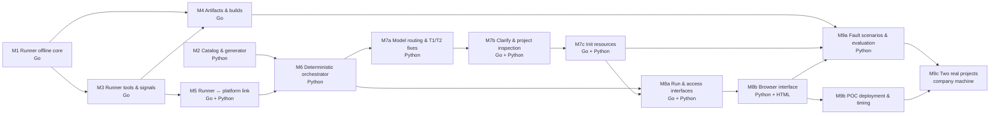

# POC Roadmap

- Date: 2026-10-17
- Design: [2026-10-17-container-agent-design.md](2026-10-17-container-agent-design.md)

The POC splits into nine milestones (M7 later split into M7a–M7c, M8 into M8a–M8b, M9 into M9a–M9c). Each milestone ends with working, tested software and gets its own detailed plan when it starts; only Milestone 1 is planned in detail today, because later plans depend on what earlier milestones teach us.

## Dependency graph



M1 and M2 share no code and can run in parallel. M3 and M4 can overlap once M3's lifecycle tools exist. M7 was split on 2026-10-18: M7a lands self-healing with model tiers first; M7b's conversational parts can then be tuned alongside M8's web UI. On the same day, init resources (topics, keyspaces, schema scripts) moved from inspection into M7c, so they also serve registered projects ([M7b design](2026-10-18-m7b-clarify-inspection-design.md)). M8 was split on 2026-10-19: M8a makes runs durable, recoverable, and access-controlled behind an HTTP and SSE interface; M8b builds the pages on the interface M8a verified ([M8 design](2026-10-19-m8-web-ui-design.md)). M9 was split on 2026-10-20 by the evidence each part yields: M9a measures repair on this machine, M9b proves the POC deploys and times prompt to healthy, M9c runs real projects on a company machine. M9 is done only when all three pass ([M9a design](2026-10-20-m9a-scenarios-eval-design.md)).

## Milestones

| # | Milestone | Delivers | Done when |
|---|---|---|---|
| M1 | Runner offline core | Go module; compose-go load and schema validation; security lint; managed labels; host-port pre-check; path guard; redaction; error fingerprinting; `cagent-runner validate` CLI; CI | `go test ./...` passes in CI; `cagent-runner validate` flags every risky sample |
| M2 | Catalog & generator | Pydantic models for `service.yaml`, middleware templates, and ClusterSpec; `requires`/`provides` matching; ClusterSpec → compose generation; MySQL, Redis, Kafka templates; local catalog directory; a service-field allow-list shared by the generator and `cagent-runner validate` — any field outside it reports `unreviewed-field` and needs approval, closing the escape vectors the M1 deny-list does not name (`uts`, `runtime`, `sysctls`, `device_cgroup_rules`, `security_opt` beyond the known-bad values) | Golden-file tests pass; generated YAML passes `cagent-runner validate`; a compose file using any field outside the allow-list fails validation |
| M3 | Runner tools & signals | Compose lifecycle (up, down, ps, logs) restricted to managed projects; signal collection into a filtered, redacted, fingerprinted diagnostic snapshot; L1–L3 probes (container state, healthcheck, HTTP/TCP) | Integration tests against a real Docker daemon start a sample cluster and report a crashing service correctly |
| M4 | Artifacts & builds | Nexus download with local credentials; snapshot → timestamped version; workdir build; `java-springboot` builder template; image cache by artifact sha256 | A sample Spring Boot app builds from release, snapshot, and workdir sources; a second build hits the cache |
| M5 | Runner ↔ platform link | Runner Hub (Python, WebSocket); tool RPC protocol; static-token auth; Runner reconnect | Platform calls each Runner tool over WSS; Runner survives a hub restart |
| M6 | Deterministic orchestrator | LangGraph state machine with a checkpointer (in-memory in M6; SQLite since M8a — the POC keeps SQLite, see the [M9a design](2026-10-20-m9a-scenarios-eval-design.md)); approval interrupt; verify L1–L4 plus stability window; ~10 T0 rules; budgets; oscillation detection; escalation | A registered sample cluster reaches "healthy" with no LLM; T0 rules fix port conflict and OOM scenarios |
| M7a | Model routing & T1/T2 fixes | LiteLLM model gateway with tiers in `platform/models.yaml` (local Ollama for the POC, Bedrock by configuration); rule-based tier choice (cross-service evidence, unknown signatures, failed attempts); Pydantic-validated answers retried once, then a tier up; T1/T2 diagnosis for failures no T0 rule covers; an environment-key allowlist for model-written patches: a patch may set only keys the service already declares (descriptor `runtime.env.required` and `defaults`, `requires[].bind` keys, middleware template `env`), and an undeclared key or an agent-loading value such as `-javaagent:` or `-agentpath:` goes to human approval instead of being applied (the M6 gate's `LD_*`/`DYLD_*` denylist cannot name every code-loading variable, e.g. `NODE_OPTIONS`, `JAVA_TOOL_OPTIONS`, `PYTHONPATH`) | With local models on real Docker: a single-service typo fixed on the small tier, a cross-service typo on the large tier, and a fix setting an undeclared key held for approval |
| M7b | Clarify & project inspection | Clarify: natural-language purpose → valid ClusterSpec, one deterministic question per generator gap (options, default), the model only extracting the first draft; read-only Runner `inspect` (fixed file set, Maven/Gradle modules, resource paths); descriptor drafts for unregistered projects — deterministic name, stack, build, output, model-filled runtime — that the user saves to `.cagent/services/<name>.yaml`; a `dockerfile` stack building from the project's own Dockerfile. Design: [2026-10-18-m7b-clarify-inspection-design.md](2026-10-18-m7b-clarify-inspection-design.md) | Clarify produces a valid ClusterSpec from a prompt; an unregistered single- and multi-module sample project gets a descriptor that builds and runs |
| M7c | Init resources | Descriptor `requires[].init` gains SQL/CQL scripts, Cassandra keyspaces, and Kafka topics; middleware templates declare how to run them; the generator adds one one-shot `<mw>-init` service per middleware (`service_completed_successfully`); during `build` the Runner stages scripts from the project's own descriptor (workdir) or from the downloaded jar (release, snapshot) into its workspace, mounted read-only; SHA-256 markers in the middleware make reruns safe; init failures escalate `init_failed`; a Cassandra template; drafts map scripts in code and take topics from the model. Design: [2026-10-18-m7c-init-resources-design.md](2026-10-18-m7c-init-resources-design.md) | A sample cluster starts with its MySQL schema, Cassandra keyspace and tables, and Kafka topics created before the application starts; scripts come from a workdir project and a release jar; a second `up` does not rerun them |
| M8a | Run & access interfaces | Runner serial execution across reconnects and a `status` tool; hub instance binding; SQLite store; `RunService` with versioned, idempotent commands and cluster exclusion; whitelisted phase events and timestamped, redacted diagnostic summaries; startup reconciliation and recovery approval; static users, sessions, CSRF, authorization; JSON API and SSE. Design: [2026-10-19-m8-web-ui-design.md](2026-10-19-m8-web-ui-design.md) | Every pending contract works over HTTP; crashes never consume a pending item twice or advance a graph on startup; a real Runner reaches healthy through the API |
| M8b | Browser interface | Jinja2 + HTMX pages: chat as a transcript with typed action cards, YAML diff approval, status panel with phase events and diagnostic summaries (no continuous log stream), escalation, reconcile and recovery views; SSE client; a persistent run record (pending items and decisions); Playwright tests in CI. Design: [2026-10-19-m8b-browser-design.md](2026-10-19-m8b-browser-design.md) | A user runs the full flow from the browser (M8 is done) |
| M9a | Fault scenarios & evaluation | Fault-scenario library under `scenarios/` with faults injected before generation, healthy baselines, and injection evidence; `cagent-eval` driving the orchestrator in-process with a real hub, Runner, and Docker; acceptance (default routing, three runs) apart from tier comparison (T0-only, T0 + small, T0 + large); offline judging and scoring with redacted evidence packs; CI checks and a T0 `ci-fast` set; the formal evaluation on the merged commit. Design: [2026-10-20-m9a-scenarios-eval-design.md](2026-10-20-m9a-scenarios-eval-design.md) | The formal evaluation of a frozen version is valid, complete, and reviewable, and CI passes; the report states whether R ≥ 80 % and the safety gate pass |
| M9b | POC deployment & timing | `deploy/poc` compose with configuration and a persistent SQLite volume (one process, one worker); start checks; restart verification; usage guide; local samples run through the deployed entry | One command starts the platform; a registered sample goes from prompt to healthy in under 15 minutes |
| M9c | Two real projects | On a company machine: artifact access, descriptors, init resources, business checks, and the full user flow for two real projects; time, human interventions, and failures recorded; new failures return, redacted, to the scenario library | Two real projects run end to end; with M9a and M9b passed, the POC success criteria in the design doc are met |

## Repository layout (target)

```
runner/            Go module: Runner binary and packages
platform/          Python: orchestrator, hub, catalog service, gateway config
web/               Web UI
catalog/           Middleware templates and sample service descriptors
scenarios/         Fault-scenario library
deploy/poc/        Compose file that runs the whole POC on one machine
docs/plans/        Design and plans
```
