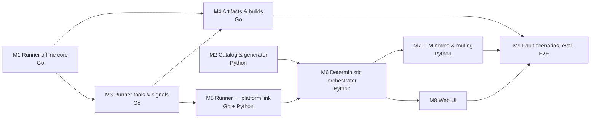

# POC Roadmap

- Date: 2026-10-17
- Design: [2026-10-17-container-agent-design.md](2026-10-17-container-agent-design.md)

The POC splits into nine milestones. Each milestone ends with working, tested software and gets its own detailed plan when it starts; only Milestone 1 is planned in detail today, because later plans depend on what earlier milestones teach us.

## Dependency graph



M1 and M2 share no code and can run in parallel. M3 and M4 can overlap once M3's lifecycle tools exist.

## Milestones

| # | Milestone | Delivers | Done when |
|---|---|---|---|
| M1 | Runner offline core | Go module; compose-go load and schema validation; security lint; managed labels; host-port pre-check; path guard; redaction; error fingerprinting; `cagent-runner validate` CLI; CI | `go test ./...` passes in CI; `cagent-runner validate` flags every risky sample |
| M2 | Catalog & generator | Pydantic models for `service.yaml`, middleware templates, and ClusterSpec; `requires`/`provides` matching; ClusterSpec → compose generation; MySQL, Redis, Kafka templates; local catalog directory; a service-field allow-list shared by the generator and `cagent-runner validate` — any field outside it reports `unreviewed-field` and needs approval, closing the escape vectors the M1 deny-list does not name (`uts`, `runtime`, `sysctls`, `device_cgroup_rules`, `security_opt` beyond the known-bad values) | Golden-file tests pass; generated YAML passes `cagent-runner validate`; a compose file using any field outside the allow-list fails validation |
| M3 | Runner tools & signals | Compose lifecycle (up, down, ps, logs) restricted to managed projects; signal collection into a filtered, redacted, fingerprinted diagnostic snapshot; L1–L3 probes (container state, healthcheck, HTTP/TCP) | Integration tests against a real Docker daemon start a sample cluster and report a crashing service correctly |
| M4 | Artifacts & builds | Nexus download with local credentials; snapshot → timestamped version; workdir build; `java-springboot` builder template; image cache by artifact sha256 | A sample Spring Boot app builds from release, snapshot, and workdir sources; a second build hits the cache |
| M5 | Runner ↔ platform link | Runner Hub (Python, WebSocket); tool RPC protocol; static-token auth; Runner reconnect | Platform calls each Runner tool over WSS; Runner survives a hub restart |
| M6 | Deterministic orchestrator | LangGraph state machine with Postgres checkpointer; approval interrupt; verify L1–L4 plus stability window; ~10 T0 rules; budgets; oscillation detection; escalation | A registered sample cluster reaches "healthy" with no LLM; T0 rules fix port conflict and OOM scenarios |
| M7 | LLM nodes & routing | LiteLLM config (Ollama + Bedrock); tier and node maps; complexity scorer; capability tags; Pydantic output validation with tier escalation; clarify node; T1/T2 diagnosis; unregistered-project inspection | Clarify produces a valid ClusterSpec from a prompt; T1/T2 fix scenarios no T0 rule covers |
| M8 | Web UI | Chat, YAML diff approval, status panel, live logs, escalation view | A user runs the full flow from the browser |
| M9 | Fault scenarios, eval, E2E | Fault-scenario library; per-tier eval harness; POC compose under `deploy/poc`; two real projects end to end | POC success criteria in the design doc are met |

## Repository layout (target)

```
runner/            Go module: Runner binary and packages
platform/          Python: orchestrator, hub, catalog service, gateway config
web/               Web UI
catalog/           Middleware templates and sample service descriptors
scenarios/         Fault-scenario library
deploy/poc/        Compose file that runs the whole POC on one machine
docs/plans/        Design and plans
```
