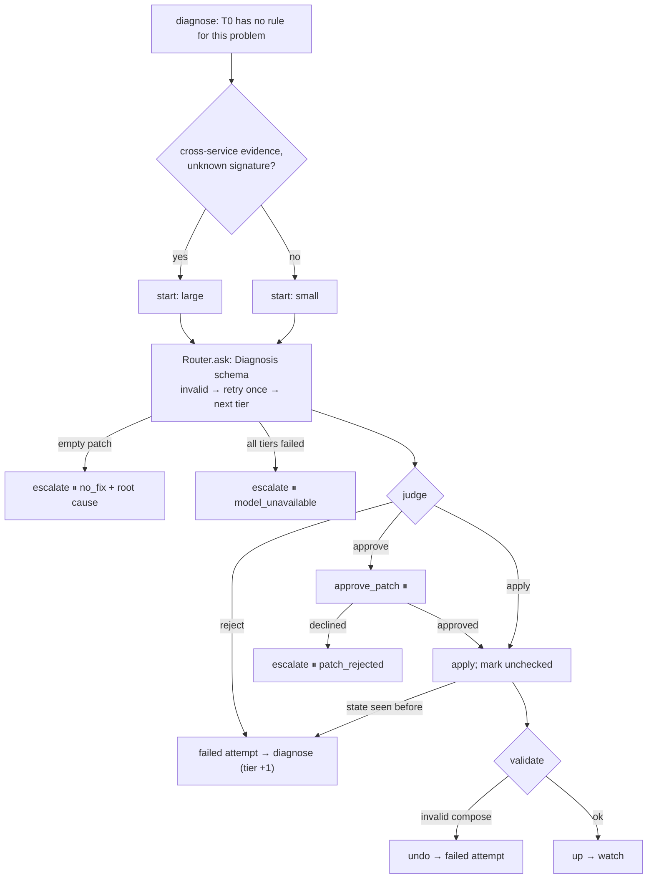
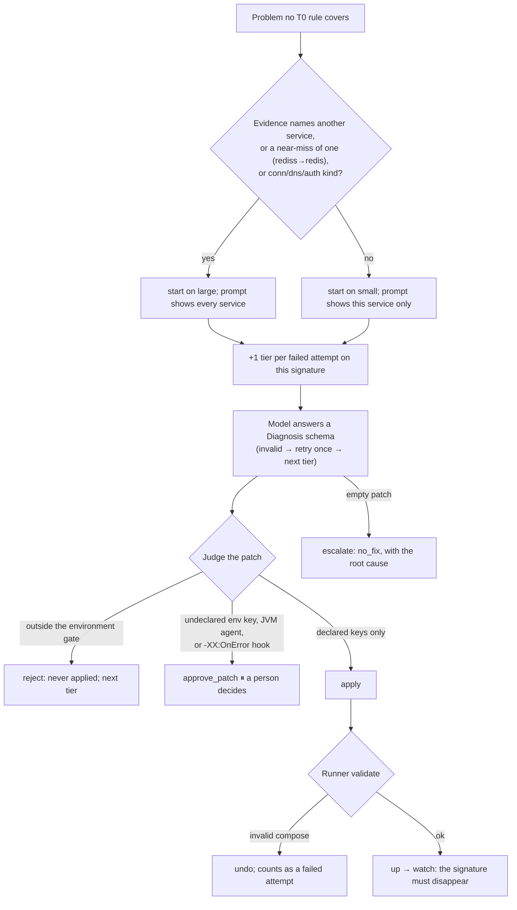
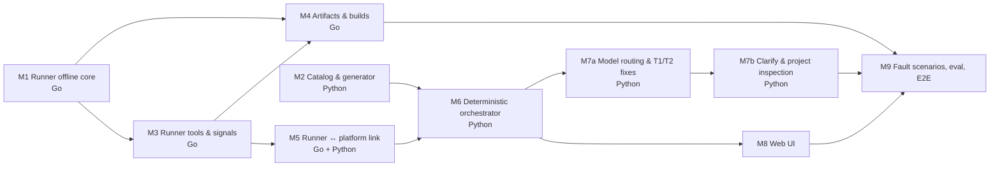

# M7a Model Routing & T1/T2 Fixes Implementation Plan

> **For Claude:** REQUIRED SUB-SKILL: Use superpowers:executing-plans to implement this plan task-by-task.

**Goal:** When no T0 rule covers a failure, let a model tier read the evidence and propose a fix; apply it only if it stays inside the environment and touches declared keys, hold it for a person if it sets an undeclared key or a JVM option that loads code or runs a command, and never apply anything else.

**Architecture:** `cagent.llm` is the model gateway: tiers in `platform/models.yaml` map to LiteLLM model strings, and a `Router` asks for a Pydantic-validated answer, retrying once and then moving up a tier. `cagent.diagnose` builds the prompt (secrets masked, `$$` shown as `$`), picks the starting tier by rules, and judges the returned JSON Patch: apply, approve, or reject. The orchestrator calls it from `diagnose` for problems T0 cannot fix, adds an `approve_patch` interrupt, and undoes a model fix that breaks the compose document.

**Tech Stack:** Python: `litellm` 1.106 (Ollama locally; Bedrock by configuration), `langgraph`, Pydantic. Go: compose-go. Local models: `tev1:4b-q4_K_M` (small), `qwen3.5:latest` (large) via Ollama 0.40.

- Roadmap: [2026-10-17-poc-roadmap.md](2026-10-17-poc-roadmap.md) — M7 is split into M7a (this plan) and M7b (clarify, project inspection)
- Design: [2026-10-17-container-agent-design.md](2026-10-17-container-agent-design.md), sections 5.3, 7, 8

---

## Decisions made while planning

| Decision | Why |
|---|---|
| Local Ollama for every tier; Bedrock only by configuration (user decision) | No Bedrock credentials on this machine. Code names tiers, so moving a tier to `bedrock/…` is a YAML change. |
| Split M7 into M7a and M7b (user decision) | Self-healing lands first; clarify and project inspection can be tuned with M8's web UI. |
| LiteLLM SDK in-process with `response_format=<Pydantic model>` | Verified with Ollama: all three local models returned schema-valid JSON. A LiteLLM proxy can sit behind the same model strings later. |
| Tiers `small = tev1:4b`, `large = qwen3.5:latest` | Measured (table below). `gpt-oss:20b` invented a fix for a code bug, so it is not a default. |
| Starting tier by rules: cross-service evidence or an unknown signature → large; +1 per failed attempt | Design 7.2: models do not rate themselves. A near-miss of another service's name (`rediss` vs `redis`, `difflib` ≥ 0.8) marks cross-service evidence. |
| Judge every model patch: reject outside the M6 gate; approve when it sets an undeclared env key, or a value that loads a JVM agent (`-javaagent/-agentpath/-agentlib`) or runs a command on JVM failure (`-XX:OnError`, `-XX:OnOutOfMemoryError`); else apply | The roadmap's allowlist: declared keys come from the service's own definition, so they track what the application uses. |
| Prompt view masks secret-looking env values and shows `$$` as `$` | Found on real models: shown `$$CACHE_PORT`, a model judged the command broken and gave up. |
| A model fix that makes `validate` fail is undone and counts as a failed attempt; a model repeating a tried state is a failed attempt, not oscillation | Found on real models: a fix passed the gate but produced an invalid `depends_on`; the retry repeated it. T0 rules keep strict oscillation. |

### Bugs found by running real models on real Docker while planning

1. **The Runner lost `$$` escapes when starting a cluster** (M3). `up` wrote the *interpolated* project with `MarshalYAML`, which does not re-escape `$`, so docker compose interpolated `$CACHE_HOST` again — from the host — and the container saw an empty value. The model saw `cannot reach cache at :` and reasonably blamed start-up order. Task 1 writes a non-interpolated load instead.
2. **The port rule failed near the top of the range** (M6). It only moved ports up by 1000; an ephemeral port such as 65271 had nowhere to go, and the M6 real-Docker test failed intermittently. Task 2 moves down when up is out of range.

### Model measurements (2026-10-18, local Ollama, temperature 0)

| Model | Single-service typo | Cross-service typo | Code bug (should give up) |
|---|---|---|---|
| `tev1:4b-q4_K_M` | fixed (12 s) | wrong: changed `depends_on` | gave up |
| `qwen3.5:latest` 9.7B | fixed (14 s) | fixed (21 s) | gave up |
| `gpt-oss:20b` | fixed (15 s) | fixed (27 s) | invented `SPRING_DATASOURCE_URL=jdbc:h2:…` |

## How a model fix is decided



## Prerequisites

- Work on a feature branch, not `main`.
- **Go is not installed on the host.** Run Go commands in the container as before.
- **Ollama** at `localhost:11434` serving `tev1:4b-q4_K_M` and `qwen3.5:latest` — needed only for Task 8's live test (`ollama list` shows them). Everything else uses a scripted fake model.

---

### Task 1: Keep `$$` escapes when the Runner starts a cluster

**Files:**
- Modify: `runner/internal/compose/load.go`, `runner/cmd/cagent-runner/main.go`
- Test: `runner/internal/compose/load_test.go`, `runner/cmd/cagent-runner/lifecycle_test.go`

**Step 1: Write the failing tests**

Append to `lifecycle_test.go`:

```go
func TestUpKeepsDollarEscapes(t *testing.T) {
	// The container must see $CACHE_HOST and expand it itself. Writing an interpolated
	// project back out would leave "$CACHE_HOST" in the file, and docker compose would then
	// interpolate it again from the host environment: an empty string.
	src := writeFile(t, "services:\n  c:\n    image: busybox:1.37\n"+
		"    command: [\"sh\", \"-c\", \"echo $$CACHE_HOST\"]\n    environment: { CACHE_HOST: redis }\n")
	d, f, root := withDocker(t, nil)
	written := filepath.Join(root, "clusters", "demo", "compose.yaml")
	f.Responses = map[string]dockercli.FakeResponse{
		"compose -p cagent-demo -f " + written + " up -d --remove-orphans": {},
	}
	var out, errOut bytes.Buffer
	if code := run([]string{"up", "-name", "demo", "-f", src}, &out, &errOut, d); code != exitOK {
		t.Fatalf("exit %d, stderr: %s", code, errOut.String())
	}
	data, _ := os.ReadFile(written)
	if !strings.Contains(string(data), "echo $$CACHE_HOST") {
		t.Errorf("escape lost in the written compose file:\n%s", data)
	}
}
```

Append to `load_test.go` (add `"strings"` to its imports):

```go
func TestLoadVerbatimKeepsEscapes(t *testing.T) {
	path := writeCompose(t, "services:\n  c:\n    image: busybox\n    command: [\"echo\", \"$$HOME\"]\n")
	p, err := LoadVerbatim(context.Background(), path, "demo")
	if err != nil {
		t.Fatal(err)
	}
	out, err := p.MarshalYAML()
	if err != nil {
		t.Fatal(err)
	}
	if !strings.Contains(string(out), "$$HOME") {
		t.Errorf("escape lost:\n%s", out)
	}
}
```

**Step 2: Run them to verify they fail**

Run: `docker run --rm -v "$PWD":/repo -w /repo/runner golang:1.24 go test ./cmd/cagent-runner/ ./internal/compose/`
Expected: FAIL — `escape lost in the written compose file` (the file says `echo $CACHE_HOST`), and `undefined: LoadVerbatim`.

**Step 3: Implement**

In `load.go`, above `serviceNames`:

```go
// LoadVerbatim loads a compose file like Load but without variable interpolation, for
// writing the project back out. MarshalYAML does not re-escape "$", so an interpolated
// project written to disk would turn each "$$" escape into "$", and docker compose would
// then interpolate it a second time from the host environment.
func LoadVerbatim(ctx context.Context, path, name string) (*types.Project, error) {
	opts, err := cli.NewProjectOptions([]string{path},
		cli.WithName(name),
		cli.WithResolvedPaths(true),
		cli.WithInterpolation(false),
	)
	if err != nil {
		return nil, fmt.Errorf("compose options: %w", err)
	}
	p, err := opts.LoadProject(ctx)
	if err != nil {
		return nil, fmt.Errorf("load %s: %w", path, err)
	}
	return p, nil
}
```

In `main.go`'s `runUp`, change `p, rep, err := check(cf, cluster.Project(*cf.name), d)` to `_, rep, err := check(cf, cluster.Project(*cf.name), d)`, and directly after the `if !rep.clean() { … }` block add:

```go
	// Checks need interpolated values; the file docker compose reads must keep its "$$".
	abs, err := filepath.Abs(*cf.file)
	if err != nil {
		fmt.Fprintln(stderr, err)
		return exitError
	}
	p, err := compose.LoadVerbatim(context.Background(), abs, cluster.Project(*cf.name))
	if err != nil {
		fmt.Fprintln(stderr, err)
		return exitError
	}
```

**Step 4: Run all Go tests**

Run: `docker run --rm -v "$PWD":/repo -w /repo golang:1.24 make runner-test`
Expected: thirteen `ok` lines.

**Step 5: Commit**

```bash
git add runner/internal/compose runner/cmd/cagent-runner
git commit -m "fix(runner): keep \$\$ escapes in the compose file a cluster starts from"
```

---

### Task 2: Port rule moves down near the top of the range

**Files:**
- Modify: `platform/src/cagent/rules.py`, `platform/tests/test_orchestrator_e2e.py`
- Test: `platform/tests/test_rules.py`

**Step 1: Write the failing test** — append to `test_rules.py`:

```python
def test_port_conflict_near_the_top_moves_down():
    # Ephemeral ports reach 65535; stepping up would leave the valid range.
    out = fixed(Problem("port:conflict", "db", "65271"), compose(db={"ports": ["65271:6379"]}))
    assert out["services"]["db"]["ports"] == ["64271:6379"]
```

**Step 2: Run it to verify it fails**

Run: `cd platform && uv run pytest tests/test_rules.py -k near_the_top`
Expected: FAIL — `fix is not None` assertion (the rule declined).

**Step 3: Implement** — in `rules.py`, add above `port_conflict`:

```python
def _free_port(port: int, used: set[int]) -> int | None:
    """The nearest port 1000 apart, upward first, then downward, that the document does not
    use and that stays within 1024–65535."""
    for step in (1000, -1000):
        candidate = port + step
        while 1024 <= candidate <= 65535:
            if candidate not in used:
                return candidate
            candidate += step
    return None
```

change `port_conflict`'s docstring to `"""Move a clashing published host port by 1000 (up, or down near the top) to a port unused in the document."""`, and replace its search loop

```python
        new = int(host) + 1000
        while new in used:
            new += 1000
        if new > 65535:
            return None
        used.add(new)
```

with:

```python
        new = _free_port(int(host), used)
        if new is None:
            return None
        used.add(new)
```

In `test_orchestrator_e2e.py`, the published-port assertion must accept either direction:

```python
        # Moved by 1000: up, or down when the taken port is near 65535.
        assert published in ([f"{port + 1000}:6379"], [f"{port - 1000}:6379"]), published
```

**Step 4: Run tests**

Run: `make platform-test`
Expected: ruff clean; `112 passed, 3 skipped`.

**Step 5: Commit**

```bash
git add platform/src/cagent/rules.py platform/tests/test_rules.py platform/tests/test_orchestrator_e2e.py
git commit -m "fix(platform): move a conflicting port down when up leaves the range"
```

---

### Task 3: Add LiteLLM

**Files:**
- Modify: `platform/pyproject.toml`, `platform/uv.lock`

**Step 1:** Run: `cd platform && uv add "litellm>=1.106"`
Expected: `+ litellm==1.106.0` (or a newer patch).

**Step 2:** Run: `make platform-test` — expected `112 passed, 3 skipped`.

**Step 3: Commit**

```bash
git add platform/pyproject.toml platform/uv.lock
git commit -m "build(platform): add litellm"
```

---

### Task 4: Model gateway and router

**Files:**
- Create: `platform/src/cagent/llm.py`, `platform/models.yaml`, `platform/tests/fakellm.py`
- Test: `platform/tests/test_llm.py`

**Step 1: Add the model configuration and the fake**

`platform/models.yaml`:

```yaml
# Model tiers for the POC, cheapest first. Code refers to tier names only; point a tier at
# another LiteLLM model string (bedrock/…, or openai/… behind a LiteLLM proxy) to change it.
#
# Chosen from measurements on 2026-10-18 with local Ollama (single-service typo, cross-service
# typo, source-code bug that must not be "fixed"):
#   tev1:4b         correct on single-service, wrong on cross-service, gave up on the code bug
#   qwen3.5:latest  correct on all three
#   gpt-oss:20b     correct on both typos, but invented a fix for the code bug, and slower
tiers:
  small:
    model: ollama_chat/tev1:4b-q4_K_M
    capabilities: [json]
    timeout_s: 120
  large:
    model: ollama_chat/qwen3.5:latest
    capabilities: [json]
    timeout_s: 300
```

`platform/tests/fakellm.py`:

```python
"""A scripted stand-in for LiteLLM: each model answers from its own queue."""

from typing import Any

from pydantic import ValidationError

from cagent.llm import ModelConfig, SchemaError, TierConfig

CONFIG = ModelConfig(
    tiers={"small": TierConfig(model="fake/small"), "large": TierConfig(model="fake/large")}
)


class FakeCompleter:
    def __init__(self, script: dict[str, list[Any]]):
        """script maps a model to its answers in order: a dict (validated against the
        requested schema) or an exception instance to raise."""
        self.script = {model: list(answers) for model, answers in script.items()}
        self.calls: list[tuple[str, str]] = []  # (model, user prompt)

    async def complete(self, model, system, user, schema, timeout_s):
        self.calls.append((model, user))
        answer = self.script[model].pop(0)
        if isinstance(answer, Exception):
            raise answer
        try:
            return schema.model_validate(answer)
        except ValidationError as e:  # as LiteLLMCompleter reports a bad answer
            raise SchemaError(str(e)) from e

    @property
    def models(self) -> list[str]:
        return [m for m, _ in self.calls]
```

**Step 2: Write the failing test**

```python
import pytest
from pydantic import BaseModel

from cagent.llm import (
    ModelConfig,
    ModelUnavailable,
    Router,
    SchemaError,
    TierConfig,
    load_model_config,
)

from .conftest import REPO
from .fakellm import CONFIG, FakeCompleter


class Answer(BaseModel):
    text: str


async def test_first_valid_answer_wins():
    fake = FakeCompleter({"fake/small": [{"text": "hi"}]})
    answer, tier = await Router(CONFIG, fake).ask("sys", "user", Answer, start="small")
    assert (answer.text, tier) == ("hi", "small")


async def test_invalid_answer_is_retried_once_then_moves_up():
    fake = FakeCompleter(
        {
            "fake/small": [SchemaError("bad"), SchemaError("bad again")],
            "fake/large": [{"text": "ok"}],
        }
    )
    answer, tier = await Router(CONFIG, fake).ask("sys", "user", Answer, start="small")
    assert tier == "large" and fake.models == ["fake/small", "fake/small", "fake/large"]


async def test_transport_errors_move_up_without_retry():
    fake = FakeCompleter({"fake/small": [TimeoutError()], "fake/large": [{"text": "ok"}]})
    _, tier = await Router(CONFIG, fake).ask("sys", "user", Answer, start="small")
    assert tier == "large" and fake.models == ["fake/small", "fake/large"]


async def test_tiers_without_the_capability_are_skipped():
    config = ModelConfig(
        tiers={
            "small": TierConfig(model="fake/small", capabilities=[]),
            "large": TierConfig(model="fake/large"),
        }
    )
    fake = FakeCompleter({"fake/large": [{"text": "ok"}]})
    _, tier = await Router(config, fake).ask("sys", "user", Answer, start="small")
    assert tier == "large" and fake.models == ["fake/large"]


async def test_top_tier_failing_raises():
    fake = FakeCompleter({"fake/large": [SchemaError("x"), SchemaError("y")]})
    with pytest.raises(ModelUnavailable, match="large: invalid answer"):
        await Router(CONFIG, fake).ask("sys", "user", Answer, start="large")


def test_tier_at_clamps_to_the_ends():
    router = Router(CONFIG, FakeCompleter({}))
    assert [router.tier_at(i) for i in (-1, 0, 1, 5)] == ["small", "small", "large", "large"]


def test_shipped_model_config_loads():
    config = load_model_config(REPO / "platform" / "models.yaml")
    assert config.order == ["small", "large"]
    assert all(t.model.startswith("ollama_chat/") for t in config.tiers.values())
```

**Step 3: Run it to verify it fails**

Run: `cd platform && uv run pytest tests/test_llm.py`
Expected: FAIL — `ModuleNotFoundError: No module named 'cagent.llm'`.

**Step 4: Write the implementation**

```python
"""Model gateway and routing (design section 7).

Code names tiers, never models. A YAML file maps each tier to a LiteLLM model string, so
moving from local Ollama to Bedrock changes configuration, not code. Every answer must parse
into a Pydantic schema; an invalid answer is retried once on the same tier, then the call
moves up a tier, and only the top tier failing raises.
"""

from collections.abc import Sequence
from pathlib import Path
from typing import Protocol, TypeVar

import yaml
from pydantic import BaseModel, ConfigDict, ValidationError

M = TypeVar("M", bound=BaseModel)


class TierConfig(BaseModel):
    model_config = ConfigDict(extra="forbid")

    model: str  # LiteLLM model string, e.g. ollama_chat/qwen3.5:latest or bedrock/…
    capabilities: list[str] = ["json"]
    timeout_s: float = 300


class ModelConfig(BaseModel):
    """tiers: name → model, in escalation order (first is cheapest)."""

    model_config = ConfigDict(extra="forbid")

    tiers: dict[str, TierConfig]

    @property
    def order(self) -> list[str]:
        return list(self.tiers)


def load_model_config(path: Path) -> ModelConfig:
    return ModelConfig.model_validate(yaml.safe_load(path.read_text()))


class SchemaError(Exception):
    """The model's answer did not match the schema."""


class ModelUnavailable(Exception):
    """Every eligible tier failed to give a valid answer."""


class Completer(Protocol):
    """One structured completion on one model; LiteLLMCompleter, or a fake in tests."""

    async def complete(
        self, model: str, system: str, user: str, schema: type[M], timeout_s: float
    ) -> M: ...


class LiteLLMCompleter:
    async def complete(
        self, model: str, system: str, user: str, schema: type[M], timeout_s: float
    ) -> M:
        import litellm  # imported lazily: heavy, and tests never need it

        litellm.suppress_debug_info = True
        response = await litellm.acompletion(
            model=model,
            messages=[{"role": "system", "content": system}, {"role": "user", "content": user}],
            response_format=schema,
            temperature=0,
            timeout=timeout_s,
        )
        try:
            return schema.model_validate_json(response.choices[0].message.content or "")
        except ValidationError as e:
            raise SchemaError(str(e)) from e


class Router:
    def __init__(self, config: ModelConfig, completer: Completer):
        self.config, self.completer = config, completer

    def tier_at(self, index: int) -> str:
        """The tier at a position in the escalation order, clamped to the ends."""
        order = self.config.order
        return order[max(0, min(index, len(order) - 1))]

    async def ask(
        self,
        system: str,
        user: str,
        schema: type[M],
        start: str,
        needs: Sequence[str] = ("json",),
    ) -> tuple[M, str]:
        """Return the first valid answer and the tier that gave it, starting at `start`."""
        order = self.config.order
        errors: list[str] = []
        for tier in order[order.index(start) :]:
            cfg = self.config.tiers[tier]
            if not set(needs) <= set(cfg.capabilities):
                errors.append(f"{tier}: lacks {sorted(set(needs) - set(cfg.capabilities))}")
                continue
            for _ in range(2):  # one retry on the same tier before moving up
                try:
                    return await self.completer.complete(
                        cfg.model, system, user, schema, cfg.timeout_s
                    ), tier
                except SchemaError as e:
                    errors.append(f"{tier}: invalid answer: {str(e)[:200]}")
                except Exception as e:  # network, timeout, model not found: try the next tier
                    errors.append(f"{tier}: {type(e).__name__}: {str(e)[:200]}")
                    break
        raise ModelUnavailable("; ".join(errors))
```

**Step 5: Run tests to verify they pass**

Run: `cd platform && uv run pytest tests/test_llm.py`
Expected: `7 passed`.

**Step 6: Commit**

```bash
git add platform/src/cagent/llm.py platform/models.yaml platform/tests/fakellm.py platform/tests/test_llm.py
git commit -m "feat(platform): add the model gateway with tiers, schema retries, and escalation"
```

---

### Task 5: Diagnosis, prompt view, and the patch judge

**Files:**
- Create: `platform/src/cagent/diagnose.py`
- Test: `platform/tests/test_diagnose.py`
- Create: `platform/tests/fixtures/e2e-catalog/middleware/modecheck.yaml`, `cacheclient.yaml`, `flagcheck.yaml`

**Step 1: Add the test templates** (also used by Tasks 6 and 8). Each is busybox that refuses to start until its configuration is right.

`modecheck.yaml` — a declared key with a typo (single service):

```yaml
# Test-only: refuses to start unless APP_MODE is "server". The template ships the typo
# "srvr", a declared key, so the model tier may fix it without asking (single service).
name: modecheck
kind: middleware
provides: { capability: modecheck }
image: "busybox:{version}"
command:
  - sh
  - -c
  - '[ "$APP_MODE" = server ] || { echo "FATAL: APP_MODE must be server, got $APP_MODE"; exit 1; }; mkdir -p /www && echo ok > /www/index.html && httpd -f -p 8080 -h /www'
versions: ["1.37"]
default_version: "1.37"
port: 8080
env:
  APP_MODE: srvr
  LOG_LEVEL: info
healthcheck:
  cmd: ["CMD", "wget", "-q", "-O", "/dev/null", "http://127.0.0.1:8080/"]
presets:
  tiny: { mem_limit: 64m, cpus: 0.25 }
```

`cacheclient.yaml` — a host name with a typo (needs the other services in view):

```yaml
# Test-only: must reach redis at CACHE_HOST:CACHE_PORT. The template ships the typo
# "rediss", so fixing it needs the other services in view (cross-service, large tier).
name: cacheclient
kind: middleware
provides: { capability: cacheclient }
image: "busybox:{version}"
command:
  - sh
  - -c
  - 'nc -z -w 3 "$CACHE_HOST" "$CACHE_PORT" || { echo "FATAL: cannot reach cache at $CACHE_HOST:$CACHE_PORT"; exit 1; }; mkdir -p /www && echo ok > /www/index.html && httpd -f -p 8080 -h /www'
versions: ["1.37"]
default_version: "1.37"
port: 8080
env:
  CACHE_HOST: rediss
  CACHE_PORT: "6379"
healthcheck:
  cmd: ["CMD", "wget", "-q", "-O", "/dev/null", "http://127.0.0.1:8080/"]
presets:
  tiny: { mem_limit: 64m, cpus: 0.25 }
```

`flagcheck.yaml` — needs a key the template does not declare:

```yaml
# Test-only: needs FEATURE_FLAG=on, a key the template does not declare, so a model fix
# that sets it must wait for a person's approval.
name: flagcheck
kind: middleware
provides: { capability: flagcheck }
image: "busybox:{version}"
command:
  - sh
  - -c
  - '[ "$FEATURE_FLAG" = on ] || { echo "FATAL: FEATURE_FLAG must be set to on"; exit 1; }; mkdir -p /www && echo ok > /www/index.html && httpd -f -p 8080 -h /www'
versions: ["1.37"]
default_version: "1.37"
port: 8080
env:
  LOG_LEVEL: info
healthcheck:
  cmd: ["CMD", "wget", "-q", "-O", "/dev/null", "http://127.0.0.1:8080/"]
presets:
  tiny: { mem_limit: 64m, cpus: 0.25 }
```

**Step 2: Write the failing test**

```python
import pytest

from cagent.catalog import load_catalog
from cagent.diagnose import (
    declared_env,
    is_cross_service,
    judge,
    mask_secrets,
    prompt_view,
    propose,
)
from cagent.llm import Router
from cagent.rules import Problem

from .conftest import FIXTURES, REPO_CATALOG, spec_with
from .fakellm import CONFIG, FakeCompleter

DECLARED = {"web": {"APP_MODE", "JAVA_OPTS"}}


def op(op, path, value=None):
    return {"op": op, "path": path, **({} if value is None else {"value": value})}


@pytest.mark.parametrize(
    "patch, verdict",
    [
        ([op("replace", "/services/web/environment/APP_MODE", "server")], "apply"),
        ([op("replace", "/services/web/mem_limit", "1g")], "apply"),
        ([op("remove", "/services/web/environment/OLD_KEY")], "apply"),
        ([op("add", "/services/web/environment/FEATURE_FLAG", "on")], "approve"),
        ([op("replace", "/services/web/environment", {"APP_MODE": "x", "NEW": "y"})], "approve"),
        ([op("add", "/services/web/environment/-", "NEW=1")], "approve"),
        ([op("replace", "/services/web/environment/JAVA_OPTS", "-javaagent:/x.jar")], "approve"),
        (
            [op("replace", "/services/web/environment/JAVA_OPTS", "-Xmx1g -agentpath:/a.so")],
            "approve",
        ),
        (
            [
                op(
                    "replace",
                    "/services/web/environment/JAVA_OPTS",
                    "-XX:OnOutOfMemoryError=sh -c x",
                )
            ],
            "approve",
        ),
        (
            [op("replace", "/services/web/environment/JAVA_OPTS", "-Xmx1g -XX:OnError=/x")],
            "approve",
        ),
        ([op("replace", "/services/web/environment/JAVA_OPTS", "-Xmx1g -XX:+UseG1GC")], "apply"),
        ([op("replace", "/services/web/image", "evil:1")], "reject"),
        ([op("add", "/services/web/environment/LD_PRELOAD", "/x.so")], "reject"),
    ],
)
def test_judge(patch, verdict):
    assert judge(patch, DECLARED)[0] == verdict


def test_judge_explains_approvals():
    _, reasons = judge([op("add", "/services/web/environment/FEATURE_FLAG", "on")], DECLARED)
    assert reasons == ["web: FEATURE_FLAG is not a declared environment key"]


def test_declared_env_comes_from_the_services_own_definitions(catalog, orders_spec):
    declared = declared_env(orders_spec, catalog)
    assert {
        "SPRING_PROFILES_ACTIVE",
        "JAVA_OPTS",
        "SPRING_DATASOURCE_URL",
        "SPRING_KAFKA_BOOTSTRAP_SERVERS",
    } <= declared["order-service"]
    assert "MYSQL_PASSWORD" in declared["mysql"]
    assert declared["redis"] == set()


def test_secret_values_are_masked_in_prompts():
    compose = {"services": {"db": {"environment": {"MYSQL_PASSWORD": "app", "MYSQL_USER": "app"}}}}
    masked = mask_secrets(compose)
    assert masked["services"]["db"]["environment"] == {
        "MYSQL_PASSWORD": "******",
        "MYSQL_USER": "app",
    }
    assert compose["services"]["db"]["environment"]["MYSQL_PASSWORD"] == "app"


@pytest.mark.parametrize(
    "kind, lines, cross",
    [
        ("exit:1", ["FATAL: APP_MODE must be server"], False),
        ("exit:1", ["nc: bad address 'rediss'"], True),  # near-miss of another service's name
        ("exit:1", ["cannot reach redis:6379"], True),
        ("conn:refused", [], True),
    ],
)
def test_cross_service_detection(kind, lines, cross):
    compose = {"services": {"app": {}, "redis": {}}}
    assert is_cross_service(Problem(kind, "app"), compose, lines) is cross


async def test_propose_starts_cross_service_problems_on_the_large_tier():
    fake = FakeCompleter(
        {
            "fake/large": [
                {
                    "root_cause": "typo",
                    "patch": [
                        {
                            "op": "replace",
                            "path": "/services/app/environment/CACHE_HOST",
                            "value": "redis",
                        }
                    ],
                }
            ]
        }
    )
    snapshot = {
        "services": [
            {
                "service": "app",
                "state": "exited",
                "exit_code": 1,
                "error_lines": ["nc: bad address 'rediss'"],
                "tail": [],
            }
        ]
    }
    compose = {"services": {"app": {"environment": {"CACHE_HOST": "rediss"}}, "redis": {}}}
    proposal = await propose(
        Router(CONFIG, fake),
        Problem("exit:1", "app"),
        snapshot,
        compose,
        {"app": {"CACHE_HOST"}},
        attempts=0,
    )
    assert (proposal.tier, proposal.verdict) == ("large", "apply")
    assert "redis:" in fake.calls[0][1]  # the whole cluster is in the prompt


async def test_propose_uses_only_the_failing_service_for_single_service_problems():
    catalog = load_catalog(REPO_CATALOG, FIXTURES / "e2e-catalog")
    spec = spec_with(services=[], middleware=[{"template": "modecheck"}, {"template": "redis"}])
    fake = FakeCompleter({"fake/small": [{"root_cause": "code bug", "patch": []}]})
    snapshot = {
        "services": [
            {"service": "modecheck", "error_lines": ["FATAL: APP_MODE must be server, got srvr"]}
        ]
    }
    compose = {
        "services": {
            "modecheck": {"environment": {"APP_MODE": "srvr"}},
            "redis": {"image": "redis:7.4"},
        }
    }
    proposal = await propose(
        Router(CONFIG, fake),
        Problem("exit:1", "modecheck"),
        snapshot,
        compose,
        declared_env(spec, catalog),
        attempts=0,
    )
    assert (proposal.tier, proposal.verdict) == ("small", "give_up")
    assert "redis:7.4" not in fake.calls[0][1]


def test_prompt_view_shows_commands_as_the_container_sees_them():
    compose = {
        "services": {
            "app": {
                "command": ["sh", "-c", 'nc -z "$$CACHE_HOST" "$$CACHE_PORT"'],
                "environment": {"DB_PASSWORD": "pw", "MODE": "a$$b"},
            }
        }
    }
    view = prompt_view(compose)["services"]["app"]
    assert view["command"][2] == 'nc -z "$CACHE_HOST" "$CACHE_PORT"'
    assert view["environment"] == {"DB_PASSWORD": "******", "MODE": "a$b"}
    assert compose["services"]["app"]["command"][2].count("$$") == 2  # input untouched
```

**Step 3: Run it to verify it fails**

Run: `cd platform && uv run pytest tests/test_diagnose.py`
Expected: FAIL — `ModuleNotFoundError: No module named 'cagent.diagnose'`.

**Step 4: Write the implementation**

```python
"""T1/T2: model-written fixes for failures no T0 rule covers (design 5.3).

The model sees the failing service's redacted evidence and its compose config (with secret
values masked), proposes a JSON Patch, and the patch is judged before anything changes:

  apply    inside the environment gate, and only declared environment keys
  approve  inside the gate, but sets an undeclared key, or a value that loads a JVM agent or
           runs a command on JVM failure: a person decides
  reject   outside the gate: never applied; the next attempt moves up a tier

Declared keys come from the service's own definition (descriptor env, bind keys, template
env), so the allowlist follows what the application really uses (roadmap, M7).
"""

import copy
import difflib
import re
from dataclasses import dataclass, field
from typing import Any, Literal

import yaml
from pydantic import BaseModel, ConfigDict

from cagent.catalog import Catalog
from cagent.llm import Router
from cagent.patches import within_environment
from cagent.rules import Problem
from cagent.spec import ClusterSpec

EnvValue = str | int | float | bool | None


class PatchOp(BaseModel):
    model_config = ConfigDict(extra="forbid")

    op: Literal["add", "replace", "remove"]
    path: str
    value: EnvValue | dict[str, EnvValue] | list[str] = None


class Diagnosis(BaseModel):
    root_cause: str
    patch: list[PatchOp]


@dataclass(frozen=True)
class Proposal:
    tier: str
    signature: str
    root_cause: str
    patch: list[dict[str, Any]]
    verdict: Literal["apply", "approve", "reject", "give_up"]
    reasons: list[str] = field(default_factory=list)


SYSTEM = (
    "You fix docker compose clusters started for testing. You may only change service "
    "environment settings: published ports, mem_limit, cpus, environment variables, platform, "
    "depends_on, and healthcheck timing. Never change images, commands, volumes, or anything "
    "else. Keep the document's existing shapes: a mapping such as environment or depends_on "
    "stays a mapping, and prefer one field per operation. "
    "If the cause lies in the application's own code or cannot be fixed by those "
    "settings, return an empty patch. Paths are RFC 6901 JSON Pointers into the compose "
    "document, e.g. /services/web/environment/APP_MODE. Answer only with JSON matching the "
    "schema."
)

_SECRET_KEY = re.compile(r"(?i)password|passwd|pwd|secret|token|api_?key|access_?key")
# JVM options that load code or run a shell command: agents, and the OnError/OnOutOfMemoryError
# hooks, which execute their argument when the JVM crashes or runs out of memory.
_AGENT_VALUE = re.compile(r"(?i)-(javaagent|agentpath|agentlib)[:=]|-XX:\+?On(OutOfMemory)?Error\b")
_ENV_KEY_PATH = re.compile(r"/services/([^/]+)/environment/([^/]+)")
_ENV_ROOT_PATH = re.compile(r"/services/([^/]+)/environment")
_CROSS_KINDS = {"conn:refused", "dns:unresolved", "auth:denied"}


def declared_env(spec: ClusterSpec, catalog: Catalog) -> dict[str, set[str]]:
    """Environment keys each service already uses, by its own definition."""
    declared: dict[str, set[str]] = {}
    for ref in spec.services:
        desc = catalog.services.get(ref.name)
        if desc is None:
            continue
        keys = set(desc.runtime.env.required) | set(desc.runtime.env.defaults) | set(ref.env)
        for req in desc.requires:
            keys |= set(req.bind)
        declared[ref.name] = keys
    for m in spec.middleware:
        if (tpl := catalog.middleware.get(m.template)) is not None:
            declared[m.instance] = set(tpl.env)
    return declared


def mask_secrets(compose: dict[str, Any]) -> dict[str, Any]:
    """A copy whose secret-looking environment values read ******, for prompts."""
    masked = copy.deepcopy(compose)
    for svc in masked.get("services", {}).values():
        env = svc.get("environment")
        if isinstance(env, dict):
            for k in env:
                if _SECRET_KEY.search(k):
                    env[k] = "******"
    return masked


def _unescape_compose(value: Any) -> Any:
    """Undo compose's $$ escaping, recursively, so the model reads what the container sees."""
    if isinstance(value, str):
        return value.replace("$$", "$")
    if isinstance(value, dict):
        return {k: _unescape_compose(v) for k, v in value.items()}
    if isinstance(value, list):
        return [_unescape_compose(v) for v in value]
    return value


def prompt_view(compose: dict[str, Any]) -> dict[str, Any]:
    """The compose document as a model should read it: secrets masked, and $$ shown as $.
    Seeing the escape, a model took `$$CACHE_PORT` for a bug in the command and gave up."""
    return _unescape_compose(mask_secrets(compose))


def _env_keys(op: dict[str, Any]) -> list[tuple[str, str]]:
    """(service, key) pairs an operation sets."""
    path = op["path"]
    if m := _ENV_KEY_PATH.fullmatch(path):
        key = m.group(2).replace("~1", "/").replace("~0", "~")
        if key.isdigit() or key == "-":  # list-form environment: "KEY=value"
            value = op.get("value")
            return [(m.group(1), str(value).partition("=")[0])] if value is not None else []
        return [(m.group(1), key)]
    if (m := _ENV_ROOT_PATH.fullmatch(path)) and isinstance(op.get("value"), dict):
        return [(m.group(1), k) for k in op["value"]]
    if m and isinstance(op.get("value"), list):
        return [(m.group(1), str(e).partition("=")[0]) for e in op["value"]]
    return []


def _values(value: Any) -> list[str]:
    if isinstance(value, dict):
        return [str(v) for v in value.values()]
    if isinstance(value, list):
        return [str(v) for v in value]
    return [] if value is None else [str(value)]


def judge(patch: list[dict[str, Any]], declared: dict[str, set[str]]) -> tuple[str, list[str]]:
    """Classify a model patch as apply, approve, or reject, with the reasons."""
    if not within_environment(patch):
        return "reject", ["changes something outside the environment gate"]
    reasons = []
    for op in patch:
        if op["op"] == "remove":
            continue
        for service, key in _env_keys(op):
            if key not in declared.get(service, set()):
                reasons.append(f"{service}: {key} is not a declared environment key")
        if op["path"].split("/")[3:4] == ["environment"] and any(
            _AGENT_VALUE.search(v) for v in _values(op.get("value"))
        ):
            reasons.append(
                "a value loads a JVM agent or command hook "
                "(-javaagent, -agentpath, -agentlib, -XX:OnError, -XX:OnOutOfMemoryError)"
            )
    return ("approve", reasons) if reasons else ("apply", [])


def is_cross_service(problem: Problem, compose: dict[str, Any], lines: list[str]) -> bool:
    """True when the evidence points at another service, so the whole cluster is in scope."""
    if problem.kind in _CROSS_KINDS:
        return True
    others = sorted(set(compose.get("services", {})) - {problem.service})
    for token in re.findall(r"[A-Za-z0-9][A-Za-z0-9_.-]*", " ".join(lines)):
        if token in others or difflib.get_close_matches(token, others, n=1, cutoff=0.8):
            return True
    return False


def _evidence(snapshot: dict[str, Any], service: str) -> tuple[dict[str, Any], list[str]]:
    for s in snapshot.get("services", []):
        if s.get("service") == service:
            lines = list(dict.fromkeys([*s.get("error_lines", []), *s.get("tail", [])]))
            return s, lines
    return {}, []


def prompt(
    problem: Problem,
    state: dict[str, Any],
    lines: list[str],
    compose: dict[str, Any],
    declared: dict[str, set[str]],
    cross: bool,
) -> str:
    services = prompt_view(compose)["services"]
    scope = services if cross else {problem.service: services.get(problem.service, {})}
    keys = {s: sorted(declared.get(s, set())) for s in scope}
    log = [f"  {line}" for line in lines[-25:]] or ["  (none)"]
    return "\n".join(
        [
            f"Service `{problem.service}` failed: signature {problem.signature}, "
            f"state {state.get('state', 'unknown')}, exit code {state.get('exit_code', 'n/a')}.",
            "Recent log lines (redacted):",
            *log,
            "Compose services:",
            yaml.safe_dump(scope, sort_keys=False).rstrip(),
            f"Declared environment keys: {keys}",
            "Propose a JSON Patch against the compose document.",
        ]
    )


async def propose(
    router: Router,
    problem: Problem,
    snapshot: dict[str, Any],
    compose: dict[str, Any],
    declared: dict[str, set[str]],
    attempts: int,
) -> Proposal:
    """Ask the model for a fix. The tier rises with cross-service scope and failed attempts."""
    state, lines = _evidence(snapshot, problem.service)
    cross = is_cross_service(problem, compose, lines)
    start = router.tier_at((1 if cross or problem.kind.startswith("unknown:") else 0) + attempts)
    diag, tier = await router.ask(
        SYSTEM, prompt(problem, state, lines, compose, declared, cross), Diagnosis, start=start
    )
    patch = [op.model_dump(exclude={"value"} if op.op == "remove" else set()) for op in diag.patch]
    if not patch:
        return Proposal(tier, problem.signature, diag.root_cause, [], "give_up")
    verdict, reasons = judge(patch, declared)
    return Proposal(tier, problem.signature, diag.root_cause, patch, verdict, reasons)
```

**Step 5: Run tests to verify they pass**

Run: `cd platform && uv run pytest tests/test_diagnose.py && cd .. && make platform-test`
Expected: `23 passed`; then `142 passed, 3 skipped`.

**Step 6: Commit**

```bash
git add platform/src/cagent/diagnose.py platform/tests/test_diagnose.py platform/tests/fixtures/e2e-catalog
git commit -m "feat(platform): ask model tiers for fixes and judge them against declared keys"
```

---

### Task 6: Orchestrator calls the model tiers

**Files:**
- Modify (full file below): `platform/src/cagent/orchestrator.py`
- Modify (full file below): `platform/tests/simcluster.py`
- Test: `platform/tests/test_orchestrator_llm.py`

**Step 1: Teach SimCluster configuration failures** — replace `simcluster.py`:

```python
"""A fake Runner and Docker for orchestrator tests.

It answers the Runner's tools from a tiny model of a cluster: which host ports are taken, how
much memory each service needs, which services crash, and how long healthchecks stay in
"starting". That is enough to drive every branch of the state machine deterministically.
"""

from typing import Any

import yaml

from cagent.hub import ToolResult
from cagent.rules import to_mb


class SimCluster:
    def __init__(
        self,
        *,
        occupied_ports: set[int] | None = None,
        needs_mb: dict[str, int] | None = None,
        crash: dict[str, int] | None = None,
        findings: list[dict[str, str]] | None = None,
        starting_snapshots: int = 0,
        requires_env: dict[str, dict[str, str]] | None = None,
        errors: dict[str, str] | None = None,
    ):
        self.occupied = occupied_ports or set()
        self.needs_mb = needs_mb or {}  # below this mem_limit the service is OOM-killed
        self.crash = crash or {}  # service -> exit code, a failure no T0 rule fixes
        self.findings = findings or []  # lint findings until the user allows them
        self.starting_snapshots = starting_snapshots
        # service -> environment it needs; until it has it, it exits 1 logging errors[service]
        self.requires_env = requires_env or {}
        self.errors = errors or {}
        self.compose: dict[str, Any] | None = None
        self.calls: list[str] = []
        self.builds: list[dict[str, Any]] = []

    async def call(self, runner_id: str, method: str, params: dict[str, Any], timeout=None):
        self.calls.append(method)
        return getattr(self, f"_{method}")(params)

    @staticmethod
    def _host_ports(svc: dict[str, Any]) -> list[int]:
        return [int(str(p).split(":")[0]) for p in svc.get("ports") or [] if ":" in str(p)]

    def _validate(self, p: dict[str, Any]) -> ToolResult:
        doc = yaml.safe_load(p["compose"])
        conflicts = [
            {"service": name, "port": port, "reason": "in-use"}
            for name, svc in doc["services"].items()
            for port in self._host_ports(svc)
            if port in self.occupied
        ]
        allowed = set(p.get("allow") or [])
        findings = [f for f in self.findings if f"{f['service']}:{f['rule']}" not in allowed]
        out = {"project": p["name"], "findings": findings, "port_conflicts": conflicts}
        return ToolResult(1 if findings or conflicts else 0, out)

    def _build(self, p: dict[str, Any]) -> ToolResult:
        self.builds.append(p)
        return ToolResult(0, {"image": p["tag"], "cached": False})

    def _up(self, p: dict[str, Any]) -> ToolResult:
        self.compose = yaml.safe_load(p["compose"])
        self._starting = self.starting_snapshots
        return ToolResult(0, {"project": f"cagent-{p['name']}"})

    def _service(self, name: str, svc: dict[str, Any]) -> dict[str, Any]:
        s = {
            "service": name,
            "state": "running",
            "exit_code": 0,
            "oom_killed": False,
            "restart_count": 0,
            "error_lines": [],
            "tail": [],
            "signatures": [],
        }
        need, limit = self.needs_mb.get(name), to_mb(svc.get("mem_limit", "0"))
        if need and (limit is None or limit < need):
            s.update(
                state="exited", exit_code=137, oom_killed=True, signatures=[f"oom:killed@{name}"]
            )
        elif name in self.crash:
            code = self.crash[name]
            s.update(state="exited", exit_code=code, signatures=[f"exit:{code}@{name}"])
        elif (want := self.requires_env.get(name)) and any(
            str((svc.get("environment") or {}).get(k)) != v for k, v in want.items()
        ):
            line = self.errors.get(name, f"FATAL: {name} is misconfigured")
            s.update(
                state="exited",
                exit_code=1,
                error_lines=[line],
                tail=[line],
                signatures=[f"exit:1@{name}"],
            )
        elif "healthcheck" in svc:
            s["health"] = "starting" if self._starting > 0 else "healthy"
        return s

    def _snapshot(self, p: dict[str, Any]) -> ToolResult:
        services = [self._service(n, s) for n, s in sorted(self.compose["services"].items())]
        self._starting = max(0, self._starting - 1)
        return ToolResult(0, {"project": f"cagent-{p['name']}", "services": services})

    def _verify(self, p: dict[str, Any]) -> ToolResult:
        services = [self._service(n, s) for n, s in sorted(self.compose["services"].items())]
        ok = all(s["state"] == "running" and s.get("health") in (None, "healthy") for s in services)
        reached = ("L3" if p.get("probes") else "L2") if ok else ""
        return ToolResult(0 if ok else 1, {"passed": ok, "reached": reached, "results": []})
```

**Step 2: Write the failing test**

```python
"""The orchestrator with model tiers, against SimCluster and a scripted model."""

import pytest
import yaml
from langgraph.checkpoint.memory import InMemorySaver

from cagent.catalog import load_catalog
from cagent.hub import ToolResult
from cagent.llm import Router
from cagent.orchestrator import Orchestrator

from .conftest import FIXTURES, REPO_CATALOG, spec_with
from .fakellm import CONFIG, FakeCompleter
from .simcluster import SimCluster
from .test_orchestrator import FAST, no_sleep


@pytest.fixture
def e2e_catalog():
    return load_catalog(REPO_CATALOG, FIXTURES / "e2e-catalog")


def run(sim, catalog, fake):
    return Orchestrator(
        sim, catalog, InMemorySaver(), FAST, sleep=no_sleep, router=Router(CONFIG, fake)
    )


def answer(path, value, op="replace", cause="typo"):
    return {"root_cause": cause, "patch": [{"op": op, "path": path, "value": value}]}


async def start_and_approve(o, spec):
    await o.start("t1", spec, "laptop-1")
    return await o.resume("t1", {"approve": True})


async def test_small_tier_fixes_a_declared_key_by_itself(e2e_catalog):
    sim = SimCluster(
        requires_env={"modecheck": {"APP_MODE": "server"}},
        errors={"modecheck": "FATAL: APP_MODE must be server, got srvr"},
    )
    fake = FakeCompleter(
        {"fake/small": [answer("/services/modecheck/environment/APP_MODE", "server")]}
    )
    status = await start_and_approve(
        run(sim, e2e_catalog, fake), spec_with(services=[], middleware=[{"template": "modecheck"}])
    )
    assert status.outcome == "healthy"
    assert [f["rule"] for f in status.fixes] == ["llm:small"]
    assert fake.models == ["fake/small"]


async def test_cross_service_problem_goes_to_the_large_tier(e2e_catalog):
    sim = SimCluster(
        requires_env={"cacheclient": {"CACHE_HOST": "redis"}},
        errors={"cacheclient": "nc: bad address 'rediss'"},
    )
    fake = FakeCompleter(
        {"fake/large": [answer("/services/cacheclient/environment/CACHE_HOST", "redis")]}
    )
    spec = spec_with(services=[], middleware=[{"template": "cacheclient"}, {"template": "redis"}])
    status = await start_and_approve(run(sim, e2e_catalog, fake), spec)
    assert status.outcome == "healthy" and [f["rule"] for f in status.fixes] == ["llm:large"]


async def test_undeclared_key_waits_for_a_person(e2e_catalog):
    sim = SimCluster(
        requires_env={"flagcheck": {"FEATURE_FLAG": "on"}},
        errors={"flagcheck": "FATAL: FEATURE_FLAG must be set to on"},
    )
    fake = FakeCompleter(
        {"fake/small": [answer("/services/flagcheck/environment/FEATURE_FLAG", "on", op="add")]}
    )
    o = run(sim, e2e_catalog, fake)
    status = await start_and_approve(
        o, spec_with(services=[], middleware=[{"template": "flagcheck"}])
    )
    assert status.waiting["kind"] == "patch_approval"
    assert status.waiting["reasons"] == [
        "flagcheck: FEATURE_FLAG is not a declared environment key"
    ]
    assert "up" in sim.calls and sim.calls[-1] == "snapshot"  # nothing applied yet
    status = await o.resume("t1", {"approve": True})
    assert status.outcome == "healthy" and status.fixes[-1]["rule"] == "llm:small"


async def test_rejected_approval_escalates(e2e_catalog):
    sim = SimCluster(requires_env={"flagcheck": {"FEATURE_FLAG": "on"}})
    fake = FakeCompleter(
        {"fake/small": [answer("/services/flagcheck/environment/FEATURE_FLAG", "on", op="add")]}
    )
    o = run(sim, e2e_catalog, fake)
    await start_and_approve(o, spec_with(services=[], middleware=[{"template": "flagcheck"}]))
    status = await o.resume("t1", {"approve": False})
    assert status.waiting["kind"] == "escalation" and status.waiting["reason"] == "patch_rejected"


async def test_a_patch_outside_the_gate_is_never_applied_and_the_next_try_moves_up(e2e_catalog):
    sim = SimCluster(requires_env={"modecheck": {"APP_MODE": "server"}})
    fake = FakeCompleter(
        {
            "fake/small": [answer("/services/modecheck/image", "busybox:latest")],
            "fake/large": [answer("/services/modecheck/environment/APP_MODE", "server")],
        }
    )
    status = await start_and_approve(
        run(sim, e2e_catalog, fake), spec_with(services=[], middleware=[{"template": "modecheck"}])
    )
    assert status.outcome == "healthy"
    assert fake.models == ["fake/small", "fake/large"]
    assert sim.compose["services"]["modecheck"]["image"] == "busybox:1.37"


async def test_giving_up_escalates_with_the_root_cause(e2e_catalog):
    sim = SimCluster(crash={"modecheck": 1})
    fake = FakeCompleter({"fake/small": [{"root_cause": "a bug in the application", "patch": []}]})
    await (o := run(sim, e2e_catalog, fake)).start(
        "t1", spec_with(services=[], middleware=[{"template": "modecheck"}]), "laptop-1"
    )
    status = await o.resume("t1", {"approve": True})
    assert status.waiting["reason"] == "no_fix"
    assert status.waiting["root_cause"] == "a bug in the application"


async def test_unreachable_models_escalate(e2e_catalog):
    sim = SimCluster(crash={"modecheck": 1})
    fake = FakeCompleter({"fake/small": [ConnectionError()], "fake/large": [ConnectionError()]})
    o = run(sim, e2e_catalog, fake)
    await o.start("t1", spec_with(services=[], middleware=[{"template": "modecheck"}]), "laptop-1")
    status = await o.resume("t1", {"approve": True})
    assert status.waiting["reason"] == "model_unavailable"


class RejectsListDependsOn(SimCluster):
    """Stands in for a Runner whose validate rejects what a gate-passing patch produced."""

    def _validate(self, p):
        doc = yaml.safe_load(p["compose"])
        if any(isinstance(s.get("depends_on"), list) for s in doc["services"].values()):
            return ToolResult(2, None, "services.modecheck.depends_on.0 must be a mapping")
        return super()._validate(p)


async def test_a_patch_that_breaks_the_compose_is_undone_and_retried_higher(e2e_catalog):
    sim = RejectsListDependsOn(requires_env={"modecheck": {"APP_MODE": "server"}})
    fake = FakeCompleter(
        {
            # Passes the schema and the gate, but the Runner rejects the result.
            "fake/small": [answer("/services/modecheck/depends_on", ["redis"], op="add")],
            "fake/large": [answer("/services/modecheck/environment/APP_MODE", "server")],
        }
    )
    status = await start_and_approve(
        run(sim, e2e_catalog, fake), spec_with(services=[], middleware=[{"template": "modecheck"}])
    )
    assert status.outcome == "healthy"
    assert fake.models == ["fake/small", "fake/large"]
    assert [f["rule"] for f in status.fixes] == ["llm:large"]  # the broken fix was undone
    assert "depends_on" not in status.compose["services"]["modecheck"]


async def test_a_model_repeating_a_tried_state_moves_up_instead_of_escalating(e2e_catalog):
    sim = RejectsListDependsOn(requires_env={"modecheck": {"APP_MODE": "server"}})
    bad = answer("/services/modecheck/depends_on", ["redis"], op="add")
    fake = FakeCompleter(
        {
            "fake/small": [bad],
            "fake/large": [bad, answer("/services/modecheck/environment/APP_MODE", "server")],
        }
    )
    status = await start_and_approve(
        run(sim, e2e_catalog, fake), spec_with(services=[], middleware=[{"template": "modecheck"}])
    )
    assert status.outcome == "healthy"
    assert fake.models == ["fake/small", "fake/large", "fake/large"]
```

**Step 3: Run it to verify it fails**

Run: `cd platform && uv run pytest tests/test_orchestrator_llm.py`
Expected: FAIL — `TypeError: Orchestrator.__init__() got an unexpected keyword argument 'router'`.

**Step 4: Replace `orchestrator.py`**

Changes from M6: the `router` argument; `snapshot`, `proposal`, `rejected`, and `unchecked` state; watch and stabilize keep the snapshot for the model; `diagnose` falls back to `_ask_model`; `_apply_fix` and `_failed_attempt` are shared by T0 and model fixes; the `approve_patch` node; and `validate` undoes an unchecked model fix that broke the document. Without a router, behaviour is exactly M6's.

```python
"""Deterministic orchestrator: the design's state machine (section 4) as a LangGraph graph.

    generate → validate → approve ⏸ → build → up → watch → stabilize → done
                  ↑                              │        │
                  └────────── diagnose ←─────────┴────────┘
                     (T0 rules, then model tiers)  │ undeclared env key / JVM agent
                                 │                 ▼
                                 │          approve_patch ⏸
                                 │ no rule / no fix / budget / oscillation
                                 ▼
                             escalate ⏸

Only `approve`, `approve_patch`, and `escalate` wait for a person, via LangGraph interrupts;
they do nothing before interrupting, because a node that called interrupt() runs again from
the top when resumed. All cluster work goes through the Runner's tools, so the orchestrator
never touches Docker.
"""

import asyncio
import re
import time
from collections.abc import Awaitable, Callable
from dataclasses import asdict, dataclass
from typing import Any, Protocol, TypedDict

from jsonpatch import JsonPatchException
from jsonpointer import JsonPointerException
from langgraph.graph import END, START, StateGraph
from langgraph.types import Command, interrupt

from cagent.catalog import Catalog
from cagent.diagnose import declared_env, propose
from cagent.generate import GenerationError, generate, to_yaml
from cagent.hub import ToolResult
from cagent.llm import ModelUnavailable, Router
from cagent.patches import apply, fingerprint, within_environment
from cagent.rules import (
    Problem,
    first_fix,
    problems_from_snapshot,
    problems_from_validate,
    upstream_first,
)
from cagent.spec import ClusterSpec


class ToolCaller(Protocol):
    """What the orchestrator needs from the hub: RunnerHub, or a fake in tests."""

    async def call(
        self, runner_id: str, method: str, params: dict[str, Any], timeout: float | None = None
    ) -> ToolResult: ...


@dataclass(frozen=True)
class Settings:
    """Budgets and timings. Defaults follow design section 5.5."""

    max_attempts_per_signature: int = 3
    max_rounds: int = 10
    deadline_s: float = 1800
    startup_timeout_s: float = 300
    poll_interval_s: float = 3
    stability_window_s: float = 120


class State(TypedDict, total=False):
    cluster: str
    runner: str
    spec: dict[str, Any]
    compose: dict[str, Any] | None
    allow: list[str]
    approved: bool
    built: bool
    findings: list[dict[str, Any]]
    problems: list[dict[str, Any]]
    snapshot: dict[str, Any]  # evidence for the model tiers
    proposal: dict[str, Any] | None  # a model fix waiting for approval
    rejected: list[dict[str, Any]]  # model fixes that could not be used
    unchecked: dict[str, Any] | None  # a model fix applied but not yet validated
    restarts: dict[str, int]
    attempts: dict[str, int]
    rounds: int
    seen: list[str]
    fixes: list[dict[str, Any]]
    report: dict[str, Any] | None
    escalation: dict[str, Any] | None
    deadline: float
    outcome: str | None


@dataclass(frozen=True)
class Status:
    """Where one cluster run stands."""

    outcome: str | None  # healthy, rejected, escalated; None while running or waiting
    waiting: dict[str, Any] | None  # the approval or escalation a person must answer
    compose: dict[str, Any] | None
    fixes: list[dict[str, Any]]


_BIND = re.compile(r"Bind for [0-9.:\[\]]*?:(\d+) failed|0\.0\.0\.0:(\d+).*address already in use")


class Orchestrator:
    def __init__(
        self,
        hub: ToolCaller,
        catalog: Catalog,
        checkpointer: Any,
        settings: Settings | None = None,
        sleep: Callable[[float], Awaitable[Any]] = asyncio.sleep,
        clock: Callable[[], float] = time.time,
        router: Router | None = None,
    ):
        """Without a router the orchestrator stays deterministic: T0 rules only."""
        self.hub, self.catalog, self.settings = hub, catalog, settings or Settings()
        self.sleep, self.clock, self.router = sleep, clock, router
        self.graph = self._graph().compile(checkpointer=checkpointer)

    # --- public API -------------------------------------------------------------------------

    async def start(self, thread_id: str, spec: ClusterSpec, runner: str) -> Status:
        initial: State = {
            "cluster": spec.name,
            "runner": runner,
            "spec": spec.model_dump(),
            "compose": None,
            "allow": [],
            "approved": False,
            "built": False,
            "findings": [],
            "problems": [],
            "snapshot": {"services": []},
            "proposal": None,
            "rejected": [],
            "unchecked": None,
            "restarts": {},
            "attempts": {},
            "rounds": 0,
            "seen": [],
            "fixes": [],
            "report": None,
            "escalation": None,
            "outcome": None,
            "deadline": self.clock() + self.settings.deadline_s,
        }
        await self.graph.ainvoke(initial, self._config(thread_id))
        return await self.status(thread_id)

    async def resume(self, thread_id: str, decision: dict[str, Any]) -> Status:
        """Answer the pending approval ({"approve": bool, "allow": [...]}) or escalation
        ({"action": "retry" | "abort"})."""
        await self.graph.ainvoke(Command(resume=decision), self._config(thread_id))
        return await self.status(thread_id)

    async def status(self, thread_id: str) -> Status:
        snap = await self.graph.aget_state(self._config(thread_id))
        values = snap.values
        waiting = snap.interrupts[0].value if snap.interrupts else None
        return Status(
            values.get("outcome"), waiting, values.get("compose"), values.get("fixes", [])
        )

    @staticmethod
    def _config(thread_id: str) -> dict[str, Any]:
        return {"configurable": {"thread_id": thread_id}}

    # --- graph ------------------------------------------------------------------------------

    def _graph(self) -> StateGraph:
        g = StateGraph(State)
        for name in (
            "generate",
            "validate",
            "approve",
            "build",
            "up",
            "watch",
            "stabilize",
            "diagnose",
            "approve_patch",
            "escalate",
            "done",
        ):
            g.add_node(name, getattr(self, f"_step_{name}"))
        g.add_edge(START, "generate")
        g.add_edge("done", END)
        return g

    async def _call(self, state: State, method: str, **params: Any) -> ToolResult:
        return await self.hub.call(state["runner"], method, {"name": state["cluster"], **params})

    @staticmethod
    def _escalation(kind: str, **detail: Any) -> Command:
        return Command(update={"escalation": {"reason": kind, **detail}}, goto="escalate")

    async def _step_generate(self, state: State) -> Command:
        try:
            compose = generate(ClusterSpec.model_validate(state["spec"]), self.catalog)
        except GenerationError as e:
            return self._escalation("clarify", problems=e.problems)
        return Command(update={"compose": compose, "seen": [fingerprint(compose)]}, goto="validate")

    async def _step_validate(self, state: State) -> Command:
        res = await self._call(
            state, "validate", compose=to_yaml(state["compose"]), allow=state["allow"]
        )
        if res.exit_code not in (0, 1) or not isinstance(res.output, dict):
            if unchecked := state.get("unchecked"):
                # A model patch passed the gate but broke the document: undo it and let the
                # next attempt start a tier higher, instead of escalating.
                return Command(
                    update={
                        "compose": unchecked["previous"],
                        "fixes": state["fixes"][:-1],
                        "unchecked": None,
                        "rejected": [
                            *state["rejected"],
                            {**unchecked["fix"], "why": f"invalid compose: {res.stderr[-300:]}"},
                        ],
                    },
                    goto="diagnose",
                )
            return self._escalation("runner_error", step="validate", stderr=res.stderr)
        checked = {"unchecked": None}
        if problems := problems_from_validate(res.output):
            return Command(
                update={**checked, "problems": [asdict(p) for p in problems]}, goto="diagnose"
            )
        if res.output.get("findings"):
            return Command(
                update={**checked, "findings": res.output["findings"], "approved": False},
                goto="approve",
            )
        if not state["approved"]:
            return Command(update={**checked, "findings": []}, goto="approve")
        return Command(update=checked, goto="up" if state["built"] else "build")

    async def _step_approve(self, state: State) -> Command:
        decision = interrupt(
            {
                "kind": "approval",
                "compose": to_yaml(state["compose"]),
                "findings": state["findings"],
                "fixes": state["fixes"],
            }
        )
        if not decision.get("approve"):
            return Command(update={"outcome": "rejected"}, goto=END)
        return Command(
            update={"approved": True, "allow": decision.get("allow", state["allow"])},
            goto="validate",
        )

    async def _step_build(self, state: State) -> Command:
        spec = ClusterSpec.model_validate(state["spec"])
        for ref in spec.services:
            desc = self.catalog.services[ref.name]
            params: dict[str, Any] = {
                "service": ref.name,
                "stack": desc.stack,
                "tag": state["compose"]["services"][ref.name]["image"],
            }
            kind = ref.source.kind
            if kind in ("release", "snapshot"):
                pattern = getattr(desc.sources, kind).nexus
                params["maven"] = pattern.replace(
                    "{version}", ref.source.ref.removesuffix("-SNAPSHOT")
                )
            elif kind == "workdir":
                params["workdir"] = ref.source.ref
            else:
                return self._escalation("unsupported_source", service=ref.name, source=kind)
            res = await self._call(state, "build", **params)
            if not res.ok:
                return self._escalation(
                    "build_failed", service=ref.name, result=res.output, stderr=res.stderr
                )
        return Command(update={"built": True}, goto="up")

    async def _step_up(self, state: State) -> Command:
        res = await self._call(state, "up", compose=to_yaml(state["compose"]), allow=state["allow"])
        if res.ok:
            return Command(goto="watch")
        if problems := self._bind_problems(state["compose"], res.stderr):
            return Command(update={"problems": [asdict(p) for p in problems]}, goto="diagnose")
        return self._escalation("up_failed", stderr=res.stderr)

    @staticmethod
    def _bind_problems(compose: dict[str, Any], stderr: str) -> list[Problem]:
        """Map docker's 'port is already allocated' errors to the services publishing it."""
        ports = {int(a or b) for a, b in _BIND.findall(stderr)}
        return [
            Problem("bind:address_in_use", name)
            for name, svc in compose["services"].items()
            if any(
                ":" in str(p) and int(str(p).split(":")[0]) in ports for p in svc.get("ports") or []
            )
        ]

    def _probes(self, state: State) -> list[dict[str, Any]]:
        """L3 probes from each app service's descriptor."""
        probes = []
        for ref in ClusterSpec.model_validate(state["spec"]).services:
            desc = self.catalog.services[ref.name]
            ports = {p.name: p.container for p in desc.runtime.ports}
            for pr in desc.probes:
                port = ports[pr.http.port] if pr.http.port else next(iter(ports.values()))
                probes.append(
                    {
                        "service": ref.name,
                        "http": {"port": port, "path": pr.http.path, "expect": pr.http.expect},
                    }
                )
        return probes

    async def _snapshot(self, state: State) -> dict[str, Any]:
        return (await self._call(state, "snapshot")).output or {"services": []}

    async def _step_watch(self, state: State) -> Command:
        """Poll until every service runs and is healthy, then verify; diagnose on failure."""
        deadline = self.clock() + self.settings.startup_timeout_s
        while True:
            snap = await self._snapshot(state)
            if problems := problems_from_snapshot(snap):
                return Command(
                    update={"problems": [asdict(p) for p in problems], "snapshot": snap},
                    goto="diagnose",
                )
            services = snap.get("services", [])
            settled = services and all(
                s["state"] == "running" and s.get("health") != "starting" for s in services
            )
            if settled:
                rep = (await self._call(state, "verify", probes=self._probes(state))).output
                if rep and rep.get("passed"):
                    restarts = {s["service"]: s.get("restart_count", 0) for s in services}
                    return Command(update={"report": rep, "restarts": restarts}, goto="stabilize")
                if self.clock() > deadline:
                    return self._escalation("verify_failed", report=rep)
            elif self.clock() > deadline:
                return self._escalation("startup_timeout", snapshot=snap)
            await self.sleep(self.settings.poll_interval_s)

    async def _step_stabilize(self, state: State) -> Command:
        """Healthy must stay healthy: no restarts and still passing after the window."""
        await self.sleep(self.settings.stability_window_s)
        snap = await self._snapshot(state)
        problems = problems_from_snapshot(snap)
        for s in snap.get("services", []):
            if s.get("restart_count", 0) != state["restarts"].get(s["service"], 0):
                problems.append(Problem("restart:unstable", s["service"]))
        if problems:
            return Command(
                update={"problems": [asdict(p) for p in problems], "snapshot": snap},
                goto="diagnose",
            )
        rep = (await self._call(state, "verify", probes=self._probes(state))).output
        if not (rep and rep.get("passed")):
            return self._escalation("verify_failed", report=rep)
        return Command(update={"report": rep}, goto="done")

    async def _step_diagnose(self, state: State) -> Command:
        """Apply the first T0 fix the budgets allow; for problems no rule covers, ask the
        model tiers when a router is configured; escalate when neither helps."""
        compose = state["compose"]
        problems = upstream_first([Problem(**p) for p in state["problems"]], compose)
        if state["rounds"] >= self.settings.max_rounds or self.clock() > state["deadline"]:
            return self._escalation("budget", problems=[p.signature for p in problems])
        exhausted, unruled = [], []
        for p in problems:
            if state["attempts"].get(p.signature, 0) >= self.settings.max_attempts_per_signature:
                exhausted.append(p.signature)
                continue
            fix = first_fix(p, compose)
            if fix is None or not within_environment(fix.patch):
                unruled.append(p)
                continue
            return self._apply_fix(state, p.signature, asdict(fix), fix.patch)
        if unruled and self.router is not None:
            return await self._ask_model(state, unruled[0])
        reason = "budget" if exhausted else "no_rule"
        return self._escalation(reason, problems=[p.signature for p in problems])

    def _apply_fix(
        self, state: State, signature: str, fix: dict[str, Any], patch: list[dict[str, Any]]
    ) -> Command:
        try:
            patched = apply(state["compose"], patch)
        except (JsonPatchException, JsonPointerException) as e:
            return self._failed_attempt(state, signature, fix, f"patch does not apply: {e}")
        if fingerprint(patched) in state["seen"]:
            if fix["rule"].startswith("llm:"):
                # A model repeating a state already tried is stuck, not oscillating: let the
                # next attempt start a tier higher, within the per-signature budget.
                return self._failed_attempt(state, signature, fix, "repeats a state already tried")
            return self._escalation("oscillation", fix=fix)
        return Command(
            update={
                "compose": patched,
                "seen": [*state["seen"], fingerprint(patched)],
                "attempts": {
                    **state["attempts"],
                    signature: state["attempts"].get(signature, 0) + 1,
                },
                "rounds": state["rounds"] + 1,
                "fixes": [*state["fixes"], fix],
                "proposal": None,
                "unchecked": (
                    {"signature": signature, "fix": fix, "previous": state["compose"]}
                    if fix["rule"].startswith("llm:")
                    else None
                ),
            },
            goto="validate",
        )

    def _failed_attempt(
        self, state: State, signature: str, fix: dict[str, Any], why: str
    ) -> Command:
        """Count a model fix that could not be used; the next try starts a tier higher."""
        return Command(
            update={
                "attempts": {
                    **state["attempts"],
                    signature: state["attempts"].get(signature, 0) + 1,
                },
                "rounds": state["rounds"] + 1,
                "rejected": [*state["rejected"], {**fix, "why": why}],
            },
            goto="diagnose",
        )

    async def _ask_model(self, state: State, problem: Problem) -> Command:
        spec = ClusterSpec.model_validate(state["spec"])
        try:
            proposal = await propose(
                self.router,
                problem,
                state["snapshot"],
                state["compose"],
                declared_env(spec, self.catalog),
                state["attempts"].get(problem.signature, 0),
            )
        except ModelUnavailable as e:
            return self._escalation("model_unavailable", problem=problem.signature, detail=str(e))
        fix = {
            "rule": f"llm:{proposal.tier}",
            "signature": proposal.signature,
            "patch": proposal.patch,
            "reason": proposal.root_cause,
        }
        if proposal.verdict == "give_up":
            return self._escalation(
                "no_fix",
                problem=problem.signature,
                root_cause=proposal.root_cause,
                tier=proposal.tier,
            )
        if proposal.verdict == "reject":
            return self._failed_attempt(
                state, problem.signature, fix, f"{proposal.tier}: {'; '.join(proposal.reasons)}"
            )
        if proposal.verdict == "approve":
            return Command(
                update={"proposal": {**asdict(proposal), "fix": fix}}, goto="approve_patch"
            )
        return self._apply_fix(state, problem.signature, fix, proposal.patch)

    async def _step_approve_patch(self, state: State) -> Command:
        p = state["proposal"]
        decision = interrupt(
            {
                "kind": "patch_approval",
                "signature": p["signature"],
                "tier": p["tier"],
                "root_cause": p["root_cause"],
                "patch": p["patch"],
                "reasons": p["reasons"],
            }
        )
        if not decision.get("approve"):
            return self._escalation(
                "patch_rejected", problem=p["signature"], root_cause=p["root_cause"]
            )
        return self._apply_fix(state, p["signature"], p["fix"], p["patch"])

    async def _step_escalate(self, state: State) -> Command:
        decision = interrupt(
            {"kind": "escalation", **(state["escalation"] or {}), "fixes": state["fixes"]}
        )
        if decision.get("action") != "retry":
            return Command(update={"outcome": "escalated"}, goto=END)
        return Command(
            update={
                "attempts": {},
                "rounds": 0,
                "escalation": None,
                "deadline": self.clock() + self.settings.deadline_s,
            },
            goto="validate" if state["compose"] else "generate",
        )

    async def _step_done(self, state: State) -> dict[str, Any]:
        return {"outcome": "healthy"}
```

**Step 5: Prove the undo test guards the undo** — temporarily change `if unchecked := state.get("unchecked"):` to `if False and (unchecked := state.get("unchecked")):`, run `uv run pytest tests/test_orchestrator_llm.py -k breaks`, see it FAIL, then restore the line.

**Step 6: Run tests to verify they pass**

Run: `cd platform && uv run pytest tests/test_orchestrator_llm.py && cd .. && make platform-test`
Expected: `9 passed`; then `151 passed, 3 skipped`. M6's orchestrator tests pass unchanged.

**Step 7: Commit**

```bash
git add platform/src/cagent/orchestrator.py platform/tests/simcluster.py platform/tests/test_orchestrator_llm.py
git commit -m "feat(platform): fall back to model tiers, hold undeclared keys for approval"
```

---

### Task 7: Real models on real Docker

The milestone's success criterion. During planning it passed three times in a row (53–58 s each) with identical fixes:

```
llm:large  exit:1@cacheclient   … using 'rediss' as the hostname … services communicate using just the service name
llm:small  exit:1@flagcheck     FEATURE_FLAG environment variable is missing or not set to 'on' …   (approved)
llm:small  exit:1@modecheck     APP_MODE environment variable is set to 'srvr' but the application expects 'server'.
```

**Files:**
- Create: `platform/tests/test_llm_e2e.py`
- Modify: `Makefile`

**Step 1: Write the test**

```python
"""M7a's success criterion with real models on real Docker: local Ollama tiers fix a
single-service typo (small) and a cross-service typo (large), and a fix that sets an
undeclared key waits for a person.

Skipped unless CAGENT_RUNNER points to the runner binary and CAGENT_LLM_E2E=1 (it needs the
models in platform/models.yaml served by a local Ollama). CI does not run it.
"""

import os
import subprocess
import time

import pytest
from langgraph.checkpoint.memory import InMemorySaver

from cagent.catalog import load_catalog
from cagent.hub import RunnerHub, start
from cagent.llm import LiteLLMCompleter, Router, load_model_config
from cagent.orchestrator import Orchestrator, Settings
from cagent.spec import ClusterSpec

from .conftest import FIXTURES, REPO, REPO_CATALOG
from .test_hub_e2e import TOKEN, free_port

pytestmark = pytest.mark.skipif(
    "CAGENT_RUNNER" not in os.environ or os.environ.get("CAGENT_LLM_E2E") != "1",
    reason="set CAGENT_RUNNER and CAGENT_LLM_E2E=1 (needs local Ollama models)",
)


async def test_models_heal_typos_and_hold_an_undeclared_key_for_approval(tmp_path):
    catalog = load_catalog(REPO_CATALOG, FIXTURES / "e2e-catalog")
    router = Router(load_model_config(REPO / "platform" / "models.yaml"), LiteLLMCompleter())
    name = f"m7-e2e-{int(time.time()) % 100000}"
    spec = ClusterSpec.model_validate(
        {
            "name": name,
            "purpose": "three services fail on configuration only a model can read from logs",
            "middleware": [
                {"template": "modecheck"},
                {"template": "cacheclient"},
                {"template": "redis"},
                {"template": "flagcheck"},
            ],
        }
    )
    hub_port = free_port()
    hub = RunnerHub({TOKEN: "e2e"})
    server = await start(hub, "127.0.0.1", hub_port)
    env = {**os.environ, "CAGENT_TOKEN": TOKEN, "CAGENT_HOME": str(tmp_path / "home")}
    runner = subprocess.Popen(
        [os.environ["CAGENT_RUNNER"], "serve", "-hub", f"ws://127.0.0.1:{hub_port}/runner"],
        env=env,
        stdout=subprocess.DEVNULL,
        stderr=subprocess.DEVNULL,
    )
    approvals = []
    try:
        await hub.wait_for_runner("e2e", timeout=10)
        o = Orchestrator(
            hub,
            catalog,
            InMemorySaver(),
            Settings(poll_interval_s=1, stability_window_s=5, startup_timeout_s=120),
            router=router,
        )
        status = await o.start("run-1", spec, "e2e")
        while status.waiting:
            kind = status.waiting["kind"]
            assert kind in ("approval", "patch_approval"), status.waiting
            if kind == "patch_approval":
                approvals.append(status.waiting)
            status = await o.resume("run-1", {"approve": True})

        assert status.outcome == "healthy"
        by_service = {f["signature"].split("@")[1]: f for f in status.fixes}
        assert by_service["modecheck"]["rule"].startswith("llm:")
        assert by_service["cacheclient"]["rule"] == "llm:large"
        assert status.compose["services"]["cacheclient"]["environment"]["CACHE_HOST"] == "redis"
        assert status.compose["services"]["modecheck"]["environment"]["APP_MODE"] == "server"
        assert [a["signature"] for a in approvals] == ["exit:1@flagcheck"]
        assert "FEATURE_FLAG is not a declared environment key" in approvals[0]["reasons"][0]
        for f in status.fixes:
            print(f"{f['rule']:10} {f['signature']:22} {f['reason']}")
    finally:
        await hub.call("e2e", "down", {"name": name})
        runner.terminate()
        runner.wait(timeout=10)
        server.close()
        await server.wait_closed()
```

**Step 2: Add the target** — append to `Makefile` (and add `e2e-llm` to `.PHONY`):

```make
# Model tiers on real Docker. Needs a local Ollama serving the models in platform/models.yaml;
# CI does not run it.
e2e-llm: runner-build
	cd platform && CAGENT_RUNNER=$(CURDIR)/bin/cagent-runner CAGENT_LLM_E2E=1 uv run pytest -s tests/test_llm_e2e.py
```

**Step 3: Run it three times, then everything with the Runner**

```bash
docker run --rm -v "$PWD":/repo -w /repo/runner -e GOOS=darwin -e GOARCH=arm64 golang:1.24 go build -o ../bin/cagent-runner ./cmd/cagent-runner
cd platform && for i in 1 2 3; do CAGENT_RUNNER=$PWD/../bin/cagent-runner CAGENT_LLM_E2E=1 uv run pytest -q -s tests/test_llm_e2e.py | grep -E "llm:|passed|failed"; done
CAGENT_RUNNER=$PWD/../bin/cagent-runner CAGENT_LLM_E2E=1 uv run pytest -q; cd ..
docker ps -a --format '{{.Names}}' | grep -E "m6-|m7-"; pgrep -fl "cagent-runner serve"; rm -rf bin; echo checked
```

Expected: three `1 passed` runs with the three fixes above; `155 passed` for the full suite; then only `checked`. If a run fails, print the prompt the model received before changing anything (wrap `LiteLLMCompleter.complete` to print `user`): both planning bugs above showed up first as "wrong" model answers to evidence that was itself wrong.

**Step 4: Commit**

```bash
git add platform/tests/test_llm_e2e.py Makefile
git commit -m "test(platform): fix real failures with local model tiers on real Docker"
```

---

### Task 8: Docs

**Files:**
- Modify: `docs/plans/2026-10-17-container-agent-design.md`, `docs/plans/2026-10-17-poc-roadmap.md`

**Step 1: Design section 3.2** — append this bullet:

```markdown
- Writes the compose file it starts from a non-interpolated load of the input, while every check runs on the interpolated project. compose-go's `MarshalYAML` does not re-escape `$`, so writing the interpolated project would turn each `$$` into `$` and docker compose would interpolate it a second time from the host environment, leaving shell variables in commands empty.
```

**Step 2: Design section 5.3** — replace the `port_conflict` row of the T0 table with:

```markdown
| `port_conflict` | `port:conflict` from validate, `bind:address_in_use` at runtime | move the published host port by 1000, upward or, near the top of the range, downward, to a port unused in the document | no port within 1024–65535 is free in the document |
```

**Step 3: Design section 7** — append after `### 7.4 User overrides` and its paragraph:

````markdown
### 7.5 T1/T2 in the POC (M7a)

`platform/models.yaml` defines two tiers, cheapest first. They were chosen by measurement on 2026-10-18 with local Ollama, on a single-service typo, a cross-service typo, and a source-code bug that must not be "fixed":

| Model | Single-service | Cross-service | Code bug (must give up) | Tier |
|---|---|---|---|---|
| `tev1:4b` | fixed | wrong fix | gave up | small |
| `qwen3.5:latest` (9.7B) | fixed | fixed | gave up | large |
| `gpt-oss:20b` | fixed | fixed | **invented a fix** | — |



- **Declared keys** come from the service's own definition: descriptor `runtime.env.required` and `defaults`, `requires[].bind` keys, the spec's own `env`, and a middleware template's `env`.
- **What the model sees**: redacted log lines, and the compose document with secret-looking environment values masked and `$$` shown as `$`. Shown the escape, a model once read `$$CACHE_PORT` as a bug in the command and gave up.
- **Safety nets beyond the gate**: an applied fix that breaks the compose document is undone; a model repeating a state already tried counts as a failed attempt rather than oscillation; and the per-signature budget plus the watch loop reject any fix that does not make the failure go away — which is what stops a confident but wrong answer such as `gpt-oss:20b`'s invented database URL.
````

**Step 4: Roadmap** — replace the whole file with:

````markdown
# POC Roadmap

- Date: 2026-10-17
- Design: [2026-10-17-container-agent-design.md](2026-10-17-container-agent-design.md)

The POC splits into nine milestones. Each milestone ends with working, tested software and gets its own detailed plan when it starts; only Milestone 1 is planned in detail today, because later plans depend on what earlier milestones teach us.

## Dependency graph



M1 and M2 share no code and can run in parallel. M3 and M4 can overlap once M3's lifecycle tools exist. M7 was split on 2026-10-18: M7a lands self-healing with model tiers first; M7b's conversational parts can then be tuned alongside M8's web UI.

## Milestones

| # | Milestone | Delivers | Done when |
|---|---|---|---|
| M1 | Runner offline core | Go module; compose-go load and schema validation; security lint; managed labels; host-port pre-check; path guard; redaction; error fingerprinting; `cagent-runner validate` CLI; CI | `go test ./...` passes in CI; `cagent-runner validate` flags every risky sample |
| M2 | Catalog & generator | Pydantic models for `service.yaml`, middleware templates, and ClusterSpec; `requires`/`provides` matching; ClusterSpec → compose generation; MySQL, Redis, Kafka templates; local catalog directory; a service-field allow-list shared by the generator and `cagent-runner validate` — any field outside it reports `unreviewed-field` and needs approval, closing the escape vectors the M1 deny-list does not name (`uts`, `runtime`, `sysctls`, `device_cgroup_rules`, `security_opt` beyond the known-bad values) | Golden-file tests pass; generated YAML passes `cagent-runner validate`; a compose file using any field outside the allow-list fails validation |
| M3 | Runner tools & signals | Compose lifecycle (up, down, ps, logs) restricted to managed projects; signal collection into a filtered, redacted, fingerprinted diagnostic snapshot; L1–L3 probes (container state, healthcheck, HTTP/TCP) | Integration tests against a real Docker daemon start a sample cluster and report a crashing service correctly |
| M4 | Artifacts & builds | Nexus download with local credentials; snapshot → timestamped version; workdir build; `java-springboot` builder template; image cache by artifact sha256 | A sample Spring Boot app builds from release, snapshot, and workdir sources; a second build hits the cache |
| M5 | Runner ↔ platform link | Runner Hub (Python, WebSocket); tool RPC protocol; static-token auth; Runner reconnect | Platform calls each Runner tool over WSS; Runner survives a hub restart |
| M6 | Deterministic orchestrator | LangGraph state machine with Postgres checkpointer; approval interrupt; verify L1–L4 plus stability window; ~10 T0 rules; budgets; oscillation detection; escalation | A registered sample cluster reaches "healthy" with no LLM; T0 rules fix port conflict and OOM scenarios |
| M7a | Model routing & T1/T2 fixes | LiteLLM model gateway with tiers in `platform/models.yaml` (local Ollama for the POC, Bedrock by configuration); rule-based tier choice (cross-service evidence, unknown signatures, failed attempts); Pydantic-validated answers retried once, then a tier up; T1/T2 diagnosis for failures no T0 rule covers; an environment-key allowlist for model-written patches: a patch may set only keys the service already declares (descriptor `runtime.env.required` and `defaults`, `requires[].bind` keys, middleware template `env`), and an undeclared key or an agent-loading value such as `-javaagent:` or `-agentpath:` goes to human approval instead of being applied (the M6 gate's `LD_*`/`DYLD_*` denylist cannot name every code-loading variable, e.g. `NODE_OPTIONS`, `JAVA_TOOL_OPTIONS`, `PYTHONPATH`) | With local models on real Docker: a single-service typo fixed on the small tier, a cross-service typo on the large tier, and a fix setting an undeclared key held for approval |
| M7b | Clarify & project inspection | Clarify node: natural-language purpose → valid ClusterSpec, asking about every gap the generator reports; unregistered-project inspection drafting a `.cagent/service.yaml` from pom, gradle, package.json, go.mod, Dockerfile | Clarify produces a valid ClusterSpec from a prompt; an unregistered sample project gets a descriptor that builds and runs |
| M8 | Web UI | Chat, YAML diff approval, status panel, live logs, escalation view | A user runs the full flow from the browser |
| M9 | Fault scenarios, eval, E2E | Fault-scenario library; per-tier eval harness; POC compose under `deploy/poc`; two real projects end to end | POC success criteria in the design doc are met |

## Repository layout (target)

```
runner/            Go module: Runner binary and packages
platform/          Python: orchestrator, hub, catalog service, gateway config
web/               Web UI
catalog/           Middleware templates and sample service descriptors
scenarios/         Fault-scenario library
deploy/poc/        Compose file that runs the whole POC on one machine
docs/plans/        Design and plans
```
````

**Step 5: Check the Mermaid diagrams render** (https://mermaid.live, or GitHub after pushing).

**Step 6: Commit**

```bash
git add docs/plans/2026-10-17-container-agent-design.md docs/plans/2026-10-17-poc-roadmap.md
git commit -m "docs: record model tiers, the patch judge, and the M7a/M7b split"
```

---

## Milestone 7a done when

- [ ] `make runner-test` passes (thirteen packages `ok`)
- [ ] `make platform-test` passes: ruff clean, `151 passed, 4 skipped`
- [ ] Task 7 passes three times in a row on the host with local Ollama, nothing left behind
- [ ] `runner` and `platform` workflows green on the PR (CI skips the model test)

## Not in M7a

- The clarify node and unregistered-project inspection (M7b)
- Bedrock: configured by editing `platform/models.yaml` once credentials exist; not exercised here
- User overrides of tiers per team, user, or cluster (design 7.4); one config file for now
- Token and cost budgets; local models have none
