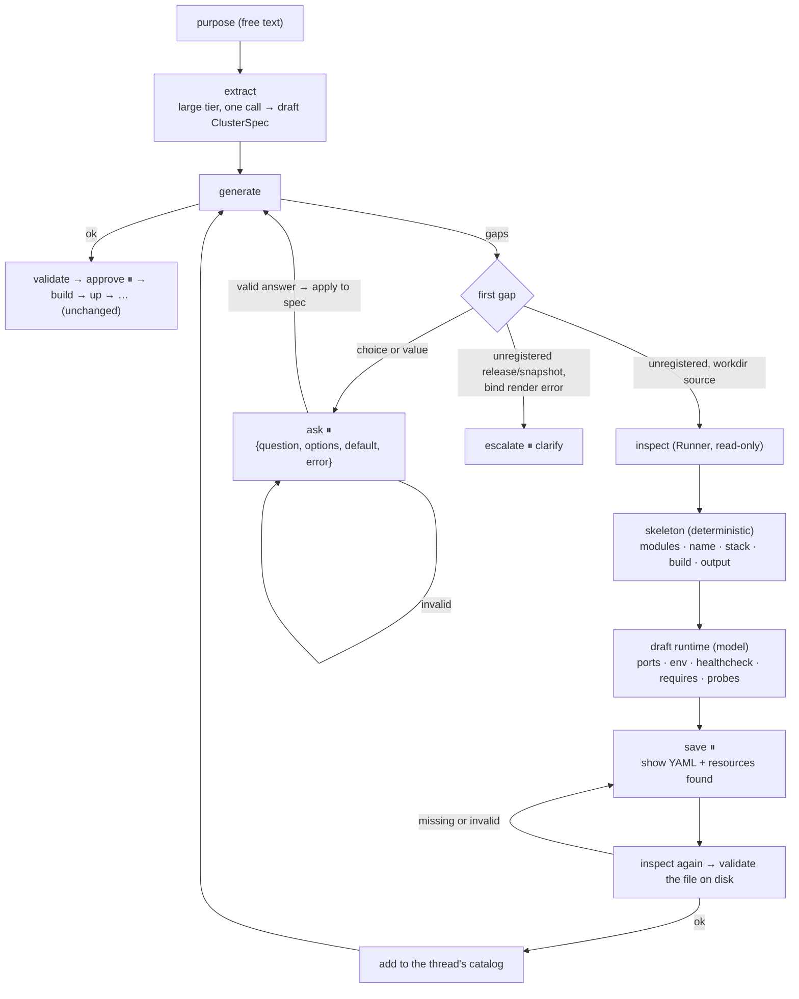
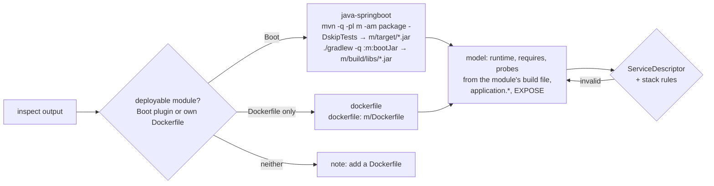

# M7b Clarify & Project Inspection — Design

- Date: 2026-10-18
- Roadmap: [2026-10-17-poc-roadmap.md](2026-10-17-poc-roadmap.md), M7b
- Design: [2026-10-17-container-agent-design.md](2026-10-17-container-agent-design.md), sections 4 (Clarify), 6.1–6.3, 7

## 1. Goal

A user states a cluster's purpose in plain words. The platform turns it into a valid `ClusterSpec`, asking one question at a time about every gap the generator finds. When a named service is a project in a working directory with no descriptor, the platform inspects it on the user's machine, drafts `.cagent/services/<name>.yaml`, and asks the user to save it; the cluster then builds and runs as if the project had always been registered.

**Done when:** Clarify produces a valid ClusterSpec from a prompt, and an unregistered sample project — single- or multi-module — gets a descriptor that builds and runs.

## 2. Decisions

| Decision | Why |
|---|---|
| **The user saves drafted descriptors**; the Runner gets no write tool (user decision) | Keeps the workdir invariant intact: the Runner only runs a build command the developer has in their own project. The platform reads the saved file back and uses exactly what is on disk. |
| **The model extracts once; questions are deterministic** (user decision) | The purpose sentence becomes a draft spec in one large-tier call. Every later question comes from a structured generator gap with options and a default, and every answer is a typed value. Matches "deterministic state machine, bounded LLM nodes"; fully testable with a scripted model; small local models cannot derail it. |
| **Stacks: `java-springboot` and a new `dockerfile` stack** (user decision) | Maven/Gradle Spring Boot modules use the existing builder. Any project with its own Dockerfile (Node, Go, …) builds from that Dockerfile, which the developer wrote. A project with neither gets a note: add a Dockerfile. |
| **Multi-module projects in M7b; descriptors at the root in `.cagent/services/<name>.yaml`** (user decision) | Builds run at the root (`mvn -pl <module> -am`), outputs stay inside the root, so path confinement is unchanged. `.cagent/service.yaml` still works for single-service projects. |
| **Init resources move to a new M7c** (user decision) | Kafka topics, Cassandra keyspaces/tables, and SQL schema scripts need a descriptor schema, generator init jobs, a Cassandra template, and Runner script copying. None depends on inspection, and all of it helps registered projects too. M7b only reports the resource files it finds. |
| A deterministic skeleton decides name, stack, build, and output; the model fills only `runtime`, `requires`, and `probes` | The fields that decide what runs and what is built never come from a model. |
| The Runner reads only a fixed set of files; the platform names no path | `inspect` takes a directory under `-workdir-root` and nothing else. Module lists come from the Runner's own parse of `pom.xml`/`settings.gradle`. |
| Redaction keeps references | `{{password}}` and `${DB_PASSWORD}` name a secret without holding it. Masking them broke read-back (a bind template became `******`) and hid which variable a draft must set. A reference's default (`${X:value}`) is still masked. |
| Extraction and drafting run with thinking off | Measured on `qwen3.5` (section 8): with thinking on, each call took minutes and drafting still failed; with thinking off, both took seconds and were right. Diagnosis (M7a) keeps the model's default. |
| Answers and drafts live in checkpointed state; a thread's catalog is the base catalog plus that thread's descriptors | The shared catalog is never written; a resumed thread re-validates its descriptors. |

## 3. Flow

`Orchestrator.start(thread_id, spec, runner)` keeps working; `start_from_purpose(thread_id, purpose, runner)` enters at `extract`. Everything from `validate` on is unchanged.

## 4. Runner (Go)

### 4.1 `inspect -workdir DIR`

A read-only subcommand, also served over RPC. `DIR` must resolve under a `-workdir-root`, as for `build`.

| Read | What |
|---|---|
| Root and every module | `pom.xml`, `build.gradle`, `build.gradle.kts`, `settings.gradle`, `settings.gradle.kts`, `package.json`, `go.mod`, `Dockerfile`, `src/main/resources/application.yml`, `application.yaml`, `application.properties` |
| Root only | `.cagent/service.yaml`, `.cagent/services/*.yaml` |
| Modules | The Runner parses `<modules>` in `pom.xml` (recursively) and `include` in `settings.gradle(.kts)` |
| Resources (paths only) | `**/*.cql`, `**/schema*.sql`, `**/db/init/**/*.sql`, Flyway `**/db/migration/**`, Liquibase `**/db/changelog/**` |

- Every path is confined with `guard`; a symlink that leaves `DIR` is skipped.
- Limits: 50 modules, 64 KiB per file (truncated and listed), 2 MiB in total.
- Contents pass through `redact`, which keeps references (`{{name}}`, `${VAR}`) and masks a reference's default.
- Output: `{"modules": [...], "files": {"<relative path>": "<content>"}, "resources": [...], "truncated": [...]}`.

### 4.2 Descriptor lookup

A workdir build reads `.cagent/services/<service>.yaml`, else `.cagent/service.yaml`; the descriptor's `name` must equal the service. The build runs at the root and the artifact must resolve inside it.

### 4.3 `dockerfile` stack

`sources.workdir` becomes `{build?, output?, dockerfile?, context?}`:

| Stack | Requires | Build |
|---|---|---|
| `java-springboot` | `build`, `output` | Run `build`, find one artifact, render the JRE Dockerfile (unchanged) |
| `dockerfile` | `dockerfile`; `context` defaults to `.` | Run `build` if present, then `docker build -f <dockerfile> -t <tag> --label cagent.managed=true <context>` |

Both paths are relative and confined to the root. Docker's layer cache stands in for the artifact-sha256 cache. For a workdir build the Runner uses the stack in the project's own descriptor; a different stack from the platform is an error.

Python's `WorkdirSource` and Go's `workdir.Descriptor` apply the same rules and are tested against the same fixture descriptors.

## 5. Platform (Python)

### 5.1 Gaps

`generate` collects structured gaps instead of strings; `str(gap)` keeps today's wording.

| Kind | Question | Options, default | Answer changes |
|---|---|---|---|
| `unknown_template` | Which template should X use? | All templates; the closest name | `template` |
| `unsupported_version` | Which version should X use? | The template's versions; its default | `version` |
| `unknown_preset` | Which preset should X use? | The template's presets; its default | `preset` |
| `no_provider` | Which middleware should provide C? | Templates providing C; the first | adds a `MiddlewareRef` |
| `binding` | Which instance should X use for C? | Instances providing C; the first | `bindings` |
| `version_mismatch` | Which version should the provider use? | Versions satisfying the requirement; the highest | the provider's `version` |
| `missing_env` | What value should X get for K? | none; must be answered | `env` |
| `unknown_port` | Which port should X publish instead of P? | The descriptor's ports; the only one | `publish` |
| `no_source` | Which source should X build from? | Source kinds the descriptor declares; the first | `source.kind` |
| `unregistered` | — workdir: inspection; otherwise escalate | | |
| `bind_render` | — escalate (catalog bug) | | |

A choice gap with no options cannot be answered and escalates.

### 5.2 Question protocol

- Interrupt: `{"kind": "question", "gap": {...}, "question": str, "options": [...], "default": ..., "error": str | None}`, like the existing `approval` and `escalation` interrupts.
- Resume: `{"answer": value}`; `{"answer": None}` takes the default; `{"action": "abort"}` stops.
- `apply_answer(spec, gap, answer) -> ClusterSpec` is pure. An invalid answer is asked again with `error` set. After each answer `generate` runs again, since one answer can add or remove gaps.
- At most 20 questions per thread, then escalate `clarify`.

### 5.3 Extraction

`extract(router, purpose, catalog)` asks the top tier once, thinking off. The prompt holds the purpose and a catalog summary: services with their source kinds, templates with capability and versions. The answer schema is `{name, services: [{name, source: {kind, ref}}], middleware: [{template, version?}], checks: [...]}`. Names outside the catalog are kept so they surface as gaps; a "service" named like a middleware template (models listed MySQL as a service) becomes middleware. An empty `ref` is a schema error, so the model is asked again. When the model gives no valid answer, escalate `model_unavailable`.

### 5.4 Drafting a descriptor

- Single-module projects drop `-pl`/`:m:`.
- The model answers a flat schema (`ports`, `env_required`, `env_defaults`, `health_path` or `health_cmd`, `requires`, `probe_paths`), converted to a descriptor in code: a JSON schema cannot say "exactly one of http or cmd", and a model filled both. A health path wins over a command.
- The prompt lists the module's files, its `${PLACEHOLDER}`s with and without defaults, and each capability's bind values, and the system prompt shows one worked `requires` example.
- Checks before the user sees a draft: every capability is provided by a template; bind keys are environment variable names and use only the provider's values; every placeholder without a default is bound or listed; no default points at `localhost`. A variable that is bound is dropped from defaults and required (models copied the config's `localhost` default next to the bind).
- An invalid draft is asked again once with the reasons; a second invalid draft escalates `model_unavailable`.
- Save interrupt: `{"kind": "save_descriptors", "service", "workdir", "files": {".cagent/services/<n>.yaml": "<yaml>"}, "note": str, "error": str | None}`; resume `{"saved": true}` or `{"action": "abort"}`. The note says, for example, that Flyway migrations need nothing, and that SQL/CQL scripts are wired up by M7c.
- A project that already has a valid descriptor for the service is used as is: no model, no save.
- Read-back validates what the user actually saved, including their edits, and refuses a masked literal secret.

### 5.5 A thread's catalog

State gains `descriptors: {name: yaml_text}`. `Orchestrator._catalog(state)` returns the base catalog plus those descriptors, validated on each read. `generate`, `build`, and `declared_env` use it.

## 6. Testing

| Layer | Covers |
|---|---|
| Go unit | `inspect`: allow-list, nested modules, limits, symlink escape, redaction, outside-root refusal, resource paths; descriptor lookup; `dockerfile` stack validation; shared fixture descriptors |
| Go integration (real Docker) | Two busybox fixture projects, no toolchain needed: a single-module `dockerfile` project, and a two-module project (one deployable, one library) built from `.cagent/services/<name>.yaml` |
| Python unit | Every gap kind × `apply_answer` (valid, invalid, default); extraction schema and unknown names; skeleton rules (Maven single and multi-module, Gradle, Dockerfile, neither); thread catalog after a checkpoint resume |
| Orchestrator (`fakellm` + `simcluster`) | purpose → questions → drafts → save → read-back → healthy; abort; question budget; model failure |
| Real Runner e2e | The two-module fixture: inspect → draft (scripted model) → save → builds and runs |
| Live model (`CAGENT_LLM_E2E`) | One extraction from a purpose sentence; one runtime draft from a Spring Boot fixture `pom.xml` and `application.yml`. A failing check prints the exact prompt first |

Java drafts are checked as descriptors only; this machine cannot run Maven.

## 7. Out of scope

- Init resources (Kafka topics, Cassandra keyspaces and tables, SQL schema scripts), a Cassandra template: M7c.
- Free-text answers mapped by a model, and the chat UI: M8.
- Node and Go builders that generate a Dockerfile; projects without a Dockerfile get a note.
- Topics or schemas defined only in source code: `inspect` does not read source.

## 8. Model measurements

Measured on local Ollama, 2026-10-18, with `qwen3.5:latest` (the top tier) on a 24 GB Apple Silicon Mac. Extraction reads the purpose sentence of the live-model test; drafting reads the Spring Boot fixture `orders-api`, which needs MySQL and Kafka.

| Thinking | Prompts | Extraction | Drafting |
|---|---|---|---|
| on (model default), 2 runs | final | correct, 146–167 s | failed after 186–214 s: HTTP healthcheck but no ports |
| off | first version | wrong: MySQL listed as a service | wrong: `bind` keyed by `host`/`port` |
| off, 3 runs | final | correct, 6.6–14.4 s (first run loads the model) | correct, 6.9–8.4 s |

Thinking made each call minutes long without making drafts right. The structural mistakes it did not prevent are what the flat answer schema, the draft checks, and the worked example fix. With them, thinking off is both fast and correct, so extraction and drafting turn it off. Diagnosis keeps the model's default until M9's eval measures it.
