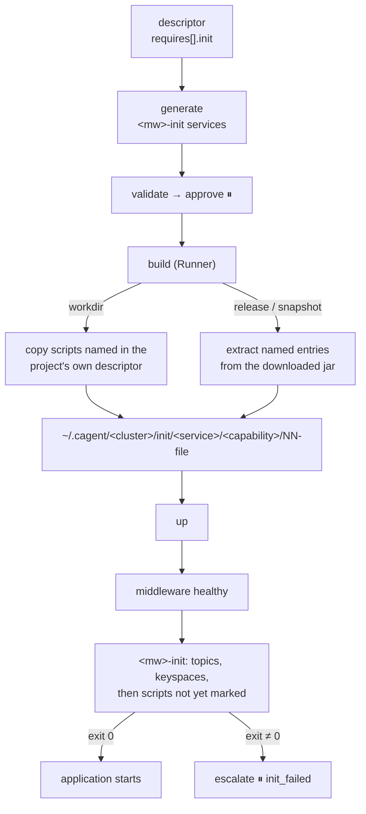

# M7c Init Resources — Design

- Date: 2026-10-18
- Roadmap: [2026-10-17-poc-roadmap.md](2026-10-17-poc-roadmap.md), M7c
- Builds on: [2026-10-18-m7b-clarify-inspection-design.md](2026-10-18-m7b-clarify-inspection-design.md) (descriptors, `inspect`, drafting)
- Design: [2026-10-17-container-agent-design.md](2026-10-17-container-agent-design.md), sections 6 and 8

## 1. Goal

An application often needs its middleware prepared before it starts: MySQL tables, a Cassandra keyspace and tables, Kafka topics. A descriptor declares these per requirement. The Runner stages the scripts, a one-shot init service per middleware runs them once, and the application starts only after init succeeds.

**Done when:** a sample cluster starts with its MySQL schema, Cassandra keyspace and tables, and Kafka topics created before the application starts; scripts come from both a workdir project and a release jar; a second `up` does not run them again; and a draft for an unregistered project fills these fields.

## 2. Decisions

| Decision | Why |
|---|---|
| **Scripts come from the project directory (workdir) or from the downloaded jar (release, snapshot)** (user decision) | A release service has no directory on the user's machine; its scripts usually ship in the jar as classpath resources. Inline scripts in the catalog were rejected: long SQL does not belong there. |
| **One-shot init service per middleware** (user decision) | One mechanism for every middleware. A failure shows up as its own container with its own logs, instead of a database that never turns healthy. |
| **Markers in the target make re-runs safe** (user decision) | Self-healing reruns `up`. Real scripts seldom say `IF NOT EXISTS`. Each script's SHA-256 is recorded in the middleware after it succeeds and skipped next time. A recreated middleware loses its markers with its data, so scripts run again: the markers track the real state. |
| **Code maps scripts in drafts; the model proposes topics** (user decision) | Which scripts run against a database must not come from a model, the same reason M7b keeps build and output in code. Topic names often live only in configuration, which the model already reads. |
| **The Runner stages scripts during `build`** | `build` already holds the project or the jar. No new tool, no new step, and mounts stay inside the workspace, so `Lint` needs no new exception. |
| For workdir, the Runner reads script paths from the project's own descriptor and refuses paths from the platform | The project decides what runs, as it decides its stack in M7b. A compromised platform cannot stage another file. |
| Templates declare how to run each init kind | The generator wraps three shell snippets (run, marked, mark) in one loop. A new database needs a template, not code. |
| An init failure escalates `init_failed` directly | A script or its data is code, not environment. Self-healing changes only the environment. |
| Model patches never touch init services | `within_environment` refuses any path under a service labelled `cagent.role: init`, and any change to another service's wait for one. |
| Every init command is guarded: `{ cmd; } \|\| { echo "cagent init failed: <what>" >&2; exit 1; }` | Found while implementing: `set -e` ignores a failure on the left of `&&`, so a template command written `a && b` could fail and still be marked. The message also names the failing script in the escalation. |
| Retrying after `init_failed` runs `build` again | The fixed script reaches the cluster only through `build`'s staging. |
| Topics are drafted by a second, small model call | Found on `qwen3.5`: one call asking for the runtime and the topics made the model copy the worked example's variable names into its binds (0/3; section 8). |

## 3. Flow



## 4. Descriptor and templates

### 4.1 Descriptor

Each `requires[]` entry gains an optional `init` block:

```yaml
requires:
  - capability: mysql
    bind: { DB_URL: "jdbc:mysql://{{host}}:{{port}}/{{db}}" }
    init:
      scripts: [db/init/01-schema.sql, db/init/02-seed.sql]
  - capability: cassandra
    init:
      keyspaces: [orders]               # SimpleStrategy, replication factor 1, before scripts
      scripts: [db/cassandra/schema.cql]
  - capability: kafka
    init:
      topics: [{ name: orders-events, partitions: 3 }]
```

- A workdir script path is relative to the project root and must resolve inside it. A release or snapshot script path is a classpath path: the Runner looks for `BOOT-INF/classes/<path>` in the jar, then `<path>`.
- A requirement may use an init kind only if its template declares it, and script suffixes must match the template's; otherwise the generator reports an `unsupported_init` gap, which escalates `clarify`. Topic names match Kafka's rule `^[A-Za-z0-9._-]{1,128}$`, keyspace names Cassandra's unquoted identifiers `^[A-Za-z][A-Za-z0-9_]{0,47}$`: both end up in shell commands and CQL. `partitions` defaults to 1. At most 20 scripts per requirement, each at most 1 MiB.
- The Python schema and the Runner's `workdir` package apply the same rules.

### 4.2 Templates

A template's `init` block says which kinds it supports and how to run them. `{{host}}` and the connection values resolve as in `bind`; the loop sets `$file` and `$sha`.

```yaml
# mysql.yaml
init:
  scripts:
    suffix: .sql
    run:    mysql -h{{host}} -uroot -proot {{db}} < "$file"
    marked: mysql -h{{host}} -uroot -proot -N -e "SELECT 1 FROM cagent.init WHERE sha='$sha'" | grep -q 1
    mark:   mysql -h{{host}} -uroot -proot -e "CREATE DATABASE IF NOT EXISTS cagent; CREATE TABLE IF NOT EXISTS cagent.init(sha CHAR(64) PRIMARY KEY); INSERT INTO cagent.init VALUES('$sha')"

# kafka.yaml
init:
  mem_limit: 512m                      # kafka-topics.sh runs a JVM
  topics:
    run: /opt/kafka/bin/kafka-topics.sh --bootstrap-server {{host}}:9092 --create --if-not-exists --topic {{topic}} --partitions {{partitions}} --replication-factor 1
```

Kafka needs no marker: `--if-not-exists` is idempotent.

### 4.3 Cassandra template

`cassandra:{version}`, versions `4.1` and `5.0` (default `5.0`), port 9042, `connection: {datacenter: datacenter1}` for drivers that name it. `MAX_HEAP_SIZE=512M` and `HEAP_NEWSIZE=128M` keep it laptop-sized; it still uses about 1.3 GB, so the `tiny` preset is 2 GB. The healthcheck runs `cqlsh -e 'describe keyspaces'`; it turned healthy after 33 s, well within the shared timing. It declares `init.keyspaces` (`CREATE KEYSPACE IF NOT EXISTS … SimpleStrategy, 1`) and `init.scripts` (`.cql`, markers in keyspace `cagent`).

## 5. Runner (Go)

### 5.1 Staging in `build`

- **workdir**: the Runner reads `requires[].init.scripts` from the descriptor it already loads. Each path must resolve inside the project root after symlinks and name a regular file. `-init` flags with `-workdir` are a usage error.
- **release, snapshot**: the platform passes the catalog descriptor's names, `-init <capability>=<path>` (repeatable; over RPC, `init: [{capability, path}]`, refused with a workdir). After downloading the jar (also on an image-cache hit, since the jar is always downloaded), the Runner opens it with `archive/zip` and reads only the named entries; with no scripts declared it does not open the jar at all. Names with `..` or a leading `/` and symlink entries are refused; reads stop at 1 MiB, so a zip bomb fails instead of filling the disk.
- **Layout**: `~/.cagent/clusters/<cluster>/init/<service>/<capability>/NN-<basename>`, `NN` being the declared order within the capability. The new `initscripts` package holds both sources and the shared limits. Writes use `WriteNoFollow`. Each `build` clears and rewrites its service's `init/` directory, so no stale script survives.
- **Result**: `BuildResult.init: [{capability, file, sha256}]`, for status and logs.
- **Errors**: a missing file, a path outside the project, a missing jar entry, or an oversized file fails the build with the path named, which escalates `build_failed`.

### 5.2 Verify and snapshot

- The snapshot gains `role` from the `cagent.role` label. A completed init container (exited 0) carries no signatures, whatever it logged; a failed one keeps its exit code, redacted tail, and signatures.
- L1 reads `init completed` for a completed init container, `init still running`, or `init failed, exit N: <last log line>`. L2 and L3 have nothing to check in it.

## 6. Platform (Python)

### 6.1 Generator

For each middleware instance with init work, the generator adds `<mw>-init`:

```yaml
mysql-init:
  image: mysql:8.4                      # the middleware's image: its client is there
  entrypoint: ["sh", "-c", "<generated loop>"]
  depends_on: { mysql: { condition: service_healthy } }
  volumes:
    - ./init/orders-api/mysql:/cagent-init/orders-api:ro
    - ./init/billing/mysql:/cagent-init/billing:ro
  restart: "no"
  mem_limit: 256m                       # or the template's init.mem_limit
  labels: { cagent.role: init }
orders-api:
  depends_on:
    mysql: { condition: service_healthy }
    mysql-init: { condition: service_completed_successfully }
```

The loop runs `set -eu`, creates keyspaces and topics, then walks `/cagent-init/<service>/NN-*` in service-name order, then file order: compute `sha`, print `skip` if `marked`, otherwise `run` and `mark`. Every command is guarded so a failure stops the loop with `cagent init failed: <keyspace k | topic t | file>`. Every `$` passes through the existing `$` → `$$` escaping. Applications sharing a middleware share its init service; a topic two services ask for is created once, with the larger partition count. An `<mw>-init` name already taken by a service is an `unsupported_init` gap.

### 6.2 Orchestrator

- `_step_build` passes `init=[{capability, path}]` from the catalog descriptor for release and snapshot sources; workdir passes nothing.
- `docker compose up` waits for `service_completed_successfully` and fails with `service "<mw>-init" didn't complete successfully`, so an init failure normally surfaces in `up`. `up`'s failure handling recognises it and escalates `init_failed` with the service, the script from the `cagent init failed:` line, and the log tail, skipping T0 and the model tiers. `watch` checks for a failed init container too, and counts a completed one as settled.
- The user fixes the script or data and answers `retry` or `abort`. A retry after `init_failed` clears `built`, so `build` stages the fixed script before `up`.
- `within_environment(patch, protected)` refuses paths under an init service and changes to another service's `depends_on` entry for one, or to a whole `depends_on`.

### 6.3 Drafting (extends M7b)

- **Scripts, by code**: from the files `inspect` reports, `**/*.cql` goes to `cassandra`; `**/schema*.sql` and `**/db/init/**/*.sql` go to the draft's SQL capability, sorted by path. Without a SQL requirement they are left out and the note says so. Flyway and Liquibase directories are left out: the application migrates itself.
- Scripts Spring Boot runs itself are left out: with `spring.sql.init.mode=always`, `src/main/resources/schema*.sql` and `data*.sql` would otherwise run twice.
- **Topics, by the model, in a second call**: only when the draft requires a capability that creates topics and the configuration has a key naming a topic (YAML flattened to dotted keys, and `.properties`). The call sees the module's configuration and those keys and answers `{topics: [{name, partitions?}]}`, thinking off. Code checks the names; an invalid one is asked again once, then left out with a note, and a failed call leaves topics to the user with a note. Neither fails the draft.
- The save note lists the scripts and topics; the user edits them before saving.

## 7. Testing

| Layer | Covers |
|---|---|
| Go unit | Workdir staging: inside the root, symlink escape, missing file, size limit, stale files cleared. Jar extraction: `BOOT-INF/classes` first, `..`, absolute, and symlink entries refused, zip bomb capped, missing entry. `NN-` naming, `BuildResult.init`. Init containers in L1, L2, L3 |
| Go integration (real Docker) | A release jar from the simulated Nexus and a workdir project: scripts from both staged and mounted read-only into a busybox init service |
| Python unit | `init` schema and template checks (kind, suffix, names, count); generated `<mw>-init`, `depends_on`, `$$` escaping, shared init; the generated loop run in `sh` against a template that only writes a log (order, markers, a failing script); `within_environment` refuses init paths; `init_failed`; drafted scripts by code, topics checked |
| Orchestrator (`simcluster`, `fakellm`) | Release init names passed to `build`; init failure escalates with no T0 or model call; retry after a fix |
| Real-Docker e2e (CI) | MySQL, Cassandra, Kafka, and a busybox application: tables, keyspace, and topics exist (`docker exec`); every init's `FinishedAt` precedes the application's `StartedAt`; a second `up` logs `skip` for every script and adds no row; a broken script escalates `init_failed`, and a retry after fixing it turns healthy |
| Live model (local) | One draft from a fixture with topic keys in `application.yml` and `src/main/resources/db/schema.sql`: scripts mapped by code, topics right |

The three-middleware e2e test takes about 65 s on a laptop, the broken-script test about 30 s.

## 8. Findings and measurements

Measured on a 24 GB Apple Silicon Mac, Docker 29, local Ollama, 2026-10-18.

- **A second `up` reruns a completed init container.** Confirmed with busybox: same configuration, the init container started again. The markers are what make this safe.
- **`up` reports an init failure itself**: `service "db-init" didn't complete successfully: exit 1`, after the middleware turned healthy.
- **Real templates**: on the first `up` (39 s, Cassandra the slowest), MySQL ran both scripts, Cassandra created the keyspace and table, Kafka created a three-partition topic. A second `up` (2 s) logged `skip` for every script and left one seed row.
- **Kafka's healthcheck was too heavy for CI.** It ran `kafka-broker-api-versions.sh`, a JVM, every 5 s: at the template's 0.5 CPU one check took 2.7–6.6 s (1.35 s at 1.0 CPU), past the 3 s timeout, so Kafka never turned healthy on the CI runner, the first time CI started Kafka. A TCP probe (`bash -c '</dev/tcp/localhost/9092'`) takes under 0.15 s; Kafka is healthy after about 10 s, and `kafka-topics.sh --create` right after succeeded 3/3.
- **`cqlsh`** exits 2 on a failed statement and on a query against a missing keyspace, so an unmarked script runs; the `cassandra` and `mysql` images run as root and ship `sha256sum`.
- **Drafting topics** (`qwen3.5:latest`, thinking off, M7b's Spring Boot fixture, 3 runs each; "binds" means `DB_URL`, `DB_PASSWORD`, and `KAFKA` all bound):

| Descriptor prompt | Binds |
|---|---|
| M7b prompt, Cassandra in the capability list, topics sentence in the system prompt | 0/3 — copied `DATABASE_URL` and `BROKERS` from the worked example |
| same, without the topics sentence | 3/3 |
| same, without Cassandra | 3/3 |

A separate topics call gave the resolved names 6/6 (YAML with `${ORDERS_TOPIC:orders-events}`, and `.properties`) in 1–4.5 s. The live draft test (runtime then topics) passes 3/3 in about 12 s; M7b's live tests are back at 7–8 s.

## 9. Out of scope

- PostgreSQL and other databases: a template adds them.
- Schema migration tools: applications run Flyway or Liquibase themselves.
- Seed data beyond what the scripts insert.
- Topic configuration beyond partitions (retention, compaction).
