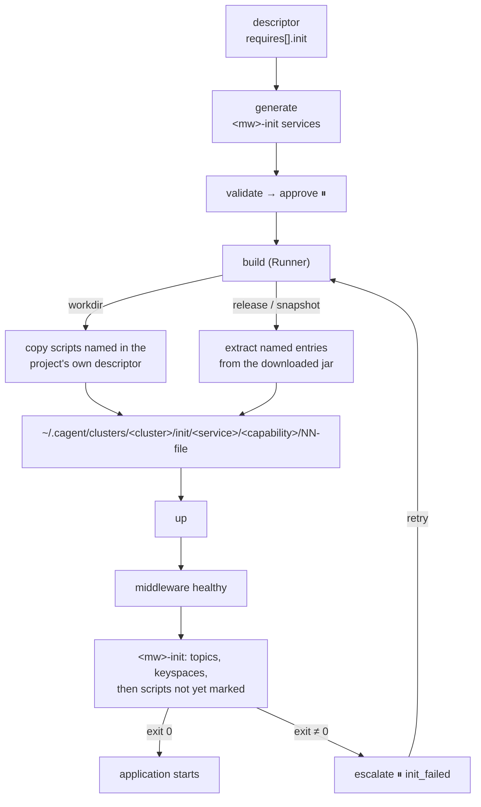
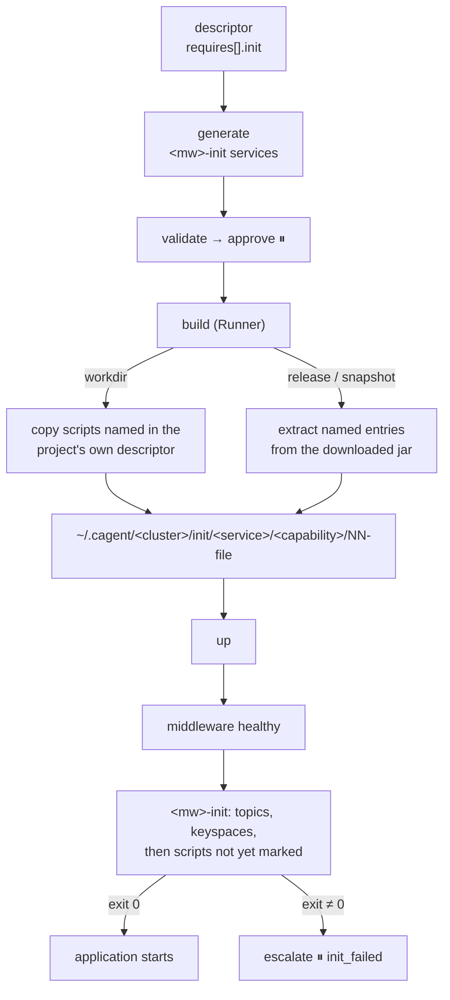

# M7c Init Resources Implementation Plan

> **For Claude:** REQUIRED SUB-SKILL: Use superpowers:executing-plans to implement this plan task-by-task.

**Goal:** A service declares the MySQL scripts, Cassandra keyspaces and scripts, and Kafka topics it needs; they exist before it starts, from a workdir project or a release jar, and a second `up` does not run them again.

**Architecture:** During `build` the Runner stages each service's scripts into the cluster's workspace — from the project's own descriptor, or from the named entries of the jar it downloaded — with a new `initscripts` package. The generator adds one one-shot `<mw>-init` service per middleware, labelled `cagent.role: init`, that the consumers wait for with `service_completed_successfully`; its loop records each script's SHA-256 in the middleware and skips what is recorded. An init failure escalates `init_failed`; no fix touches init. Drafts map scripts in code and ask a model for topics in a separate call.

**Tech Stack:** Go (`archive/zip`, compose-go), Python (Pydantic, `langgraph`), Docker images `mysql:8.4`, `cassandra:5.0`, `apache/kafka:3.9.0`, local Ollama (`qwen3.5:latest`).

- Design: [2026-10-18-m7c-init-resources-design.md](2026-10-18-m7c-init-resources-design.md) — Task 13 records what implementing changed
- Roadmap: [2026-10-17-poc-roadmap.md](2026-10-17-poc-roadmap.md), M7c

## Decisions

| Decision | Why |
|---|---|
| Scripts come from the project directory (workdir) or the downloaded jar (release, snapshot) (user decision) | A release service has no directory on the user's machine; its scripts ship as classpath resources. |
| One one-shot init service per middleware (user decision) | One mechanism; a failure is its own container with its own logs. |
| Markers in the middleware make reruns safe (user decision) | Measured: a second `up` reruns a completed init container. Real scripts seldom say `IF NOT EXISTS`. A recreated middleware loses its markers with its data, so scripts run again. |
| Scripts mapped by code, topics by the model (user decision) | What runs against a database must not come from a model; topic names live in configuration. |
| The Runner stages during `build`; for workdir it reads the project's own descriptor and refuses `-init` | No new tool; mounts stay inside the workspace, so `Lint` needs no exception; the project decides what runs. |
| Every init command is guarded and names what failed | Found while implementing: `set -e` ignores a failure on the left of `&&`, so a script could fail and still be marked. |
| `up` recognises a failed init service; a retry rebuilds | Measured: compose's `up` itself fails with `service "<mw>-init" didn't complete successfully`. Only `build` stages a fixed script. |
| Patches may not touch init services or another service's wait for one | An init failure is code or data, not environment. |
| Topics are asked in a second, small call | Found on `qwen3.5`: one call for runtime and topics broke binds (0/3). |

## Measurements (2026-10-18, 24 GB Apple Silicon, Docker 29, local Ollama)

| What | Result |
|---|---|
| Real templates, first `up` (MySQL, Cassandra, Kafka) | 39 s; tables, keyspace, three-partition topic created |
| Second `up` | 2 s; every script `skip`, no row added |
| `cassandra:5.0` with a 512 MB heap | healthy after 33 s, about 1.3 GB used |
| `qwen3.5` descriptor call, M7b prompt + Cassandra + a topics sentence | binds 0/3 (copied the worked example's names) |
| same without the topics sentence, or without Cassandra | binds 3/3 |
| Separate topics call | resolved names 6/6, 1–4.5 s |
| Live draft test (runtime, then topics) | 3/3, about 12 s |

## How init runs



## Prerequisites

- Work on a feature branch from `main`, in its own worktree.
- **Go is not installed on the host.** Every Go command runs in `golang:1.24`, as written in each step (the `cagent-gomod`/`cagent-gocache` volumes only cache).
- **Docker** running, for Tasks 5, 11, and 13's checks; Task 11 pulls `cassandra:5.0` if it is missing.
- **Ollama** at `localhost:11434` serving `qwen3.5:latest` — only for Task 12.
- Baseline on `main`: `make platform-test` → `256 passed, 7 skipped`; `make runner-test` (in the container) → every package `ok`.

---

### Task 1: Stage init scripts from the project directory

A new `initscripts` package copies the scripts a service declares into the cluster's workspace, named `<capability>/NN-<basename>`: `NN` is the declared order, and the source's directory part is never used. Each script must resolve inside the project (symlinks included) and be a regular file of at most 1 MiB; at most 20 per capability. The workdir descriptor learns `requires[].init.scripts`, checked when it is parsed. `workdir.Relative` now delegates to `initscripts.Relative`, so the path rule lives in one place.

**Files:**
- Create: `runner/internal/initscripts/initscripts_test.go`
- Create: `runner/internal/initscripts/initscripts.go`
- Modify: `runner/internal/workdir/workdir_test.go`
- Modify: `runner/internal/workdir/workdir.go`

**Step 1: Write the failing tests**

Create `runner/internal/initscripts/initscripts_test.go`:

```go
package initscripts

import (
	"os"
	"path/filepath"
	"strings"
	"testing"
)

func write(t *testing.T, path, text string) {
	t.Helper()
	if err := os.MkdirAll(filepath.Dir(path), 0o755); err != nil {
		t.Fatal(err)
	}
	if err := os.WriteFile(path, []byte(text), 0o644); err != nil {
		t.Fatal(err)
	}
}

func read(t *testing.T, path string) string {
	t.Helper()
	data, err := os.ReadFile(path)
	if err != nil {
		t.Fatal(err)
	}
	return string(data)
}

func TestFromDirStagesInDeclaredOrderPerCapability(t *testing.T) {
	root, dest := t.TempDir(), t.TempDir()
	write(t, filepath.Join(root, "db/init/schema.sql"), "CREATE TABLE a (id INT);")
	write(t, filepath.Join(root, "db/init/seed.sql"), "INSERT INTO a VALUES (1);")
	write(t, filepath.Join(root, "cql/schema.cql"), "CREATE TABLE b (id int PRIMARY KEY);")
	got, err := FromDir(root, []Script{
		{"mysql", "db/init/seed.sql"}, {"cassandra", "cql/schema.cql"}, {"mysql", "db/init/schema.sql"},
	}, dest)
	if err != nil {
		t.Fatal(err)
	}
	want := []string{"mysql/01-seed.sql", "cassandra/01-schema.cql", "mysql/02-schema.sql"}
	if len(got) != len(want) {
		t.Fatalf("staged %v", got)
	}
	for i, s := range got {
		if s.Capability+"/"+s.File != want[i] || len(s.SHA256) != 64 {
			t.Errorf("staged[%d] = %+v, want %s", i, s, want[i])
		}
	}
	if read(t, filepath.Join(dest, "mysql/01-seed.sql")) != "INSERT INTO a VALUES (1);" {
		t.Error("seed.sql not copied")
	}
}

func TestFromDirClearsWhatAnEarlierBuildStaged(t *testing.T) {
	root, dest := t.TempDir(), t.TempDir()
	write(t, filepath.Join(dest, "mysql/01-old.sql"), "DROP TABLE a;")
	write(t, filepath.Join(root, "new.sql"), "SELECT 1;")
	if _, err := FromDir(root, []Script{{"mysql", "new.sql"}}, dest); err != nil {
		t.Fatal(err)
	}
	if _, err := os.Stat(filepath.Join(dest, "mysql/01-old.sql")); !os.IsNotExist(err) {
		t.Errorf("stale script kept: %v", err)
	}
}

func TestFromDirRefusesPathsLeavingTheProject(t *testing.T) {
	root, dest := t.TempDir(), t.TempDir()
	outside := t.TempDir()
	write(t, filepath.Join(outside, "secret.sql"), "x")
	if err := os.Symlink(filepath.Join(outside, "secret.sql"), filepath.Join(root, "link.sql")); err != nil {
		t.Fatal(err)
	}
	for _, p := range []string{"../secret.sql", "/etc/passwd", "link.sql"} {
		if _, err := FromDir(root, []Script{{"mysql", p}}, dest); err == nil {
			t.Errorf("%s staged", p)
		}
	}
}

func TestFromDirNamesAMissingOrOversizedScript(t *testing.T) {
	root, dest := t.TempDir(), t.TempDir()
	if _, err := FromDir(root, []Script{{"mysql", "db/missing.sql"}}, dest); err == nil ||
		!strings.Contains(err.Error(), "db/missing.sql") {
		t.Errorf("missing: %v", err)
	}
	write(t, filepath.Join(root, "big.sql"), strings.Repeat("x", MaxBytes+1))
	if _, err := FromDir(root, []Script{{"mysql", "big.sql"}}, dest); err == nil ||
		!strings.Contains(err.Error(), "big.sql") {
		t.Errorf("oversized: %v", err)
	}
	if err := os.Mkdir(filepath.Join(root, "dir.sql"), 0o755); err != nil {
		t.Fatal(err)
	}
	if _, err := FromDir(root, []Script{{"mysql", "dir.sql"}}, dest); err == nil {
		t.Error("directory staged")
	}
}

func TestCheckLimitsScriptsAndNames(t *testing.T) {
	var many []Script
	for range MaxScripts + 1 {
		many = append(many, Script{"mysql", "a.sql"})
	}
	for _, scripts := range [][]Script{many, {{"My SQL", "a.sql"}}, {{"mysql", ""}}} {
		if err := Check(scripts); err == nil {
			t.Errorf("accepted %v", scripts[0])
		}
	}
	if err := Check([]Script{{"mysql", "db/a.sql"}, {"cassandra", "b.cql"}}); err != nil {
		t.Error(err)
	}
}
```

In `runner/internal/workdir/workdir_test.go`, replace:

```go
	"os"
	"path/filepath"
	"strings"
	"testing"
)
```

with:

```go
	"os"
	"path/filepath"
	"slices"
	"strings"
	"testing"

	"github.com/yutaofr/container-agent/runner/internal/initscripts"
)
```

In `runner/internal/workdir/workdir_test.go`, replace:

```go
		t.Error("missing Dockerfile accepted")
	}
}
```

with:

```go
		t.Error("missing Dockerfile accepted")
	}
}

func TestDescriptorListsItsInitScriptsInOrder(t *testing.T) {
	d, err := ParseDescriptor([]byte("name: demo\nsources:\n  workdir: {build: make, output: app.jar}\n"+
		"requires:\n  - capability: mysql\n    init: {scripts: [db/schema.sql, db/seed.sql]}\n"+
		"  - capability: kafka\n    init: {topics: [{name: orders}]}\n"+
		"  - capability: cassandra\n    init: {scripts: [cql/schema.cql]}\n"), "demo")
	if err != nil {
		t.Fatal(err)
	}
	got := d.Scripts()
	want := []initscripts.Script{
		{Capability: "mysql", Path: "db/schema.sql"},
		{Capability: "mysql", Path: "db/seed.sql"},
		{Capability: "cassandra", Path: "cql/schema.cql"},
	}
	if !slices.Equal(got, want) {
		t.Errorf("scripts %v, want %v", got, want)
	}
}

func TestDescriptorRefusesAScriptOutsideTheProject(t *testing.T) {
	_, err := ParseDescriptor([]byte("name: demo\nsources:\n  workdir: {build: make, output: app.jar}\n"+
		"requires:\n  - capability: mysql\n    init: {scripts: [../other/schema.sql]}\n"), "demo")
	if err == nil || !strings.Contains(err.Error(), "../other/schema.sql") {
		t.Errorf("got %v", err)
	}
}
```

**Step 2: Run them to verify they fail**

```bash
docker run --rm -v "$PWD":/repo -w /repo/runner -v cagent-gomod:/go/pkg/mod -v cagent-gocache:/root/.cache/go-build golang:1.24 go vet ./internal/initscripts/ ./internal/workdir/
```

Expected: FAIL — `undefined: FromDir`, `d.Scripts undefined`.

**Step 3: Implement**

Create `runner/internal/initscripts/initscripts.go`:

```go
// Package initscripts stages the SQL and CQL scripts a service declares for its middleware
// (M7c). Scripts come from the project directory or from the downloaded jar and are copied
// into the cluster's workspace, where a one-shot init service mounts them read-only.
//
// Staged files are named <capability>/NN-<basename>, NN being the declared order within
// the capability. The source's directory part is never used, so a script name cannot place
// a file anywhere else.
package initscripts

import (
	"bytes"
	"errors"
	"fmt"
	"io"
	"os"
	"path/filepath"
	"strings"

	"github.com/yutaofr/container-agent/runner/internal/guard"
	"github.com/yutaofr/container-agent/runner/internal/workspace"
)

const (
	MaxScripts = 20      // per capability, as in the platform's descriptor schema
	MaxBytes   = 1 << 20 // per script
)

// Script is one declared script: the capability whose middleware runs it and its path,
// relative to the project root or, in a jar, a classpath path.
type Script struct {
	Capability string `json:"capability"`
	Path       string `json:"path"`
}

// Staged is one staged script.
type Staged struct {
	Capability string `json:"capability"`
	File       string `json:"file"`
	SHA256     string `json:"sha256"`
}

// Check validates names, paths, and counts before anything is read.
func Check(scripts []Script) error {
	count := map[string]int{}
	for _, s := range scripts {
		if !workspace.ValidName(s.Capability) {
			return fmt.Errorf("invalid capability %q", s.Capability)
		}
		if !Relative(s.Path) {
			return fmt.Errorf("script %q must be a relative path inside the project", s.Path)
		}
		if count[s.Capability]++; count[s.Capability] > MaxScripts {
			return fmt.Errorf("%s: more than %d scripts", s.Capability, MaxScripts)
		}
	}
	return nil
}

// Relative reports whether p is a relative path that stays inside its base lexically.
// Symlinks are checked when the path is used.
func Relative(p string) bool {
	if p == "" || filepath.IsAbs(p) {
		return false
	}
	c := filepath.Clean(p)
	return c != ".." && !strings.HasPrefix(c, ".."+string(filepath.Separator))
}

// FromDir stages scripts from the project at root into dest, replacing what dest held.
// Each script must resolve inside root and be a regular file of at most MaxBytes.
func FromDir(root string, scripts []Script, dest string) ([]Staged, error) {
	if err := Check(scripts); err != nil {
		return nil, err
	}
	base, err := guard.Resolve(root)
	if err != nil {
		return nil, err
	}
	return stage(scripts, dest, func(s Script) ([]byte, error) {
		p, err := guard.Resolve(filepath.Join(base, s.Path))
		if err != nil {
			return nil, err
		}
		if !guard.Within(base, p) {
			return nil, errors.New("resolves outside the project")
		}
		fi, err := os.Stat(p)
		if err != nil {
			return nil, errors.New("not found")
		}
		if !fi.Mode().IsRegular() {
			return nil, errors.New("not a regular file")
		}
		f, err := os.Open(p)
		if err != nil {
			return nil, err
		}
		defer f.Close()
		return readLimited(f)
	})
}

// stage clears dest, then reads and writes each script in order.
func stage(scripts []Script, dest string, read func(Script) ([]byte, error)) ([]Staged, error) {
	if err := os.RemoveAll(dest); err != nil {
		return nil, err
	}
	out := make([]Staged, 0, len(scripts))
	n := map[string]int{}
	for _, s := range scripts {
		data, err := read(s)
		if err != nil {
			return nil, fmt.Errorf("init script %s: %w", s.Path, err)
		}
		dir := filepath.Join(dest, s.Capability)
		if err := os.MkdirAll(dir, 0o700); err != nil {
			return nil, err
		}
		n[s.Capability]++
		file := fmt.Sprintf("%02d-%s", n[s.Capability], filepath.Base(filepath.Clean(s.Path)))
		_, sum, err := workspace.WriteNoFollow(dir, file, bytes.NewReader(data))
		if err != nil {
			return nil, err
		}
		out = append(out, Staged{Capability: s.Capability, File: file, SHA256: sum})
	}
	return out, nil
}

// readLimited reads at most MaxBytes; a longer input is an error, whatever its header said.
func readLimited(r io.Reader) ([]byte, error) {
	data, err := io.ReadAll(io.LimitReader(r, MaxBytes+1))
	if err != nil {
		return nil, err
	}
	if len(data) > MaxBytes {
		return nil, fmt.Errorf("larger than %d bytes", MaxBytes)
	}
	return data, nil
}
```

In `runner/internal/workdir/workdir.go`, replace:

```go

	"github.com/yutaofr/container-agent/runner/internal/guard"
	"github.com/yutaofr/container-agent/runner/internal/redact"
	"github.com/yutaofr/container-agent/runner/internal/workspace"
```

with:

```go

	"github.com/yutaofr/container-agent/runner/internal/guard"
	"github.com/yutaofr/container-agent/runner/internal/initscripts"
	"github.com/yutaofr/container-agent/runner/internal/redact"
	"github.com/yutaofr/container-agent/runner/internal/workspace"
```

In `runner/internal/workdir/workdir.go`, replace:

```go
		Workdir *Workdir `yaml:"workdir"`
	} `yaml:"sources"`
}
```

with:

```go
		Workdir *Workdir `yaml:"workdir"`
	} `yaml:"sources"`
	Requires []struct {
		Capability string `yaml:"capability"`
		Init       struct {
			Scripts []string `yaml:"scripts"`
		} `yaml:"init"`
	} `yaml:"requires"`
}

// Scripts lists the init scripts the descriptor declares, in declared order.
func (d Descriptor) Scripts() []initscripts.Script {
	var out []initscripts.Script
	for _, r := range d.Requires {
		for _, p := range r.Init.Scripts {
			out = append(out, initscripts.Script{Capability: r.Capability, Path: p})
		}
	}
	return out
}
```

In `runner/internal/workdir/workdir.go`, replace:

```go
		return Descriptor{}, fmt.Errorf("unsupported stack %q", d.Stack)
	}
	return d, nil
}
```

with:

```go
		return Descriptor{}, fmt.Errorf("unsupported stack %q", d.Stack)
	}
	if err := initscripts.Check(d.Scripts()); err != nil {
		return Descriptor{}, err
	}
	return d, nil
}
```

In `runner/internal/workdir/workdir.go`, replace:

```go
// Relative reports whether p is a relative path that stays inside its base lexically.
// Symlinks are checked when the path is used.
func Relative(p string) bool {
	if p == "" || filepath.IsAbs(p) {
		return false
	}
	c := filepath.Clean(p)
	return c != ".." && !strings.HasPrefix(c, ".."+string(filepath.Separator))
}

// DockerInputs returns the resolved Dockerfile and build context of a dockerfile-stack
```

with:

```go
// Relative reports whether p is a relative path that stays inside its base lexically.
// Symlinks are checked when the path is used.
func Relative(p string) bool { return initscripts.Relative(p) }

// DockerInputs returns the resolved Dockerfile and build context of a dockerfile-stack
```

**Step 4: Run the whole suite**

```bash
docker run --rm -v "$PWD":/repo -w /repo/runner -v cagent-gomod:/go/pkg/mod -v cagent-gocache:/root/.cache/go-build golang:1.24 sh -c 'test -z "$(gofmt -l .)" && go vet ./... && go vet -tags integration ./... && go test ./...'
```

Expected: every package `ok`, no gofmt output.

**Step 5: Commit**

```bash
git add runner/internal/initscripts/initscripts_test.go runner/internal/workdir/workdir_test.go runner/internal/initscripts/initscripts.go runner/internal/workdir/workdir.go
git commit -m "feat(runner): stage init scripts from the project directory"
```

---

### Task 2: Stage init scripts from a downloaded jar

For a release or snapshot service the scripts ship in the jar. `FromJar` reads only the named entries — `BOOT-INF/classes/<path>` first, then `<path>` — and only regular files (a symlink entry is refused), at most 1 MiB each, whatever the entry's header claims. With no scripts declared it clears the old staging and never opens the jar.

**Files:**
- Create: `runner/internal/initscripts/jar_test.go`
- Create: `runner/internal/initscripts/jar.go`

**Step 1: Write the failing tests**

Create `runner/internal/initscripts/jar_test.go`:

```go
package initscripts

import (
	"archive/zip"
	"os"
	"path/filepath"
	"strings"
	"testing"
)

// jar writes a zip with the given entries; a name ending in "@" becomes a symlink entry.
func jar(t *testing.T, entries map[string]string) string {
	t.Helper()
	path := filepath.Join(t.TempDir(), "app.jar")
	f, err := os.Create(path)
	if err != nil {
		t.Fatal(err)
	}
	zw := zip.NewWriter(f)
	for name, body := range entries {
		h := &zip.FileHeader{Name: strings.TrimSuffix(name, "@"), Method: zip.Deflate}
		if strings.HasSuffix(name, "@") {
			h.SetMode(os.ModeSymlink | 0o777)
		}
		w, err := zw.CreateHeader(h)
		if err != nil {
			t.Fatal(err)
		}
		if _, err := w.Write([]byte(body)); err != nil {
			t.Fatal(err)
		}
	}
	if err := zw.Close(); err != nil {
		t.Fatal(err)
	}
	if err := f.Close(); err != nil {
		t.Fatal(err)
	}
	return path
}

func TestFromJarPrefersBootInfClasses(t *testing.T) {
	j := jar(t, map[string]string{
		"BOOT-INF/classes/db/schema.sql": "CREATE TABLE boot (id INT);",
		"db/schema.sql":                  "CREATE TABLE plain (id INT);",
		"schema.cql":                     "CREATE TABLE c (id int PRIMARY KEY);",
	})
	dest := t.TempDir()
	got, err := FromJar(j, []Script{{"mysql", "db/schema.sql"}, {"cassandra", "schema.cql"}}, dest)
	if err != nil {
		t.Fatal(err)
	}
	if len(got) != 2 || got[0].File != "01-schema.sql" || got[1].File != "01-schema.cql" {
		t.Fatalf("staged %v", got)
	}
	if read(t, filepath.Join(dest, "mysql/01-schema.sql")) != "CREATE TABLE boot (id INT);" {
		t.Error("did not take BOOT-INF/classes first")
	}
	if read(t, filepath.Join(dest, "cassandra/01-schema.cql")) != "CREATE TABLE c (id int PRIMARY KEY);" {
		t.Error("root entry not staged")
	}
}

func TestFromJarRefusesWhatIsNotAPlainEntry(t *testing.T) {
	j := jar(t, map[string]string{
		"BOOT-INF/classes/link.sql@": "/etc/passwd",
		"BOOT-INF/classes/big.sql":   strings.Repeat("0", MaxBytes+1),
		"BOOT-INF/classes/db/":       "",
	})
	for _, p := range []string{"link.sql", "big.sql", "db", "missing.sql", "../BOOT-INF/classes/big.sql"} {
		_, err := FromJar(j, []Script{{"mysql", p}}, t.TempDir())
		if err == nil {
			t.Errorf("%s staged", p)
		} else if p != "../BOOT-INF/classes/big.sql" && !strings.Contains(err.Error(), p) {
			t.Errorf("%s: error does not name it: %v", p, err)
		}
	}
}

func TestFromJarNeedsAJar(t *testing.T) {
	path := filepath.Join(t.TempDir(), "not.jar")
	write(t, path, "plain text")
	if _, err := FromJar(path, []Script{{"mysql", "a.sql"}}, t.TempDir()); err == nil {
		t.Error("a non-zip file was read as a jar")
	}
}

func TestFromJarWithoutScriptsOnlyClears(t *testing.T) {
	path := filepath.Join(t.TempDir(), "app.jar")
	write(t, path, "not read: nothing is declared")
	dest := t.TempDir()
	write(t, filepath.Join(dest, "mysql/01-old.sql"), "x")
	got, err := FromJar(path, nil, dest)
	if err != nil || len(got) != 0 {
		t.Fatalf("got %v, %v", got, err)
	}
	if _, err := os.Stat(filepath.Join(dest, "mysql")); !os.IsNotExist(err) {
		t.Error("stale scripts kept")
	}
}
```

**Step 2: Run them to verify they fail**

```bash
docker run --rm -v "$PWD":/repo -w /repo/runner -v cagent-gomod:/go/pkg/mod -v cagent-gocache:/root/.cache/go-build golang:1.24 go vet ./internal/initscripts/
```

Expected: FAIL — `undefined: FromJar`.

**Step 3: Implement**

Create `runner/internal/initscripts/jar.go`:

```go
package initscripts

import (
	"archive/zip"
	"errors"
	"path"
)

// bootClasses is where a Spring Boot jar keeps the application's classpath resources.
const bootClasses = "BOOT-INF/classes/"

// FromJar stages scripts from the jar the Runner downloaded into dest, replacing what dest
// held. A script path is a classpath path: BOOT-INF/classes/<path> is tried first, then
// <path>. Only regular file entries are read, at most MaxBytes each; nothing else in the
// jar is extracted.
func FromJar(jar string, scripts []Script, dest string) ([]Staged, error) {
	if err := Check(scripts); err != nil {
		return nil, err
	}
	if len(scripts) == 0 {
		return stage(nil, dest, nil) // clear what an earlier build staged; the jar is not read
	}
	zr, err := zip.OpenReader(jar)
	if err != nil {
		return nil, err
	}
	defer zr.Close()
	entries := map[string]*zip.File{}
	for _, f := range zr.File {
		if _, seen := entries[f.Name]; !seen {
			entries[f.Name] = f
		}
	}
	return stage(scripts, dest, func(s Script) ([]byte, error) {
		name := path.Clean(s.Path)
		f := entries[bootClasses+name]
		if f == nil {
			f = entries[name]
		}
		if f == nil {
			return nil, errors.New("not found in the jar")
		}
		if !f.Mode().IsRegular() {
			return nil, errors.New("not a regular file in the jar")
		}
		r, err := f.Open()
		if err != nil {
			return nil, err
		}
		defer r.Close()
		return readLimited(r)
	})
}
```

**Step 4: Run the whole suite**

```bash
docker run --rm -v "$PWD":/repo -w /repo/runner -v cagent-gomod:/go/pkg/mod -v cagent-gocache:/root/.cache/go-build golang:1.24 sh -c 'test -z "$(gofmt -l .)" && go vet ./... && go vet -tags integration ./... && go test ./...'
```

Expected: every package `ok`.

**Step 5: Commit**

```bash
git add runner/internal/initscripts/jar_test.go runner/internal/initscripts/jar.go
git commit -m "feat(runner): stage init scripts from a downloaded jar"
```

---

### Task 3: `build` stages each service's init scripts

`build` stages into `~/.cagent/clusters/<cluster>/init/<service>/`. For `-workdir` the scripts come from the project's own descriptor and `-init` is refused: the project decides what runs. For `-maven` the platform passes `-init capability=path` (repeatable; over RPC `init: [{capability, path}]`). `BuildResult` reports each staged file with its SHA-256. A missing script fails the build before any image is built.

**Files:**
- Modify: `runner/cmd/cagent-runner/build_test.go`
- Modify: `runner/internal/workspace/workspace.go`
- Modify: `runner/cmd/cagent-runner/main.go`
- Modify: `runner/cmd/cagent-runner/serve.go`

**Step 1: Write the failing tests**

In `runner/cmd/cagent-runner/build_test.go`, replace:

```go

import (
	"bytes"
	"crypto/sha256"
```

with:

```go

import (
	"archive/zip"
	"bytes"
	"crypto/sha256"
```

In `runner/cmd/cagent-runner/build_test.go`, replace:

```go
		}
	}
}
```

with:

```go
		}
	}
}

// zipBytes returns a jar holding entries (name -> body).
func zipBytes(t *testing.T, entries map[string]string) []byte {
	t.Helper()
	var buf bytes.Buffer
	zw := zip.NewWriter(&buf)
	for name, body := range entries {
		w, err := zw.Create(name)
		if err != nil {
			t.Fatal(err)
		}
		if _, err := w.Write([]byte(body)); err != nil {
			t.Fatal(err)
		}
	}
	if err := zw.Close(); err != nil {
		t.Fatal(err)
	}
	return buf.Bytes()
}

func TestBuildFromMavenStagesInitScriptsFromTheJar(t *testing.T) {
	jar := zipBytes(t, map[string]string{"BOOT-INF/classes/db/schema.sql": "CREATE TABLE t (id INT);"})
	repo := maventest.New(t, "dev", "token")
	repo.PutRelease("com.acme", "web", "1.0.0", jar)
	d, f, dir := buildDeps(t)
	expectBuild(f, dir, sha256Hex(string(jar)))

	code, res, stderr := runBuildCmd(t, d, "-maven", "com.acme:web:1.0.0",
		"-settings", repo.SettingsXML(t, t.TempDir()), "-init", "mysql=db/schema.sql")
	if code != exitOK {
		t.Fatalf("exit %d, stderr %s, res %+v", code, stderr, res)
	}
	if len(res.Init) != 1 || res.Init[0].File != "01-schema.sql" || res.Init[0].SHA256 != sha256Hex("CREATE TABLE t (id INT);") {
		t.Errorf("init %+v", res.Init)
	}
	staged := filepath.Join(filepath.Dir(filepath.Dir(dir)), "init", "web", "mysql", "01-schema.sql")
	if got, _ := os.ReadFile(staged); string(got) != "CREATE TABLE t (id INT);" {
		t.Errorf("staged %q", got)
	}
}

func TestBuildFailsOnAScriptTheJarLacks(t *testing.T) {
	repo := maventest.New(t, "dev", "token")
	repo.PutRelease("com.acme", "web", "1.0.0", zipBytes(t, map[string]string{"x.txt": "x"}))
	d, f, _ := buildDeps(t)
	code, res, _ := runBuildCmd(t, d, "-maven", "com.acme:web:1.0.0",
		"-settings", repo.SettingsXML(t, t.TempDir()), "-init", "mysql=db/schema.sql")
	if code != exitFindings || !strings.Contains(res.Error, "db/schema.sql") {
		t.Fatalf("exit %d, res %+v", code, res)
	}
	for _, c := range f.Calls {
		if strings.HasPrefix(c, "build ") {
			t.Errorf("image built despite a missing script: %s", c)
		}
	}
}

func TestBuildFromWorkdirStagesTheProjectsOwnScripts(t *testing.T) {
	proj := project(t, map[string]string{
		"Dockerfile":    "FROM busybox\n",
		"db/schema.sql": "CREATE TABLE t (id INT);",
		".cagent/services/web.yaml": "name: web\nstack: dockerfile\nsources:\n  workdir: {dockerfile: Dockerfile}\n" +
			"requires:\n  - capability: mysql\n    init: {scripts: [db/schema.sql]}\n",
	})
	d, f, dir := buildDeps(t)
	f.Responses["build -t "+webTag+" --label cagent.managed=true -f "+filepath.Join(proj, "Dockerfile")+" "+proj] = dockercli.FakeResponse{}
	code, res, stderr := runBuildCmd(t, d, "-workdir", proj)
	if code != exitOK || len(res.Init) != 1 || res.Init[0].Capability != "mysql" {
		t.Fatalf("exit %d, stderr %s, res %+v", code, stderr, res)
	}
	staged := filepath.Join(filepath.Dir(filepath.Dir(dir)), "init", "web", "mysql", "01-schema.sql")
	if _, err := os.Stat(staged); err != nil {
		t.Error(err)
	}
	// The project's descriptor decides what runs; the caller cannot add scripts.
	code, _, stderr = runBuildCmd(t, d, "-workdir", proj, "-init", "mysql=db/schema.sql")
	if code != exitError || !strings.Contains(stderr, "-init") {
		t.Errorf("exit %d, stderr %s", code, stderr)
	}
}

func TestBuildToolPassesInitScriptsForMavenOnly(t *testing.T) {
	argv, err := buildTool(serveConfig{}, deps{}, json.RawMessage(`{"name":"demo","service":"web",`+
		`"tag":"cagent/web:x","maven":"a:b:1","init":[{"capability":"mysql","path":"db/schema.sql"}]}`))
	if err != nil {
		t.Fatal(err)
	}
	if got := strings.Join(argv, " "); !strings.HasSuffix(got, "-init mysql=db/schema.sql") {
		t.Errorf("argv %s", got)
	}
	root := t.TempDir()
	_, err = buildTool(serveConfig{workdirRoots: []string{root}}, deps{}, json.RawMessage(`{"name":"demo",`+
		`"service":"web","tag":"cagent/web:x","workdir":"`+root+`","init":[{"capability":"mysql","path":"a.sql"}]}`))
	if err == nil {
		t.Error("init accepted with workdir")
	}
}
```

**Step 2: Run them to verify they fail**

```bash
docker run --rm -v "$PWD":/repo -w /repo/runner -v cagent-gomod:/go/pkg/mod -v cagent-gocache:/root/.cache/go-build golang:1.24 go vet ./cmd/cagent-runner/
```

Expected: FAIL — `res.Init undefined`.

**Step 3: Implement**

In `runner/internal/workspace/workspace.go`, replace:

```go
}

// WriteNoFollow streams r into file, a plain file name inside dir, and returns the path
// and the hex SHA-256 of the bytes written. The guard rejects a path that resolves outside
```

with:

```go
}

// InitDir returns where one service's init scripts are staged. It is not created: staging
// replaces it whole.
func (w *Workspace) InitDir(cluster, service string) (string, error) {
	if !ValidName(service) {
		return "", fmt.Errorf("invalid service name %q", service)
	}
	dir, err := w.ClusterDir(cluster)
	if err != nil {
		return "", err
	}
	return filepath.Join(dir, "init", service), nil
}

// WriteNoFollow streams r into file, a plain file name inside dir, and returns the path
// and the hex SHA-256 of the bytes written. The guard rejects a path that resolves outside
```

In `runner/cmd/cagent-runner/main.go`, replace:

```go
	"github.com/yutaofr/container-agent/runner/internal/compose"
	"github.com/yutaofr/container-agent/runner/internal/dockercli"
	"github.com/yutaofr/container-agent/runner/internal/maven"
	"github.com/yutaofr/container-agent/runner/internal/signals"
```

with:

```go
	"github.com/yutaofr/container-agent/runner/internal/compose"
	"github.com/yutaofr/container-agent/runner/internal/dockercli"
	"github.com/yutaofr/container-agent/runner/internal/initscripts"
	"github.com/yutaofr/container-agent/runner/internal/maven"
	"github.com/yutaofr/container-agent/runner/internal/signals"
```

In `runner/cmd/cagent-runner/main.go`, replace:

```go
// Cached, and the exit code is exitFindings so the platform can diagnose the log.
type BuildResult struct {
	Image   string   `json:"image"`
	Source  string   `json:"source"`
	Version string   `json:"version,omitempty"` // resolved repository version
	SHA256  string   `json:"sha256,omitempty"`
	Cached  bool     `json:"cached"`
	Error   string   `json:"error,omitempty"`
	Log     []string `json:"log,omitempty"`
}
```

with:

```go
// Cached, and the exit code is exitFindings so the platform can diagnose the log.
type BuildResult struct {
	Image   string               `json:"image"`
	Source  string               `json:"source"`
	Version string               `json:"version,omitempty"` // resolved repository version
	SHA256  string               `json:"sha256,omitempty"`
	Cached  bool                 `json:"cached"`
	Init    []initscripts.Staged `json:"init,omitempty"`
	Error   string               `json:"error,omitempty"`
	Log     []string             `json:"log,omitempty"`
}
```

In `runner/cmd/cagent-runner/main.go`, replace:

```go
	stack := fs.String("stack", "", "builder stack; for -workdir it must match the project's descriptor (default java-springboot)")
	jdk := fs.String("jdk", "", "Java major version (default "+builder.DefaultJDK+")")
	if err := fs.Parse(args); err != nil {
		return exitError
```

with:

```go
	stack := fs.String("stack", "", "builder stack; for -workdir it must match the project's descriptor (default java-springboot)")
	jdk := fs.String("jdk", "", "Java major version (default "+builder.DefaultJDK+")")
	var inits stringList
	fs.Var(&inits, "init", "init script of a -maven build, capability=classpath path (repeatable)")
	if err := fs.Parse(args); err != nil {
		return exitError
```

In `runner/cmd/cagent-runner/main.go`, replace:

```go
	case (*coord == "") == (*dir == ""):
		return usageErr("build needs exactly one of -maven or -workdir")
	}
	w, err := openWorkspace(d)
```

with:

```go
	case (*coord == "") == (*dir == ""):
		return usageErr("build needs exactly one of -maven or -workdir")
	case len(inits) > 0 && *dir != "":
		return usageErr("-init applies to -maven builds; a workdir project declares its own scripts")
	}
	scripts := make([]initscripts.Script, 0, len(inits))
	for _, s := range inits {
		capability, p, ok := strings.Cut(s, "=")
		if !ok {
			return usageErr(fmt.Sprintf("-init %q is not capability=path", s))
		}
		scripts = append(scripts, initscripts.Script{Capability: capability, Path: p})
	}
	if err := initscripts.Check(scripts); err != nil {
		return usageErr(err.Error())
	}
	w, err := openWorkspace(d)
```

In `runner/cmd/cagent-runner/main.go`, replace:

```go
	}
	buildDir, err := w.BuildDir(*name, *service)
	if err != nil {
		return usageErr(err.Error())
```

with:

```go
	}
	buildDir, err := w.BuildDir(*name, *service)
	if err != nil {
		return usageErr(err.Error())
	}
	initDir, err := w.InitDir(*name, *service)
	if err != nil {
		return usageErr(err.Error())
```

In `runner/cmd/cagent-runner/main.go`, replace:

```go
		}
		res.Source, res.Version = "maven:"+c.String(), art.Resolved
		if _, res.SHA256, err = client.Download(ctx, art, buildDir, builder.ArtifactFile); err != nil {
			return failed(err)
		}
```

with:

```go
		}
		res.Source, res.Version = "maven:"+c.String(), art.Resolved
		jar, sum, err := client.Download(ctx, art, buildDir, builder.ArtifactFile)
		if err != nil {
			return failed(err)
		}
		res.SHA256 = sum
		if res.Init, err = initscripts.FromJar(jar, scripts, initDir); err != nil {
			return failed(err)
		}
```

In `runner/cmd/cagent-runner/main.go`, replace:

```go
		artifact, err := workdir.Build(ctx, abs, desc)
		if err != nil {
			return failed(err)
		}
```

with:

```go
		artifact, err := workdir.Build(ctx, abs, desc)
		if err != nil {
			return failed(err)
		}
		if res.Init, err = initscripts.FromDir(abs, desc.Scripts(), initDir); err != nil {
			return failed(err)
		}
```

In `runner/cmd/cagent-runner/serve.go`, replace:

```go

	"github.com/yutaofr/container-agent/runner/internal/guard"
	"github.com/yutaofr/container-agent/runner/internal/redact"
	"github.com/yutaofr/container-agent/runner/internal/workspace"
```

with:

```go

	"github.com/yutaofr/container-agent/runner/internal/guard"
	"github.com/yutaofr/container-agent/runner/internal/initscripts"
	"github.com/yutaofr/container-agent/runner/internal/redact"
	"github.com/yutaofr/container-agent/runner/internal/workspace"
```

In `runner/cmd/cagent-runner/serve.go`, replace:

```go
func buildTool(cfg serveConfig, _ deps, params json.RawMessage) ([]string, error) {
	var p struct {
		Name    string `json:"name"`
		Service string `json:"service"`
		Tag     string `json:"tag"`
		Maven   string `json:"maven"`
		Workdir string `json:"workdir"`
		Stack   string `json:"stack"`
		JDK     string `json:"jdk"`
	}
	if err := decode(params, &p); err != nil {
```

with:

```go
func buildTool(cfg serveConfig, _ deps, params json.RawMessage) ([]string, error) {
	var p struct {
		Name    string               `json:"name"`
		Service string               `json:"service"`
		Tag     string               `json:"tag"`
		Maven   string               `json:"maven"`
		Workdir string               `json:"workdir"`
		Stack   string               `json:"stack"`
		JDK     string               `json:"jdk"`
		Init    []initscripts.Script `json:"init"`
	}
	if err := decode(params, &p); err != nil {
```

In `runner/cmd/cagent-runner/serve.go`, replace:

```go
			argv = append(argv, "-settings", cfg.settings)
		}
	case p.Workdir != "" && p.Maven == "":
		dir, err := allowedWorkdir(cfg, p.Workdir)
		if err != nil {
```

with:

```go
			argv = append(argv, "-settings", cfg.settings)
		}
		for _, s := range p.Init {
			argv = append(argv, "-init", s.Capability+"="+s.Path)
		}
	case p.Workdir != "" && p.Maven == "":
		if len(p.Init) > 0 {
			return nil, errors.New("init applies to maven builds; a workdir project declares its own scripts")
		}
		dir, err := allowedWorkdir(cfg, p.Workdir)
		if err != nil {
```

**Step 4: Run the whole suite**

```bash
docker run --rm -v "$PWD":/repo -w /repo/runner -v cagent-gomod:/go/pkg/mod -v cagent-gocache:/root/.cache/go-build golang:1.24 sh -c 'test -z "$(gofmt -l .)" && go vet ./... && go vet -tags integration ./... && go test ./...'
```

Expected: every package `ok`.

**Step 5: Commit**

```bash
git add runner/cmd/cagent-runner/build_test.go runner/internal/workspace/workspace.go runner/cmd/cagent-runner/main.go runner/cmd/cagent-runner/serve.go
git commit -m "feat(runner): build stages each service's init scripts"
```

> **Checkpoint.** Tasks 1–3 done. Verify the files against this plan, run `make runner-test` in the container, and report.

---

### Task 4: A completed init container passes verify and raises no signal

The generator labels init services `cagent.role: init` (Task 7). The snapshot reports that role. A completed init container (exited 0) carries no signatures, whatever it logged, so the orchestrator does not diagnose it; a failed one keeps its evidence. L1 reads `init completed`, `init still running`, or `init failed, exit N: <last line>`.

**Files:**
- Modify: `runner/internal/signals/signals_test.go`
- Modify: `runner/internal/verify/verify_test.go`
- Modify: `runner/internal/signals/signals.go`
- Modify: `runner/internal/verify/verify.go`

**Step 1: Write the failing tests**

In `runner/internal/signals/signals_test.go`, replace:

```go
	"encoding/json"
	"reflect"
	"strings"
	"testing"
```

with:

```go
	"encoding/json"
	"reflect"
	"slices"
	"strings"
	"testing"
```

In `runner/internal/signals/signals_test.go`, replace:

```go
		t.Errorf("got %+v", snap)
	}
}
```

with:

```go
		t.Errorf("got %+v", snap)
	}
}

func TestCompletedInitContainerIsNoProblem(t *testing.T) {
	c := container(t, `{"Id":"a","Name":"/cagent-demo-mysql-init-1",
		"State":{"Status":"exited","ExitCode":0},
		"Config":{"Labels":{"com.docker.compose.service":"mysql-init","cagent.role":"init"}}}`)
	s := FromContainer(c, "run 01-schema.sql\nskip 02-seed.sql: error table already there\n", DefaultOptions)
	if s.Role != "init" || len(s.Signatures) != 0 {
		t.Errorf("role %q, signatures %v", s.Role, s.Signatures)
	}
}

func TestFailedInitContainerKeepsItsEvidence(t *testing.T) {
	c := container(t, `{"Id":"a","Name":"/cagent-demo-mysql-init-1",
		"State":{"Status":"exited","ExitCode":1},
		"Config":{"Labels":{"com.docker.compose.service":"mysql-init","cagent.role":"init"}}}`)
	s := FromContainer(c, "ERROR 1064 (42000) at line 1: You have an error in your SQL syntax\n", DefaultOptions)
	if !slices.Contains(s.Signatures, "exit:1@mysql-init") {
		t.Errorf("signatures %v", s.Signatures)
	}
	if len(s.ErrorLines) != 1 {
		t.Errorf("error lines %v", s.ErrorLines)
	}
}
```

In `runner/internal/verify/verify_test.go`, replace:

```go
		}
	}
}
```

with:

```go
		}
	}
}

func TestCompletedInitContainerPassesL1(t *testing.T) {
	done := signals.Service{Service: "mysql-init", Role: "init", State: "exited", ExitCode: 0}
	rep := Verify(context.Background(), &dockercli.Fake{}, snapshot(dbRunning, done), nil)
	if !rep.Passed || rep.Reached != "L2" {
		t.Fatalf("got %+v", rep)
	}
	if got := rep.Results[1]; !got.OK || got.Detail != "init completed" {
		t.Errorf("init L1 = %+v", got)
	}
}

func TestFailedOrRunningInitContainerFailsL1(t *testing.T) {
	for _, tc := range []struct {
		s    signals.Service
		want string
	}{
		{signals.Service{Service: "mysql-init", Role: "init", State: "exited", ExitCode: 1,
			Tail: []string{"ERROR 1064 at line 1"}}, "init failed, exit 1: ERROR 1064 at line 1"},
		{signals.Service{Service: "mysql-init", Role: "init", State: "running"}, "init still running"},
	} {
		rep := Verify(context.Background(), &dockercli.Fake{}, snapshot(dbRunning, tc.s), nil)
		if rep.Passed || rep.Results[1].OK || rep.Results[1].Detail != tc.want {
			t.Errorf("got %+v, want detail %q", rep.Results[1], tc.want)
		}
	}
}
```

**Step 2: Run them to verify they fail**

```bash
docker run --rm -v "$PWD":/repo -w /repo/runner -v cagent-gomod:/go/pkg/mod -v cagent-gocache:/root/.cache/go-build golang:1.24 go vet ./internal/signals/ ./internal/verify/
```

Expected: FAIL — `s.Role undefined`.

**Step 3: Implement**

In `runner/internal/signals/signals.go`, replace:

```go
	Service      string   `json:"service"`
	Container    string   `json:"container"`
	State        string   `json:"state"`
	ExitCode     int      `json:"exit_code"`
```

with:

```go
	Service      string   `json:"service"`
	Container    string   `json:"container"`
	Role         string   `json:"role,omitempty"` // "init" for a one-shot init service
	State        string   `json:"state"`
	ExitCode     int      `json:"exit_code"`
```

In `runner/internal/signals/signals.go`, replace:

```go
	Project  string    `json:"project"`
	Services []Service `json:"services"`
}
```

with:

```go
	Project  string    `json:"project"`
	Services []Service `json:"services"`
}

// RoleLabel marks a container's role; RoleInit is a one-shot init service that runs its
// middleware's init scripts and exits.
const (
	RoleLabel = "cagent.role"
	RoleInit  = "init"
)

// Completed reports a one-shot init container that finished successfully.
func (s Service) Completed() bool {
	return s.Role == RoleInit && s.State == "exited" && s.ExitCode == 0
}
```

In `runner/internal/signals/signals.go`, replace:

```go
		Service:      c.Service(),
		Container:    strings.TrimPrefix(c.Name, "/"),
		State:        c.State.Status,
		ExitCode:     c.State.ExitCode,
```

with:

```go
		Service:      c.Service(),
		Container:    strings.TrimPrefix(c.Name, "/"),
		Role:         c.Config.Labels[RoleLabel],
		State:        c.State.Status,
		ExitCode:     c.State.ExitCode,
```

In `runner/internal/signals/signals.go`, replace:

```go
	s.Tail = append(s.Tail, lines...)

	if stopped := c.State.Status == "exited" || c.State.Status == "dead"; stopped || c.State.Restarting || c.State.OOMKilled {
		sigs[fingerprint.FromExit(s.Service, c.State.ExitCode, c.State.OOMKilled).String()] = true
	}
```

with:

```go
	s.Tail = append(s.Tail, lines...)

	if s.Completed() {
		sigs = map[string]bool{} // a finished init container is not a problem, whatever it logged
	} else if stopped := c.State.Status == "exited" || c.State.Status == "dead"; stopped || c.State.Restarting || c.State.OOMKilled {
		sigs[fingerprint.FromExit(s.Service, c.State.ExitCode, c.State.OOMKilled).String()] = true
	}
```

In `runner/internal/verify/verify.go`, replace:

```go
// Package verify runs acceptance levels L1–L3 against a cluster snapshot.
//
//	L1  every container is running
//	L2  every container with a healthcheck is healthy
//	L3  every probe passes
```

with:

```go
// Package verify runs acceptance levels L1–L3 against a cluster snapshot.
//
//	L1  every container is running; a one-shot init container has exited 0
//	L2  every container with a healthcheck is healthy
//	L3  every probe passes
```

In `runner/internal/verify/verify.go`, replace:

```go

func levelOne(s signals.Service) Result {
	r := Result{Level: "L1", Service: s.Service, OK: s.State == "running", Detail: s.State}
	switch {
```

with:

```go

func levelOne(s signals.Service) Result {
	if s.Role == signals.RoleInit {
		r := Result{Level: "L1", Service: s.Service, OK: s.Completed(), Detail: "init completed"}
		switch {
		case s.State == "running" || s.State == "created":
			r.Detail = "init still running"
		case !r.OK:
			r.Detail = fmt.Sprintf("init failed, exit %d", s.ExitCode)
			if n := len(s.Tail); n > 0 {
				r.Detail += ": " + s.Tail[n-1]
			}
		}
		return r
	}
	r := Result{Level: "L1", Service: s.Service, OK: s.State == "running", Detail: s.State}
	switch {
```

**Step 4: Run the whole suite**

```bash
docker run --rm -v "$PWD":/repo -w /repo/runner -v cagent-gomod:/go/pkg/mod -v cagent-gocache:/root/.cache/go-build golang:1.24 sh -c 'test -z "$(gofmt -l .)" && go vet ./... && go vet -tags integration ./... && go test ./...'
```

Expected: every package `ok`.

**Step 5: Commit**

```bash
git add runner/internal/signals/signals_test.go runner/internal/verify/verify_test.go runner/internal/signals/signals.go runner/internal/verify/verify.go
git commit -m "feat(runner): a completed init container passes verify and raises no signal"
```

---

### Task 5: Real Docker: scripts from a project and a jar run before the application

**Files:**
- Create: `runner/test/integration/init_test.go`

**Step 1: Write the test**

It stages scripts as `build` does — from a workdir project's descriptor and from a release jar served by the simulated Nexus — writes the compose file into the workspace as `serve` does, lints it (no findings: the mounts stay inside the workspace), and starts it from a non-interpolated load as `up` does, so `$$` survives.

Create `runner/test/integration/init_test.go`:

```go
//go:build integration

package integration

import (
	"archive/zip"
	"bytes"
	"context"
	"fmt"
	"os"
	"os/exec"
	"path/filepath"
	"strings"
	"testing"
	"time"

	"github.com/yutaofr/container-agent/runner/internal/builder"
	"github.com/yutaofr/container-agent/runner/internal/cluster"
	"github.com/yutaofr/container-agent/runner/internal/compose"
	"github.com/yutaofr/container-agent/runner/internal/initscripts"
	"github.com/yutaofr/container-agent/runner/internal/maven"
	"github.com/yutaofr/container-agent/runner/internal/maven/maventest"
	"github.com/yutaofr/container-agent/runner/internal/signals"
	"github.com/yutaofr/container-agent/runner/internal/verify"
	"github.com/yutaofr/container-agent/runner/internal/workdir"
	"github.com/yutaofr/container-agent/runner/internal/workspace"
)

// initCompose stands in for the generator's output: a middleware, its one-shot init service
// mounting what build staged, and an application that waits for init to finish.
const initCompose = `services:
  db:
    image: busybox:1.37
    command: ["sh", "-c", "touch /tmp/up && sleep 3600"]
    healthcheck: {test: ["CMD", "test", "-f", "/tmp/up"], interval: 1s, retries: 30}
  db-init:
    image: busybox:1.37
    entrypoint: ["sh", "-c", "for f in /cagent-init/*/*; do echo \"run $$f: $$(cat $$f)\"; done"]
    depends_on: {db: {condition: service_healthy}}
    volumes:
      - ./init/api/mysql:/cagent-init/api:ro
      - ./init/orders/mysql:/cagent-init/orders:ro
    restart: "no"
    labels: {cagent.role: init}
  app:
    image: busybox:1.37
    command: ["sleep", "3600"]
    depends_on:
      db: {condition: service_healthy}
      db-init: {condition: service_completed_successfully}
`

func jarWith(t *testing.T, entries map[string]string) []byte {
	t.Helper()
	var buf bytes.Buffer
	zw := zip.NewWriter(&buf)
	for name, body := range entries {
		w, err := zw.Create(name)
		if err != nil {
			t.Fatal(err)
		}
		if _, err := w.Write([]byte(body)); err != nil {
			t.Fatal(err)
		}
	}
	if err := zw.Close(); err != nil {
		t.Fatal(err)
	}
	return buf.Bytes()
}

func TestInitScriptsFromAProjectAndAJarRunBeforeTheApplication(t *testing.T) {
	ctx := context.Background()
	w, err := workspace.Open(t.TempDir())
	if err != nil {
		t.Fatal(err)
	}
	name := fmt.Sprintf("it-%d", time.Now().UnixNano()%1_000_000_000)

	// A workdir project names its scripts in its own descriptor.
	proj := t.TempDir()
	for rel, body := range map[string]string{
		"db/schema.sql": "workdir-script",
		".cagent/services/api.yaml": "name: api\nstack: dockerfile\nsources:\n  workdir: {dockerfile: Dockerfile}\n" +
			"requires:\n  - capability: mysql\n    init: {scripts: [db/schema.sql]}\n",
	} {
		path := filepath.Join(proj, rel)
		if err := os.MkdirAll(filepath.Dir(path), 0o755); err != nil {
			t.Fatal(err)
		}
		if err := os.WriteFile(path, []byte(body), 0o644); err != nil {
			t.Fatal(err)
		}
	}
	desc, err := workdir.LoadDescriptor(proj, "api")
	if err != nil {
		t.Fatal(err)
	}
	apiInit, err := w.InitDir(name, "api")
	if err != nil {
		t.Fatal(err)
	}
	if _, err := initscripts.FromDir(proj, desc.Scripts(), apiInit); err != nil {
		t.Fatal(err)
	}

	// A release jar carries its scripts as classpath resources.
	repo := maventest.New(t, "dev", "token")
	repo.PutRelease("com.acme", "orders", "1.0.0", jarWith(t, map[string]string{"BOOT-INF/classes/db/release.sql": "release-script"}))
	mrepo, err := maven.LoadRepo(repo.SettingsXML(t, t.TempDir()))
	if err != nil {
		t.Fatal(err)
	}
	client := maven.Client{Repo: mrepo}
	art, err := client.Resolve(ctx, maven.Coord{Group: "com.acme", Artifact: "orders", Version: "1.0.0", Ext: "jar"})
	if err != nil {
		t.Fatal(err)
	}
	buildDir, err := w.BuildDir(name, "orders")
	if err != nil {
		t.Fatal(err)
	}
	jar, _, err := client.Download(ctx, art, buildDir, builder.ArtifactFile)
	if err != nil {
		t.Fatal(err)
	}
	ordersInit, err := w.InitDir(name, "orders")
	if err != nil {
		t.Fatal(err)
	}
	if _, err := initscripts.FromJar(jar, []initscripts.Script{{Capability: "mysql", Path: "db/release.sql"}}, ordersInit); err != nil {
		t.Fatal(err)
	}

	// The compose file lives in the cluster's workspace, as serve writes it: the init
	// mounts stay inside the workspace and need no approval.
	path, err := w.WriteFile(name, "candidate.yaml", []byte(initCompose))
	if err != nil {
		t.Fatal(err)
	}
	p, err := compose.Load(ctx, path, cluster.Project(name))
	if err != nil {
		t.Fatal(err)
	}
	if findings := compose.Lint(p, []string{filepath.Dir(filepath.Dir(filepath.Dir(path)))}, nil); len(findings) != 0 {
		t.Fatalf("lint: %+v", findings)
	}
	t.Cleanup(func() {
		if err := cluster.Down(context.Background(), d, name); err != nil {
			t.Errorf("cleanup: %v", err)
		}
	})
	// As runUp does: start from a non-interpolated load, so $$ in the init loop survives.
	verbatim, err := compose.LoadVerbatim(ctx, path, cluster.Project(name))
	if err != nil {
		t.Fatal(err)
	}
	if _, err := cluster.Up(ctx, d, w, name, verbatim); err != nil {
		t.Fatal(err)
	}

	snap := waitFor(t, name, 60*time.Second, func(s map[string]signals.Service) bool {
		return s["app"].State == "running" && s["db-init"].Completed()
	})
	logs, err := exec.Command("docker", "logs", cluster.Project(name)+"-db-init-1").CombinedOutput()
	if err != nil {
		t.Fatal(err)
	}
	for _, want := range []string{"run /cagent-init/api/01-schema.sql: workdir-script", "run /cagent-init/orders/01-release.sql: release-script"} {
		if !strings.Contains(string(logs), want) {
			t.Errorf("init logs lack %q:\n%s", want, logs)
		}
	}
	rep := verify.Verify(ctx, d, snap, nil)
	if !rep.Passed {
		t.Errorf("verify: %+v", rep)
	}
	finished := inspectTime(t, cluster.Project(name)+"-db-init-1", "{{.State.FinishedAt}}")
	started := inspectTime(t, cluster.Project(name)+"-app-1", "{{.State.StartedAt}}")
	if !finished.Before(started) {
		t.Errorf("app started at %s, before init finished at %s", started, finished)
	}
}

func inspectTime(t *testing.T, container, format string) time.Time {
	t.Helper()
	out, err := exec.Command("docker", "inspect", "--format", format, container).Output()
	if err != nil {
		t.Fatal(err)
	}
	ts, err := time.Parse(time.RFC3339Nano, strings.TrimSpace(string(out)))
	if err != nil {
		t.Fatal(err)
	}
	return ts
}
```

**Step 2: Build the integration tests for the host and run them**

Go is not on the host, and the tests must reach the host's Docker: cross-compile the test binary in the container, run it on the host.

```bash
docker run --rm -v "$PWD":/repo -w /repo/runner -v cagent-gomod:/go/pkg/mod -v cagent-gocache:/root/.cache/go-build golang:1.24 go vet -tags integration ./test/integration/ && docker run --rm -v "$PWD":/repo -w /repo/runner -v cagent-gomod:/go/pkg/mod -v cagent-gocache:/root/.cache/go-build -e GOOS=darwin -e GOARCH=arm64 golang:1.24 go test -c -tags integration -o /repo/bin/it.test ./test/integration/ && (cd runner/test/integration && ../../../bin/it.test -test.count=1 -test.v) ; rc=$?; rm -f bin/it.test && rmdir bin && test -z "$(docker ps -aq --filter label=cagent.managed)" && exit $rc
```

Expected: every test `PASS`, among them `TestInitScriptsFromAProjectAndAJarRunBeforeTheApplication` (about 9 s); nothing left running.

**Step 3: Commit**

```bash
git add runner/test/integration/init_test.go
git commit -m "test(runner): init scripts from a project and a jar run before the application"
```

> **Checkpoint.** Tasks 4–5 done: the Runner side of M7c is complete. Verify the files, rerun `make runner-test` and the integration tests, confirm no containers are left, and report.

---

### Task 6: Init resources in descriptors and templates; a Cassandra template

A requirement gains `init: {scripts, keyspaces, topics}`. Script paths stay inside the project; topic names follow Kafka's rule and keyspace names Cassandra's, because both end up in shell commands and CQL. A template's `init` says which kinds it supports and how to run them (`run`, `marked`, `mark` for scripts, which see `$file` and `$sha`); its commands may use only known placeholders. MySQL records scripts in `cagent.init`, Cassandra in keyspace `cagent`; Kafka's `--if-not-exists` needs no marker. The Cassandra template keeps a 512 MB heap; it still uses about 1.3 GB, so `tiny` is 2 GB.

**Files:**
- Create: `platform/tests/test_init_schema.py`
- Create: `catalog/middleware/cassandra.yaml`
- Modify: `platform/tests/test_catalog.py`
- Modify: `platform/tests/test_generate.py`
- Modify: `platform/src/cagent/catalog.py`
- Modify: `catalog/middleware/mysql.yaml`
- Modify: `catalog/middleware/kafka.yaml`

**Step 1: Write the failing tests**

Create `platform/tests/test_init_schema.py`:

```python
"""M7c: init resources in descriptors and middleware templates."""

import pytest
import yaml
from pydantic import ValidationError

from cagent.catalog import MAX_SCRIPTS, MiddlewareTemplate, Requirement

from .conftest import REPO_CATALOG


def test_requirement_declares_scripts_keyspaces_and_topics():
    req = Requirement.model_validate(
        {
            "capability": "cassandra",
            "init": {
                "keyspaces": ["orders"],
                "scripts": ["db/cassandra/schema.cql"],
                "topics": [{"name": "orders-events", "partitions": 3}, {"name": "audit.v1"}],
            },
        }
    )
    assert req.init.keyspaces == ["orders"]
    assert [(t.name, t.partitions) for t in req.init.topics] == [
        ("orders-events", 3),
        ("audit.v1", 1),
    ]


@pytest.mark.parametrize(
    "init",
    [
        {"scripts": ["../shared/schema.sql"]},
        {"scripts": ["/etc/schema.sql"]},
        {"scripts": [""]},
        {"scripts": [f"s{i}.sql" for i in range(MAX_SCRIPTS + 1)]},
        {"topics": [{"name": "orders events"}]},
        {"topics": [{"name": "a;rm -rf /"}]},
        {"topics": [{"name": "orders", "partitions": 0}]},
        {"keyspaces": ["1orders"]},
        {"keyspaces": ["orders-v1"]},
        {"keyspaces": ["k" * 49]},
    ],
)
def test_requirement_init_rejects_unsafe_or_oversized_values(init):
    with pytest.raises(ValidationError):
        Requirement.model_validate({"capability": "mysql", "init": init})


def template(**init) -> dict:
    doc = yaml.safe_load((REPO_CATALOG / "middleware" / "mysql.yaml").read_text())
    doc["init"] = init
    return doc


def test_shipped_templates_declare_their_init_kinds(catalog):
    assert catalog.middleware["mysql"].init.scripts.suffix == ".sql"
    assert catalog.middleware["kafka"].init.topics is not None
    cassandra = catalog.middleware["cassandra"]
    assert cassandra.init.scripts.suffix == ".cql"
    assert cassandra.init.keyspaces is not None
    assert catalog.middleware["redis"].init is None


@pytest.mark.parametrize(
    ("init", "match"),
    [
        ({"topics": {"run": "kafka-topics --topic {{topic}} --broker {{brokers}}"}}, "brokers"),
        ({"keyspaces": {"run": "cqlsh -e 'CREATE KEYSPACE {{topic}}'"}}, "topic"),
        (
            {"scripts": {"suffix": ".sql", "run": "mysql {{keyspace}}", "marked": "", "mark": ""}},
            "keyspace",
        ),
        ({"scripts": {"suffix": "sql", "run": "x", "marked": "x", "mark": "y"}}, "suffix"),
    ],
)
def test_template_init_commands_use_only_known_placeholders(init, match):
    with pytest.raises(ValidationError, match=match):
        MiddlewareTemplate.model_validate(template(**init))


def test_template_init_may_use_connection_values():
    tpl = MiddlewareTemplate.model_validate(
        template(
            scripts={
                "suffix": ".sql",
                "run": 'mysql -h{{host}} -P{{port}} {{db}} < "$file"',
                "marked": "true",
                "mark": "true",
            }
        )
    )
    assert tpl.init.mem_limit == "256m"
```

In `platform/tests/test_catalog.py`, replace:

```python

def test_shipped_catalog_loads(catalog):
    assert set(catalog.middleware) == {"mysql", "redis", "kafka"}
    assert set(catalog.services) == {"order-service"}
    assert catalog.middleware["kafka"].provides.capability == "kafka"
```

with:

```python

def test_shipped_catalog_loads(catalog):
    assert set(catalog.middleware) == {"mysql", "redis", "kafka", "cassandra"}
    assert set(catalog.services) == {"order-service"}
    assert catalog.middleware["kafka"].provides.capability == "kafka"
```

In `platform/tests/test_generate.py`, replace:

```python
        generate(spec, catalog)
    gaps = {(g.kind, g.target, g.key): g for g in err.value.gaps}
    assert gaps[("unknown_template", "mysq", None)].options == ("kafka", "mysql", "redis")
    assert gaps[("unknown_template", "mysq", None)].default == "mysql"
    assert gaps[("unsupported_version", "kafka", None)].options == ("3.9.0", "4.0.0")
```

with:

```python
        generate(spec, catalog)
    gaps = {(g.kind, g.target, g.key): g for g in err.value.gaps}
    assert gaps[("unknown_template", "mysq", None)].options == (
        "cassandra",
        "kafka",
        "mysql",
        "redis",
    )
    assert gaps[("unknown_template", "mysq", None)].default == "mysql"
    assert gaps[("unsupported_version", "kafka", None)].options == ("3.9.0", "4.0.0")
```

**Step 2: Run them to verify they fail**

```bash
cd platform && uv run pytest -q tests/test_init_schema.py
```

Expected: ERROR — `cannot import name 'MAX_SCRIPTS'`.

**Step 3: Implement**

In `platform/src/cagent/catalog.py`, replace:

```python


class Requirement(Strict):
    capability: str
    version: str | None = None  # PEP 440 specifier, e.g. ">=8.0"
    bind: dict[str, str] = {}  # env var -> template over {{host}}, {{port}}, provider connection

    @field_validator("version")
```

with:

```python


# Init resources (M7c). Names end up in shell commands and CQL, so the patterns are strict.
MAX_SCRIPTS = 20  # per requirement; the Runner's initscripts package has the same limit
TOPIC_PATTERN = r"^[A-Za-z0-9._-]{1,128}$"  # Kafka's own topic name rule
KEYSPACE_PATTERN = r"^[A-Za-z][A-Za-z0-9_]{0,47}$"  # Cassandra's unquoted identifier rule


class Topic(Strict):
    name: Annotated[str, Field(pattern=TOPIC_PATTERN)]
    partitions: Annotated[int, Field(ge=1, le=1000)] = 1


class RequirementInit(Strict):
    """What a service needs created in its middleware before it starts."""

    # Relative to the project root (workdir) or classpath paths inside the jar (release,
    # snapshot); run in this order.
    scripts: Annotated[list[str], Field(max_length=MAX_SCRIPTS)] = []
    keyspaces: list[Annotated[str, Field(pattern=KEYSPACE_PATTERN)]] = []
    topics: list[Topic] = []

    @field_validator("scripts")
    @classmethod
    def _scripts_inside(cls, scripts: list[str]) -> list[str]:
        for path in scripts:
            if not _inside(path):
                raise ValueError(f"script {path!r} must be a relative path inside the project")
        return scripts


class Requirement(Strict):
    capability: str
    version: str | None = None  # PEP 440 specifier, e.g. ">=8.0"
    bind: dict[str, str] = {}  # env var -> template over {{host}}, {{port}}, provider connection
    init: RequirementInit | None = None

    @field_validator("version")
```

In `platform/src/cagent/catalog.py`, replace:

```python


class MiddlewareTemplate(Strict):
    """A platform-maintained middleware definition."""
```

with:

```python


class InitCommand(Strict):
    run: str  # one shell command, run once per keyspace or topic


class ScriptInit(Strict):
    """How a template runs one script file ($file) and records it by content ($sha)."""

    suffix: Annotated[str, Field(pattern=r"^\.[a-z0-9]+$")]
    run: str
    marked: str  # exits 0 when $sha is already recorded
    mark: str  # records $sha after run succeeded


class TemplateInit(Strict):
    """The init kinds a template supports. Commands may use {{host}}, {{port}}, and the
    connection values; keyspaces add {{keyspace}}, topics {{topic}} and {{partitions}}."""

    scripts: ScriptInit | None = None
    keyspaces: InitCommand | None = None
    topics: InitCommand | None = None
    mem_limit: str = "256m"


class MiddlewareTemplate(Strict):
    """A platform-maintained middleware definition."""
```

In `platform/src/cagent/catalog.py`, replace:

```python
    presets: dict[str, Preset]
    default_preset: str = "tiny"

    @model_validator(mode="after")
```

with:

```python
    presets: dict[str, Preset]
    default_preset: str = "tiny"
    init: TemplateInit | None = None

    @model_validator(mode="after")
```

In `platform/src/cagent/catalog.py`, replace:

```python
        if unknown := used - known:
            raise ValueError(f"unknown placeholders: {', '.join(sorted(unknown))}")
        return self
```

with:

```python
        if unknown := used - known:
            raise ValueError(f"unknown placeholders: {', '.join(sorted(unknown))}")
        if self.init is not None:
            self._check_init(self.init, known)
        return self

    @staticmethod
    def _check_init(init: TemplateInit, known: set[str]) -> None:
        commands: dict[str, tuple[list[str], set[str]]] = {}
        if init.scripts:
            s = init.scripts
            commands["scripts"] = ([s.run, s.marked, s.mark], known)
        if init.keyspaces:
            commands["keyspaces"] = ([init.keyspaces.run], known | {"keyspace"})
        if init.topics:
            commands["topics"] = ([init.topics.run], known | {"topic", "partitions"})
        for kind, (texts, allowed) in commands.items():
            used = set().union(*(placeholders(t) for t in texts))
            if unknown := used - allowed:
                raise ValueError(f"init.{kind}: unknown placeholders: {', '.join(sorted(unknown))}")
```

In `catalog/middleware/mysql.yaml`, replace:

```yaml
  tiny: { mem_limit: 512m, cpus: 0.5 }
  standard: { mem_limit: 1g, cpus: 1.0 }
```

with:

```yaml
  tiny: { mem_limit: 512m, cpus: 0.5 }
  standard: { mem_limit: 1g, cpus: 1.0 }
# Init scripts run as root in the app database; cagent.init records each script by content.
init:
  scripts:
    suffix: .sql
    run: mysql -h{{host}} -uroot -proot {{db}} < "$file"
    marked: mysql -h{{host}} -uroot -proot -N -e "SELECT 1 FROM cagent.init WHERE sha='$sha'" 2>/dev/null | grep -q 1
    mark: mysql -h{{host}} -uroot -proot -e "CREATE DATABASE IF NOT EXISTS cagent; CREATE TABLE IF NOT EXISTS cagent.init (sha CHAR(64) PRIMARY KEY); INSERT INTO cagent.init VALUES ('$sha')"
```

In `catalog/middleware/kafka.yaml`, replace:

```yaml
  tiny: { mem_limit: 768m, cpus: 0.5 }
  standard: { mem_limit: 1536m, cpus: 1.0 }
```

with:

```yaml
  tiny: { mem_limit: 768m, cpus: 0.5 }
  standard: { mem_limit: 1536m, cpus: 1.0 }
# --if-not-exists makes topic creation idempotent; no marker needed. kafka-topics.sh is a JVM.
init:
  mem_limit: 512m
  topics:
    run: /opt/kafka/bin/kafka-topics.sh --bootstrap-server {{host}}:9092 --create --if-not-exists --topic {{topic}} --partitions {{partitions}} --replication-factor 1
```

Create `catalog/middleware/cassandra.yaml`:

```yaml
name: cassandra
kind: middleware
provides: { capability: cassandra }
image: "cassandra:{version}"
versions: ["4.1", "5.0"]
default_version: "5.0"
port: 9042
# Single node; drivers name its datacenter (e.g. spring.cassandra.local-datacenter).
connection:
  datacenter: datacenter1
env:
  MAX_HEAP_SIZE: 512M
  HEAP_NEWSIZE: 128M
  JVM_EXTRA_OPTS: -Dcassandra.skip_wait_for_gossip_to_settle=0
healthcheck:
  cmd: ["CMD-SHELL", "cqlsh -e 'describe keyspaces' > /dev/null"]
presets:
  tiny: { mem_limit: 2g, cpus: 1.0 }
  standard: { mem_limit: 4g, cpus: 2.0 }
# cqlsh exits non-zero on a failed statement; cagent.init records each script by content.
init:
  keyspaces:
    run: cqlsh {{host}} -e "CREATE KEYSPACE IF NOT EXISTS {{keyspace}} WITH replication = {'class':'SimpleStrategy','replication_factor':1}"
  scripts:
    suffix: .cql
    run: cqlsh {{host}} -f "$file"
    marked: cqlsh {{host}} -e "SELECT sha FROM cagent.init WHERE sha='$sha'" 2>/dev/null | grep -q "$sha"
    mark: cqlsh {{host}} -e "CREATE KEYSPACE IF NOT EXISTS cagent WITH replication = {'class':'SimpleStrategy','replication_factor':1}; CREATE TABLE IF NOT EXISTS cagent.init (sha text PRIMARY KEY); INSERT INTO cagent.init (sha) VALUES ('$sha')"
```

**Step 4: Run the whole suite**

```bash
make platform-test
```

Expected: ruff clean, `273 passed, 7 skipped`.

**Step 5: Commit**

```bash
git add platform/tests/test_init_schema.py platform/tests/test_catalog.py platform/tests/test_generate.py platform/src/cagent/catalog.py catalog/middleware/mysql.yaml catalog/middleware/kafka.yaml catalog/middleware/cassandra.yaml
git commit -m "feat(platform): init resources in descriptors and templates, a Cassandra template"
```

---

### Task 7: Generate one-shot init services with markers

For each middleware instance with init work the generator adds `<mw>-init`: the middleware's image, after the middleware is healthy, mounting `./init/<consumer>/<capability>` read-only, labelled `cagent.role: init`. Consumers wait for it with `service_completed_successfully`. Its shell loop creates keyspaces and topics, then runs each staged script not yet marked. Every command is guarded: `set -e` misses a failure on the left of `&&`, so a template command `a && b` could otherwise fail and still be marked. A template that cannot do what a requirement asks, or a taken `<mw>-init` name, is an `unsupported_init` gap. The tests run the generated loop in `sh` against a template that only writes a log.

**Files:**
- Create: `platform/tests/test_generate_init.py`
- Modify: `platform/src/cagent/generate.py`
- Modify: `platform/src/cagent/gaps.py`

**Step 1: Write the failing tests**

Create `platform/tests/test_generate_init.py`:

```python
"""M7c: the generator adds one one-shot init service per middleware with init work."""

import subprocess
from pathlib import Path

import pytest

from cagent import generate as gen
from cagent.catalog import load_catalog
from cagent.generate import GenerationError, generate
from cagent.spec import ClusterSpec

from .conftest import REPO_CATALOG

APP = """name: {name}
kind: app
stack: java-springboot
sources:
  release: {{ nexus: "com.acme:{name}:{{version}}:jar" }}
runtime: {{}}
requires:
{requires}
"""

ORDERS = APP.format(
    name="orders",
    requires="""  - capability: mysql
    init: { scripts: [db/schema.sql, db/seed.sql] }
  - capability: kafka
    init: { topics: [{ name: orders-events, partitions: 3 }, { name: audit }] }""",
)
BILLING = APP.format(
    name="billing",
    requires="""  - capability: mysql
    init: { scripts: [db/billing.sql] }
  - capability: kafka
    init: { topics: [{ name: audit, partitions: 2 }] }""",
)
PLAIN = APP.format(name="plain", requires="  - capability: mysql")


def catalog_with(tmp_path: Path, *descriptors: str, extra_middleware: str | None = None):
    (tmp_path / "services").mkdir(parents=True)
    for i, text in enumerate(descriptors):
        (tmp_path / "services" / f"s{i}.yaml").write_text(text)
    if extra_middleware:
        (tmp_path / "middleware").mkdir(parents=True)
        (tmp_path / "middleware" / "fakedb.yaml").write_text(extra_middleware)
    return load_catalog(REPO_CATALOG, tmp_path)


def spec(*services: str, middleware=("mysql", "kafka")) -> ClusterSpec:
    return ClusterSpec.model_validate(
        {
            "name": "demo",
            "purpose": "test",
            "services": [
                {"name": s, "source": {"kind": "release", "ref": "1.0"}} for s in services
            ],
            "middleware": [{"template": m} for m in middleware],
        }
    )


def test_init_service_runs_after_its_middleware_and_before_its_consumers(tmp_path):
    compose = generate(
        spec("orders", "billing", "plain"), catalog_with(tmp_path, ORDERS, BILLING, PLAIN)
    )
    svcs = compose["services"]
    init = svcs["mysql-init"]
    assert init["image"] == svcs["mysql"]["image"]
    assert init["depends_on"] == {"mysql": {"condition": "service_healthy"}}
    assert init["volumes"] == [
        "./init/billing/mysql:/cagent-init/billing:ro",
        "./init/orders/mysql:/cagent-init/orders:ro",
    ]
    assert init["labels"] == {"cagent.role": "init"}
    assert init["restart"] == "no"
    assert init["mem_limit"] == "256m"
    assert svcs["kafka-init"]["mem_limit"] == "512m"
    assert "volumes" not in svcs["kafka-init"]
    assert svcs["orders"]["depends_on"] == {
        "kafka": {"condition": "service_healthy"},
        "kafka-init": {"condition": "service_completed_successfully"},
        "mysql": {"condition": "service_healthy"},
        "mysql-init": {"condition": "service_completed_successfully"},
    }
    assert svcs["plain"]["depends_on"] == {"mysql": {"condition": "service_healthy"}}


def test_topics_are_created_once_with_the_most_partitions_asked(tmp_path):
    compose = generate(spec("orders", "billing"), catalog_with(tmp_path, ORDERS, BILLING))
    script = compose["services"]["kafka-init"]["entrypoint"][2]
    assert script.count("--topic audit ") == 1
    assert "--topic audit --partitions 2 " in script
    assert "--topic orders-events --partitions 3 " in script
    assert "--bootstrap-server kafka:9092" in script


def test_dollars_reach_the_shell_escaped(tmp_path):
    script = generate(spec("orders"), catalog_with(tmp_path, ORDERS))["services"]["mysql-init"][
        "entrypoint"
    ][2]
    assert "$$sha" in script and "$$file" in script
    assert "$sha" not in script.replace("$$", "")


@pytest.mark.parametrize(
    ("requires", "middleware", "match"),
    [
        (
            "  - capability: redis\n    init: { topics: [{ name: t }] }",
            ("redis",),
            "redis cannot create topics",
        ),
        (
            "  - capability: mysql\n    init: { scripts: [schema.cql] }",
            ("mysql",),
            "schema.cql: mysql runs .sql scripts",
        ),
        (
            "  - capability: mysql\n    init: { keyspaces: [k] }",
            ("mysql",),
            "mysql cannot create keyspaces",
        ),
    ],
)
def test_init_a_template_cannot_do_is_a_gap(tmp_path, requires, middleware, match):
    cat = catalog_with(tmp_path, APP.format(name="orders", requires=requires))
    with pytest.raises(GenerationError, match=match) as err:
        generate(spec("orders", middleware=middleware), cat)
    assert {g.kind for g in err.value.gaps} == {"unsupported_init"}


def test_init_service_name_must_be_free(tmp_path):
    taken = APP.format(name="mysql-init", requires="  - capability: kafka")
    cat = catalog_with(tmp_path, ORDERS, taken)
    with pytest.raises(GenerationError, match="mysql-init: name taken"):
        generate(spec("orders", "mysql-init"), cat)


# A template whose commands only write a log, so the generated loop can run in sh here.
FAKEDB = """name: fakedb
kind: middleware
provides: { capability: mysql }
image: "busybox:{version}"
versions: ["1.37"]
default_version: "1.37"
port: 3306
connection: { log: LOG }
healthcheck: { cmd: ["CMD", "true"] }
presets: { tiny: { mem_limit: 64m, cpus: 0.1 } }
init:
  keyspaces: { run: 'echo "keyspace {{keyspace}}" >> {{log}}' }
  scripts:
    suffix: .sql
    run: 'echo "run $(basename "$file") $(cat "$file")" >> {{log}}'
    marked: 'grep -q "^mark $sha" {{log}}'
    mark: 'echo "mark $sha" >> {{log}}'
"""


def test_generated_loop_runs_each_script_once(tmp_path, monkeypatch):
    log, root = tmp_path / "log", tmp_path / "init"
    monkeypatch.setattr(gen, "INIT_ROOT", str(root))
    a = APP.format(
        name="aaa",
        requires="  - capability: mysql\n    init: { keyspaces: [ks], scripts: [x.sql, y.sql] }",
    )
    b = APP.format(name="bbb", requires="  - capability: mysql\n    init: { scripts: [z.sql] }")
    cat = catalog_with(tmp_path / "cat", a, b, extra_middleware=FAKEDB.replace("LOG", str(log)))
    compose = generate(spec("bbb", "aaa", middleware=("fakedb",)), cat)
    # What build would stage: <service>/NN-<file>.
    for rel, body in {
        "aaa/01-x.sql": "one",
        "aaa/02-y.sql": "two",
        "bbb/01-z.sql": "three",
    }.items():
        (root / rel).parent.mkdir(parents=True, exist_ok=True)
        (root / rel).write_text(body)
    script = compose["services"]["fakedb-init"]["entrypoint"][2].replace("$$", "$")

    first = subprocess.run(["sh", "-c", script], capture_output=True, text=True)
    assert first.returncode == 0, first.stderr
    lines = log.read_text().splitlines()
    assert [ln for ln in lines if not ln.startswith("mark ")] == [
        "keyspace ks",
        "run 01-x.sql one",
        "run 02-y.sql two",
        "run 01-z.sql three",
    ]
    second = subprocess.run(["sh", "-c", script], capture_output=True, text=True)
    assert second.returncode == 0, second.stderr
    assert log.read_text().splitlines()[len(lines) :] == ["keyspace ks"]
    assert second.stdout.count("skip ") == 3


def test_generated_loop_stops_at_a_failing_script(tmp_path, monkeypatch):
    log, root = tmp_path / "log", tmp_path / "init"
    monkeypatch.setattr(gen, "INIT_ROOT", str(root))
    a = APP.format(
        name="aaa", requires="  - capability: mysql\n    init: { scripts: [x.sql, y.sql] }"
    )
    failing = FAKEDB.replace("LOG", str(log)).replace(
        "run: 'echo \"run", 'run: \'grep -qv boom "$file" && echo "run'
    )
    cat = catalog_with(tmp_path / "cat", a, extra_middleware=failing)
    compose = generate(spec("aaa", middleware=("fakedb",)), cat)
    (root / "aaa").mkdir(parents=True)
    (root / "aaa/01-x.sql").write_text("boom")
    (root / "aaa/02-y.sql").write_text("fine")
    script = compose["services"]["fakedb-init"]["entrypoint"][2].replace("$$", "$")
    result = subprocess.run(["sh", "-c", script], capture_output=True, text=True)
    assert result.returncode != 0
    assert f"cagent init failed: {root}/aaa/01-x.sql" in result.stderr
    assert not log.exists() or "mark" not in log.read_text()
```

**Step 2: Run them to verify they fail**

```bash
cd platform && uv run pytest -q tests/test_generate_init.py
```

Expected: `9 failed`.

**Step 3: Implement**

Replace `platform/src/cagent/generate.py` (full file):

```python
"""Generate a compose document from a ClusterSpec and the catalog."""

import difflib
import hashlib
import re
from collections import defaultdict
from dataclasses import dataclass, field
from typing import Any

import yaml

from cagent.catalog import Catalog, Healthcheck, MiddlewareTemplate, TemplateInit
from cagent.gaps import Gap
from cagent.matching import Binding, match
from cagent.render import RenderError, escape_compose, render
from cagent.spec import ClusterSpec, Source

# Shared healthcheck timing: up to ~2.5 minutes after a 10 s grace period.
HEALTH_TIMING = {"interval": "5s", "timeout": "3s", "retries": 30, "start_period": "10s"}

# Where an init service sees each consumer's staged scripts: <INIT_ROOT>/<consumer>/NN-file.
INIT_ROOT = "/cagent-init"
INIT_LABELS = {"cagent.role": "init"}  # the Runner's verify and signals read this label


class GenerationError(Exception):
    """The spec cannot be turned into a compose file. gaps lists every reason."""

    def __init__(self, gaps: list[Gap]):
        super().__init__("\n".join(str(g) for g in gaps))
        self.gaps = gaps

    @property
    def problems(self) -> list[str]:
        return [str(g) for g in self.gaps]


def image_tag(name: str, source: Source) -> str:
    """Tag the Runner builds for a service source (M4). Docker tags allow [A-Za-z0-9_.-]."""
    if source.kind == "workdir":
        ref = hashlib.sha256(source.ref.encode()).hexdigest()[:12]
    else:
        ref = re.sub(r"[^A-Za-z0-9_.-]", "-", source.ref)
    return f"cagent/{name}:{f'{source.kind}-{ref}'[:128]}"


def _healthcheck(hc: Healthcheck, ports: dict[str, int], values: dict[str, str]) -> dict[str, Any]:
    if hc.cmd is not None:
        test = [escape_compose(render(part, values)) for part in hc.cmd]
    else:
        port = ports[hc.port] if hc.port else next(iter(ports.values()))
        url = f"http://localhost:{port}{hc.http}"
        probe = f"test \"$(curl -s -o /dev/null -w '%{{http_code}}' {url})\" = {hc.expect}"
        test = ["CMD-SHELL", escape_compose(probe)]
    return {"test": test, **HEALTH_TIMING}


@dataclass
class _InitWork:
    """What one middleware instance's init service creates."""

    keyspaces: list[str] = field(default_factory=list)
    topics: dict[str, int] = field(default_factory=dict)  # name -> partitions
    scripts: list[tuple[str, str]] = field(default_factory=list)  # (consumer, capability)
    consumers: set[str] = field(default_factory=set)  # services that wait for it


def _plan_init(
    bindings: list[Binding], templates: dict[str, MiddlewareTemplate], gaps: list[Gap]
) -> dict[str, _InitWork]:
    """Init work per provider instance, consumers in name order. A requirement asking for
    something its template cannot do is a gap."""
    work: dict[str, _InitWork] = {}
    for b in sorted(bindings, key=lambda b: (b.consumer, b.requirement.capability)):
        init = b.requirement.init
        if init is None or not (init.scripts or init.keyspaces or init.topics):
            continue
        tpl = templates[b.provider]
        can = tpl.init or TemplateInit()
        problems = []
        if init.keyspaces and can.keyspaces is None:
            problems.append(f"{tpl.name} cannot create keyspaces")
        if init.topics and can.topics is None:
            problems.append(f"{tpl.name} cannot create topics")
        if init.scripts and can.scripts is None:
            problems.append(f"{tpl.name} cannot run scripts")
        elif can.scripts is not None:
            suffix = can.scripts.suffix
            problems += [
                f"{s}: {tpl.name} runs {suffix} scripts"
                for s in init.scripts
                if not s.endswith(suffix)
            ]
        target = f"{b.consumer}/{b.requirement.capability}"
        if problems:
            gaps += [Gap("unsupported_init", target, f"{target}: {p}") for p in problems]
            continue
        w = work.setdefault(b.provider, _InitWork())
        w.consumers.add(b.consumer)
        w.keyspaces += [k for k in init.keyspaces if k not in w.keyspaces]
        for topic in init.topics:
            w.topics[topic.name] = max(w.topics.get(topic.name, 0), topic.partitions)
        if init.scripts:
            w.scripts.append((b.consumer, b.requirement.capability))
    return work


def _guarded(command: str, what: str) -> str:
    """Run command; on failure, name what failed and stop. set -e alone misses a failure on
    the left of && inside a template's command."""
    return f'{{ {command}; }} || {{ echo "cagent init failed: {what}" >&2; exit 1; }}'


def _init_script(tpl: MiddlewareTemplate, values: dict[str, str], w: _InitWork) -> str:
    """The init service's shell program: keyspaces and topics, which are idempotent, then
    each staged script not yet marked, consumers in name order, files in staged order."""
    init = tpl.init or TemplateInit()
    lines = ["set -eu"]
    if init.keyspaces:
        lines += [
            _guarded(render(init.keyspaces.run, {**values, "keyspace": k}), f"keyspace {k}")
            for k in w.keyspaces
        ]
    if init.topics:
        lines += [
            _guarded(
                render(init.topics.run, {**values, "topic": name, "partitions": str(n)}),
                f"topic {name}",
            )
            for name, n in sorted(w.topics.items())
        ]
    if init.scripts and w.scripts:
        s = init.scripts
        dirs = " ".join(f"{INIT_ROOT}/{consumer}/*" for consumer, _ in w.scripts)
        lines += [
            f"for file in {dirs}; do",
            '  [ -f "$file" ] || continue',
            '  sha=$(sha256sum "$file" | cut -d " " -f 1)',
            f'  if {render(s.marked, values)}; then echo "skip $file"; continue; fi',
            '  echo "run $file"',
            f"  {_guarded(render(s.run, values), '$file')}",
            f"  {_guarded(render(s.mark, values), 'marking $file')}",
            "done",
        ]
    return "\n".join(lines)


def generate(spec: ClusterSpec, catalog: Catalog) -> dict[str, Any]:
    """Return the compose document as a dict. Raises GenerationError listing every problem."""
    gaps: list[Gap] = []
    services: dict[str, dict[str, Any]] = {}

    for ref in spec.middleware:
        tpl = catalog.middleware.get(ref.template)
        if tpl is None:
            names = sorted(catalog.middleware)
            closest = difflib.get_close_matches(ref.template, names, n=1, cutoff=0)
            gaps.append(
                Gap(
                    "unknown_template",
                    ref.instance,
                    f"{ref.instance}: unknown middleware template {ref.template!r}",
                    tuple(names),
                    closest[0] if closest else None,
                )
            )
            continue
        version = ref.version or tpl.default_version
        if version not in tpl.versions:
            gaps.append(
                Gap(
                    "unsupported_version",
                    ref.instance,
                    f"{ref.instance}: {tpl.name} {version} unsupported; "
                    f"use {', '.join(tpl.versions)}",
                    tuple(tpl.versions),
                    tpl.default_version,
                )
            )
            continue
        preset = tpl.presets.get(ref.preset or tpl.default_preset)
        if preset is None:
            gaps.append(
                Gap(
                    "unknown_preset",
                    ref.instance,
                    f"{ref.instance}: unknown preset {ref.preset!r}; use {', '.join(tpl.presets)}",
                    tuple(tpl.presets),
                    tpl.default_preset,
                )
            )
            continue
        values = {"host": ref.instance, "port": str(tpl.port), **tpl.connection}
        svc: dict[str, Any] = {"image": tpl.image.replace("{version}", version)}
        if tpl.command:
            svc["command"] = [escape_compose(c) for c in tpl.command]
        if tpl.env:
            svc["environment"] = {
                k: escape_compose(render(v, values)) for k, v in sorted(tpl.env.items())
            }
        if ref.publish:
            svc["ports"] = [f"{ref.publish}:{tpl.port}"]
        svc["healthcheck"] = _healthcheck(tpl.healthcheck, {"default": tpl.port}, values)
        svc["mem_limit"] = preset.mem_limit
        svc["cpus"] = preset.cpus
        services[ref.instance] = svc

    bindings, match_gaps = match(spec, catalog)
    gaps += match_gaps
    by_consumer: dict[str, list[Binding]] = defaultdict(list)
    for b in bindings:
        by_consumer[b.consumer].append(b)
    instances = {m.instance: m for m in spec.middleware}
    templates = {i: catalog.middleware[m.template] for i, m in instances.items() if i in services}
    init_work = _plan_init([b for b in bindings if b.provider in templates], templates, gaps)
    initialized = {(c, provider) for provider, w in init_work.items() for c in w.consumers}

    for ref in spec.services:
        desc = catalog.services.get(ref.name)
        if desc is None:
            gaps.append(Gap("unregistered", ref.name, f"{ref.name}: not registered in the catalog"))
            continue
        if getattr(desc.sources, ref.source.kind) is None:
            declared = tuple(
                k for k in ("release", "snapshot", "ci", "workdir") if getattr(desc.sources, k)
            )
            gaps.append(
                Gap(
                    "no_source",
                    ref.name,
                    f"{ref.name}: its descriptor declares no {ref.source.kind} source",
                    declared,
                    declared[0] if declared else None,
                )
            )
        ports = {p.name: p.container for p in desc.runtime.ports}
        env = dict(desc.runtime.env.defaults)
        depends: dict[str, dict[str, str]] = {}
        for b in by_consumer[ref.name]:
            tpl = catalog.middleware[instances[b.provider].template]
            values = {"host": b.provider, "port": str(tpl.port), **tpl.connection}
            for var, template in b.requirement.bind.items():
                try:
                    env[var] = render(template, values)
                except RenderError as e:
                    key = f"{ref.name}/{b.requirement.capability}"
                    gaps.append(Gap("bind_render", key, f"{key}: {var}: {e}", key=var))
            depends[b.provider] = {"condition": "service_healthy"}
            if (ref.name, b.provider) in initialized:
                depends[f"{b.provider}-init"] = {"condition": "service_completed_successfully"}
        env.update(ref.env)
        for var in desc.runtime.env.required:
            if var not in env:
                gaps.append(
                    Gap(
                        "missing_env",
                        ref.name,
                        f"{ref.name}: missing required env {var}",
                        key=var,
                    )
                )
        for name in sorted(set(ref.publish) - set(ports)):
            gaps.append(
                Gap(
                    "unknown_port",
                    ref.name,
                    f"{ref.name}: cannot publish unknown port {name}; "
                    f"ports are {', '.join(ports) or 'none'}",
                    tuple(ports),
                    next(iter(ports)) if len(ports) == 1 else None,
                    name,
                )
            )

        svc = {"image": image_tag(ref.name, ref.source)}
        if env:
            svc["environment"] = {k: escape_compose(v) for k, v in sorted(env.items())}
        published = [f"{host}:{ports[n]}" for n, host in sorted(ref.publish.items()) if n in ports]
        if published:
            svc["ports"] = published
        if depends:
            svc["depends_on"] = dict(sorted(depends.items()))
        if desc.runtime.healthcheck is not None:
            svc["healthcheck"] = _healthcheck(desc.runtime.healthcheck, ports, {})
        services[ref.name] = svc

    taken = {s.name for s in spec.services} | set(instances)
    for provider, w in sorted(init_work.items()):
        name = f"{provider}-init"
        if name in taken:
            gaps.append(
                Gap(
                    "unsupported_init",
                    name,
                    f"{name}: name taken by the init service of {provider}",
                )
            )
            continue
        tpl = templates[provider]
        values = {"host": provider, "port": str(tpl.port), **tpl.connection}
        init_svc: dict[str, Any] = {
            "image": services[provider]["image"],
            "entrypoint": ["sh", "-c", escape_compose(_init_script(tpl, values, w))],
            "depends_on": {provider: {"condition": "service_healthy"}},
            "restart": "no",
            "mem_limit": (tpl.init or TemplateInit()).mem_limit,
            "labels": dict(INIT_LABELS),
        }
        if w.scripts:
            init_svc["volumes"] = [
                f"./init/{consumer}/{capability}:{INIT_ROOT}/{consumer}:ro"
                for consumer, capability in w.scripts
            ]
        services[name] = init_svc

    if gaps:
        raise GenerationError(gaps)
    return {"name": spec.name, "services": dict(sorted(services.items()))}


def to_yaml(compose: dict[str, Any]) -> str:
    return yaml.safe_dump(compose, sort_keys=False, default_flow_style=False, allow_unicode=True)
```

In `platform/src/cagent/gaps.py`, replace:

```python
from typing import Any

# Gaps a person can close by answering a question. unregistered and bind_render cannot be:
# the first needs a descriptor, the second is a catalog bug.
ANSWERABLE = frozenset(
    {
```

with:

```python
from typing import Any

# Gaps a person can close by answering a question. unregistered, bind_render, and
# unsupported_init cannot be: the first needs a descriptor, the second is a catalog bug, the
# third asks a template for init work it cannot do (M7c).
ANSWERABLE = frozenset(
    {
```

**Step 4: Run the whole suite**

```bash
make platform-test
```

Expected: ruff clean, `282 passed, 7 skipped`.

**Step 5: Commit**

```bash
git add platform/tests/test_generate_init.py platform/src/cagent/generate.py platform/src/cagent/gaps.py
git commit -m "feat(platform): generate one-shot init services with markers"
```

---

### Task 8: Automatic fixes never touch init services

`within_environment(patch, protected)` refuses a path under an init service, and a change to another service's `depends_on` entry for one (or to a whole `depends_on`), which could drop the wait for init. The orchestrator's T0 path and the model judge pass the init services found by label.

**Files:**
- Create: `platform/tests/test_init_gate.py`
- Modify: `platform/src/cagent/patches.py`
- Modify: `platform/src/cagent/diagnose.py`
- Modify: `platform/src/cagent/orchestrator.py`

**Step 1: Write the failing tests**

Create `platform/tests/test_init_gate.py`:

```python
"""M7c: automatic fixes never change an init service or what waits for it."""

import pytest

from cagent.diagnose import judge
from cagent.patches import init_services, within_environment

COMPOSE = {
    "services": {
        "mysql": {"image": "mysql:8.4"},
        "mysql-init": {"image": "mysql:8.4", "labels": {"cagent.role": "init"}},
        "orders": {
            "image": "cagent/orders:release-1",
            "depends_on": {
                "mysql": {"condition": "service_healthy"},
                "mysql-init": {"condition": "service_completed_successfully"},
            },
        },
    }
}
PROTECTED = init_services(COMPOSE)


def test_init_services_are_found_by_label():
    assert PROTECTED == frozenset({"mysql-init"})


@pytest.mark.parametrize(
    "op",
    [
        {"op": "replace", "path": "/services/mysql-init/mem_limit", "value": "1g"},
        {"op": "add", "path": "/services/mysql-init/environment/X", "value": "1"},
        {"op": "remove", "path": "/services/orders/depends_on/mysql-init"},
        {"op": "replace", "path": "/services/orders/depends_on", "value": {}},
        {"op": "remove", "path": "/services/orders/depends_on"},
    ],
)
def test_patches_touching_init_are_outside_the_gate(op):
    assert within_environment([op])  # the gate alone does not know which services are init
    assert not within_environment([op], PROTECTED)


def test_other_fixes_still_pass():
    ops = [
        {"op": "replace", "path": "/services/mysql/mem_limit", "value": "1g"},
        {"op": "remove", "path": "/services/orders/depends_on/mysql"},
    ]
    assert within_environment(ops, PROTECTED)


def test_judge_rejects_a_model_patch_on_an_init_service():
    patch = [{"op": "replace", "path": "/services/mysql-init/mem_limit", "value": "1g"}]
    verdict, _ = judge(patch, {"mysql-init": set()}, PROTECTED)
    assert verdict == "reject"
```

**Step 2: Run them to verify they fail**

```bash
cd platform && uv run pytest -q tests/test_init_gate.py
```

Expected: ERROR — `cannot import name 'init_services'`.

**Step 3: Implement**

In `platform/src/cagent/patches.py`, replace:

```python


def within_environment(patch: list[dict[str, Any]]) -> bool:
    """True when every operation only changes environment-level service settings."""
    return all(_op_allowed(op) for op in patch)
```

with:

```python


_SERVICE_OF = re.compile(rf"/services/({_SERVICE})(/.*)?")
_DEPENDS_ON = re.compile(rf"/services/{_SERVICE}/depends_on(/.*)?")


def init_services(compose: dict[str, Any]) -> frozenset[str]:
    """Services the generator labelled as one-shot init services (M7c)."""
    return frozenset(
        name
        for name, svc in (compose.get("services") or {}).items()
        if (svc.get("labels") or {}).get("cagent.role") == "init"
    )


def _touches(op: dict[str, Any], protected: frozenset[str]) -> bool:
    """An op on a protected service, on a dependency on one, or on a whole depends_on, which
    could drop a wait for init."""
    path = op.get("path", "")
    if (m := _SERVICE_OF.fullmatch(path)) and m.group(1) in protected:
        return True
    if m := _DEPENDS_ON.fullmatch(path):
        rest = (m.group(1) or "").lstrip("/").split("/", 1)[0]
        return rest == "" or _unescape(rest) in protected
    return False


def within_environment(
    patch: list[dict[str, Any]], protected: frozenset[str] = frozenset()
) -> bool:
    """True when every operation only changes environment-level service settings. Init
    services, and other services' waits for them, are never changed automatically: an init
    failure is the user's to fix."""
    return all(_op_allowed(op) and not (protected and _touches(op, protected)) for op in patch)
```

In `platform/src/cagent/diagnose.py`, replace:

```python
from cagent.catalog import Catalog
from cagent.llm import Router
from cagent.patches import within_environment
from cagent.rules import Problem
from cagent.spec import ClusterSpec
```

with:

```python
from cagent.catalog import Catalog
from cagent.llm import Router
from cagent.patches import init_services, within_environment
from cagent.rules import Problem
from cagent.spec import ClusterSpec
```

In `platform/src/cagent/diagnose.py`, replace:

```python


def judge(patch: list[dict[str, Any]], declared: dict[str, set[str]]) -> tuple[str, list[str]]:
    """Classify a model patch as apply, approve, or reject, with the reasons."""
    if not within_environment(patch):
        return "reject", ["changes something outside the environment gate"]
    reasons = []
```

with:

```python


def judge(
    patch: list[dict[str, Any]],
    declared: dict[str, set[str]],
    protected: frozenset[str] = frozenset(),
) -> tuple[str, list[str]]:
    """Classify a model patch as apply, approve, or reject, with the reasons. protected names
    the init services, which no patch may change."""
    if not within_environment(patch, protected):
        return "reject", ["changes something outside the environment gate"]
    reasons = []
```

In `platform/src/cagent/diagnose.py`, replace:

```python
    if not patch:
        return Proposal(tier, problem.signature, diag.root_cause, [], "give_up")
    verdict, reasons = judge(patch, declared)
    return Proposal(tier, problem.signature, diag.root_cause, patch, verdict, reasons)
```

with:

```python
    if not patch:
        return Proposal(tier, problem.signature, diag.root_cause, [], "give_up")
    verdict, reasons = judge(patch, declared, init_services(compose))
    return Proposal(tier, problem.signature, diag.root_cause, patch, verdict, reasons)
```

In `platform/src/cagent/orchestrator.py`, replace:

```python
from cagent.hub import ToolResult
from cagent.llm import ModelUnavailable, Router
from cagent.patches import apply, fingerprint, within_environment
from cagent.rules import (
    Problem,
```

with:

```python
from cagent.hub import ToolResult
from cagent.llm import ModelUnavailable, Router
from cagent.patches import apply, fingerprint, init_services, within_environment
from cagent.rules import (
    Problem,
```

In `platform/src/cagent/orchestrator.py`, replace:

```python
                continue
            fix = first_fix(p, compose)
            if fix is None or not within_environment(fix.patch):
                unruled.append(p)
                continue
```

with:

```python
                continue
            fix = first_fix(p, compose)
            if fix is None or not within_environment(fix.patch, init_services(compose)):
                unruled.append(p)
                continue
```

**Step 4: Run the whole suite**

```bash
make platform-test
```

Expected: ruff clean, `290 passed, 7 skipped`.

**Step 5: Commit**

```bash
git add platform/tests/test_init_gate.py platform/src/cagent/patches.py platform/src/cagent/diagnose.py platform/src/cagent/orchestrator.py
git commit -m "feat(platform): automatic fixes never touch init services"
```

> **Checkpoint.** Tasks 6–8 done. Verify the files and `make platform-test`.

---

### Task 9: Pass release scripts to `build`; an init failure escalates

`build` gets the catalog descriptor's scripts for release and snapshot sources. `docker compose up` waits for `service_completed_successfully` and fails naming the init service, so `up`'s failure handling recognises it and escalates `init_failed` with the service, the script from the `cagent init failed:` line, and the log — no rule or model tries a fix. `watch` checks for a failed init container too and counts a completed one as settled. A retry after `init_failed` clears `built`, so `build` stages the fixed script. SimCluster learns init services.

**Files:**
- Create: `platform/tests/test_orchestrator_init.py`
- Modify: `platform/tests/simcluster.py`
- Modify: `platform/src/cagent/orchestrator.py`

**Step 1: Write the failing tests**

In `platform/tests/simcluster.py`, replace:

```python
        errors: dict[str, str] | None = None,
        projects: dict[str, dict[str, Any]] | None = None,
    ):
        self.occupied = occupied_ports or set()
```

with:

```python
        errors: dict[str, str] | None = None,
        projects: dict[str, dict[str, Any]] | None = None,
        failing_init: dict[str, str] | None = None,
        init_fails_quietly: bool = False,
    ):
        self.occupied = occupied_ports or set()
```

In `platform/tests/simcluster.py`, replace:

```python
        # workdir -> what inspect reports; tests add a saved descriptor to its "files"
        self.projects = projects or {}
        self.compose: dict[str, Any] | None = None
        self.calls: list[str] = []
```

with:

```python
        # workdir -> what inspect reports; tests add a saved descriptor to its "files"
        self.projects = projects or {}
        # init service -> the last line it logs before exiting 1. up fails naming it, as
        # docker compose does, unless init_fails_quietly: then only snapshots show it.
        self.failing_init = failing_init or {}
        self.init_fails_quietly = init_fails_quietly
        self.compose: dict[str, Any] | None = None
        self.calls: list[str] = []
```

In `platform/tests/simcluster.py`, replace:

```python
        self.compose = yaml.safe_load(p["compose"])
        self._starting = self.starting_snapshots
        return ToolResult(0, {"project": f"cagent-{p['name']}"})

    def _service(self, name: str, svc: dict[str, Any]) -> dict[str, Any]:
```

with:

```python
        self.compose = yaml.safe_load(p["compose"])
        self._starting = self.starting_snapshots
        failed = [n for n in sorted(self.compose["services"]) if n in self.failing_init]
        if failed and not self.init_fails_quietly:
            return ToolResult(
                1, None, f'service "{failed[0]}" didn\'t complete successfully: exit 1'
            )
        return ToolResult(0, {"project": f"cagent-{p['name']}"})

    @staticmethod
    def _is_init(svc: dict[str, Any]) -> bool:
        return (svc.get("labels") or {}).get("cagent.role") == "init"

    def _service(self, name: str, svc: dict[str, Any]) -> dict[str, Any]:
```

In `platform/tests/simcluster.py`, replace:

```python
        }
        need, limit = self.needs_mb.get(name), to_mb(svc.get("mem_limit", "0"))
        if need and (limit is None or limit < need):
            s.update(
                state="exited", exit_code=137, oom_killed=True, signatures=[f"oom:killed@{name}"]
```

with:

```python
        }
        need, limit = self.needs_mb.get(name), to_mb(svc.get("mem_limit", "0"))
        if self._is_init(svc):
            s.update(role="init", state="exited")
            if line := self.failing_init.get(name):
                s.update(
                    exit_code=1, error_lines=[line], tail=[line], signatures=[f"exit:1@{name}"]
                )
        elif need and (limit is None or limit < need):
            s.update(
                state="exited", exit_code=137, oom_killed=True, signatures=[f"oom:killed@{name}"]
```

In `platform/tests/simcluster.py`, replace:

```python
    def _verify(self, p: dict[str, Any]) -> ToolResult:
        services = [self._service(n, s) for n, s in sorted(self.compose["services"].items())]
        ok = all(s["state"] == "running" and s.get("health") in (None, "healthy") for s in services)
        reached = ("L3" if p.get("probes") else "L2") if ok else ""
        return ToolResult(0 if ok else 1, {"passed": ok, "reached": reached, "results": []})
```

with:

```python
    def _verify(self, p: dict[str, Any]) -> ToolResult:
        services = [self._service(n, s) for n, s in sorted(self.compose["services"].items())]
        ok = all(
            (s["state"] == "running" and s.get("health") in (None, "healthy"))
            or (s.get("role") == "init" and s["exit_code"] == 0)
            for s in services
        )
        reached = ("L3" if p.get("probes") else "L2") if ok else ""
        return ToolResult(0 if ok else 1, {"passed": ok, "reached": reached, "results": []})
```

Create `platform/tests/test_orchestrator_init.py`:

```python
"""M7c: the orchestrator stages release scripts and stops at an init failure."""

from pathlib import Path

from langgraph.checkpoint.memory import InMemorySaver

from cagent.catalog import load_catalog
from cagent.orchestrator import Orchestrator
from cagent.spec import ClusterSpec

from .conftest import REPO_CATALOG
from .simcluster import SimCluster
from .test_orchestrator import FAST, approve, no_sleep

SHOP = """name: shop
kind: app
stack: java-springboot
sources:
  release: { nexus: "com.acme:shop:{version}:jar" }
  workdir: { build: "mvn -q package", output: "target/*.jar" }
runtime: {}
requires:
  - capability: mysql
    init: { scripts: [db/schema.sql, db/seed.sql] }
  - capability: kafka
    init: { topics: [{ name: orders }] }
"""
FAILED_LINE = "cagent init failed: /cagent-init/shop/01-schema.sql"


def catalog(tmp_path: Path):
    (tmp_path / "services").mkdir()
    (tmp_path / "services" / "shop.yaml").write_text(SHOP)
    return load_catalog(REPO_CATALOG, tmp_path)


def spec(kind: str = "release") -> ClusterSpec:
    ref = "1.0" if kind == "release" else "/work/shop"
    return ClusterSpec.model_validate(
        {
            "name": "shop",
            "purpose": "test",
            "services": [{"name": "shop", "source": {"kind": kind, "ref": ref}}],
            "middleware": [{"template": "mysql"}, {"template": "kafka"}],
        }
    )


def orchestrator(sim, cat) -> Orchestrator:
    return Orchestrator(sim, cat, InMemorySaver(), FAST, sleep=no_sleep)


async def test_release_scripts_go_to_build_and_init_counts_as_settled(tmp_path):
    sim = SimCluster()
    o = orchestrator(sim, catalog(tmp_path))
    await o.start("t1", spec(), "laptop-1")
    status = await approve(o, "t1")
    assert status.outcome == "healthy", status.waiting
    assert sim.builds[0]["init"] == [
        {"capability": "mysql", "path": "db/schema.sql"},
        {"capability": "mysql", "path": "db/seed.sql"},
    ]


async def test_workdir_builds_send_no_scripts(tmp_path):
    sim = SimCluster()
    o = orchestrator(sim, catalog(tmp_path))
    await o.start("t1", spec("workdir"), "laptop-1")
    assert (await approve(o, "t1")).outcome == "healthy"
    assert "init" not in sim.builds[0]


async def test_failed_init_escalates_without_a_fix_then_retry_rebuilds(tmp_path):
    sim = SimCluster(failing_init={"mysql-init": FAILED_LINE})
    o = orchestrator(sim, catalog(tmp_path))
    await o.start("t1", spec(), "laptop-1")
    status = await approve(o, "t1")
    assert status.waiting["kind"] == "escalation"
    assert status.waiting["reason"] == "init_failed"
    assert status.waiting["service"] == "mysql-init"
    assert status.waiting["script"] == "/cagent-init/shop/01-schema.sql"
    assert status.waiting["log"] == [FAILED_LINE]
    assert status.fixes == []

    sim.failing_init = {}  # the user fixed the script in the project or the release
    status = await o.resume("t1", {"action": "retry"})
    assert status.outcome == "healthy", status.waiting
    assert len(sim.builds) == 2  # build ran again, so it staged the fixed script


async def test_init_failure_seen_only_in_a_snapshot_also_escalates(tmp_path):
    sim = SimCluster(failing_init={"mysql-init": FAILED_LINE}, init_fails_quietly=True)
    o = orchestrator(sim, catalog(tmp_path))
    await o.start("t1", spec(), "laptop-1")
    status = await approve(o, "t1")
    assert status.waiting["reason"] == "init_failed"
    assert status.fixes == []
```

**Step 2: Run them to verify they fail**

```bash
cd platform && uv run pytest -q tests/test_orchestrator_init.py
```

Expected: `4 failed` (about 10 s: `watch` waits for its timeout).

**Step 3: Implement**

In `platform/src/cagent/orchestrator.py`, replace:

```python

_BIND = re.compile(r"Bind for [0-9.:\[\]]*?:(\d+) failed|0\.0\.0\.0:(\d+).*address already in use")
```

with:

```python

_BIND = re.compile(r"Bind for [0-9.:\[\]]*?:(\d+) failed|0\.0\.0\.0:(\d+).*address already in use")
# docker compose's error when a service_completed_successfully dependency exits non-zero
_NOT_COMPLETED = re.compile(r"service \"([A-Za-z0-9._-]+)\" didn't complete successfully")
# the generated init loop's last words: what it was running when it failed
_INIT_FAILED = re.compile(r"cagent init failed: (.+)")


def _completed(s: dict[str, Any]) -> bool:
    return s.get("role") == "init" and s["state"] == "exited" and s.get("exit_code") == 0


def _failed_init(snap: dict[str, Any]) -> dict[str, Any] | None:
    for s in snap.get("services") or []:
        if s.get("role") == "init" and s["state"] == "exited" and s.get("exit_code") != 0:
            return s
    return None
```

In `platform/src/cagent/orchestrator.py`, replace:

```python
    async def _call(self, state: State, method: str, **params: Any) -> ToolResult:
        return await self.hub.call(state["runner"], method, {"name": state["cluster"], **params})

    @staticmethod
```

with:

```python
    async def _call(self, state: State, method: str, **params: Any) -> ToolResult:
        return await self.hub.call(state["runner"], method, {"name": state["cluster"], **params})

    def _init_failed(self, s: dict[str, Any]) -> Command:
        """An init script failed: that is the project's code or data, not the environment, so
        no rule or model tries a fix. The user fixes it and retries; build stages it again."""
        lines = s.get("tail") or []
        script = next(
            (m.group(1) for ln in reversed(lines) if (m := _INIT_FAILED.search(ln))), None
        )
        return self._escalation("init_failed", service=s["service"], script=script, log=lines)

    @staticmethod
```

In `platform/src/cagent/orchestrator.py`, replace:

```python
                    "{version}", ref.source.ref.removesuffix("-SNAPSHOT")
                )
            elif kind == "workdir":
                params["workdir"] = ref.source.ref
```

with:

```python
                    "{version}", ref.source.ref.removesuffix("-SNAPSHOT")
                )
                scripts = [
                    {"capability": r.capability, "path": path}
                    for r in desc.requires
                    if r.init
                    for path in r.init.scripts
                ]
                if scripts:
                    params["init"] = scripts
            elif kind == "workdir":
                params["workdir"] = ref.source.ref
```

In `platform/src/cagent/orchestrator.py`, replace:

```python
        if res.ok:
            return Command(goto="watch")
        if problems := self._bind_problems(state["compose"], res.stderr):
            return Command(update={"problems": [asdict(p) for p in problems]}, goto="diagnose")
```

with:

```python
        if res.ok:
            return Command(goto="watch")
        m = _NOT_COMPLETED.search(res.stderr or "")
        if m and m.group(1) in init_services(state["compose"]):
            snap = await self._snapshot(state)
            failed = next((s for s in snap["services"] if s["service"] == m.group(1)), None)
            return self._init_failed(failed or {"service": m.group(1), "tail": []})
        if problems := self._bind_problems(state["compose"], res.stderr):
            return Command(update={"problems": [asdict(p) for p in problems]}, goto="diagnose")
```

In `platform/src/cagent/orchestrator.py`, replace:

```python
        while True:
            snap = await self._snapshot(state)
            if problems := problems_from_snapshot(snap):
                return Command(
```

with:

```python
        while True:
            snap = await self._snapshot(state)
            if failed := _failed_init(snap):
                return self._init_failed(failed)
            if problems := problems_from_snapshot(snap):
                return Command(
```

In `platform/src/cagent/orchestrator.py`, replace:

```python
            services = snap.get("services", [])
            settled = services and all(
                s["state"] == "running" and s.get("health") != "starting" for s in services
            )
            if settled:
```

with:

```python
            services = snap.get("services", [])
            settled = services and all(
                (s["state"] == "running" and s.get("health") != "starting") or _completed(s)
                for s in services
            )
            if settled:
```

In `platform/src/cagent/orchestrator.py`, replace:

```python
        if decision.get("action") != "retry":
            return Command(update={"outcome": "escalated"}, goto=END)
        return Command(
            update={
```

with:

```python
        if decision.get("action") != "retry":
            return Command(update={"outcome": "escalated"}, goto=END)
        reason = (state["escalation"] or {}).get("reason")
        return Command(
            update={
```

In `platform/src/cagent/orchestrator.py`, replace:

```python
                "escalation": None,
                "deadline": self.clock() + self.settings.deadline_s,
            },
            goto="validate" if state["compose"] else "generate",
```

with:

```python
                "escalation": None,
                "deadline": self.clock() + self.settings.deadline_s,
                # a fixed init script reaches the cluster only through build's staging
                "built": state["built"] and reason != "init_failed",
            },
            goto="validate" if state["compose"] else "generate",
```

**Step 4: Run the whole suite**

```bash
make platform-test
```

Expected: ruff clean, `294 passed, 7 skipped`.

**Step 5: Commit**

```bash
git add platform/tests/simcluster.py platform/tests/test_orchestrator_init.py platform/src/cagent/orchestrator.py
git commit -m "feat(platform): pass release scripts to build; an init failure escalates"
```

---

### Task 10: Drafts declare init scripts by code and topics from a second model call

Code maps the scripts `inspect` found: the module's own and those outside every module, Flyway and Liquibase left out, Spring's own `schema*.sql`/`data*.sql` left out when `spring.sql.init.mode=always`, each by suffix to a required capability whose template runs it. Topics come from a second, small model call — only when the draft requires a capability that creates topics and the configuration names one — because asking for both in one call made `qwen3.5` copy the worked example's variable names into its binds. Invalid names are asked again once, then left out with a note. `Draft.note` replaces `resource_note` in the save step.

**Files:**
- Create: `platform/tests/test_draft_init.py`
- Modify: `platform/tests/test_draft.py`
- Modify: `platform/src/cagent/draft.py`
- Modify: `platform/src/cagent/orchestrator.py`

**Step 1: Write the failing tests**

Create `platform/tests/test_draft_init.py`:

```python
"""M7c: drafts declare init scripts by code and topics from the model, checked by code."""

from cagent.draft import draft
from cagent.llm import Router

from .fakellm import CONFIG, FakeCompleter
from .test_draft import AGGREGATOR, APP_YML, BOOT_POM, PLAIN_POM, answer, inspection

# M7b's configuration plus one topic, named by a placeholder with a default.
YML = APP_YML + "  kafka:\n    topic:\n      orders: ${ORDERS_TOPIC:orders-events}\n"
FILES = {
    "pom.xml": AGGREGATOR,
    "api/pom.xml": BOOT_POM.format(name="orders-api"),
    "api/src/main/resources/application.yml": YML,
    "lib/pom.xml": PLAIN_POM.format(name="lib"),
    "worker/pom.xml": PLAIN_POM.format(name="worker"),
}
RESOURCES = [
    "api/src/main/resources/db/init/02-seed.sql",
    "api/src/main/resources/db/init/01-schema.sql",
    "api/src/main/resources/db/migration/V1__init.sql",
    "cql/keyspace.cql",
    "worker/db/init/worker.sql",
]
SHOP = inspection(FILES, modules=["api", "lib", "worker"], resources=RESOURCES)
WITH_CASSANDRA = {"capability": "cassandra", "bind": {"CASSANDRA_DC": "{{datacenter}}"}}


NO_TOPICS = {"topics": []}


async def drafted(catalog, *answers, project=SHOP):
    fake = FakeCompleter({"fake/large": list(answers)})
    return await draft(Router(CONFIG, fake), "orders-api", project, catalog), fake


def by_capability(d):
    return {r.capability: r.init for r in d.descriptor.requires}


async def test_scripts_are_mapped_by_code_in_path_order(catalog):
    d, _ = await drafted(catalog, answer(), NO_TOPICS)
    init = by_capability(d)
    assert init["mysql"].scripts == [
        "api/src/main/resources/db/init/01-schema.sql",
        "api/src/main/resources/db/init/02-seed.sql",
    ]
    assert "Flyway or Liquibase migrations run when the application starts" in d.note
    assert "cql/keyspace.cql" in d.note and "requires no capability that runs .cql" in d.note
    assert "worker" not in str(d.descriptor.model_dump())


async def test_a_cql_script_goes_to_cassandra_when_the_draft_requires_it(catalog):
    a = answer()
    a["requires"].append(WITH_CASSANDRA)
    d, _ = await drafted(catalog, a, NO_TOPICS)
    assert by_capability(d)["cassandra"].scripts == ["cql/keyspace.cql"]


async def test_scripts_spring_runs_itself_are_left_out(catalog):
    files = {
        **FILES,
        "api/src/main/resources/application.properties": "spring.sql.init.mode=always\n",
    }
    project = inspection(
        files, modules=["api", "lib", "worker"], resources=["api/src/main/resources/schema.sql"]
    )
    d, _ = await drafted(catalog, answer(), NO_TOPICS, project=project)
    assert by_capability(d)["mysql"] is None
    assert "api/src/main/resources/schema.sql" in d.note and "runs it itself" in d.note


async def test_topics_are_asked_apart_from_the_runtime(catalog):
    d, fake = await drafted(
        catalog, answer(), {"topics": [{"name": "orders-events", "partitions": 3}]}
    )
    topics = by_capability(d)["kafka"].topics
    assert [(t.name, t.partitions) for t in topics] == [("orders-events", 3)]
    runtime_prompt, topics_prompt = fake.calls[0][1], fake.calls[1][1]
    assert "topic" not in runtime_prompt.split("Capabilities you may require")[1]
    assert "app.kafka.topic.orders: ${ORDERS_TOPIC:orders-events}" in topics_prompt
    assert fake.thinks == [False, False]
    assert "Topics created in kafka: orders-events" in d.note


async def test_an_unresolved_topic_name_is_asked_again(catalog):
    bad = {"topics": [{"name": "${ORDERS_TOPIC:orders-events}"}]}
    d, fake = await drafted(catalog, answer(), bad, {"topics": [{"name": "orders-events"}]})
    assert "is not a valid Kafka topic name" in fake.calls[2][1]
    assert by_capability(d)["kafka"].topics[0].partitions == 1


async def test_a_name_still_invalid_is_left_out_and_the_draft_kept(catalog):
    bad = {"topics": [{"name": "orders events"}, {"name": "audit"}]}
    d, _ = await drafted(catalog, answer(), bad, bad)
    assert [t.name for t in by_capability(d)["kafka"].topics] == ["audit"]
    assert "Left out topic 'orders events'" in d.note


async def test_a_failed_topics_call_leaves_topics_to_the_user(catalog):
    broken = {"topics": "orders-events"}  # not the schema: the router gives up after a retry
    d, _ = await drafted(catalog, answer(), broken, broken)
    assert by_capability(d)["kafka"] is None
    assert "Topics were not drafted" in d.note


async def test_no_topics_call_without_a_capability_that_creates_topics(catalog):
    a = answer()
    a["requires"] = [r for r in a["requires"] if r["capability"] != "kafka"]
    a["env_required"] = ["KAFKA"]
    d, fake = await drafted(catalog, a)
    assert len(fake.calls) == 1 and "kafka" not in by_capability(d)
```

In `platform/tests/test_draft.py`, replace:

```python
    pick,
    read_back,
    resource_note,
    skeletons,
)
```

with:

```python
    pick,
    read_back,
    skeletons,
)
```

In `platform/tests/test_draft.py`, replace:

```python
    with pytest.raises(DraftError, match=why):
        read_back("ui", inspection(files))


def test_resource_note():
    note = resource_note(SHOP["resources"])
    assert "Flyway or Liquibase migrations run when the application starts" in note
    assert "cql/keyspace.cql" in note and "M7c" in note
    assert resource_note([]) == ""
```

with:

```python
    with pytest.raises(DraftError, match=why):
        read_back("ui", inspection(files))
```

**Step 2: Run them to verify they fail**

```bash
cd platform && uv run pytest -q tests/test_draft_init.py
```

Expected: `7 failed, 1 passed` — `Draft` has no `note` and declares no init; only the no-topics-call test passes.

**Step 3: Implement**

Replace `platform/src/cagent/draft.py` (full file):

```python
"""Draft a descriptor for a project with none (M7b design 5.4).

The Runner's read-only inspect returns the project's build files. A deterministic skeleton
decides what is built and how: the module, name, stack, build command, and output. A model
fills in only how the service runs (ports, environment, healthcheck, requirements, probes),
and its answer is checked before the user sees it. The user saves the draft into the project;
read_back then validates the file actually on disk, which is what the Runner builds from.
"""

import difflib
import re
import xml.etree.ElementTree as ET
from dataclasses import dataclass
from typing import Any

import yaml
from pydantic import BaseModel, ValidationError

from cagent.catalog import (
    TOPIC_PATTERN,
    Catalog,
    Env,
    Healthcheck,
    HttpProbe,
    Port,
    Probe,
    Requirement,
    RequirementInit,
    Runtime,
    ServiceDescriptor,
    Topic,
)
from cagent.llm import ModelUnavailable, Router
from cagent.render import placeholders

_PLACEHOLDER = re.compile(r"\$\{([A-Z][A-Z0-9_]*)(:[^}]*)?\}")
_ENV_NAME = re.compile(r"[A-Z][A-Z0-9_]*")
_LOCAL = re.compile(r"\b(localhost|127\.0\.0\.1)\b")
_JAR_IN_DOCKERFILE = re.compile(r"target/|build/libs")
MASK = "******"  # what the Runner's redaction leaves in place of a secret


class DraftError(Exception):
    """No usable descriptor: say why, so the user can act."""


@dataclass(frozen=True)
class Skeleton:
    name: str
    module: str  # "." for the project root
    stack: str
    workdir: dict[str, str]


@dataclass(frozen=True)
class Draft:
    path: str  # where the user saves it, relative to the project root
    text: str
    descriptor: ServiceDescriptor
    note: str = ""  # what the user should know before saving: init scripts, topics, omissions


def _slug(text: str) -> str:
    return re.sub(r"[^a-z0-9_-]+", "-", text.lower()).strip("-_") or "app"


def _pom(text: str) -> tuple[str | None, bool, bool]:
    """(artifactId, packaging is pom, Spring Boot plugin in build/plugins)."""
    try:
        root = ET.fromstring(text)
    except ET.ParseError:
        return None, False, False
    for el in root.iter():
        el.tag = el.tag.rsplit("}", 1)[-1]  # drop the Maven namespace
    plugins = root.findall("./build/plugins/plugin/artifactId")
    return (
        root.findtext("artifactId"),
        root.findtext("packaging") == "pom",
        any(p.text == "spring-boot-maven-plugin" for p in plugins),
    )


def _skeleton(module: str, files: dict[str, str]) -> Skeleton | None:
    def f(name: str) -> str | None:
        return files.get(name if module == "." else f"{module}/{name}")

    def path(name: str) -> str:
        return name if module == "." else f"{module}/{name}"

    pom, gradle = f("pom.xml"), f("build.gradle.kts") or f("build.gradle")
    artifact, aggregator, maven_boot = _pom(pom) if pom else (None, False, False)
    gradle_boot = gradle is not None and "org.springframework.boot" in gradle
    if module == ".":
        name, maven_build = artifact or "app", "mvn -q package -DskipTests"
        gradle_task = "./gradlew -q bootJar"
    else:
        name = artifact or module.rsplit("/", 1)[-1]
        maven_build = f"mvn -q -pl {module} -am package -DskipTests"
        gradle_task = f"./gradlew -q :{module.replace('/', ':')}:bootJar"
    if pom and maven_boot and not aggregator:
        return Skeleton(
            _slug(name),
            module,
            "java-springboot",
            {"build": maven_build, "output": path("target/*.jar")},
        )
    if gradle_boot and not pom:
        return Skeleton(
            _slug(name),
            module,
            "java-springboot",
            {"build": gradle_task, "output": path("build/libs/*.jar")},
        )
    if (dockerfile := f("Dockerfile")) is not None:
        workdir = {"dockerfile": path("Dockerfile"), "context": module}
        if _JAR_IN_DOCKERFILE.search(dockerfile) and (pom or gradle):
            workdir = {"build": maven_build if pom else gradle_task, **workdir}
        return Skeleton(_slug(name), module, "dockerfile", workdir)
    return None


def skeletons(inspection: dict[str, Any]) -> list[Skeleton]:
    """One skeleton per deployable module: a Spring Boot build or its own Dockerfile. With
    modules, the root is an aggregator and is skipped."""
    modules = inspection["modules"] or ["."]
    found = [_skeleton(m, inspection["files"]) for m in modules]
    return [s for s in found if s is not None]


def pick(found: list[Skeleton], service: str) -> Skeleton:
    if not found:
        raise DraftError(
            f"{service}: no Spring Boot build or Dockerfile found; add a Dockerfile to the project"
        )
    if len(found) == 1:
        return found[0]
    names = [s.name for s in found]
    close = difflib.get_close_matches(service, names, n=1, cutoff=0.8)
    if not close:
        raise DraftError(f"no deployable module matches {service}: {', '.join(names)}")
    return found[names.index(close[0])]


def env_placeholders(text: str) -> tuple[list[str], list[str]]:
    """Environment variables a config references: (without a default, with a default)."""
    found = _PLACEHOLDER.findall(text)
    required = sorted({n for n, default in found if not default})
    return required, sorted({n for n, default in found if default} - set(required))


class _Port(BaseModel):
    name: str
    container: int


class _Requirement(BaseModel):
    capability: str
    version: str | None = None
    bind: dict[str, str] = {}


class _Topic(BaseModel):
    name: str
    partitions: int | None = None


class DraftAnswer(BaseModel):
    """What the model fills in; the skeleton supplies everything else. It is flatter than a
    descriptor: a JSON schema cannot say "exactly one of http or cmd", and a local model
    filled both."""

    ports: list[_Port] = []
    env_required: list[str] = []
    env_defaults: dict[str, str] = {}
    health_path: str | None = None  # an HTTP path that answers 200 when healthy
    health_cmd: list[str] | None = None  # a compose healthcheck test, when there is no path
    requires: list[_Requirement] = []
    probe_paths: list[str] = []  # HTTP paths that must answer 200 once the cluster is up

    def bound(self) -> set[str]:
        return {var for req in self.requires for var in req.bind}

    def without_bound(self) -> "DraftAnswer":
        """A bound variable needs no default or required entry: the bind sets it. Models
        copied the config's own default (often localhost) next to the bind."""
        bound = self.bound()
        return self.model_copy(
            update={
                "env_required": [v for v in self.env_required if v not in bound],
                "env_defaults": {k: v for k, v in self.env_defaults.items() if k not in bound},
            }
        )

    def runtime(self) -> Runtime:
        if self.health_path:
            health = Healthcheck(http=self.health_path)
        elif self.health_cmd:
            health = Healthcheck(cmd=self.health_cmd)
        else:
            health = None
        return Runtime(
            ports=[Port(name=p.name, container=p.container) for p in self.ports],
            env=Env(required=self.env_required, defaults=self.env_defaults),
            healthcheck=health,
        )


DRAFT_SYSTEM = (
    "You describe how one service runs in a docker compose test cluster. From its build file "
    "and configuration, give its container ports, its environment, an HTTP health path, the "
    "middleware capabilities it requires, and HTTP smoke probe paths.\n"
    "requires[].bind maps an environment variable the service reads to a template over the "
    "capability's values. For a service whose configuration reads ${DATABASE_URL}, "
    "${DATABASE_PASSWORD}, ${BROKERS} and ${CACHE_HOST}, requires is:\n"
    '[{"capability": "mysql", "bind": {"DATABASE_URL": "jdbc:mysql://{{host}}:{{port}}/{{db}}", '
    '"DATABASE_PASSWORD": "{{password}}"}}, {"capability": "kafka", "bind": {"BROKERS": '
    '"{{host}}:{{port}}"}}, {"capability": "redis", "bind": {"CACHE_HOST": "{{host}}"}}]\n'
    "Bind every placeholder that holds a connection setting (URL, host, port, user, password); "
    "list other placeholders without a default in env_required. Set version only when the "
    "build file pins one, as a specifier such as >=8.0. Never default a setting to localhost: "
    "inside a container that is the service itself. A Spring Boot service with actuator "
    "answers /actuator/health. Answer only with JSON matching the schema."
)


class TopicsAnswer(BaseModel):
    """Kafka topics, asked apart from the runtime: on qwen3.5, asking for both in one call
    made the model copy the worked example's variable names into its binds."""

    topics: list[_Topic] = []


TOPICS_SYSTEM = (
    "You list the Kafka topics one service reads or writes, from its configuration. Give each "
    "topic by its resolved name: for ${ORDERS_TOPIC:orders} the name is orders. List only "
    "topics; a broker address is not a topic. Answer only with JSON matching the schema."
)


def _capabilities(catalog: Catalog) -> dict[str, set[str]]:
    """capability -> the values every template providing it offers a bind template."""
    caps: dict[str, set[str]] = {}
    for t in catalog.middleware.values():
        values = {"host", "port", *t.connection}
        cap = t.provides.capability
        caps[cap] = caps[cap] & values if cap in caps else values
    return caps


def _module_files(sk: Skeleton, files: dict[str, str]) -> dict[str, str]:
    if sk.module == ".":
        return {p: c for p, c in files.items() if not p.startswith(".cagent/")}
    return {p: c for p, c in files.items() if p.startswith(f"{sk.module}/")}


def _flatten(doc: Any, prefix: str = "") -> dict[str, str]:
    if isinstance(doc, dict):
        out: dict[str, str] = {}
        for k, v in doc.items():
            out.update(_flatten(v, f"{prefix}{k}."))
        return out
    return {prefix.rstrip("."): str(doc)}


def topic_settings(texts: dict[str, str]) -> list[str]:
    """Configuration keys that name a topic, as "key: value", from YAML and properties."""
    found: dict[str, str] = {}
    for path, text in texts.items():
        if path.endswith((".yml", ".yaml")):
            try:
                found.update(_flatten(yaml.safe_load(text) or {}))
            except yaml.YAMLError:
                continue
        elif path.endswith(".properties"):
            for line in text.splitlines():
                key, sep, value = line.partition("=")
                if sep and not key.lstrip().startswith("#"):
                    found[key.strip()] = value.strip()
    return [f"{k}: {v}" for k, v in sorted(found.items()) if "topic" in k.lower()]


def draft_prompt(sk: Skeleton, files: dict[str, str], catalog: Catalog) -> str:
    texts = _module_files(sk, files)
    required, optional = env_placeholders("\n".join(texts.values()))
    caps = [
        f"- {cap}: "
        + ", ".join("{{" + v + "}}" for v in ["host", "port", *sorted(values - {"host", "port"})])
        for cap, values in sorted(_capabilities(catalog).items())
    ]
    return "\n".join(
        [
            f"Service `{sk.name}`, stack {sk.stack}, module `{sk.module}`.",
            "Files:",
            *(f"--- {p}\n{c}" for p, c in sorted(texts.items())),
            f"Environment placeholders without a default (set each one): "
            f"{', '.join(required) or 'none'}",
            f"Environment placeholders with a default (optional): {', '.join(optional) or 'none'}",
            "Capabilities you may require, and the values their bind templates may use:",
            *caps,
        ]
    )


def topics_prompt(texts: dict[str, str]) -> str:
    return "\n".join(
        [
            *(f"--- {p}\n{c}" for p, c in sorted(texts.items())),
            "Configuration values that name Kafka topics: " + "; ".join(topic_settings(texts)),
        ]
    )


def _bad_topics(topics: list[_Topic]) -> list[str]:
    return [
        f"topic {t.name!r} is not a valid Kafka topic name; give the resolved name, "
        "e.g. orders for ${ORDERS_TOPIC:orders}"
        for t in topics
        if not re.fullmatch(TOPIC_PATTERN, t.name)
    ]


async def draft_topics(router: Router, texts: dict[str, str]) -> tuple[list[Topic], list[str]]:
    """Topics from the configuration, by the top tier; an invalid name is asked again once,
    then left out with a note. A model failure leaves topics to the user, noted."""
    prompt, feedback = topics_prompt(texts), ""
    for _ in range(2):
        try:
            answer, _ = await router.ask(
                TOPICS_SYSTEM,
                prompt + feedback,
                TopicsAnswer,
                start=router.config.order[-1],
                think=False,
            )
        except ModelUnavailable as e:
            return [], [f"Topics were not drafted ({e}); add them under requires[].init.topics."]
        if not (bad := _bad_topics(answer.topics)):
            break
        feedback = f"\nYour previous answer was invalid: {'; '.join(bad)}"
    good = [t for t in answer.topics if re.fullmatch(TOPIC_PATTERN, t.name)]
    notes = [f"Left out {b}." for b in bad]
    return [Topic(name=t.name, partitions=t.partitions or 1) for t in good], notes


def _problems(answer: DraftAnswer, required: list[str], catalog: Catalog) -> list[str]:
    caps = _capabilities(catalog)
    problems = []
    for req in answer.requires:
        if req.capability not in caps:
            problems.append(f"no template provides {req.capability}; use {', '.join(sorted(caps))}")
            continue
        for var, template in req.bind.items():
            if not _ENV_NAME.fullmatch(var):
                problems.append(
                    "bind keys are environment variables the service reads, "
                    f"such as DB_URL; {var} is not"
                )
            elif unknown := placeholders(template) - caps[req.capability]:
                names = ", ".join("{{" + u + "}}" for u in sorted(unknown))
                problems.append(f"{req.capability} bind {var} uses unknown {names}")
    for var, value in answer.env_defaults.items():
        if _LOCAL.search(value):
            problems.append(
                f"{var}={value} points at the container itself; in a cluster, bind {var} "
                "to a capability instead"
            )
    covered = set(answer.env_required) | set(answer.env_defaults) | answer.bound()
    if missing := [v for v in required if v not in covered]:
        problems.append(
            f"placeholders {', '.join(missing)} are set nowhere: "
            "add each to env_required or to a requires bind"
        )
    return problems


_MIGRATIONS = ("db/migration/", "db/changelog/")
# Spring Boot runs classpath schema*.sql and data*.sql itself when this is set.
_SPRING_RUNS_SQL = re.compile(
    r"sql\.init\.mode\s*[=:]\s*always|sql:\s*\n\s+init:\s*\n\s+mode:\s*always"
)
_SPRING_SCRIPT = re.compile(r"src/main/resources/(schema|data)[^/]*\.sql$")


def _owned(resource: str, sk: Skeleton, modules: list[str]) -> bool:
    """A resource belongs to the module it sits in; one outside every module, to all."""
    if sk.module == "." or resource.startswith(f"{sk.module}/"):
        return True
    return not any(resource.startswith(f"{m}/") for m in modules)


def _init(
    sk: Skeleton,
    inspection: dict[str, Any],
    answer: DraftAnswer,
    catalog: Catalog,
    topics: list[Topic],
) -> tuple[dict[str, RequirementInit], list[str]]:
    """Init per required capability: scripts mapped by code, topics as drafted, and notes on
    everything found but left out."""
    required = {r.capability for r in answer.requires}
    runs: dict[str, str] = {}  # script suffix -> a required capability that runs it
    creates_topics = None
    for tpl in sorted(catalog.middleware.values(), key=lambda t: t.name):
        cap = tpl.provides.capability
        if tpl.init and cap in required:
            if tpl.init.scripts:
                runs.setdefault(tpl.init.scripts.suffix, cap)
            if tpl.init.topics and creates_topics is None:
                creates_topics = cap
    texts = "\n".join(_module_files(sk, inspection["files"]).values())
    spring_runs = bool(_SPRING_RUNS_SQL.search(texts))
    scripts: dict[str, list[str]] = {}
    notes, migrations = [], False
    for res in sorted(inspection["resources"]):
        if not _owned(res, sk, inspection["modules"]):
            continue
        if any(m in res for m in _MIGRATIONS):
            migrations = True
        elif spring_runs and _SPRING_SCRIPT.search(res):
            notes.append(f"Left out {res}: the application runs it itself (spring.sql.init.mode).")
        elif (cap := runs.get(_suffix(res))) is not None:
            scripts.setdefault(cap, []).append(res)
        else:
            notes.append(
                f"Left out {res}: the draft requires no capability that runs "
                f"{_suffix(res)} scripts."
            )
    out = {cap: RequirementInit(scripts=paths) for cap, paths in scripts.items()}
    if topics and creates_topics is not None:
        prev = out.get(creates_topics, RequirementInit())
        out[creates_topics] = prev.model_copy(update={"topics": topics})
    lead = []
    for cap, init in sorted(out.items()):
        if init.scripts:
            lead.append(
                f"Init scripts for {cap}, run once before the service starts: "
                f"{', '.join(init.scripts)}."
            )
        if init.topics:
            lead.append(f"Topics created in {cap}: {', '.join(t.name for t in init.topics)}.")
    if migrations:
        lead.append("Flyway or Liquibase migrations run when the application starts.")
    return out, lead + notes


def _creates_topics(answer: DraftAnswer, catalog: Catalog) -> bool:
    required = {r.capability for r in answer.requires}
    return any(
        t.init and t.init.topics and t.provides.capability in required
        for t in catalog.middleware.values()
    )


def _suffix(path: str) -> str:
    name = path.rsplit("/", 1)[-1]
    return name[name.rfind(".") :] if "." in name else ""


def _render(sk: Skeleton, service: str, descriptor: ServiceDescriptor) -> str:
    body = yaml.safe_dump(
        descriptor.model_dump(mode="json", exclude_none=True), sort_keys=False, allow_unicode=True
    )
    return (
        f"# Drafted by cagent for {service} from module {sk.module}. Review it, then save it\n"
        f"# as .cagent/services/{service}.yaml in the project root.\n{body}"
    )


async def draft(
    router: Router, service: str, inspection: dict[str, Any], catalog: Catalog
) -> Draft:
    """Draft service's descriptor on the top tier. An invalid answer is asked again once,
    with the reasons; a second invalid answer raises ModelUnavailable."""
    sk = pick(skeletons(inspection), service)
    files = _module_files(sk, inspection["files"])
    required, _ = env_placeholders("\n".join(files.values()))
    prompt = draft_prompt(sk, inspection["files"], catalog)
    errors: list[str] = []
    for _ in range(2):
        feedback = f"\nYour previous answer was invalid: {errors[-1]}" if errors else ""
        answer, _ = await router.ask(
            DRAFT_SYSTEM, prompt + feedback, DraftAnswer, start=router.config.order[-1], think=False
        )
        answer = answer.without_bound()
        problems = _problems(answer, required, catalog)
        if not problems:
            topics, topic_notes = [], []
            if _creates_topics(answer, catalog) and topic_settings(files):
                topics, topic_notes = await draft_topics(router, files)
            init, notes = _init(sk, inspection, answer, catalog, topics)
            notes += topic_notes
            try:
                descriptor = ServiceDescriptor(
                    name=service,
                    kind="app",
                    stack=sk.stack,
                    sources={"workdir": sk.workdir},
                    runtime=answer.runtime(),
                    requires=[
                        Requirement(**r.model_dump(), init=init.get(r.capability))
                        for r in answer.requires
                    ],
                    probes=[Probe(http=HttpProbe(path=p)) for p in answer.probe_paths],
                )
            except ValidationError as e:
                problems = [str(e)]
            else:
                path = f".cagent/services/{service}.yaml"
                text = _render(sk, service, descriptor)
                return Draft(path, text, descriptor, " ".join(notes))
        errors.append("; ".join(problems))
    raise ModelUnavailable(f"no valid draft for {service}: {' | '.join(errors)}")


def read_back(service: str, inspection: dict[str, Any]) -> ServiceDescriptor:
    """The descriptor the user saved, as the Runner will find it."""
    files = inspection["files"]
    path = f".cagent/services/{service}.yaml"
    if path not in files:
        path = ".cagent/service.yaml"
    if path not in files:
        raise DraftError(f"{service}: .cagent/services/{service}.yaml is not saved yet")
    try:
        doc = yaml.safe_load(files[path])
    except yaml.YAMLError as e:
        raise DraftError(f"{path} is not valid YAML: {e}") from e
    if isinstance(doc, dict) and doc.get("name") != service:
        raise DraftError(f"{path} names {doc.get('name')}, not {service}")
    if MASK in files[path]:
        raise DraftError(
            f"{path} holds a masked secret: a literal password or token cannot be read back; "
            "take it from a requires bind or remove it"
        )
    try:
        desc = ServiceDescriptor.model_validate(doc)
    except ValidationError as e:
        raise DraftError(f"{path}: {e}") from e
    if desc.sources.workdir is None:
        raise DraftError(f"{path} declares no workdir source")
    return desc
```

In `platform/src/cagent/orchestrator.py`, replace:

```python
from cagent.clarify import AnswerError, apply_answer, extract, question
from cagent.diagnose import declared_env, propose
from cagent.draft import DraftError, draft, read_back, resource_note
from cagent.gaps import ANSWERABLE, Gap
from cagent.generate import GenerationError, generate, to_yaml
```

with:

```python
from cagent.clarify import AnswerError, apply_answer, extract, question
from cagent.diagnose import declared_env, propose
from cagent.draft import DraftError, draft, read_back
from cagent.gaps import ANSWERABLE, Gap
from cagent.generate import GenerationError, generate, to_yaml
```

In `platform/src/cagent/orchestrator.py`, replace:

```python
                    **d,
                    "files": {drafted.path: drafted.text},
                    "note": resource_note(res.output["resources"]),
                }
            },
```

with:

```python
                    **d,
                    "files": {drafted.path: drafted.text},
                    "note": drafted.note,
                }
            },
```

**Step 4: Run the whole suite**

```bash
make platform-test
```

Expected: ruff clean, `301 passed, 7 skipped`.

**Step 5: Commit**

```bash
git add platform/tests/test_draft_init.py platform/tests/test_draft.py platform/src/cagent/draft.py platform/src/cagent/orchestrator.py
git commit -m "feat(platform): drafts declare init scripts by code and topics from the model"
```

> **Checkpoint.** Tasks 9–10 done. Verify the files and `make platform-test`.

---

### Task 11: Real Docker: MySQL, Cassandra, and Kafka initialized before the application

**Files:**
- Create: `platform/tests/test_init_e2e.py`
- Modify: `Makefile`

**Step 1: Write the test**

The project already has its descriptor, so no model is involved and CI runs it. It checks the table and its row, the keyspace and table, the three-partition topic, that every init finished before the application started, that a second `up` skips every script and adds no row, and that a broken script escalates `init_failed` until it is fixed.

Create `platform/tests/test_init_e2e.py`:

```python
"""M7c's acceptance on real Docker: MySQL tables, a Cassandra keyspace and table, and Kafka
topics exist before the application starts; a second up runs no script again; a broken script
stops the run as init_failed until the user fixes it.

The project already has its descriptor, so no model is involved and this runs in CI. Skipped
unless CAGENT_RUNNER points to the runner binary; `make e2e` sets it.
"""

import os
import subprocess
import time
from contextlib import asynccontextmanager
from datetime import datetime
from pathlib import Path

import pytest
from langgraph.checkpoint.memory import InMemorySaver

from cagent.catalog import load_catalog
from cagent.generate import to_yaml
from cagent.hub import RunnerHub, start
from cagent.orchestrator import Orchestrator, Settings
from cagent.spec import ClusterSpec

from .conftest import REPO_CATALOG
from .test_hub_e2e import TOKEN, free_port

pytestmark = pytest.mark.skipif(
    "CAGENT_RUNNER" not in os.environ, reason="set CAGENT_RUNNER to the runner binary"
)

DOCKERFILE = (
    "FROM busybox:1.37\n"
    "RUN mkdir -p /www && echo ok > /www/index.html\n"
    'CMD ["httpd", "-f", "-p", "8080", "-h", "/www"]\n'
)
DESCRIPTOR = """name: shop
kind: app
stack: dockerfile
sources:
  workdir: {{ dockerfile: Dockerfile }}
runtime:
  ports: [{{ name: http, container: 8080 }}]
  healthcheck: {{ cmd: ["CMD-SHELL", "wget -q -O /dev/null http://localhost:8080/"] }}
requires:
{requires}
"""
ALL_THREE = """  - capability: mysql
    init: { scripts: [db/schema.sql, db/seed.sql] }
  - capability: cassandra
    init: { keyspaces: [shop], scripts: [cql/schema.cql] }
  - capability: kafka
    init: { topics: [{ name: orders-events, partitions: 3 }] }"""


def exec_in(name: str, service: str, *cmd: str) -> str:
    out = subprocess.run(
        ["docker", "exec", f"cagent-{name}-{service}-1", *cmd], capture_output=True, text=True
    )
    assert out.returncode == 0, out.stderr
    return out.stdout


def container_time(name: str, service: str, field: str) -> datetime:
    out = subprocess.run(
        ["docker", "inspect", "--format", "{{.State." + field + "}}", f"cagent-{name}-{service}-1"],
        capture_output=True,
        text=True,
        check=True,
    ).stdout.strip()
    base, _, frac = out.removesuffix("Z").partition(".")  # nanoseconds, maybe trimmed
    return datetime.fromisoformat(f"{base}.{(frac + '000000')[:6]}+00:00")


def logs(name: str, service: str) -> str:
    return subprocess.run(
        ["docker", "logs", f"cagent-{name}-{service}-1"], capture_output=True, text=True
    ).stdout


@asynccontextmanager
async def runner_session(tmp_path: Path, root: Path):
    hub_port = free_port()
    hub = RunnerHub({TOKEN: "e2e"})
    server = await start(hub, "127.0.0.1", hub_port)
    env = {**os.environ, "CAGENT_TOKEN": TOKEN, "CAGENT_HOME": str(tmp_path / "home")}
    runner = subprocess.Popen(
        [
            os.environ["CAGENT_RUNNER"],
            "serve",
            "-hub",
            f"ws://127.0.0.1:{hub_port}/runner",
            "-workdir-root",
            str(root),
        ],
        env=env,
        stdout=subprocess.DEVNULL,
        stderr=subprocess.DEVNULL,
    )
    try:
        await hub.wait_for_runner("e2e", timeout=10)
        yield hub
    finally:
        runner.terminate()
        runner.wait(timeout=10)
        server.close()
        await server.wait_closed()


def project(root: Path, requires: str, files: dict[str, str]) -> Path:
    path = root / "shop"
    for rel, body in {
        "Dockerfile": DOCKERFILE,
        ".cagent/services/shop.yaml": DESCRIPTOR.format(requires=requires),
        **files,
    }.items():
        (path / rel).parent.mkdir(parents=True, exist_ok=True)
        (path / rel).write_text(body)
    return path


def run(hub, name: str, workdir: Path, *middleware: str) -> tuple[Orchestrator, ClusterSpec]:
    spec = ClusterSpec.model_validate(
        {
            "name": name,
            "purpose": "the shop with its schema, keyspace, and topics",
            "services": [{"name": "shop", "source": {"kind": "workdir", "ref": str(workdir)}}],
            "middleware": [{"template": m} for m in middleware],
        }
    )
    settings = Settings(poll_interval_s=1, stability_window_s=5, startup_timeout_s=240)
    return Orchestrator(hub, load_catalog(REPO_CATALOG), InMemorySaver(), settings), spec


async def test_init_runs_once_before_the_application(tmp_path):
    root = tmp_path / "projects"
    workdir = project(
        root,
        ALL_THREE,
        {
            "db/schema.sql": "CREATE TABLE orders (id INT PRIMARY KEY, item VARCHAR(40));\n",
            "db/seed.sql": "INSERT INTO orders VALUES (1, 'book');\n",
            "cql/schema.cql": "CREATE TABLE shop.events (id int PRIMARY KEY, kind text);\n",
        },
    )
    name = f"m7c-e2e-{int(time.time()) % 100000}"
    tag = None
    async with runner_session(tmp_path, root) as hub:
        try:
            o, spec = run(hub, name, workdir, "mysql", "cassandra", "kafka")
            status = await o.start("run-1", spec, "e2e")
            assert status.waiting["kind"] == "approval", status.waiting
            status = await o.resume("run-1", {"approve": True})
            assert status.outcome == "healthy", status.waiting
            tag = status.compose["services"]["shop"]["image"]

            rows = exec_in(
                name, "mysql", "mysql", "-uroot", "-proot", "-N", "-e", "SELECT * FROM app.orders"
            )
            assert rows.split() == ["1", "book"]
            assert "CREATE TABLE shop.events" in exec_in(
                name, "cassandra", "cqlsh", "-e", "DESCRIBE TABLE shop.events"
            )
            topic = exec_in(
                name,
                "kafka",
                "/opt/kafka/bin/kafka-topics.sh",
                "--bootstrap-server",
                "localhost:9092",
                "--describe",
                "--topic",
                "orders-events",
            )
            assert "PartitionCount: 3" in topic
            started = container_time(name, "shop", "StartedAt")
            for init in ("mysql-init", "cassandra-init", "kafka-init"):
                assert container_time(name, init, "FinishedAt") < started, init

            # A second up, as after a self-healing patch: init runs again and skips everything.
            res = await hub.call("e2e", "up", {"name": name, "compose": to_yaml(status.compose)})
            assert res.ok, res.stderr
            assert logs(name, "mysql-init").count("skip /cagent-init/shop/") == 2
            assert logs(name, "cassandra-init").count("skip /cagent-init/shop/") == 1
            rows = exec_in(
                name,
                "mysql",
                "mysql",
                "-uroot",
                "-proot",
                "-N",
                "-e",
                "SELECT COUNT(*) FROM app.orders",
            )
            assert rows.strip() == "1"
        finally:
            await hub.call("e2e", "down", {"name": name})
            if tag:
                subprocess.run(["docker", "rmi", "-f", tag], capture_output=True)


async def test_a_broken_script_stops_the_run_until_it_is_fixed(tmp_path):
    root = tmp_path / "projects"
    requires = "  - capability: mysql\n    init: { scripts: [db/schema.sql] }"
    workdir = project(
        root, requires, {"db/schema.sql": "CREATE TABLE orders (id INT PRIMARY KEY;\n"}
    )
    name = f"m7c-bad-{int(time.time()) % 100000}"
    tag = None
    async with runner_session(tmp_path, root) as hub:
        try:
            o, spec = run(hub, name, workdir, "mysql")
            await o.start("run-1", spec, "e2e")
            status = await o.resume("run-1", {"approve": True})
            assert status.waiting["kind"] == "escalation", status.waiting
            assert status.waiting["reason"] == "init_failed"
            assert status.waiting["service"] == "mysql-init"
            assert status.waiting["script"] == "/cagent-init/shop/01-schema.sql"
            assert status.fixes == []

            (workdir / "db/schema.sql").write_text("CREATE TABLE orders (id INT PRIMARY KEY);\n")
            status = await o.resume("run-1", {"action": "retry"})
            assert status.outcome == "healthy", status.waiting
            tag = status.compose["services"]["shop"]["image"]
        finally:
            await hub.call("e2e", "down", {"name": name})
            if tag:
                subprocess.run(["docker", "rmi", "-f", tag], capture_output=True)
```

**Step 2: Add it to `make e2e`**

In `Makefile`, replace:

```makefile
# Generated compose files must pass the real validate command, the real Runner must
# answer the hub and reconnect after a hub restart, the orchestrator must heal a real
# cluster with T0 rules alone, and an unregistered project must be inspected, drafted, and
# built.
e2e: runner-build
	cd platform && CAGENT_RUNNER=$(CURDIR)/bin/cagent-runner uv run pytest tests/test_cli.py tests/test_hub_e2e.py tests/test_orchestrator_e2e.py tests/test_inspect_e2e.py

# Model tiers on real Docker, and Clarify's model calls. Needs a local Ollama serving the
```

with:

```makefile
# Generated compose files must pass the real validate command, the real Runner must
# answer the hub and reconnect after a hub restart, the orchestrator must heal a real
# cluster with T0 rules alone, an unregistered project must be inspected, drafted, and
# built, and init scripts, keyspaces, and topics must exist before the application starts.
e2e: runner-build
	cd platform && CAGENT_RUNNER=$(CURDIR)/bin/cagent-runner uv run pytest tests/test_cli.py tests/test_hub_e2e.py tests/test_orchestrator_e2e.py tests/test_inspect_e2e.py tests/test_init_e2e.py

# Model tiers on real Docker, and Clarify's model calls. Needs a local Ollama serving the
```

**Step 3: Run it with a host Runner**

`make e2e` builds a Linux binary; on this Mac, build a darwin one in the container and run the test.

```bash
docker run --rm -v "$PWD":/repo -w /repo -v cagent-gomod:/go/pkg/mod -v cagent-gocache:/root/.cache/go-build -e GOOS=darwin -e GOARCH=arm64 golang:1.24 make runner-build && (cd platform && CAGENT_RUNNER=$PWD/../bin/cagent-runner uv run pytest -q tests/test_init_e2e.py) ; rc=$?; rm -f bin/cagent-runner && rmdir bin && test -z "$(docker ps -aq --filter label=cagent.managed)" && test -z "$(docker images -q "cagent/*")" && exit $rc
```

Expected: `2 passed` (about 95 s; Cassandra takes about 35 s to turn healthy), nothing left behind.

**Step 4: Run the whole suite**

```bash
make platform-test
```

Expected: ruff clean, `301 passed, 9 skipped`.

**Step 5: Commit**

```bash
git add platform/tests/test_init_e2e.py Makefile
git commit -m "test(platform): init resources exist before the application, on real Docker"
```

---

### Task 12: Real local model: a topic drafted by its resolved name

**Files:**
- Create: `platform/tests/test_draft_init_llm_e2e.py`
- Modify: `Makefile`

**Step 1: Write the test**

Create `platform/tests/test_draft_init_llm_e2e.py`:

```python
"""M7c's model call with a real local model: a Spring Boot module whose configuration names a
Kafka topic gets that topic, by its resolved name, next to the scripts code mapped.

Skipped unless CAGENT_LLM_E2E=1 (needs the models in platform/models.yaml served by a local
Ollama). CI does not run it. On failure, the test prints the exact prompt first.
"""

import os

import pytest

from cagent.draft import draft, draft_prompt, pick, skeletons

from .test_clarify_llm_e2e import router
from .test_draft_init import SHOP

pytestmark = pytest.mark.skipif(
    os.environ.get("CAGENT_LLM_E2E") != "1",
    reason="set CAGENT_LLM_E2E=1 (needs local Ollama models)",
)


async def test_a_topic_in_the_configuration_is_drafted_by_its_resolved_name(catalog):
    sk = pick(skeletons(SHOP), "orders-api")
    print(draft_prompt(sk, SHOP["files"], catalog))
    d = await draft(router(), "orders-api", SHOP, catalog)
    print(d.text, d.note, sep="\n")
    init = {r.capability: r.init for r in d.descriptor.requires}
    assert [t.name for t in init["kafka"].topics] == ["orders-events"]
    assert init["mysql"].scripts == [
        "api/src/main/resources/db/init/01-schema.sql",
        "api/src/main/resources/db/init/02-seed.sql",
    ]
```

**Step 2: Add it to `make e2e-llm`**

In `Makefile`, replace:

```makefile
	cd platform && CAGENT_RUNNER=$(CURDIR)/bin/cagent-runner uv run pytest tests/test_cli.py tests/test_hub_e2e.py tests/test_orchestrator_e2e.py tests/test_inspect_e2e.py tests/test_init_e2e.py

# Model tiers on real Docker, and Clarify's model calls. Needs a local Ollama serving the
# models in platform/models.yaml; CI does not run it.
e2e-llm: runner-build
	cd platform && CAGENT_RUNNER=$(CURDIR)/bin/cagent-runner CAGENT_LLM_E2E=1 uv run pytest -s tests/test_llm_e2e.py tests/test_clarify_llm_e2e.py
```

with:

```makefile
	cd platform && CAGENT_RUNNER=$(CURDIR)/bin/cagent-runner uv run pytest tests/test_cli.py tests/test_hub_e2e.py tests/test_orchestrator_e2e.py tests/test_inspect_e2e.py tests/test_init_e2e.py

# Model tiers on real Docker, and Clarify's and drafting's model calls. Needs a local Ollama
# serving the models in platform/models.yaml; CI does not run it.
e2e-llm: runner-build
	cd platform && CAGENT_RUNNER=$(CURDIR)/bin/cagent-runner CAGENT_LLM_E2E=1 uv run pytest -s tests/test_llm_e2e.py tests/test_clarify_llm_e2e.py tests/test_draft_init_llm_e2e.py
```

**Step 3: Run it and M7b's live tests three times**

Needs Ollama at `localhost:11434` serving the models in `platform/models.yaml`. M7b's draft test runs too: it caught the one-call topics prompt breaking binds.

```bash
cd platform && for i in 1 2 3; do CAGENT_LLM_E2E=1 uv run pytest -q tests/test_draft_init_llm_e2e.py tests/test_clarify_llm_e2e.py || exit 1; done
```

Expected: `3 passed` each time (about 30 s a run). On a failure, read the printed prompt before changing anything.

**Step 4: Run the whole suite**

```bash
make platform-test
```

Expected: ruff clean, `301 passed, 10 skipped`.

**Step 5: Commit**

```bash
git add platform/tests/test_draft_init_llm_e2e.py Makefile
git commit -m "test(platform): a drafted topic with a real local model"
```

> **Checkpoint.** Tasks 11–12 done. Rerun both with your own eyes on the output; confirm no containers or `cagent/*` images are left.

---

### Task 13: Docs

**Files:**
- Modify (full file below): `docs/plans/2026-10-18-m7c-init-resources-design.md`
- Modify: `docs/plans/2026-10-17-container-agent-design.md`

**Step 1: Record what implementing changed — replace the M7c design**

Replace `docs/plans/2026-10-18-m7c-init-resources-design.md` (full file):

````markdown
# M7c Init Resources — Design

- Date: 2026-10-18
- Roadmap: [2026-10-17-poc-roadmap.md](2026-10-17-poc-roadmap.md), M7c
- Builds on: [2026-10-18-m7b-clarify-inspection-design.md](2026-10-18-m7b-clarify-inspection-design.md) (descriptors, `inspect`, drafting)
- Design: [2026-10-17-container-agent-design.md](2026-10-17-container-agent-design.md), sections 6 and 8

## 1. Goal

An application often needs its middleware prepared before it starts: MySQL tables, a Cassandra keyspace and tables, Kafka topics. A descriptor declares these per requirement. The Runner stages the scripts, a one-shot init service per middleware runs them once, and the application starts only after init succeeds.

**Done when:** a sample cluster starts with its MySQL schema, Cassandra keyspace and tables, and Kafka topics created before the application starts; scripts come from both a workdir project and a release jar; a second `up` does not run them again; and a draft for an unregistered project fills these fields.

## 2. Decisions

| Decision | Why |
|---|---|
| **Scripts come from the project directory (workdir) or from the downloaded jar (release, snapshot)** (user decision) | A release service has no directory on the user's machine; its scripts usually ship in the jar as classpath resources. Inline scripts in the catalog were rejected: long SQL does not belong there. |
| **One-shot init service per middleware** (user decision) | One mechanism for every middleware. A failure shows up as its own container with its own logs, instead of a database that never turns healthy. |
| **Markers in the target make re-runs safe** (user decision) | Self-healing reruns `up`. Real scripts seldom say `IF NOT EXISTS`. Each script's SHA-256 is recorded in the middleware after it succeeds and skipped next time. A recreated middleware loses its markers with its data, so scripts run again: the markers track the real state. |
| **Code maps scripts in drafts; the model proposes topics** (user decision) | Which scripts run against a database must not come from a model, the same reason M7b keeps build and output in code. Topic names often live only in configuration, which the model already reads. |
| **The Runner stages scripts during `build`** | `build` already holds the project or the jar. No new tool, no new step, and mounts stay inside the workspace, so `Lint` needs no new exception. |
| For workdir, the Runner reads script paths from the project's own descriptor and refuses paths from the platform | The project decides what runs, as it decides its stack in M7b. A compromised platform cannot stage another file. |
| Templates declare how to run each init kind | The generator wraps three shell snippets (run, marked, mark) in one loop. A new database needs a template, not code. |
| An init failure escalates `init_failed` directly | A script or its data is code, not environment. Self-healing changes only the environment. |
| Model patches never touch init services | `within_environment` refuses any path under a service labelled `cagent.role: init`, and any change to another service's wait for one. |
| Every init command is guarded: `{ cmd; } \|\| { echo "cagent init failed: <what>" >&2; exit 1; }` | Found while implementing: `set -e` ignores a failure on the left of `&&`, so a template command written `a && b` could fail and still be marked. The message also names the failing script in the escalation. |
| Retrying after `init_failed` runs `build` again | The fixed script reaches the cluster only through `build`'s staging. |
| Topics are drafted by a second, small model call | Found on `qwen3.5`: one call asking for the runtime and the topics made the model copy the worked example's variable names into its binds (0/3; section 8). |

## 3. Flow



## 4. Descriptor and templates

### 4.1 Descriptor

Each `requires[]` entry gains an optional `init` block:

```yaml
requires:
  - capability: mysql
    bind: { DB_URL: "jdbc:mysql://{{host}}:{{port}}/{{db}}" }
    init:
      scripts: [db/init/01-schema.sql, db/init/02-seed.sql]
  - capability: cassandra
    init:
      keyspaces: [orders]               # SimpleStrategy, replication factor 1, before scripts
      scripts: [db/cassandra/schema.cql]
  - capability: kafka
    init:
      topics: [{ name: orders-events, partitions: 3 }]
```

- A workdir script path is relative to the project root and must resolve inside it. A release or snapshot script path is a classpath path: the Runner looks for `BOOT-INF/classes/<path>` in the jar, then `<path>`.
- A requirement may use an init kind only if its template declares it, and script suffixes must match the template's; otherwise the generator reports an `unsupported_init` gap, which escalates `clarify`. Topic names match Kafka's rule `^[A-Za-z0-9._-]{1,128}$`, keyspace names Cassandra's unquoted identifiers `^[A-Za-z][A-Za-z0-9_]{0,47}$`: both end up in shell commands and CQL. `partitions` defaults to 1. At most 20 scripts per requirement, each at most 1 MiB.
- The Python schema and the Runner's `workdir` package apply the same rules.

### 4.2 Templates

A template's `init` block says which kinds it supports and how to run them. `{{host}}` and the connection values resolve as in `bind`; the loop sets `$file` and `$sha`.

```yaml
# mysql.yaml
init:
  scripts:
    suffix: .sql
    run:    mysql -h{{host}} -uroot -proot {{db}} < "$file"
    marked: mysql -h{{host}} -uroot -proot -N -e "SELECT 1 FROM cagent.init WHERE sha='$sha'" | grep -q 1
    mark:   mysql -h{{host}} -uroot -proot -e "CREATE DATABASE IF NOT EXISTS cagent; CREATE TABLE IF NOT EXISTS cagent.init(sha CHAR(64) PRIMARY KEY); INSERT INTO cagent.init VALUES('$sha')"

# kafka.yaml
init:
  mem_limit: 512m                      # kafka-topics.sh runs a JVM
  topics:
    run: /opt/kafka/bin/kafka-topics.sh --bootstrap-server {{host}}:9092 --create --if-not-exists --topic {{topic}} --partitions {{partitions}} --replication-factor 1
```

Kafka needs no marker: `--if-not-exists` is idempotent.

### 4.3 Cassandra template

`cassandra:{version}`, versions `4.1` and `5.0` (default `5.0`), port 9042, `connection: {datacenter: datacenter1}` for drivers that name it. `MAX_HEAP_SIZE=512M` and `HEAP_NEWSIZE=128M` keep it laptop-sized; it still uses about 1.3 GB, so the `tiny` preset is 2 GB. The healthcheck runs `cqlsh -e 'describe keyspaces'`; it turned healthy after 33 s, well within the shared timing. It declares `init.keyspaces` (`CREATE KEYSPACE IF NOT EXISTS … SimpleStrategy, 1`) and `init.scripts` (`.cql`, markers in keyspace `cagent`).

## 5. Runner (Go)

### 5.1 Staging in `build`

- **workdir**: the Runner reads `requires[].init.scripts` from the descriptor it already loads. Each path must resolve inside the project root after symlinks and name a regular file. `-init` flags with `-workdir` are a usage error.
- **release, snapshot**: the platform passes the catalog descriptor's names, `-init <capability>=<path>` (repeatable; over RPC, `init: [{capability, path}]`, refused with a workdir). After downloading the jar (also on an image-cache hit, since the jar is always downloaded), the Runner opens it with `archive/zip` and reads only the named entries; with no scripts declared it does not open the jar at all. Names with `..` or a leading `/` and symlink entries are refused; reads stop at 1 MiB, so a zip bomb fails instead of filling the disk.
- **Layout**: `~/.cagent/clusters/<cluster>/init/<service>/<capability>/NN-<basename>`, `NN` being the declared order within the capability. The new `initscripts` package holds both sources and the shared limits. Writes use `WriteNoFollow`. Each `build` clears and rewrites its service's `init/` directory, so no stale script survives.
- **Result**: `BuildResult.init: [{capability, file, sha256}]`, for status and logs.
- **Errors**: a missing file, a path outside the project, a missing jar entry, or an oversized file fails the build with the path named, which escalates `build_failed`.

### 5.2 Verify and snapshot

- The snapshot gains `role` from the `cagent.role` label. A completed init container (exited 0) carries no signatures, whatever it logged; a failed one keeps its exit code, redacted tail, and signatures.
- L1 reads `init completed` for a completed init container, `init still running`, or `init failed, exit N: <last log line>`. L2 and L3 have nothing to check in it.

## 6. Platform (Python)

### 6.1 Generator

For each middleware instance with init work, the generator adds `<mw>-init`:

```yaml
mysql-init:
  image: mysql:8.4                      # the middleware's image: its client is there
  entrypoint: ["sh", "-c", "<generated loop>"]
  depends_on: { mysql: { condition: service_healthy } }
  volumes:
    - ./init/orders-api/mysql:/cagent-init/orders-api:ro
    - ./init/billing/mysql:/cagent-init/billing:ro
  restart: "no"
  mem_limit: 256m                       # or the template's init.mem_limit
  labels: { cagent.role: init }
orders-api:
  depends_on:
    mysql: { condition: service_healthy }
    mysql-init: { condition: service_completed_successfully }
```

The loop runs `set -eu`, creates keyspaces and topics, then walks `/cagent-init/<service>/NN-*` in service-name order, then file order: compute `sha`, print `skip` if `marked`, otherwise `run` and `mark`. Every command is guarded so a failure stops the loop with `cagent init failed: <keyspace k | topic t | file>`. Every `$` passes through the existing `$` → `$$` escaping. Applications sharing a middleware share its init service; a topic two services ask for is created once, with the larger partition count. An `<mw>-init` name already taken by a service is an `unsupported_init` gap.

### 6.2 Orchestrator

- `_step_build` passes `init=[{capability, path}]` from the catalog descriptor for release and snapshot sources; workdir passes nothing.
- `docker compose up` waits for `service_completed_successfully` and fails with `service "<mw>-init" didn't complete successfully`, so an init failure normally surfaces in `up`. `up`'s failure handling recognises it and escalates `init_failed` with the service, the script from the `cagent init failed:` line, and the log tail, skipping T0 and the model tiers. `watch` checks for a failed init container too, and counts a completed one as settled.
- The user fixes the script or data and answers `retry` or `abort`. A retry after `init_failed` clears `built`, so `build` stages the fixed script before `up`.
- `within_environment(patch, protected)` refuses paths under an init service and changes to another service's `depends_on` entry for one, or to a whole `depends_on`.

### 6.3 Drafting (extends M7b)

- **Scripts, by code**: from the files `inspect` reports, `**/*.cql` goes to `cassandra`; `**/schema*.sql` and `**/db/init/**/*.sql` go to the draft's SQL capability, sorted by path. Without a SQL requirement they are left out and the note says so. Flyway and Liquibase directories are left out: the application migrates itself.
- Scripts Spring Boot runs itself are left out: with `spring.sql.init.mode=always`, `src/main/resources/schema*.sql` and `data*.sql` would otherwise run twice.
- **Topics, by the model, in a second call**: only when the draft requires a capability that creates topics and the configuration has a key naming a topic (YAML flattened to dotted keys, and `.properties`). The call sees the module's configuration and those keys and answers `{topics: [{name, partitions?}]}`, thinking off. Code checks the names; an invalid one is asked again once, then left out with a note, and a failed call leaves topics to the user with a note. Neither fails the draft.
- The save note lists the scripts and topics; the user edits them before saving.

## 7. Testing

| Layer | Covers |
|---|---|
| Go unit | Workdir staging: inside the root, symlink escape, missing file, size limit, stale files cleared. Jar extraction: `BOOT-INF/classes` first, `..`, absolute, and symlink entries refused, zip bomb capped, missing entry. `NN-` naming, `BuildResult.init`. Init containers in L1, L2, L3 |
| Go integration (real Docker) | A release jar from the simulated Nexus and a workdir project: scripts from both staged and mounted read-only into a busybox init service |
| Python unit | `init` schema and template checks (kind, suffix, names, count); generated `<mw>-init`, `depends_on`, `$$` escaping, shared init; the generated loop run in `sh` against a template that only writes a log (order, markers, a failing script); `within_environment` refuses init paths; `init_failed`; drafted scripts by code, topics checked |
| Orchestrator (`simcluster`, `fakellm`) | Release init names passed to `build`; init failure escalates with no T0 or model call; retry after a fix |
| Real-Docker e2e (CI) | MySQL, Cassandra, Kafka, and a busybox application: tables, keyspace, and topics exist (`docker exec`); every init's `FinishedAt` precedes the application's `StartedAt`; a second `up` logs `skip` for every script and adds no row; a broken script escalates `init_failed`, and a retry after fixing it turns healthy |
| Live model (local) | One draft from a fixture with topic keys in `application.yml` and `src/main/resources/db/schema.sql`: scripts mapped by code, topics right |

The three-middleware e2e test takes about 65 s on a laptop, the broken-script test about 30 s.

## 8. Findings and measurements

Measured on a 24 GB Apple Silicon Mac, Docker 29, local Ollama, 2026-10-18.

- **A second `up` reruns a completed init container.** Confirmed with busybox: same configuration, the init container started again. The markers are what make this safe.
- **`up` reports an init failure itself**: `service "db-init" didn't complete successfully: exit 1`, after the middleware turned healthy.
- **Real templates**: on the first `up` (39 s, Cassandra the slowest), MySQL ran both scripts, Cassandra created the keyspace and table, Kafka created a three-partition topic. A second `up` (2 s) logged `skip` for every script and left one seed row.
- **`cqlsh`** exits 2 on a failed statement and on a query against a missing keyspace, so an unmarked script runs; the `cassandra` and `mysql` images run as root and ship `sha256sum`.
- **Drafting topics** (`qwen3.5:latest`, thinking off, M7b's Spring Boot fixture, 3 runs each; "binds" means `DB_URL`, `DB_PASSWORD`, and `KAFKA` all bound):

| Descriptor prompt | Binds |
|---|---|
| M7b prompt, Cassandra in the capability list, topics sentence in the system prompt | 0/3 — copied `DATABASE_URL` and `BROKERS` from the worked example |
| same, without the topics sentence | 3/3 |
| same, without Cassandra | 3/3 |

A separate topics call gave the resolved names 6/6 (YAML with `${ORDERS_TOPIC:orders-events}`, and `.properties`) in 1–4.5 s. The live draft test (runtime then topics) passes 3/3 in about 12 s; M7b's live tests are back at 7–8 s.

## 9. Out of scope

- PostgreSQL and other databases: a template adds them.
- Schema migration tools: applications run Flyway or Liquibase themselves.
- Seed data beyond what the scripts insert.
- Topic configuration beyond partitions (retention, compaction).
````

**Step 2: Design section 8: where init scripts come from**

In `docs/plans/2026-10-17-container-agent-design.md`, replace:

```markdown
- **Reviewed-field allow-list**: the deny-list above names known escape vectors; the allow-list closes the rest. `runner/internal/compose/allowed_fields.json` lists the top-level and service keys the generator emits or that cannot weaken isolation. `validate` checks the keys in effect after YAML anchors, `extends`, and `include` are applied, and reports every other key as `field:<key>`, approvable one key at a time (`web:field:sysctls`, or `*:field:configs` for a top-level key). A key that already triggered a specific rule above is not reported twice. Keys starting with `x-` are compose extensions and always allowed. The platform's tests read the same file, so the generator cannot emit a key `validate` would reject.
- **Local ceiling for RPC approvals**: over RPC, an approval takes effect only if its rule is in the Runner's local `serve -allow-rule` list (for example `-allow-rule privileged -allow-rule field:sysctls`). The list is empty by default, so a compromised platform or a leaked token cannot approve `privileged`, `docker-sock`, or any other exception on its own. The Runner rejects the call with JSON-RPC invalid params, naming the rule. An entry splits at its first colon into service and rule, so `*:field:configs` has the rule `field:configs`. The direct `-allow` flag of `validate` and `up` on the command line is unaffected: there the user is at the keyboard.
- **Build commands**: the Runner runs a working-directory build only as that project's own descriptor (`.cagent/services/<service>.yaml` or `.cagent/service.yaml`) describes it: its build command, or its own Dockerfile. The platform can name a directory and a service to build but cannot supply a command, and the artifact, Dockerfile, and build context must resolve inside the directory. Drafted descriptors are saved by the user, never written by the Runner.
- **Credentials and redaction**: credentials never leave the machine. The Runner redacts diagnostic snapshots (passwords, tokens, AK/SK, passwords inside JDBC URLs) before upload, so neither the platform nor any model sees raw logs. References such as `{{password}}` or `${DB_PASSWORD}` are kept: they name a secret without holding it. A reference's default is masked.
- **Audit**: the platform logs every tool call, patch, and approval, replayable per cluster.
```

with:

```markdown
- **Reviewed-field allow-list**: the deny-list above names known escape vectors; the allow-list closes the rest. `runner/internal/compose/allowed_fields.json` lists the top-level and service keys the generator emits or that cannot weaken isolation. `validate` checks the keys in effect after YAML anchors, `extends`, and `include` are applied, and reports every other key as `field:<key>`, approvable one key at a time (`web:field:sysctls`, or `*:field:configs` for a top-level key). A key that already triggered a specific rule above is not reported twice. Keys starting with `x-` are compose extensions and always allowed. The platform's tests read the same file, so the generator cannot emit a key `validate` would reject.
- **Local ceiling for RPC approvals**: over RPC, an approval takes effect only if its rule is in the Runner's local `serve -allow-rule` list (for example `-allow-rule privileged -allow-rule field:sysctls`). The list is empty by default, so a compromised platform or a leaked token cannot approve `privileged`, `docker-sock`, or any other exception on its own. The Runner rejects the call with JSON-RPC invalid params, naming the rule. An entry splits at its first colon into service and rule, so `*:field:configs` has the rule `field:configs`. The direct `-allow` flag of `validate` and `up` on the command line is unaffected: there the user is at the keyboard.
- **Build commands**: the Runner runs a working-directory build only as that project's own descriptor (`.cagent/services/<service>.yaml` or `.cagent/service.yaml`) describes it: its build command, or its own Dockerfile. The platform can name a directory and a service to build but cannot supply a command, and the artifact, Dockerfile, and build context must resolve inside the directory. Drafted descriptors are saved by the user, never written by the Runner. Init scripts are staged only as the project's own descriptor names them (workdir) or from the downloaded jar's named entries (release, snapshot), into the workspace.
- **Credentials and redaction**: credentials never leave the machine. The Runner redacts diagnostic snapshots (passwords, tokens, AK/SK, passwords inside JDBC URLs) before upload, so neither the platform nor any model sees raw logs. References such as `{{password}}` or `${DB_PASSWORD}` are kept: they name a secret without holding it. A reference's default is masked.
- **Audit**: the platform logs every tool call, patch, and approval, replayable per cluster.
```

**Step 3: Check the Mermaid diagram renders**

Or paste the block into https://mermaid.live.

```bash
mkdir -p .mmd && python3 -c "import re;[open(f'.mmd/{i}.mmd','w').write(b) for i,b in enumerate(re.findall(r'\`\`\`mermaid\n(.*?)\`\`\`', open('docs/plans/2026-10-18-m7c-init-resources-design.md').read(), re.S))]" && for m in .mmd/*.mmd; do docker run --rm -v "$PWD/.mmd":/data minlag/mermaid-cli -i /data/$(basename $m) -o /data/$(basename $m .mmd).svg >/dev/null || exit 1; done; rc=$?; rm -f .mmd/* && rmdir .mmd && exit $rc
```

Expected: no errors.

**Step 4: Run everything once more**

```bash
docker run --rm -v "$PWD":/repo -w /repo/runner -v cagent-gomod:/go/pkg/mod -v cagent-gocache:/root/.cache/go-build golang:1.24 sh -c 'test -z "$(gofmt -l .)" && go vet ./... && go vet -tags integration ./... && go test ./...' && make platform-test
```

Expected: every Go package `ok`; ruff clean, `301 passed, 10 skipped`.

**Step 5: Commit**

```bash
git add docs/plans/2026-10-18-m7c-init-resources-design.md docs/plans/2026-10-17-container-agent-design.md
git commit -m "docs: record M7c's implementation findings and measurements"
```

> **Checkpoint.** All tasks done. Verify the files against this plan, rerun every check including Tasks 5, 11, and 12, confirm no containers or `cagent/*` images are left, then report.

---

## Milestone 7c done when

- [ ] `make runner-test` passes in the container (fifteen packages `ok`, `initscripts` new)
- [ ] `make platform-test` passes: ruff clean, `301 passed, 10 skipped`
- [ ] Tasks 5 and 11 pass on real Docker, nothing left behind
- [ ] Task 12 passes three times in a row with local Ollama
- [ ] `runner` and `platform` workflows green on the PR (CI runs Task 11's test, skips Task 12's)

## Not in M7c

- PostgreSQL and other databases: a template with an `init` block adds them
- Schema migration tools: applications run Flyway or Liquibase themselves
- Seed data beyond what the scripts insert; topic settings beyond partitions
- Scripts or topics defined only in source code: `inspect` does not read source
