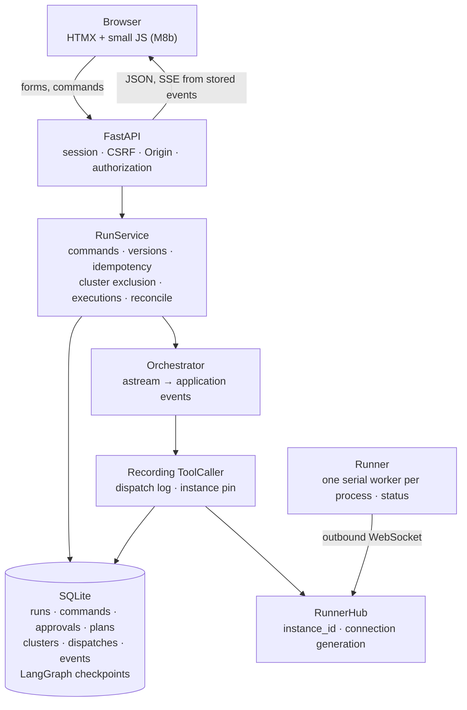
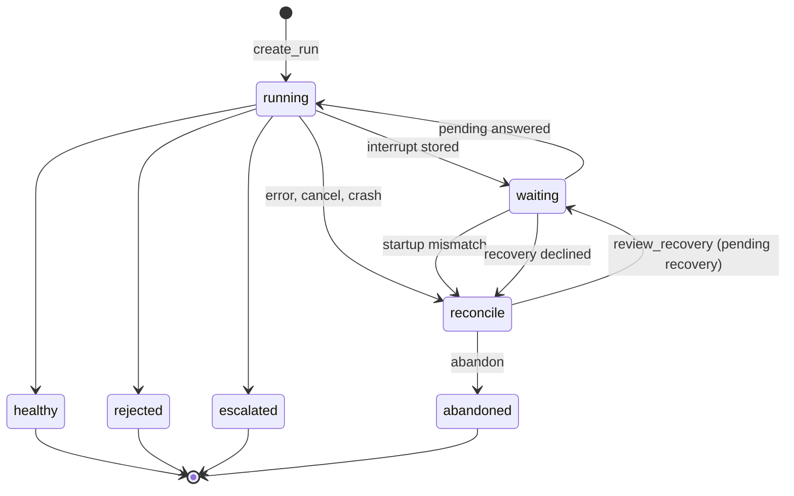
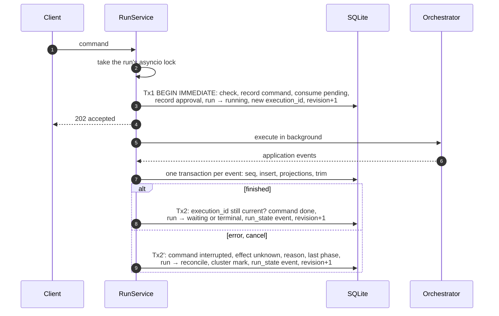
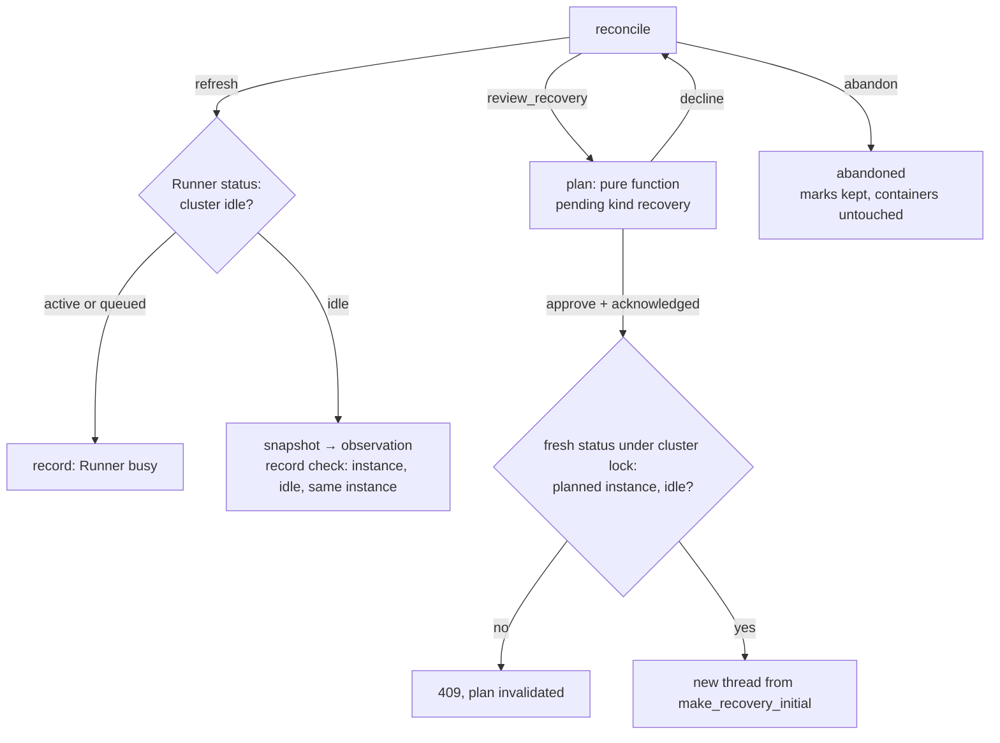

# M8 Web UI — Design

- Date: 2026-10-19
- Roadmap: [2026-10-17-poc-roadmap.md](2026-10-17-poc-roadmap.md), M8a and M8b
- Design: [2026-10-17-container-agent-design.md](2026-10-17-container-agent-design.md), sections 3, 4, 8, and 10
- Builds on: M5 (Runner ↔ hub link), M6–M7c (orchestrator, interrupts, clarify, init resources)

## 1. Goal

A user runs the whole flow from a browser: state a purpose, answer questions, save drafted descriptors, approve the compose file and model patches, watch the cluster come up, and handle escalations. The cluster still runs on the user's machine through the Runner.

M8 splits in two, each with its own plan and PR:

| Part | Scope | Done when |
|---|---|---|
| **M8a: run and access interfaces** | Runner serial execution across reconnects and `status`; hub instance binding; SQLite store; `RunService` (commands, versions, idempotency, cluster exclusion); orchestrator event adapter; startup reconciliation and recovery approval; static users, sessions, CSRF, authorization; JSON API; SSE endpoint | Every pending contract (section 8) and its approve and reject/abort branches work over HTTP alone; the crash, Runner, access, and SSE race tests in section 13 pass; a real Runner reaches `healthy` through the API |
| **M8b: browser interface** | Jinja2 + HTMX pages, one view per pending kind, reconcile and recovery pages, status panel, diagnostic summaries, SSE client, Playwright tests, a browser CI job | A user completes the flow from the browser; refresh, reconnect, several tabs, and session expiry behave as specified |

M8 is done only when M8b is done. M8b's detailed plan is written after M8a merges, against the interfaces M8a has verified.

## 2. Decisions

| Decision | Why |
|---|---|
| **FastAPI + Jinja2 + HTMX + a little plain JS** (user decision) | The flow is a server-side state machine: submit, answer, approve, watch. HTML fragments fit it, and no Node build is needed. Browser tests and asset checks still enter CI. |
| **No live log stream; phase events plus timestamped, redacted diagnostic summaries** (user decision) | The Runner returns results only when a subcommand ends, and snapshots keep only redacted error lines and short tails. Showing the last five lines repeatedly as "live logs" would mislead. A continuous log protocol is a separate follow-up. |
| **Static users from a config file** (user decision) | Several people can try the POC without an identity system. The authentication adapter is replaceable; internal user IDs, run ownership, and authorization checks stay stable when SSO arrives. |
| **SQLite persistence; unclear executions go to `reconcile`** (user decision) | Runs, ownership, and approval evidence must survive a restart. Persisted checkpoints do not make a half-finished node safe to replay. |
| **A reconciled run continues only after a new recovery approval** (user decision) | A workdir build runs the project's build command before the image cache is checked, and init scripts run before their marker is written. A matching compose fingerprint proves neither safe to repeat. |
| **No "destroy cluster" in M8** (user decision) | `down` runs `docker compose down -v` and deletes volumes; the platform cannot yet preview exactly what it deletes, lock it per cluster, or confirm a timed-out deletion. The page shows the local `cagent-runner down` command and warns that it deletes volumes. |
| **Runner serial execution and `status` belong to M8a** (user decision) | Today each connection has its own worker and subcommands run on `context.Background()`, so after a reconnect an old call (and its queue) keeps running beside new calls. Without a Runner change the platform cannot know that an old operation has stopped. |
| **One process, one worker** | The hub's connections and the background executions live in process memory. Several web workers would scatter them. M9's Postgres move must verify multi-worker coordination separately. |
| **HTTP never touches LangGraph** | Routes call `RunService`; templates make no business decisions. A later React UI could keep `RunService`, the approval rules, and the view model. |

## 3. Architecture

`cagent-platform serve --config platform.yaml` runs the hub, uvicorn (`workers=1`), and `RunService` in one asyncio loop. New platform modules: `store.py`, `runs.py`, `recovery.py`, `auth.py`, `api.py`, `server.py`.

**Startup:** open the database and apply the schema; mark every Runner offline in the stored projection; reconcile persisted runs (section 12) without calling the graph and without waiting for Runners; start the hub; only then accept requests.

**Shutdown:** stop accepting commands (503); cancel background executions and record the cancellation as the reason; close the hub; close the database. An operation not confirmed as finished goes to `reconcile` on the next start.

## 4. Runner: serial execution across reconnects (M8a prerequisite)

This is an independent task with its own tests, done first.

- **One worker per process.** The read loop only receives and enqueues. Each call carries the generation of the connection it arrived on; a disconnect invalidates that generation. Before starting a call the worker checks the generation and marks the call active in one step, under the same lock that invalidates a generation, so a call cannot pass the check and then start after its connection died. Invalid calls are dropped unanswered. An active call runs to completion and the Runner stays busy until the subcommand returns.
- **`instance_id`.** Generated once per process; unchanged across reconnects; sent in `hello`.
- **`status` tool.** Answered by the read loop, never queued: `{instance_id, active: {call_id, method, cluster, started_at} | null, queued: {cluster: count}}`. It covers every tool, including `validate`, which writes the cluster's workspace.
- **Bounded queue.** When the queue is full the read loop answers at once with a JSON-RPC error, so `status` and pings keep working.
- **Results stay with their call.** A result is written only to the connection its call arrived on; an old call's result never answers a new call.

Tests use controllable blocking points, not fixed sleeps: a long call across a disconnect and reconnect never overlaps a new call; queued calls from the old connection do not run; `status` answers during a long call and with a full queue; `instance_id` is stable across reconnects and changes after a restart; no result crosses connections.

## 5. Hub

- Store each Runner's `instance_id` from `hello` and expose it; expose connection changes so `RunService` can update the Runner projection.
- `call(..., instance=…)` checks the expected instance against the connection it is about to use and sends on that exact connection object. A mismatch raises `RunnerUnavailable("instance_changed")`.
- A `status` helper for `RunService`.

## 6. Orchestrator

- **Event adapter.** `start`, `resume`, and the recovery start consume `astream(..., stream_mode=["tasks", "custom"], version="v2")` to the end, with or without an `on_event` callback, and map raw events to whitelisted application events (section 11). Raw task events carry inputs, results, and errors that may hold the whole state, so they never reach storage or SSE. An interrupt is reported as `phase_interrupted`, never as completed. Resuming re-emits a task start with the same task ID, so events are keyed by `run_id + execution_id + task_id` and the store assigns its own sequence; a task-finish event is not evidence that the checkpoint and the registry are both written.
- **Observations.** `_snapshot()` checks that the tool succeeded and the output has the expected shape, then emits `observation` through `get_stream_writer()`; otherwise it emits `observation_failed` with a reason. A failure is never shown as "no containers". It runs only in non-interrupt nodes (`up`, `watch`, `stabilize`).
- **Cluster name from the user.** `start_from_purpose(..., cluster=…)` sets both `State.cluster` and `ClusterSpec.name`.
- **Full-set `allow`.** `validate` always calls the Runner with an empty `allow`, so the platform sees every finding, then computes which findings the current `allow` does not cover. An approval shows all findings; the submitted `allow` is the complete set of exact `service:rule` entries for that candidate, not merged with older entries. `approve:false` requires an empty `allow`. The Runner's local `-allow-rule` ceiling still applies.
- **Errors propagate.** `RunnerUnavailable`, RPC timeouts, and cancellations leave the graph and reach `RunService`, which records the exact reason.
- **Recovery entry.** `START` routes to `validate` when the state says `recovered`, and to `generate`/`extract` otherwise. `make_recovery_initial(plan)` (section 12) builds that state.
- Interrupt nodes keep the M6 rule, sharpened: **no side effects before `interrupt()`** — no Runner call, no business record, no notification. Reading state and building the payload is fine.

## 7. Store

One SQLite file under the platform's data directory; `AsyncSqliteSaver` uses the same file for checkpoints. The two are **not** written in one transaction, and nothing assumes they are.

| Table | Holds |
|---|---|
| `runs` | `id, owner, runner, cluster, state, revision, pending (id, kind, payload, created_at), thread_id, execution_id, execution_instance, reconcile (reason, last_phase, since), last_observation, last_observation_attempt, verified_at, event_seq, min_event_seq` |
| `commands` | `user, command_id, run_id, kind, payload_digest, response, class (advancing, read_only), status (accepted, done, interrupted), effect (unknown), reason` — unique `(user, command_id)` |
| `approvals` | immutable: `id, run_id, pending_id, kind, candidate_digest, content, decision, user, at` |
| `plans` | immutable recovery plans: `id, run_id, mode, digest, based_on_observation_seq, content, created_at, invalidated_at` |
| `clusters` | `runner, name, owner, lock_run_id, marks` (each `needs_reconcile` mark has an ID and a reason) |
| `dispatches` | `run_id, execution_id, call_id, method, instance, sent_at, result_at` — written before the call is sent |
| `runner_status` | `runner, online, instance_id, changed_at` |
| `events` | `run_id, seq, execution_id?, task_id?, type, at, payload` — unique `(run_id, seq)` |

M8 does not trim commands, approvals, plans, or dispatches automatically; archiving and deletion are left for later.

## 8. Run states and pending contracts

Clients read the run registry only. `RunService` updates it from execution results and persisted checkpoints. `waiting` is published only after the pending item is durably stored.

| State | Meaning | Allowed |
|---|---|---|
| `running` | An execution is accepted and has no definite result yet (including the moment before its task starts) | view, subscribe |
| `waiting` | A stored pending item | view, answer it |
| `reconcile` | The result of an execution is unknown | refresh, review recovery, abandon |
| `healthy` | Passed acceptance at `verified_at`; **nothing watches it afterwards** | view |
| `rejected`, `escalated`, `abandoned` | Declined or aborted; ended at an escalation; orchestration abandoned | view |

A terminal state releases the cluster's execution lock once the execution has exited. It never releases cluster ownership, and it never clears a `needs_reconcile` mark.

Every pending item is published as `{pending_id, kind, revision, created_at, payload}`. `pending_id` is generated by the application for each publication; LangGraph's interrupt ID is only an internal link. Payload fields are whitelisted per kind. All dynamic text — model output, log lines, user input, paths, service names — is rendered as escaped text.

| Kind | Decision (strict; extra fields and mixed actions rejected) | Notes |
|---|---|---|
| `question` | `{answer}` or `{action:"abort"}` | `answer: null` takes the default; a missing `answer` is a 422 |
| `save_descriptors` | `{saved: true}` or `{action:"abort"}` | `saved` asks the Runner to read back; it does not mean the file is valid |
| `approval` | `{approve, allow}` | Section 6's full-set `allow`; payload adds `previous_approved` from the approval records (ID, time, compose, digest). The last approved compose may differ from what last ran: automatic fixes happen in between |
| `patch_approval` | `{approve}` | |
| `escalation` | `{action:"retry"\|"abort"}` | |
| `recovery` | `{approve, acknowledged}` | Section 12. Declining returns to `reconcile` |

## 9. Commands

Pending answers use `{command_id, expected_revision, pending_id, decision}`. `refresh`, `review_recovery`, and `abandon` use `{command_id, expected_revision}`. `create_run` uses `{command_id, runner, cluster, purpose}` and no revision.

`revision` changes with the run's state, pending item, or recovery plan. Observations do not change it, unless they invalidate a recovery plan.

**Order of checks:** session and request protection → access to the run → idempotency record → (new commands only) revision and pending ID → decision schema → accept.

- The idempotency key is `(user, command_id)`. The payload digest covers the command kind, its target, and every semantic parameter. A repeat with the same digest returns the original `202` and body with a `Cagent-Replay: true` header, after the current authorization check but without re-checking the old revision. A different digest returns `409 command_id_reused`.
- First acceptance returns `202 {command_id, accepted_revision, execution_id}`. Completion is read from the run snapshot or the command.
- `409` (stale) carries the current snapshot; `404` covers both a missing run and one the user may not see; `422` rejects a malformed decision without consuming the pending item; `503` during shutdown.

| Command | Path |
|---|---|
| Pending answer, recovery approval | Consume the pending item, start an execution |
| `create_run` | In one transaction: create the run, claim or check cluster ownership, take the execution lock; then start an execution (or enter `reconcile` if the cluster carries a mark, section 12) |
| `refresh` | Read-only: query the Runner, store an observation; no state or revision change unless a plan becomes invalid |
| `review_recovery` | Build and publish a recovery plan; no graph call |
| `abandon` | Allowed in `reconcile`; ends orchestration in one transaction; keeps marks |

Tx1 checks the business rules explicitly — run state allows the command, the cluster's execution lock, ownership and marks, the pending item not yet consumed. `BEGIN IMMEDIATE` only serializes writers. The asyncio lock is taken before the transaction; nothing inside a transaction waits on the Runner, a model, a broadcast, or a lock. Tx2 and Tx2′ check that the run's `execution_id` is still this execution, so a late result cannot overwrite later state. If Tx2′ itself fails, the execution stops advancing and the accepted command sends the run to `reconcile` on restart. Events are committed before they are broadcast; a lost broadcast is recovered through the cursor.

Tx1 makes the application's acceptance consistent: a command is accepted, its pending item consumed, and the run marked running, all or nothing. It does not make LangGraph checkpoints and Runner operations atomic, nor run external operations exactly once; reconciliation and recovery handle that.

## 10. Identity, sessions, authorization, and clusters

**Configuration** (`platform.yaml`): `hub.runners.<id>.token_env`; `users.<id>.{token_env, runners}`; `web.{origin, secure_cookies, session_ttl_s, idle_ttl_s, dev_http}`; `db.path`. Startup fails when a token variable is missing or empty, when any two tokens — across all users and Runners — are equal, when a user names an unknown Runner, when `origin` is not exactly `scheme://host[:port]`, when an https origin lacks `secure_cookies`, or when an http origin is used outside explicit local development mode. A non-loopback deployment needs an https entry point. `Secure` cookies do not turn on TLS in uvicorn: behind a TLS proxy, the plain port must not be reachable directly.

**Login:** `GET /login` sets a short-lived pre-session cookie and puts its CSRF token in the form. Pre-sessions have a TTL, a count limit, and the same cookie attributes. `POST /login` checks Origin, the form's CSRF token, and the user token with a constant-time comparison. On success the pre-session is destroyed and a new random session ID is issued (`HttpOnly`, `SameSite=Strict`, `Secure` when configured); the cookie never holds the token. Failed logins and pre-session creation are rate-limited. Tokens never appear in URLs or logs. Sessions live in memory, `{user, csrf, created, last_seen}`, with idle and absolute expiry; a restart logs everyone out, but runs survive.

**Request protection:** every state-changing request after login needs `X-CSRF-Token` equal to the session's token and an `Origin` header exactly equal to the configured origin; a missing or `null` Origin is rejected. Proxy headers are never consulted. Login uses its own check (form field and pre-session), not the session token.

**Logout and expiry** revoke access at once, including open SSE streams (section 11); background runs continue.

**Authorization:** a user may see and act on a run only if `run.owner == user` and `run.runner ∈ user.runners` under the current configuration. One function enforces it for listings, snapshots, SSE, and commands. Two users sharing Runner `r1` cannot see or approve each other's runs.

**Clusters:** `(runner, cluster)` has a permanent owner and, separately, an execution lock held by at most one non-terminal run. Another user's name returns `409 cluster_name_taken` without naming the owner; a held lock returns `409 cluster_busy`. A cluster with a `needs_reconcile` mark still allows its owner to create a run, but that run starts in `reconcile` and inherits the mark (section 12).

## 11. Events, snapshots, and SSE

| Event | Payload |
|---|---|
| `phase_started`, `phase_completed` | `{phase}` |
| `phase_interrupted` | `{phase, pending_kind}` |
| `phase_failed` | `{phase, reason}` |
| `observation` | `{received_at, services: [{service, role, state, health, restart_count, exit_code, errors, tail}]}` — from the redacted snapshot |
| `observation_failed` | `{received_at, reason}` |
| `run_state` | `{state, revision, pending_id}` |
| `runner` | `{online, instance_id}` — written to the Runner's non-terminal runs |

`execution_id` and `task_id` may be empty (Runner and some state events). Each event is written in one transaction that increments the run's persisted counter, inserts the event, updates the projections it affects (`last_observation`, `last_observation_attempt`, state), and trims the run to its newest 1000 events. Sequence numbers never derive from retained rows. With no events, `event_seq = 0` and `min_event_seq = 1`. Payloads have a byte limit; truncation is marked.

**Snapshot** `GET /api/runs/{id}` reads in one transaction: state, revision, pending item, current phase and execution, Runner status (the stored projection with its time), last observation, last observation attempt and its result, `verified_at`, `event_seq`, `min_event_seq`. An `observation_failed` shows as "last summary from T, latest collection failed".

**SSE** `GET /api/runs/{id}/events`:

1. Authorize. The cursor is `Last-Event-ID`, or `after` on the first connection only; a negative, malformed, or future cursor gets `resync`.
2. Read pages of stored events with `seq > cursor`, each page in a short read transaction that first checks the retention boundary; a gap sends `resync` instead of skipping. No read transaction is held while sending.
3. Wait on a per-run notification generation guarded by a condition, so a commit between "found nothing" and "start waiting" is not missed; the heartbeat (every 15 s) re-reads the database as a fallback.
4. Logout and expiry are pushed through a per-session revocation signal, and the session is checked again before sending each business event. Heartbeats never refresh `last_seen`.
5. `resync` and `session_expired` are control events: no `id`, no sequence number. The client must call `EventSource.close()` first; on `resync` it fetches the snapshot and reconnects from its `event_seq`; on `session_expired` it goes to login and does not reconnect. Sending a control event is best effort; an invalid session's stream is closed regardless.
6. Limits: events per page, bytes per page, send timeout, streams per session. A stream that falls too far behind gets `resync`. Clients deduplicate by `seq`. Proxies must not buffer the response.

Subscriptions never call the Runner, so open pages add no collection load.

## 12. Reconciliation and recovery

### 12.1 Startup

| Persisted state | On startup |
|---|---|
| Terminal | Unchanged; history and last observation time shown |
| `waiting` on a graph interrupt, no open advancing command, checkpoint interrupt matches the registry | Stays `waiting` with the same `pending_id` |
| `waiting` on a recovery plan, no open advancing command, plan and source checkpoint intact | Stays `waiting`; submitting still needs a fresh Runner check |
| Anything else: `running`, an accepted advancing command, a mismatch | `reconcile`; the command becomes `interrupted` with `effect: unknown`, a reason, and the last known phase |

An open read-only command (`refresh`) never sends a run to `reconcile`. Whether a cluster gets a `needs_reconcile` mark depends on the **dispatch log**: a mutating call (`validate`, `build`, `up`, `down`) sent without a recorded result marks it. Without proof that no mutating call was sent, the cluster is marked. Phases are only for display.

### 12.2 Operations in `reconcile`

1. **Refresh** (read-only command; needs the Runner online). Call `status`. If the cluster has an active or queued call, record "Runner busy" and stop. If idle, take a snapshot as an observation. Record the check `{at, instance_id, idle, same_instance}`. Idle is a precondition for recovery, not evidence that the earlier call succeeded. If the check changes a fact the current plan relies on, invalidate the plan and bump the revision.
2. **Review recovery** needs a latest check showing the cluster idle. A pure function builds the plan from the interrupted thread's last checkpoint, the last approval record, the last observation, the last check, and the descriptor and catalog digests. It publishes `pending_kind = recovery` with `plan_id`, `plan_digest`, and `based_on_observation_seq`. Two modes:

   | Mode | When | Contents and entry |
   |---|---|---|
   | `resume_execution` | The run has a compose | Full compose and its diff against the last approved one; steps `validate → build → up → watch → stabilize`; enters at `validate` |
   | `continue_cluster` | A new run on a marked cluster; may have no compose | The cluster's open marks and evidence; enters at `START`, and the normal configuration approval still follows |

   Build is all or nothing: **skip all** only if the checkpoint says `built` and the interrupted execution has no `build` in its dispatch log; otherwise **rebuild all**, listing the services and the workdir build commands that will run again. Risks are listed; those marked `requires_ack` — init services that may have run partially (manual check needed), a changed Runner instance — must be acknowledged one by one. A changed instance reads "you accept a risk the platform cannot verify: processes the old Runner started may still be running", never "the old operation stopped".
3. **Approve recovery** `{approve: true, acknowledged}`: `acknowledged` must equal the plan's required risk IDs exactly. Under the cluster's asyncio lock and outside any transaction, call `status` again; only the plan's instance, idle, proceeds to Tx1, otherwise `409` and the plan is invalidated. The execution is pinned to the plan's instance; if the instance changes before a dispatch, the hub refuses to send and the run returns to `reconcile`.
4. **Decline** `{approve: false}` returns to `reconcile` and keeps the execution lock. It does not need the Runner.
5. **Abandon** ends orchestration (`abandoned`), releases the execution lock once no execution runs, keeps every mark, and touches no container.

### 12.3 Recovery state

`make_recovery_initial(plan)` builds the new thread's state from a whitelist, never by copying the old checkpoint:

- **Kept** (validated): spec, candidate compose, the descriptors the build needs, links to the source thread and checkpoint.
- **Cleared**: pending question and drafting, `proposal`, `unchecked`, `report`, `outcome`, `escalation`, `restarts`.
- **Set fresh**: budgets (`attempts`, `rounds`), `deadline`, `seen` starting from the candidate's fingerprint, `recovered: true`.
- **From this authorization only**: `approved` for the plan's candidate digest, an empty `allow` (so `validate` sends any finding back to a normal approval), and `built` from the plan's build decision. Nothing is copied from older approvals.

The old thread stays as history. A new thread starts at an entry point the user approved, so the graph never silently continues a node pending in the old checkpoint. `validate` still writes the workspace: safety comes from the instance check, cluster exclusion, and the recovery approval, not from the new thread itself.

### 12.4 Clearing a mark

A recovery approval lets this run follow this plan; it does not mark the cluster reconciled. Waiting for input, rejection, escalation, and abandonment clear nothing. A mark clears only when the recovery chain passes acceptance again, is stored as `healthy`, and left no unconfirmed mutating call; only the marks the plan named (by ID) clear, never one added during recovery. Acknowledged risks stay in the approval records; `healthy` does not prove that a past script ran exactly once.

## 13. Testing and acceptance

Every task ships its own tests; a final task combines them.

**M8a**

- Contracts: each of the six pending kinds over JSON, with its approve and reject/abort branches; one real Runner run reaches `healthy` through the API.
- Crashes, with a real process kill and a restart on the same database (not raised exceptions): after an approval is accepted; after a Runner operation finished but before its result was stored; while waiting for input. A pending item is never consumed twice, a command never starts two executions, and startup never advances a graph. Recovery may then ask for a new approval bound to a plan.
- Recovery: a recovery that stops at a question, an approval, an escalation, or a decline keeps the mark; reaching `healthy` clears only the plan's marks. The new thread inherits no stale `approved`, `unchecked`, `report`, or `deadline`; the build that runs matches the plan. `waiting(recovery)` survives a restart. A new run on a marked cluster without a compose still gets the normal configuration approval. An instance change between the check and a dispatch sends nothing to the new instance. Declining works with the Runner offline.
- Runner (section 4) with controllable blocking points.
- Access: cross-user access returns 404; stale and duplicate approvals; a replayed `command_id` with a different payload; cluster name and lock conflicts; login CSRF; a wrong or missing Origin; logout closes SSE at once.
- SSE races, arranged with synchronization barriers: trimming in the middle of a page; a commit right after an empty read; a snapshot read concurrent with a state commit; logout during continuous sending. One test against a real server covers disconnect, reconnect, and session expiry.
- Last: combined fault verification and an end-to-end run with a real Runner.

**M8b** (planned after M8a merges): each pending view, the reconcile and recovery pages, refresh and reconnect, several tabs, session expiry, escaping of logs and model text, and init success and failure, in Playwright, plus a CI browser job.

## 14. HTTP interface (M8a, input to M8b)

| Method | Path | Body or parameters | Answer |
|---|---|---|---|
| GET | `/login` | — | `{csrf}`; sets the `cagent_pre` cookie |
| POST | `/login` | form `token`, `csrf`; `Origin` | `{user, csrf}`; sets `cagent_session`, clears `cagent_pre` |
| POST | `/logout` | `X-CSRF-Token`, `Origin` | `{ok}`; closes the session's event streams |
| GET | `/api/runs` | — | the user's runs |
| POST | `/api/runs` | `{command_id, runner, cluster, purpose \| spec}` | `202 {command_id, run_id, accepted_revision, execution_id}` |
| GET | `/api/runs/{id}` | — | the snapshot (section 11) |
| POST | `/api/runs/{id}/commands` | `{command_id, expected_revision, action, pending_id?, decision?}`, `action` ∈ `answer`, `refresh`, `review_recovery`, `abandon` | `202 {command_id, run_id, accepted_revision, execution_id}`; `Cagent-Replay: true` on a repeat |
| GET | `/api/runs/{id}/commands/{command_id}` | — | `{command_id, kind, status, effect, reason, response}` |
| GET | `/api/runs/{id}/events` | `Last-Event-ID` or `?after=` | `text/event-stream` (section 11) |

Errors are `{error, detail?, snapshot?}`: `401 login_required`, `401 login_failed`, `403 bad_origin`, `403 bad_csrf`, `404 not_found`, `409 stale | not_waiting | not_reconcile | command_id_reused | cluster_name_taken | cluster_busy | runner_offline | runner_unavailable | check_needed | no_compose | plan_stale` (stale ones carry the snapshot), `422 invalid_command | invalid_decision | invalid_cluster | invalid_input | invalid_spec | bad_cursor`, `429 rate_limited | too_many_streams`, `503 shutting_down`.

`refresh` is read-only and ignores `expected_revision`; every other command checks it. Configuration: [`platform/platform.example.yaml`](../../platform/platform.example.yaml); `orchestrator` holds the state machine's timings.

## 15. Implementation findings (M8a)

- **A node that raises ends `astream` without a task result** (LangGraph 1.2.16). The adapter therefore reports `phase_failed` itself for every task still started, then re-raises.
- **A resumed node reports a task start again, with the same task id.** Events are keyed by `execution_id + task_id`, and the store numbers them.
- **Approval and recovery digests agree.** An approval record's `candidate_digest` is the SHA-256 of the compose YAML shown, the same function recovery plans use, so "the compose changed since it was approved" is never a false alarm.
- **`validate` now always runs with an empty `allow`.** The approval payload carries the current `allow` so a page can pre-select it; `up` still passes the approved set, and the Runner's `-allow-rule` ceiling still applies.
- **`status` is a normal tool result** (`exit_code` 0, the report as output), so the hub's call path needed no special case.
- **Behind a TLS proxy every client has the proxy's address**, because proxy headers are never trusted; login rate limits are then shared by all users. Acceptable for the POC; a deployment that needs per-client limits must terminate TLS in the platform. Recorded, not changed.
- Measurements on the dev machine: the three `kill -9` scenarios take ~7.4 s together; the real-Docker run over HTTP ~11 s; the Runner's serve tests pass 20 times in a row under `-race`.

## 16. Out of scope and follow-ups

- Continuous log streaming (Runner log events with redaction, rate limits, backpressure, and gap handling).
- Destroying a cluster from the browser: needs a Runner deletion preview, ownership checks, cluster-wide exclusion, and confirmation of the result. The future page is a separate confirmation that asks for the cluster name.
- Per-service rebuild plans.
- Ongoing watch after `healthy` (design phase 10).
- Cancelling Runner process trees and exactly-once external operations.
- An arbitrary YAML editor in the approval view: there is no edit command or approval invalidation protocol for it.
- Postgres, multiple workers, and SSO (M9 and later).
