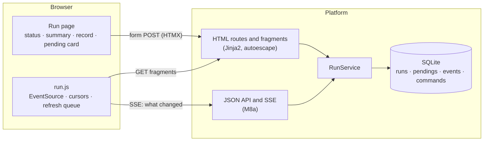
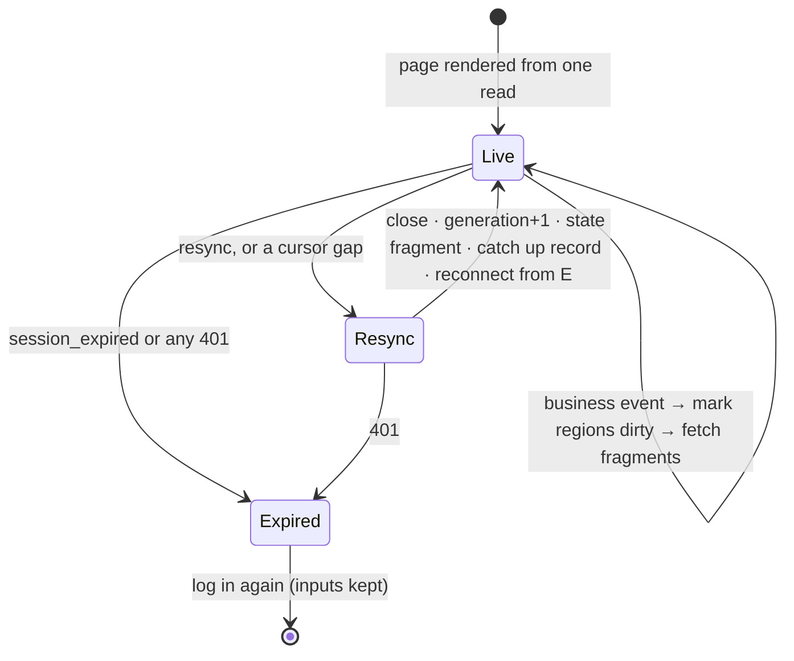

# M8b Browser Interface — Design

- Date: 2026-10-19
- Roadmap: [2026-10-17-poc-roadmap.md](2026-10-17-poc-roadmap.md), M8b
- Builds on: [2026-10-19-m8-web-ui-design.md](2026-10-19-m8-web-ui-design.md) (M8 decisions; M8a's HTTP interface in section 14)

## 1. Goal

A user runs the whole flow from a browser: create a run, answer each pending item on a typed card, watch phases and diagnostic summaries, handle reconciliation and recovery, and read a run record of what was asked and decided. M8 is done when this works and the scenarios in section 9 pass in Chromium.

## 2. Decisions

| Decision | Why |
|---|---|
| **A run record with typed action cards, not free chat** (user decision) | The backend asks questions only through the six pending kinds. The purpose (or a spec) is entered once; afterwards input exists only on the current card. Free questions about a run are a later feature. The page is called the **run record**. |
| **A `pendings` table and a `record` endpoint** (user decision) | M8a keeps no copy of a question, a saved-descriptor request, or an escalation once it is answered, and no decision outside approval records. An append-only table, written in the same transactions as M8a's state changes, makes the record traceable. |
| **SSE says what changed; the page fetches server-rendered fragments** (user decision) | One set of Jinja templates renders everything, with autoescaping. A small native `EventSource` module manages the connection, cursors, and refresh scheduling; it never builds HTML from data. |
| **Python Playwright, async API, with `pytest-playwright-asyncio`** (user decision) | The real-server fixtures (uvicorn, FakeRunner, SimCluster) run on the test event loop. No Node project, npm dependency, or front-end build step; Playwright Python still uses its bundled Node runtime. Chromium only. |
| HTMX 2.x vendored into the package, no CDN | The platform may run on an internal network; the file's SHA-256 is recorded in the plan. |
| English UI | Every project artifact is in English. |

## 3. Routes and page skeleton

- **Login.** `GET/POST /api/login` keeps M8a's programmatic contract (moved from `/login`). `GET/POST /login` is the HTML form: the pre-session's CSRF token is a hidden field; success answers `303 → /`. Because `Sessions.login` uses up the pre-session whether it succeeds or not, a failed login re-renders the form with a new pre-session and CSRF token and never echoes the token.
- **Pages.** `/` lists the user's runs by `created_at`, newest first. `/runs/new` and `POST /runs` create a run (Runner with its online state, cluster name, purpose or spec YAML; errors shown in place; success `303 → /runs/{id}`). `/runs/{id}` is the run page, in four independent DOM regions: status bar, diagnostic summary, run record, pending card.
- **Fragments.** `GET /runs/{id}/fragments/state` returns the status, pending, and summary regions from **one** read with the `event_seq` they reflect; the first page render uses the same read. `GET /runs/{id}/fragments/record?after=N` returns record entries with `Cagent-Record-After` and whether more follow. `GET /runs/{id}/fragments/command/{command_id}` returns one command's current result. Every fragment carries the seq of the data it shows.
- **Commands.** `POST /runs/{id}/commands` (HTML) takes the form, converts it explicitly (booleans, repeated `allow` and `acknowledged` fields, "use default"), and passes M8a's envelope to `RunService.submit`'s strict validation. The `command_id` is generated when the server renders the card, so a retry of the same submission reuses M8a's idempotency path.
- **Access.** Fragments and HTML routes use the same session and authorization rules as the JSON API. Requests the page makes by itself (fragments, record, command status) check the session but never refresh its idle time; only user actions do. Dynamic responses carry `Cache-Control: no-store`.
- **Security headers.** `Content-Security-Policy: default-src 'self'; script-src 'self'; style-src 'self'; connect-src 'self'; object-src 'none'; base-uri 'none'; frame-ancestors 'none'; form-action 'self'`, `X-Content-Type-Options: nosniff`, `Referrer-Policy: no-referrer`. HTMX is configured before it initializes: `allowEval=false`, `allowScriptTags=false`, `includeIndicatorStyles=false` (indicator styles live in `app.css`), history snapshots off. No inline scripts and no `hx-on`. Jinja autoescaping is explicit; user and model text is never marked `safe`, never reaches scripts or event handlers, and never chooses an `hx-*` attribute, a template name, or a link.

## 4. Run record (backend)

**`pendings`** (append-only): `run_id, seq, pending_id, record_type ∈ {published, decided}, kind, at, payload, user, command_id`, unique on `(pending_id, record_type)`.

- A `published` row is written in the same transaction that moves the run to `waiting` (Tx2, and `review_recovery`). Its payload is the whitelisted content as published, kept as it was; nothing regenerates it later.
- A `decided` row is written in Tx1 with the command and the consumed pending item (including a declined recovery). It holds the decision, the user, and the `command_id`. A decision is not an execution result.
- **Masking.** One rule set applies to published payloads and decisions alike, nested fields included: every value of a `missing_env` question (answer, default, options, error text) is masked; variable names stay; the action stays visible ("answered (masked)", "took the default", "aborted"). Key-name matching (`PASSWORD`, `SECRET`, `TOKEN`, `KEY`, `CREDENTIAL`) is an extra rule, never the only one. This governs the new copy; checkpoints are unchanged.
- **Approval evidence is fixed at publication.** A `patch_approval` payload gains a preview computed by applying the patch op by op to a copy of the current compose with the existing patch code: for each op, `before` and `after` as `{present, value}` (absent is not `null`), `add` as insert or replace, `remove` as removal, `test` as an assertion. If the preview fails, the card shows no guessed values and cannot be approved. The payload also keeps the observation current at publication (with seq and received time). Both go into the live pending item and the permanent record.

**One sequence.** `published` and `decided` rows take their `seq` from the run's event counter but are not written to the events table, and each wakes subscribers with its `run_state` event in the same transaction.

**Trimming watermark.** The event log keeps the newest N **event rows**, and `events_pruned_through_seq` records the highest seq actually deleted. SSE and the record detect a gap only when a cursor is below that watermark; holes in the sequence are normal. A cursor past the counter still resyncs.

**`GET /api/runs/{id}/record?after=N`** merges pending rows and kept events by seq in one read, paged by count and bytes, and returns `{entries, after, events_pruned_through, history}`:

- A gap in events never skips pending rows: with `published=10`, `decided=12`, and events trimmed through 20, `after=0` still returns 10 and 12. `after` advances only to what the page delivered; one entry over the byte budget is a page of its own, marked truncated.
- A `decided` entry carries its command's **current** `status/effect/reason` (joined on user, command id, and run). The page refreshes unfinished commands until they end.
- `history` is `complete` for runs created after this feature and `partial` for runs migrated from before (set by the migration, including runs then `waiting`). A decision without a published row is shown as "the content of this item was not kept"; nothing is inferred. The UI says "records created before run history was added may be incomplete". Complete means: pending items published after the feature keep their publication and decision, with sensitive values masked.

## 5. The run page client (`run.js`)

- **Start.** The page carries `data-event-seq` and `data-record-after` from the same read as its regions. It opens `EventSource` with `?after=`; on its own reconnects the browser sends `Last-Event-ID`, which the server prefers. It also catches up the record and queries unfinished commands at once, without waiting for an event.
- **Events.** Control events (`resync`, `session_expired`) are handled before deduplication: an event without an id may inherit the last id. Business events are deduplicated by seq and mark regions dirty:

  | Event | Regions |
  |---|---|
  | `run_state` | status, pending, record (then unfinished commands) |
  | `observation`, `observation_failed` | summary, record |
  | phase events | status, record |
  | `runner` | status and the actions it enables, record |

- **Two cursors.** `lastEventSeq` (SSE) and `recordAfter` (record) move separately; `recordAfter` advances only after entries are appended, and entries are deduplicated by seq.
- **Refresh queue.** Dirty regions are batched (about 100 ms). Each region has at most one request in flight and is fetched again if it became dirty meanwhile. A response older than the region's version, or from an earlier generation, is dropped; a failed fetch keeps the region dirty and retries with backoff. Fragments are swapped with `htmx.swap` so their `hx-*` attributes work.
- **Resync.** Close the connection, bump the generation (late responses are ignored), load the state fragment and its `event_seq` E, update status, pending, and summary, catch up the record and unfinished commands, then reconnect from E. Failures keep the page in resync and retry.
- **Editing.** A card being edited (its form is marked modified) is kept only while it is the same pending item, still actionable, with the same revision and evidence. Otherwise the old card is disabled with its input visible and a note that the item changed; a new card is inserted. Nothing carries over, and no hidden `expected_revision` is changed silently.
- **Submitting.** `htmx:configRequest` stores the full envelope of the first submission; `htmx:beforeRequest` disables the card. A retry after an unknown result resends that stored envelope, or the user queries the command; no new id is made. Every HTMX response passes the same generation, version, and pending-identity checks: a late `202` may update its command's result but never replaces a newer card. HTMX `responseHandling` swaps 422 and 409 into the card (422 keeps the input; 409 disables by reason); 401 enters the expired state.
- **Expired.** `session_expired` and every 401 lead to one state: close SSE, bump the generation, stop timers and fetches, disable submissions, show a login link, keep inputs. A command already sent stays "result unknown" until it is checked after logging in.

## 6. Cards and pages

- **question:** the question and error; radio options or a text field. "Use the default" appears only if there is one; for masked questions it reads "Use the default (hidden)", sends `answer: null`, and the default is never in the HTML. "Abort" ends the run.
- **save_descriptors:** each file as plain text with a download served only from this card's published content (`run_id + pending_id + file index`, server-chosen file name, `no-store`, `nosniff`). The instruction reads: save it on the Runner's machine as `<workdir>/.cagent/services/<service>.yaml`; downloading it to the browser's computer does not save it in the project. The model's note is marked untrusted. "I saved it" is a claim the read-back checks; a read-back error shows at the top of the next card.
- **approval:** the full compose and a unified diff against `previous_approved`, rendered and escaped line by line on the server; a findings table with one checkbox per exact `service:rule`, pre-checked only for current findings already in `allow`; fixes listed as "applied to the configuration". The note says the last approved compose may differ from what last ran.
- **patch_approval:** tier, root cause (untrusted), reasons, the per-op preview, and the observation fixed at publication. "Approve patch" and "Reject patch"; rejecting leads to an escalation, not the end of the run. No approval without a valid preview.
- **escalation:** reason, details (stderr, log tail, problems), fixes applied. Guidance per reason; for `init_failed`: retrying validates and builds again and may run init again, so check what a partial run left first. "Retry" and "End"; ending leaves containers as they are.
- **recovery:** mode, steps, the build decision, risks (one checkbox per risk that needs acknowledging), compose and diff, and the last check and observation with their times. "Approve" and "Decline".
- **Reconcile panel** (`reconcile` with no pending item): reason, last phase, since when, last check. "Refresh", "Review recovery plan" (enabled when the last check was idle; the backend checks again), "Abandon" (asks to confirm; leaves containers as they are).
- **Ended runs:** state and time. Cleanup advice names the Runner and the cluster: run `cagent-runner down -name <cluster>` on that Runner's machine with the same Docker; it deletes the cluster's current resources and volumes, whichever run made them. It is not offered while the cluster has another active run or open marks, and even then the state can change after the command is copied.

## 7. Error handling

| Situation | Page behaviour |
|---|---|
| 409 on a command | In the card: the reason (stale, not waiting, plan stale, cluster busy); the card is disabled and the pending region refreshed |
| 422 on a command | In the card: the validation message; input kept |
| 401 anywhere | The expired state (section 5) |
| Network failure on a submit | "Result unknown", with "Retry the same request" and "Check this command" |
| Fragment fetch failure | The region stays dirty and retries with backoff; a stale badge shows the data's time |
| Runner offline | Status bar says so; actions needing the Runner are disabled, and the backend still decides |

## 8. Testing

1. **Toolchain spike first:** a real uvicorn server, an async page, a login, one fragment update, and failure artifacts, before any page work. The browser suite gets its own loop-scope configuration, passed explicitly on the command line; the backend suite keeps function scope.
2. **Unit:** masking, patch preview, form conversion, diff rendering, record merging.
3. **Store integration (real SQLite):** upgrading an old database (including a run then `waiting`); a rolled-back publication or decision leaves nothing; a repeated command records one decision; multi-page reads across the trimming watermark keep every pending row; one oversized entry still advances the cursor.
4. **HTTP (httpx + ASGI):** HTML routes, fragments, version headers, security headers, `no-store`, 401/409/422 rendering, download authorization, fragments never refreshing the session.
5. **Browser (Playwright async, `tests/browser/`):** each test has its own database, real uvicorn, FakeRunner with SimCluster, and FakeCompleter where a model is needed. Test hooks live only in fixtures or dependency injection, never in production HTTP routes. Waits are conditions with limits; long-lived SSE pages never wait for `networkidle`. Races assert invariants (one accepted command, the new card's identity and version kept, no unexpected request), not only messages.

Browser scenarios: the full flow from the browser; all six cards; crash and recovery by killing the platform subprocess at a set point and restarting it with the same database, FakeRunner, and SimCluster (old session invalid, log in again, the run in the expected state, nothing replayed, recovery only after approval); refresh and reconnect; resync after a lost observation; a control event inheriting an old id; two tabs consuming one item; one item changing version; an old POST response after a new card; a late response after a 401; session expiry keeping input; catching up the record with no new event; an accepted command updated in place; injected `<script>` and `hx-` text neither running nor sending requests; masked defaults absent from the HTML; consecutive and array patch previews; evidence not drifting; a download outside the run refused; init success and failure; cleanup advice for an old run while a new one is active.

FakeRunner scenarios check the platform and page contracts; the Go worker and Docker stay covered by M8a's real-Runner tests.

**CI:** a `browser` job in `platform/`: `uv sync --locked`, `uv run playwright install --with-deps chromium`, then the browser suite with `--browser chromium --tracing retain-on-failure --screenshot only-on-failure` (contexts made outside the plugin's fixtures manage their own traces); trace, screenshots, and server logs are uploaded on failure. `make platform-test` and the other jobs exclude `tests/browser`.

**Task order:** the toolchain spike; the run record backend as the first independently accepted task; then pending payload additions, the login move and HTML skeleton, the run page and state fragment, the cards and HTML commands, record fragments, the reconcile panel and ended runs, `run.js`, each with its own tests; finally cross-component races, the CI job, and docs. As with M8a, every task is implemented and verified on a scratch branch first, then replayed into the plan.

## 9. Done when

- A user completes create → questions → approval → healthy from Chromium, and every pending kind and the recovery path work from the page.
- The browser scenarios in section 8 pass in CI, and the backend suites still pass without a browser.

## 10. Implementation findings

- **`Referrer-Policy: no-referrer` breaks the Origin check.** Under it Chromium sends `Origin: null` on the page's own POSTs (form and fetch), and the exact Origin check refuses them. The policy is `same-origin`: same-origin requests carry their origin; nothing leaks to other sites.
- **An open event stream kept uvicorn's graceful shutdown waiting forever** (from M8a): a SIGTERM never stopped a platform with a browser tab open. `web_server` now sets `timeout_graceful_shutdown` (5 s; 1 s in tests).
- **Starlette's `BaseHTTPMiddleware` breaks the event stream's own disconnect handling**: after a stream ended, the next request failed with 500. Security headers come from a plain ASGI middleware that only adds headers to `http.response.start`.
- **htmx dispatches `HX-Trigger` events before it swaps.** A 409's stale signal retired the card before its message was swapped in. The server sends `HX-Trigger-After-Swap`, and the page blocks only late successes (2xx), never error messages, from swapping into an old card.
- **Masking covers the question's records, not the compose that uses the answer.** A `missing_env` answer is masked in the record, but the next approval shows the compose that will run, value included: approval evidence must be what actually runs. The M8a approval records already held that compose.
- **Chromium compiles `pattern` attributes with the `v` flag**, where `-` inside a character class must be escaped; the console check in the browser tests caught it.
- `/runs/new` must be registered before `/runs/{run_id}`; Python Playwright has no `expect.poll` (tests use `wait_for_function`); `wait_for_url("/runs/*")` matches `/runs/new` itself, so tests wait for a 32-hex run id.
- Measurements on the dev machine: the backend suite 485 passed / 11 skipped in ~17 s; the browser suite 11 tests in ~30 s (the crash-and-recovery test ~10 s of it), stable across repeated runs.

## 11. Out of scope

Free questions about a run; continuous log streaming; destroying a cluster from the page; a YAML editor; Firefox and WebKit; ongoing watch after `healthy`.
